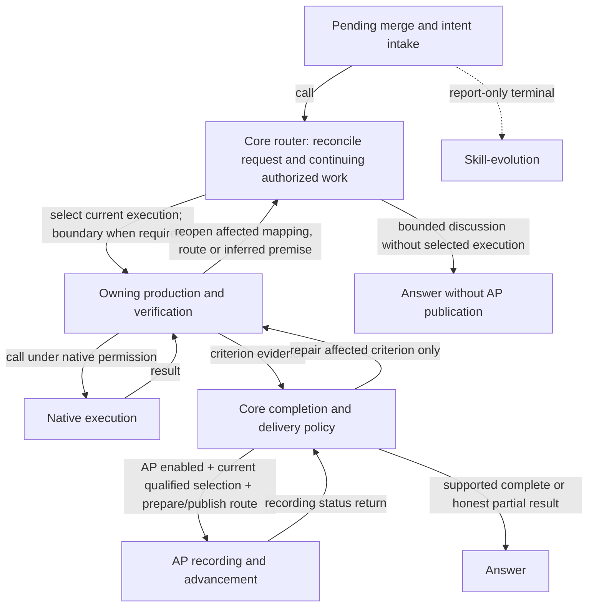

# Ghost-ALICE OS

Language: English | [Korean](./README_ko.md)


Ghost-ALICE OS is an agent governance layer for AI work. It keeps intent, boundaries, evidence, and runtime state inspectable across supported agent runtimes.

It is not a prompt library, a chatbot wrapper, or a standalone agent runtime. It is the operating layer that makes agent work auditable before the agent claims completion.

## Candidate 0.5.0

[Website](https://aidall.github.io/ghost-alice/) · [Architecture](./architecture.md) · [Previous release notes](./docs/release/2026-10-01-release-notes.md)

This source candidate pairs Core 0.5.0 with Autopilot 0.5.0, whose minimum Core version is 0.5.0. The version identifies the coordinated response-route and completion contract; it is not a tag, release, installed-adoption or publication claim. Native validation and publication require their own evidence. Both projects remain Apache-2.0.

## How governed work proceeds

Ghost-ALICE preserves the approved objective and repairs the affected work when contrary evidence appears. Focus moves directly in either direction among micro artifacts, meso mappings, macro combined results and meta inferred premises. The philosophy is a quality floor, not a mandatory traversal.



A read-only review that actually executes work still requires owning verification. Core owns the shared routing projection and per-criterion completion/delivery decisions; domain owners retain their checks. AP consumes Core's `publication_route: none | prepare | publish | blocked`, never mere run existence or the accumulated backlog. Missing or stale route bindings block capture/advancement, not existing authorization or native permission.

New input rebinds the request while unchanged valid proof keeps its original source and time. A changed criterion, artifact or dependency reopens only affected evidence. Supported business outcome, recording/application, whole-unit completion and delivery scope remain distinct. Recording-only failures get bounded repair; identical unchanged failure parks that branch until relevant change while independent approved work continues.

Human authorization, credentials and native tool permission retain their owners. Strict audit remains active; printed io-trace is optional. The standalone per-input classifier and downstream gate are retired without a replacement classifier. Intake feeds the router directly and evolution remains report-only.

## Quick Start

From the cloned Ghost-ALICE repository, install Core and the official Autopilot addon together. The installer automatically detects the available agent platforms:

```bash
bash install.sh --addon autopilot
```

See the [detailed installation guide](./docs/getting-started/installation.md) for cloning, OS-native entrypoints, platform selection, updates and troubleshooting.

## Official Addons

Autopilot continues explicitly approved work one item at a time within its session, scope and budget. Installation does not grant run approval. It is maintained in [AidALL/ghost-alice-autopilot](https://github.com/AidALL/ghost-alice-autopilot).

For native commands, custom addon sources, platform selection and removal, use the [installation guide](./docs/getting-started/installation.md) and [official addon reference](./docs/reference/official-addons.md).

## Documentation Map

| Need | Go to |
| --- | --- |
| Full installation and update commands | [Installation and update guide](./docs/getting-started/installation.md) |
| Uninstall scope and cleanup behavior | [Uninstall cleanup procedure](./docs/getting-started/uninstall.md) |
| Failed update, merge conflict, or reinstall recovery | [Troubleshooting](./docs/getting-started/troubleshooting.md) |
| Repository layout | [Repository structure](./docs/reference/repository-structure.md) |
| Skill catalog reference | [Skill catalog guide](./docs/reference/skills.md) |
| Session gate contract | [Session gate matrix](./docs/policies/session-gate-matrix.md) |
| Installer compatibility contract | [Installer platform compatibility](./docs/policies/installer-platform-compatibility-matrix.md) |
| Team onboarding and background | [GitHub Wiki](https://github.com/AidALL/ghost-alice/wiki) |
| Official addon usage | [Wiki: official addons](./docs/reference/official-addons.md) |
| Addon authoring | [Wiki: addon authoring](https://github.com/AidALL/ghost-alice/wiki/addon-authoring) |

## Project Guarantees

- Ghost-ALICE OS is a governance operating layer for agent sessions, not a general-purpose operating system.
- User intent, boundaries, verification criteria, and install state are first-class surfaces.
- Core routing consumes recorded intent and selects current work before the owning workflow executes through native permissions.
- Completion claims require owning evidence; valid unchanged proof is reused at its original source and time.
- The installer tracks managed surfaces and avoids broad deletion when ownership cannot be proven.

Agent visibility command surface:

- Claude Code uses `/visibility strict|dynamic|minimal` as its workspace command.
- Codex handles `/visibility` through the trusted `UserPromptSubmit` hook pseudo-command path.
- Every platform can inspect and change the same profile value through `_shared/agent_visibility_cli.py`.
- The install-time default is `dynamic`. Use `bash install.sh --visibility dynamic` or `.\install.cmd --visibility dynamic` to set the initial profile; `--agent-visibility` remains a compatibility alias.
- Visibility changes the user-facing governance message surface only. It does not weaken hook execution, strict-grade logs, or Work-Impact Projection.

Full uninstall:

```bash
bash install.sh --uninstall
```

```cmd
.\install.cmd --uninstall
```

## Contributing And Validation

Before changing skills, installer behavior, or public command surfaces, read [AGENTS.md](./AGENTS.md). After creating or modifying a skill, pass Phases 1-5 of [official-docs/derived/skill-compliance-checklist.md](./official-docs/derived/skill-compliance-checklist.md).

Public surface validation:

```bash
python3 scripts/validate_public_surfaces.py
```

Session gate contract validation checks the repository contract in `skill-catalog/session-gates.json` and the user-facing policy surfaces:

```bash
python scripts/check_skill_gate_contract.py
```

Installer compatibility groups:

```bash
python3 scripts/run_installer_compat_tests.py --list
python3 scripts/run_installer_compat_tests.py --group public-surface-contract
```

## License

Ghost-ALICE OS project-owned source code and documentation are licensed under the Apache License, Version 2.0. See [LICENSE](./LICENSE), [NOTICE](./NOTICE), and [THIRD_PARTY_NOTICES.md](./THIRD_PARTY_NOTICES.md).
