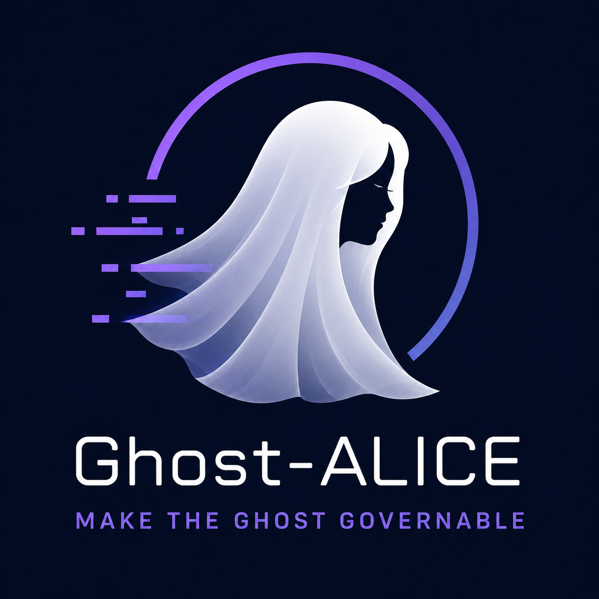

# Ghost-ALICE OS

Language: English | [Korean](./README_ko.md)



Ghost-ALICE OS is an agent governance layer for AI work. It keeps intent, boundaries, evidence, and runtime state inspectable across supported agent runtimes.

It is not a prompt library, a chatbot wrapper, or a standalone agent runtime. It is the operating layer that makes agent work auditable before the agent claims completion.

## Version 0.5.0

[Website](https://aidall.github.io/ghost-alice/) · [Architecture](./architecture.md)

Core 0.5.0 and Ghost-ALICE Autopilot 0.5.0 use the current response-route and completion contract. Ghost-ALICE Autopilot requires Core 0.5.0 or later. Both projects use Apache-2.0.

## How governed work proceeds

The responding model keeps the user's objective and constraints, performs authorized work, and judges whether contrary evidence affects a required result or dependency. It corrects affected work when needed and preserves supported results and unresolved requirements.

1. Input hooks record the current human input without storing the raw prompt. The responding model selects authorized work; a host tool passes that selection to Core for validation and storage.
2. The model asks the host to run the needed tools and reads their actual observations. Valid unchanged evidence retains its original source and verification time.
3. Through a host execution tool, the model sends Core its complete answer draft and original source paths. Core saves and returns the exact review inputs. The model first judges each claim against those sources, then judges the whole answer against the user's objective and constraints.
4. The model submits both judgments through a host tool. Core validates and records them together, returning the exact answer only when supported. Recording does not perform the model's meaning judgment.
5. At Stop, the host independently invokes the Core guard and Ghost-ALICE Autopilot adapter. Each reads Core's authenticated result. Ghost-ALICE Autopilot records supported criteria and may return a task from a plan the model already registered using actual user approval. The host delivers any task request to the triggering conversation.

A route or saved plan does not grant permission. A supported answer can accurately report unfinished work. New input reopens routing without invalidating unchanged evidence; recording errors do not require replaying the business operation.

See the [architecture](./architecture.md) for the responsibility diagram and [session gate matrix](./docs/policies/session-gate-matrix.md) for the detailed contract.

## Quick Start

From the cloned Ghost-ALICE repository, install Core and the official Ghost-ALICE Autopilot addon together. The installer automatically detects the available agent platforms:

```bash
bash install.sh --addon autopilot
```

See the [detailed installation guide](./docs/getting-started/installation.md) for cloning, OS-native entrypoints, platform selection, updates and troubleshooting.

## Official Addons

Ghost-ALICE Autopilot continues explicitly approved work one item at a time within its session, scope and budget. Installation does not grant run approval. It is maintained in [AidALL/ghost-alice-autopilot](https://github.com/AidALL/ghost-alice-autopilot).

For native commands, custom addon sources, platform selection and removal, use the [installation guide](./docs/getting-started/installation.md) and [official addon reference](./docs/reference/official-addons.md).

## Documentation Map

| Need | Go to |
| --- | --- |
| Full installation and update commands | [Installation and update guide](./docs/getting-started/installation.md) |
| Uninstall scope and cleanup behavior | [Uninstall cleanup procedure](./docs/getting-started/uninstall.md) |
| Failed update, merge conflict, or reinstall recovery | [Troubleshooting](./docs/getting-started/troubleshooting.md) |
| Repository layout | [Repository structure](./docs/reference/repository-structure.md) |
| Skill catalog reference | [Skill catalog guide](./docs/reference/skills.md) |
| Session gate contract | [Session gate matrix](./docs/policies/session-gate-matrix.md) |
| Installer compatibility contract | [Installer platform compatibility](./docs/policies/installer-platform-compatibility-matrix.md) |
| Team onboarding and background | [GitHub Wiki](https://github.com/AidALL/ghost-alice/wiki) |
| Official addon usage | [Official addon reference](./docs/reference/official-addons.md) |
| Addon authoring | [Wiki: addon authoring](https://github.com/AidALL/ghost-alice/wiki/addon-authoring) |

## Project Guarantees

- Ghost-ALICE OS is a governance operating layer for agent sessions, not a general-purpose operating system.
- User intent, boundaries, verification criteria, and install state are first-class surfaces.
- The responding model selects current work from recorded intent; Core validates the submitted route before host tools execute permitted actions.
- Completion claims require owning evidence; valid unchanged proof is reused at its original source and time.
- The installer tracks managed surfaces and avoids broad deletion when ownership cannot be proven.

Agent visibility command surface:

- Claude Code uses `/visibility strict|dynamic|minimal` as its workspace command.
- Codex handles `/visibility` through the trusted `UserPromptSubmit` hook pseudo-command path.
- Every platform can inspect and change the same profile value through `_shared/agent_visibility_cli.py`.
- The install-time default is `dynamic`. Use `bash install.sh --visibility dynamic` or `.\install.cmd --visibility dynamic` to set the initial profile; `--agent-visibility` remains a compatibility alias.
- Visibility changes the user-facing governance message surface only. It does not weaken hook execution, strict-grade logs, or Work-Impact Projection.

Full uninstall:

```bash
bash install.sh --uninstall
```

```cmd
.\install.cmd --uninstall
```

## Contributing And Validation

Before changing skills, installer behavior, or public command surfaces, read [AGENTS.md](https://github.com/AidALL/ghost-alice/blob/main/AGENTS.md). After creating or modifying a skill, pass Phases 1-5 of [official-docs/derived/skill-compliance-checklist.md](https://github.com/AidALL/ghost-alice/blob/main/official-docs/derived/skill-compliance-checklist.md).

Public surface validation:

```bash
python3 scripts/validate_public_surfaces.py
```

Session gate contract validation checks the repository contract in `skill-catalog/session-gates.json` and the user-facing policy surfaces:

```bash
python scripts/check_skill_gate_contract.py
```

Installer compatibility groups:

```bash
python3 scripts/run_installer_compat_tests.py --list
python3 scripts/run_installer_compat_tests.py --group public-surface-contract
```

## License

Ghost-ALICE OS project-owned source code and documentation are licensed under the Apache License, Version 2.0. See [LICENSE](./LICENSE), [NOTICE](./NOTICE), and [THIRD_PARTY_NOTICES.md](https://github.com/AidALL/ghost-alice/blob/main/THIRD_PARTY_NOTICES.md).
