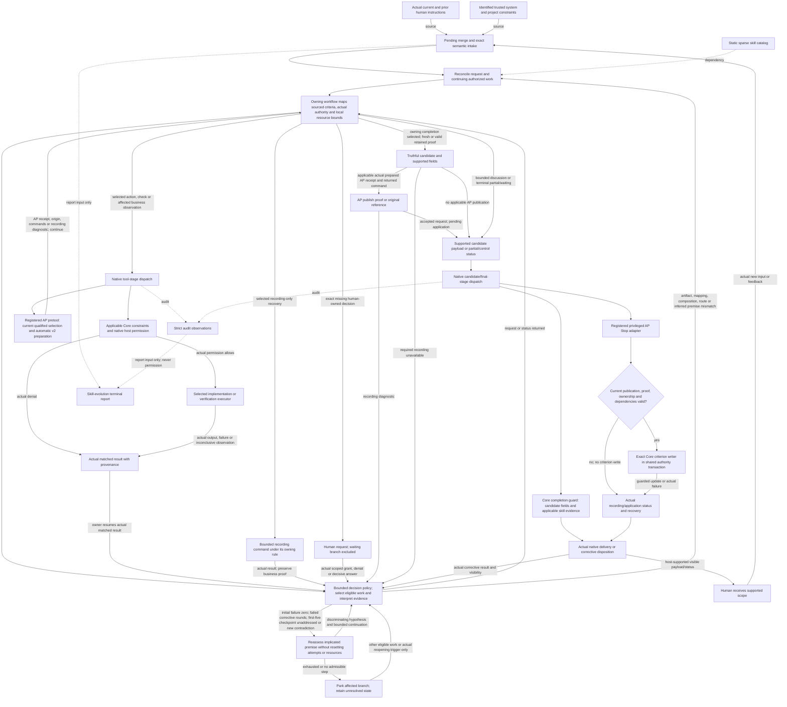

# Ghost-ALICE OS

Language: English | [Korean](./README_ko.md)


Ghost-ALICE OS is an agent governance layer for AI work. It keeps intent, boundaries, evidence, and runtime state inspectable across supported agent runtimes.

It is not a prompt library, a chatbot wrapper, or a standalone agent runtime. It is the operating layer that makes agent work auditable before the agent claims completion.

## Candidate 0.5.0

[Website](https://aidall.github.io/ghost-alice/) · [Architecture](./architecture.md)

Core 0.5.0 and Autopilot 0.5.0 use the current response-route and completion contract. Autopilot requires Core 0.5.0 or later. Both projects use Apache-2.0.

## How governed work proceeds

Ghost-ALICE preserves the approved objective and repairs the affected work when contrary evidence appears. Focus moves directly in either direction among micro artifacts, meso mappings, macro combined results and meta inferred premises. The philosophy is a quality floor, not a mandatory traversal.



This call graph preserves each handler's actual native invocation semantics. The workflow executes selected requests and returns actual matched results to its policy; AP recording does not grant or deny native tool permission. Business observation uses its own authority and limits. The first-five checkpoint remains addressed after reassessment; a new contradiction or stopping condition can reopen the premise. Recording recovery retains its stricter unchanged-failure park rule.

The registered v2 pretool automatically prepares the current selected bindings before the tool. Reuse its valid AP receipt/origin; an explicit returned preparation helper is used only for an applicable unfulfilled dependency. Compatible accepted proof is reused with its original source and verification time. A failed prepare does not revoke business authority: perform only independently justified work, report uncaptured proof honestly, and never relabel it as proof captured by a later receipt. Both preparation and publication/application failures use bounded diagnostic repair; an unchanged failure parks dependent recording. A retry requires a relevant recording or dependency change. `none` and `blocked` permit no AP capture or advancement. Domain checks and native permissions retain their owners.

A read-only review that actually executes work still requires owning verification. Core owns the shared routing projection and per-criterion completion/delivery decisions; domain owners retain their checks. AP consumes Core's `publication_route: none | prepare | publish | blocked`, never mere run existence or the accumulated backlog. Missing or stale route bindings block capture/advancement, not existing authorization or native permission.

New input rebinds the request while unchanged valid proof keeps its original source and time. A changed criterion, artifact or dependency reopens only affected evidence. Supported business outcome, recording/application, whole-unit completion and delivery scope remain distinct. Recording-only failures get bounded repair; identical unchanged failure parks that branch until relevant change while independent approved work continues.

Human authorization, credentials and native tool permission retain their owners. Strict audit remains active; printed io-trace is optional. Intake feeds the router directly and evolution remains report-only.

## Quick Start

From the cloned Ghost-ALICE repository, install Core and the official Autopilot addon together. The installer automatically detects the available agent platforms:

```bash
bash install.sh --addon autopilot
```

See the [detailed installation guide](./docs/getting-started/installation.md) for cloning, OS-native entrypoints, platform selection, updates and troubleshooting.

## Official Addons

Autopilot continues explicitly approved work one item at a time within its session, scope and budget. Installation does not grant run approval. It is maintained in [AidALL/ghost-alice-autopilot](https://github.com/AidALL/ghost-alice-autopilot).

For native commands, custom addon sources, platform selection and removal, use the [installation guide](./docs/getting-started/installation.md) and [official addon reference](./docs/reference/official-addons.md).

## Documentation Map

| Need | Go to |
| --- | --- |
| Full installation and update commands | [Installation and update guide](./docs/getting-started/installation.md) |
| Uninstall scope and cleanup behavior | [Uninstall cleanup procedure](./docs/getting-started/uninstall.md) |
| Failed update, merge conflict, or reinstall recovery | [Troubleshooting](./docs/getting-started/troubleshooting.md) |
| Repository layout | [Repository structure](./docs/reference/repository-structure.md) |
| Skill catalog reference | [Skill catalog guide](./docs/reference/skills.md) |
| Session gate contract | [Session gate matrix](./docs/policies/session-gate-matrix.md) |
| Installer compatibility contract | [Installer platform compatibility](./docs/policies/installer-platform-compatibility-matrix.md) |
| Team onboarding and background | [GitHub Wiki](https://github.com/AidALL/ghost-alice/wiki) |
| Official addon usage | [Wiki: official addons](./docs/reference/official-addons.md) |
| Addon authoring | [Wiki: addon authoring](https://github.com/AidALL/ghost-alice/wiki/addon-authoring) |

## Project Guarantees

- Ghost-ALICE OS is a governance operating layer for agent sessions, not a general-purpose operating system.
- User intent, boundaries, verification criteria, and install state are first-class surfaces.
- Core routing consumes recorded intent and selects current work before the owning workflow executes through native permissions.
- Completion claims require owning evidence; valid unchanged proof is reused at its original source and time.
- The installer tracks managed surfaces and avoids broad deletion when ownership cannot be proven.

Agent visibility command surface:

- Claude Code uses `/visibility strict|dynamic|minimal` as its workspace command.
- Codex handles `/visibility` through the trusted `UserPromptSubmit` hook pseudo-command path.
- Every platform can inspect and change the same profile value through `_shared/agent_visibility_cli.py`.
- The install-time default is `dynamic`. Use `bash install.sh --visibility dynamic` or `.\install.cmd --visibility dynamic` to set the initial profile; `--agent-visibility` remains a compatibility alias.
- Visibility changes the user-facing governance message surface only. It does not weaken hook execution, strict-grade logs, or Work-Impact Projection.

Full uninstall:

```bash
bash install.sh --uninstall
```

```cmd
.\install.cmd --uninstall
```

## Contributing And Validation

Before changing skills, installer behavior, or public command surfaces, read [AGENTS.md](./AGENTS.md). After creating or modifying a skill, pass Phases 1-5 of [official-docs/derived/skill-compliance-checklist.md](./official-docs/derived/skill-compliance-checklist.md).

Public surface validation:

```bash
python3 scripts/validate_public_surfaces.py
```

Session gate contract validation checks the repository contract in `skill-catalog/session-gates.json` and the user-facing policy surfaces:

```bash
python scripts/check_skill_gate_contract.py
```

Installer compatibility groups:

```bash
python3 scripts/run_installer_compat_tests.py --list
python3 scripts/run_installer_compat_tests.py --group public-surface-contract
```

## License

Ghost-ALICE OS project-owned source code and documentation are licensed under the Apache License, Version 2.0. See [LICENSE](./LICENSE), [NOTICE](./NOTICE), and [THIRD_PARTY_NOTICES.md](./THIRD_PARTY_NOTICES.md).

## Repair decisions and stopping conditions

Actual current and prior human instructions supply the authorization envelope: objective, prohibitions, allowed actions and targets, side effects and resources. Retained authority facts preserve their human source; trusted system/project constraints retain their identified source. Intake compresses semantic facts and the router selects current work without granting authority. Distinguish human-owned criteria and resource choices from agent-derived interpretations and bounded local plans; an absent explicit resource cap is not an approved human limit. Renew a narrower implementation contract only inside actual authority, without weakening acceptance criteria or inferring permission from focus expansion. Request an exact human-owned decision before crossing its boundary. Actual grant renews only the affected plan and granted scope; denial parks it; no response leaves it waiting. Continue other eligible authorized work.

A failed repair round requires a corrective change and a completed relevant observation of the same unresolved failure. Initial failure is zero. Group by unresolved failure, affected criterion, stage and target; explain what each result changes about cause, mapping, design or verification. Unknown causes cannot justify relabeling/reset, and identical error text cannot combine unrelated business and recording failures. Preserve cumulative attempts and the addressed first-five checkpoint across agents and handoffs. Demonstrated resolution followed by recurrence is a linked new incident. Five failed rounds is the maximum before the first mandatory premise reassessment, not a minimum retry count or whole-task limit. Once addressed, cumulative six or seven alone do not retrigger that checkpoint. New relevant contradiction or a current stopping condition can require reassessment. Continuation requires a distinguishable hypothesis, a discriminating check, an explicit additional-attempt or resource allowance and a stopping condition inside remaining parent resources. Reassessment resets neither attempts nor resources; exhaustion parks the affected continuation. Five alone does not require human escalation.

Before a discretionary check, name the unresolved criterion or competing explanation, why the method discriminates, and attainable outcomes mapped to different specified actions, acceptance judgments or boundary decisions. Mere potential to find something is insufficient. Stochastic repeats require uncertainty, sampling and stopping rules. Mandatory owning checks remain required; unavailable proof or unresolved required criteria prevent completion. Reuse valid unchanged passing proof at its original source and time; reopen only affected proof after observed change, contradiction or explicit recheck. Unknown already-executed business state calls for bounded affected observation, not automatic business replay; not-yet-executed required work still needs its actual action. Inconclusive checks give no business pass/fail verdict or failed-business-repair increment, but observation and recording attempts consume their bounded resources.

Retain decisions in existing work context and handoffs; no counter hook, classifier, compulsory per-conversation record or new mandatory report is required. Recording-specific typed recovery parks an identical unchanged failure without waiting for five rounds. Preserve known business proof when only recording fails. Exclude parked and human-waiting branches until an actual relevant reopening event. If no eligible work remains, use valid proof for all required criteria and resolve relevant contrary evidence before owning completion verification; otherwise report honest partial/waiting status.

The owning workflow calls the selected business action or corrective change and receives its actual result; declared action output may itself supply the verification observation. Domain verification returns actual observations, source and time to the workflow for criterion judgment. The applicable registered v2 pretool automatically prepares AP origin/receipt before the tool and returns current qualified command context. Reuse that valid prepared result; use an explicit returned preparation helper only when the applicable dependency remains genuinely unfulfilled. A recording gap affects capture/publication/application recordability; AP pretool continues and native tool permission remains with its host. Required or discriminating business observation follows its own authority and resource bounds; recording recovery rules govern recording attempts only. Preserve valid proof and its original source/time, including when recording is unavailable.

For a candidate closure, the owning workflow obtains or reuses supported proof. Applicable AP publication uses the exact current qualified selection, prepared AP receipt and actual returned publish command to leave a pending-adapter request. Native candidate/final dispatch invokes its actually registered handlers: the completion guard checks candidate fields and applicable skill evidence; the privileged AP Stop adapter revalidates publication, proof, ownership and dependencies. Only accepted current publication reaches the exact Core criterion writer within the shared authority transaction. Missing, stale or invalid publication returns a recording diagnostic without a criterion write. Actual application status and remaining criteria determine unit recording/completion claims. The handlers retain their actual native invocation semantics. Core owns delivery policy and may assemble the permitted payload; the workflow/native host performs visible delivery. Candidate claims use the supported current scope, while actual recording/application and visibility results govern further repair and closure claims. Preserve already-visible unchanged business content for applicable control-only repair. Return an admissible affected step to the workflow, or honest partial/waiting status when no eligible continuation remains.

## Repair entry, result and return paths

The connected master links sourced goals and authority, owning policy requests, actual native/tool results, bounded repair, pending publication, guarded criterion application and human feedback. Focus may move directly between micro artifacts, meso mappings, macro composition and meta inferred premises; every repair returns to the affected owning work.

[Connected master: sources, decisions and actual returns](https://github.com/AidALL/ghost-alice/blob/main/architecture.md#repair-entry-result-and-return-paths).
