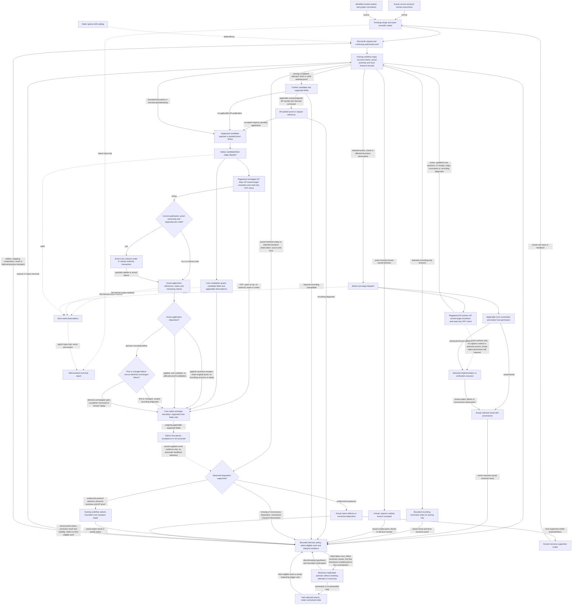

# Ghost-ALICE OS

언어: [English](./README.md) | Korean


Ghost-ALICE OS는 AI 에이전트의 작업을 관리하는 거버넌스 계층입니다. 지원하는 에이전트 실행 환경에서 사용자의 의도, 작업 범위, 검증 근거, 실행 상태를 확인할 수 있도록 관리합니다.

기존 에이전트 실행 환경 위에서 동작하며, 에이전트가 완료를 선언하기 전에 작업 과정과 근거를 검토할 수 있도록 돕습니다. 프롬프트 모음이나 챗봇 연결 도구, 독립 실행형 에이전트 런타임을 제공하는 저장소는 아닙니다.

## 후보 버전 0.5.0

[웹사이트](https://aidall.github.io/ghost-alice/) · [아키텍처](./architecture.md)

Core 0.5.0과 Autopilot 0.5.0은 현재 response-route와 완료 계약을 사용합니다. Autopilot에는 Core 0.5.0 이상이 필요합니다. 두 프로젝트 모두 Apache-2.0으로 제공됩니다.

## 승인된 작업의 진행과 복구

Ghost-ALICE는 승인된 목표를 유지하며 반대 근거가 나타난 작업을 수정합니다. micro 산출물, meso 매핑, macro 통합 결과, meta 추론 전제 사이에서 필요한 위치로 양방향 이동합니다. 철학은 품질의 하한선이며 모든 단계를 순회하는 절차가 아닙니다.



일반 Core hook 전달은 실제 native cwd를 Core 맥락으로 유지하고 명시된 AP 대상 override를 보존합니다. 프로젝트 선택은 AP가 담당합니다. Claude는 절대 CLI 프로젝트 경로를 payload cwd보다 먼저 선택하며, Codex는 payload cwd를 사용하고 Claude 전용 힌트를 무시합니다. 설치 source와 프로젝트 신뢰 경로는 AP 대상을 선택하지 않으며, 격리 바인딩은 소유 프로젝트 대상을 유지합니다. Pretool과 Stop은 해당 대상을 선택하고 OFF를 읽은 뒤 Core 권한 자료에 접근합니다. OFF는 캡처 맥락이나 권한 읽기·쓰기 없이 조용히 계속 진행을 반환하며, 활성 대상은 기존 적격 선택 검사로 진행합니다. 대상 선택은 권한을 부여하지 않습니다.

This call graph preserves each handler's actual native invocation semantics. The workflow executes selected requests and returns actual matched results to its policy; AP recording does not grant or deny native tool permission. Business observation uses its own authority and limits. The first-five checkpoint remains addressed after reassessment; a new contradiction or stopping condition can reopen the premise. Recording recovery retains its stricter unchanged-failure park rule.

활성 AP 대상과 적용되는 현재 qualified 선택이 있을 때 등록된 v2 pretool이 도구 실행 전에 선택된 바인딩을 자동 준비합니다. 유효한 AP receipt·origin을 재사용하며 적용되는 미충족 의존성이 있을 때만 반환된 명시적 준비 helper를 사용합니다. 호환되는 승인된 proof는 원래 출처와 검증 시간을 유지하여 재사용합니다. prepare 실패는 업무 권한을 취소하지 않습니다. 독립적으로 정당한 작업만 수행하고, capture되지 않은 proof는 그 상태를 정확히 알리며 이후 receipt에서 capture한 증명으로 다시 표시하지 않습니다. 준비와 publication·적용 실패 모두 한정된 진단·복구를 사용합니다. 변하지 않은 실패는 관련 기록을 보류하며 관련 기록·의존성이 실제로 바뀐 경우에만 재시도합니다. `none`과 `blocked`에서는 AP capture나 진행을 하지 않습니다. 담당 검증과 네이티브 권한은 각 소유자가 유지합니다.

실제 작업을 수행한 읽기 전용 리뷰에도 담당 검증이 필요합니다. Core는 공통 라우팅과 기준별 완료·전달 결정을 소유하며, 도메인 담당자는 검증을 유지합니다. AP는 실행 상태의 존재나 누적 목록 대신 Core의 `publication_route: none | prepare | publish | blocked`를 사용합니다. 누락되거나 오래된 경로는 capture와 진행을 막지만, 기존 승인이나 네이티브 도구 권한을 취소하지 않습니다.

새 입력은 요청을 다시 연결하며 유효하고 변하지 않은 증명의 원래 출처와 시간을 유지합니다. 기준·산출물·의존성이 변하면 해당 근거만 다시 검토합니다. 업무 결과, 기록 적용, 작업 단위 전체 완료, 전달 범위를 구분합니다. 기록만 실패하면 한정된 복구를 시도하고, 같은 실패가 변함없이 반복되면 관련 변경까지 해당 기록 경로를 보류합니다. 독립적으로 승인된 작업은 계속합니다.

사용자 승인, 자격 증명, 네이티브 도구 권한은 각각의 담당자가 관리합니다. 엄격한 감사는 유지되며 화면 io-trace는 선택 사항입니다. intake는 router로 직접 연결되며 evolution은 보고 전용입니다.

## Quick Start

복제한 Ghost-ALICE 저장소 폴더에서 Core와 공식 Autopilot을 한 번에 설치해 주세요. 설치기가 사용 가능한 에이전트 플랫폼을 자동으로 감지합니다.

```bash
bash install.sh --addon autopilot
```

저장소 복제, 운영체제별 실행 명령, 플랫폼 선택, 업데이트와 문제 해결은 [상세 설치 안내](./docs/ko/getting-started/installation.md)를 확인해 주세요.

## Official Addons

Autopilot은 명시적으로 승인된 작업을 해당 세션의 범위와 예산 안에서 항목 단위로 이어갑니다. 설치 자체가 실행 승인을 부여하지는 않습니다. 별도 저장소인 [AidALL/ghost-alice-autopilot](https://github.com/AidALL/ghost-alice-autopilot)에서 관리합니다.

운영체제별 명령, 사용자 정의 애드온, 플랫폼 선택과 제거는 [설치 안내](./docs/ko/getting-started/installation.md)와 [공식 애드온 참조](./docs/ko/reference/official-addons.md)를 확인해 주세요.

## Documentation Map

| 필요한 정보 | 안내 문서 |
| --- | --- |
| 전체 설치·업데이트 명령 | [Installation and update guide](./docs/ko/getting-started/installation.md) |
| 제거 범위와 정리 방식 | [Uninstall cleanup procedure](./docs/ko/getting-started/uninstall.md) |
| 업데이트 실패, 병합 충돌, 재설치 복구 | [Troubleshooting](./docs/ko/getting-started/troubleshooting.md) |
| 저장소 구조 | [Repository structure](./docs/ko/reference/repository-structure.md) |
| 스킬 목록과 참조 정보 | [Skill catalog guide](./docs/ko/reference/skills.md) |
| 세션 처리 단계와 필수 검사 규칙 | [Session gate matrix](./docs/ko/policies/session-gate-matrix.md) |
| 설치기의 플랫폼별 호환성 기준 | [Installer platform compatibility](./docs/ko/policies/installer-platform-compatibility-matrix.md) |
| 팀 도입 안내와 설계 배경 | [GitHub Wiki](https://github.com/AidALL/ghost-alice/wiki) |
| 공식 애드온 사용법 | [Wiki: official addons](./docs/ko/reference/official-addons.md) |
| 애드온 제작 방법 | [Wiki: addon authoring](https://github.com/AidALL/ghost-alice/wiki/addon-authoring_ko) |

## Project Guarantees

- Ghost-ALICE OS는 에이전트 세션의 작업을 관리하는 운영 계층이며, 범용 운영체제는 아닙니다.
- 사용자의 의도, 작업 범위, 검증 기준, 설치 상태를 핵심 관리 대상으로 다룹니다.
- Core 라우팅은 기록된 의도로 현재 작업을 선택하며, 담당 워크플로가 네이티브 권한 아래 실행합니다.
- 실행, 수정, 검증이 끝났다고 선언하려면 현재 상태를 뒷받침하는 근거가 필요합니다.
- 설치기는 자신이 관리하는 파일과 설정을 추적하며, 관리 대상임을 입증할 수 없으면 삭제 범위를 넓히지 않습니다.

작업 관리 메시지의 표시 수준은 다음 명령으로 조절하실 수 있습니다.

- Claude Code에서는 작업 공간 명령인 `/visibility strict|dynamic|minimal`을 사용합니다.
- Codex에서는 신뢰된 `UserPromptSubmit` 훅의 의사 명령 경로를 통해 `/visibility`를 처리합니다.
- 모든 플랫폼에서 `_shared/agent_visibility_cli.py`를 통해 같은 프로필 값을 확인하고 변경하실 수 있습니다.
- 설치 시 기본값은 `dynamic`입니다. 초기 프로필은 `bash install.sh --visibility dynamic` 또는 `.\install.cmd --visibility dynamic`으로 설정하실 수 있습니다. `--agent-visibility`도 호환성을 위한 별칭으로 유지됩니다.
- 표시 수준은 사용자에게 보이는 작업 관리 메시지만 바꿉니다. 훅 실행, 엄격한 감사 로그, 작업 영향 분류인 Work-Impact Projection은 축소하지 않습니다.

전체 제거가 필요하시면 다음 명령을 사용해 주세요.

```bash
bash install.sh --uninstall
```

```cmd
.\install.cmd --uninstall
```

## Contributing And Validation

스킬, 설치기 동작, 공개 명령을 변경하기 전에는 [AGENTS.md](./AGENTS.md)를 읽어 주세요. 새 스킬을 만들거나 기존 스킬을 수정하신 뒤에는 [official-docs/derived/skill-compliance-checklist.md](./official-docs/derived/skill-compliance-checklist.md)의 Phase 1-5를 통과해야 합니다.

공개 문서와 명령 안내의 일관성은 다음 명령으로 검증하실 수 있습니다.

```bash
python3 scripts/validate_public_surfaces.py
```

세션 검사 규칙 검증 명령은 저장소의 `skill-catalog/session-gates.json`과 사용자용 정책 안내를 함께 확인합니다.

```bash
python scripts/check_skill_gate_contract.py
```

설치기 호환성 검사 그룹은 다음 명령으로 조회하고 실행하실 수 있습니다.

```bash
python3 scripts/run_installer_compat_tests.py --list
python3 scripts/run_installer_compat_tests.py --group public-surface-contract
```

## License

Ghost-ALICE OS 프로젝트가 소유한 소스 코드와 문서는 Apache License, Version 2.0으로 제공됩니다. 자세한 내용은 [LICENSE](./LICENSE), [NOTICE](./NOTICE), [THIRD_PARTY_NOTICES.md](./THIRD_PARTY_NOTICES.md)를 확인해 주세요.

## 복구 판단과 중단 조건

현재 입력과 이전의 실제 사용자 지시가 목표·금지 사항·허용 행동과 대상·부수 효과·자원에 관한 권한의 출처입니다. 보관된 권한 사실과 신뢰된 system/project 제약에는 각각 출처를 유지합니다. intake와 router가 권한을 부여하지는 않습니다. 사용자가 정한 기준과 자원 한도는 에이전트가 도출한 해석이나 한정된 실행 계획과 구별합니다. 명시적 자원 한도가 없다는 이유로 승인된 한도를 만들지 않습니다. 실제 권한 안에서 구현 계획을 갱신하되 수락 기준을 약화하지 않습니다. 경계를 넘기 전에 정확한 사람 소유 결정을 요청합니다. 실제 승인만 해당 계획과 권한을 갱신하며, 거부는 해당 경로를 보류하고 응답이 없으면 대기를 유지합니다.

실패한 복구 라운드는 수정과 완료된 해당 관측에서 같은 미해결 실패가 확인된 경우입니다. 최초 실패는 0회입니다. 미해결 실패·기준·단계·대상으로 사건을 구별하고 각 결과가 원인·매핑·설계·검증 판단에 무엇을 바꾸는지 설명합니다. 담당자나 세션이 바뀌어도 누적 시도와 최초 다섯 회 재평가의 처리 여부를 유지합니다. 원인을 모른다는 이유로 이름이나 횟수를 초기화하지 않으며, 같은 오류 문구만으로 서로 다른 업무·기록 실패를 합치지 않습니다. 해결이 입증된 뒤 재발하면 연결된 새 사건으로 다룹니다. 다섯 회는 최초 필수 전제 재평가 전의 최대 실패 횟수이며 최소 재시도 횟수나 전체 작업 한도가 아닙니다. 이 재평가를 처리했다면 누적 여섯·일곱 회라는 사실만으로 다시 발동하지 않습니다. 새로운 관련 반대 근거나 현재 중단 조건은 별도로 재평가를 요구할 수 있습니다. 계속하려면 구별 가능한 가설·검사·명시적인 추가 시도 또는 자원 한도·중단 조건이 남은 전체 자원 안에 있어야 합니다. 재평가는 횟수나 자원을 초기화하지 않으며 한도가 소진되면 해당 진행을 보류합니다. 다섯 회만으로 사람에게 결정을 요구하지 않습니다.

재량 검사는 미해결 기준이나 경쟁 설명, 검사가 이를 구별하는 이유, 서로 다른 구체적 다음 행동·수락 판단·경계 결정으로 이어지는 결과를 명시합니다. 무언가 발견할 가능성만으로는 부족합니다. 확률적 반복에는 불확실성·표본 추출·중단 규칙이 필요합니다. 필수 검사는 유지하며 필수 근거가 없거나 기준이 미해결이면 완료할 수 없습니다. 변하지 않은 유효한 proof는 원래 출처와 시간으로 재사용합니다. 이미 실행한 업무의 상태가 불명확하면 해당 관측을 복구하며 업무를 자동 재실행하지 않습니다. 아직 실행하지 않은 필수 업무는 실제 실행이 필요합니다. 불확정 검사는 업무 성공·실패나 복구 실패 횟수를 확정하지 않지만 관측·기록 시도도 한정된 자원을 소비합니다.

기존 작업 문맥과 인계에 판단을 유지하며 별도 counter hook·classifier·매 대화 기록·필수 보고서를 만들지 않습니다. 변하지 않은 동일 기록 실패는 담당 typed recovery에 따라 다섯 회를 기다리지 않고 보류합니다. 기록만 실패했다면 업무 proof를 유지합니다. 보류·사람 응답 대기 경로는 실제 재개 조건 전까지 선택에서 제외합니다. 선택할 업무가 없으면 모든 필수 기준의 유효한 proof와 관련 반대 근거를 확인하여 담당 완료 검증으로 진행하며, 충족하지 못하면 정직한 부분·대기 상태를 반환합니다.

담당 workflow는 선택한 업무나 수정을 호출하고 실제 결과를 받으며, 선언한 실행 결과 자체가 검증 관측이 될 수 있습니다. 도메인 검증은 실제 관측·출처·시간을 workflow에 반환하여 기준을 판단하게 합니다. 적용되는 등록 v2 pretool은 도구 실행 전에 AP origin·receipt를 자동 준비하고 현재 qualified 명령 문맥을 반환합니다. 유효한 준비 결과를 재사용하며 적용되는 의존성이 실제 미충족일 때만 반환된 명시적 준비 helper를 사용합니다. 기록 누락은 capture·publication·application의 기록 가능성에 영향을 주며 AP pretool은 계속 진행하고 native 도구 권한은 host가 담당합니다. 필수 또는 판단을 구별하는 업무 관측은 자체 권한·자원 한도를 따르며 기록 복구 규칙은 기록 시도에만 적용됩니다. 기록이 불가능한 경우에도 유효한 proof와 원래 출처·시간을 유지합니다.

후보 완료를 위해 담당 workflow가 근거를 얻거나 유효한 proof를 재사용합니다. 적용되는 AP publication은 정확한 현재 qualified 선택·prepared AP receipt·실제 반환된 publish 명령으로 pending-adapter 요청을 만듭니다. Native candidate/final dispatch는 실제 등록된 handler를 호출합니다. 완료 guard는 후보의 필드와 해당 skill 근거를 확인하고 privileged AP Stop adapter는 publication·proof·소유권·의존성을 재검증합니다. 현재 유효한 publication만 공유 권한 transaction에서 정확한 Core 기준 writer로 진행합니다. 누락·오래됨·무효 상태는 기준 기록 없이 기록 진단을 반환합니다. 실제 application 상태와 남은 기준이 단위별 기록·완료 주장의 근거입니다. Handler는 실제 native 호출 규칙을 따릅니다. Core는 전달 정책과 허용된 payload 조합을 담당하며 workflow/native host가 실제 화면에 전달합니다. 후보 주장은 현재 지원되는 범위를 사용하고 실제 기록·적용·관측된 전달 결과가 후속 복구와 완료 주장을 결정합니다. 이미 보이는 변경 없는 업무 본문은 해당 control-only repair로 보존합니다. 가능한 후속 조치는 workflow로 반환하고 선택 가능한 진행이 없으면 정직한 부분·대기 상태를 반환합니다.

## 복구 진입·결과·복귀 경로

연결된 master는 출처가 있는 목표·권한, 담당 정책 요청, 실제 native/tool 결과, 한정된 복구, 적용 대기 publication, 보호된 기준 적용, 사람의 피드백을 함께 보여 줍니다. 초점은 micro 산출물·meso 매핑·macro 구성·meta 추론 전제 사이를 직접 오갈 수 있으며 복구는 해당 담당 작업으로 돌아옵니다.

[Connected master: sources, decisions and actual returns](https://github.com/AidALL/ghost-alice/blob/main/architecture.md#repair-entry-result-and-return-paths).

적용에 성공했지만 업무 조건이 남아 있다면 적용 참조와 원래 증거를 보존하고, 현재 권한 안의 수행 가능한 남은 업무를 선택합니다. 이 상태는 기록 복구·증거 재제출·답변 재작성의 근거가 아닙니다. 실제 기록 실패의 최초 또는 관련 변화 후 진단은 한정되며, 변화 없는 동일 실패는 제출 명령이나 답변 재작성 없이 해당 기록 경로를 보류합니다.

Core는 네이티브 훅 전달 경계를 담당합니다. Codex Stop/SubagentStop의 호스트 출력은 `continue`, `decision`, `reason`, `stopReason`, `suppressOutput`, `systemMessage`만 포함하고, 전체 내부 출력은 엄격 로그에 보존합니다. Core의 출력 정리는 파서의 피드백을 관측하거나 만들지 않습니다. 담당 워크플로는 실제 호스트·도구 출력 또는 선택된 전달 관측의 출처·시각을 미결 요청에 연결합니다. 실제 근거가 있는 프로토콜 거부만 한정된 Core 전달 복구로 연결하며, 예상 처리 결과가 없으면 거부로 확정하지 않고 미확인 전달 관측으로 유지합니다. 유효한 업무 증거와 AP 제출·적용 상태를 보존합니다.
