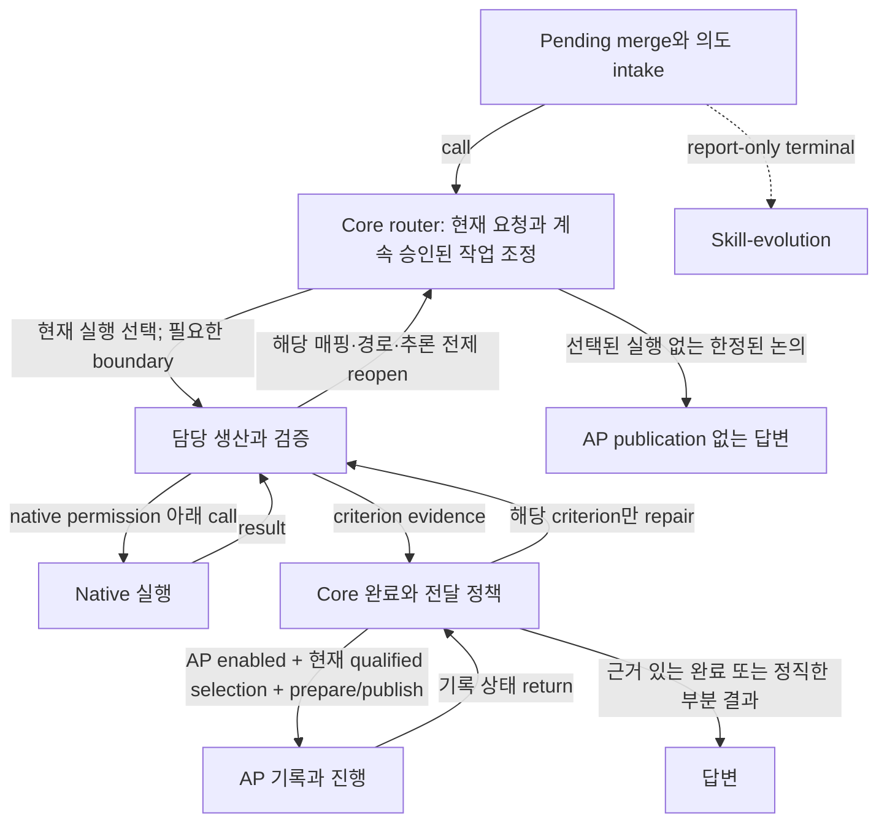

# Ghost-ALICE OS

언어: [English](./README.md) | Korean


Ghost-ALICE OS는 AI 에이전트의 작업을 관리하는 거버넌스 계층입니다. 지원하는 에이전트 실행 환경에서 사용자의 의도, 작업 범위, 검증 근거, 실행 상태를 확인할 수 있도록 관리합니다.

기존 에이전트 실행 환경 위에서 동작하며, 에이전트가 완료를 선언하기 전에 작업 과정과 근거를 검토할 수 있도록 돕습니다. 프롬프트 모음이나 챗봇 연결 도구, 독립 실행형 에이전트 런타임을 제공하는 저장소는 아닙니다.

## 후보 버전 0.5.0

[웹사이트](https://aidall.github.io/ghost-alice/) · [아키텍처](./architecture.md) · [이전 릴리즈 안내](./docs/ko/release/2026-10-01-release-notes.md)

이 소스 후보는 Core 0.5.0과 Autopilot 0.5.0을 함께 사용하며, Autopilot의 최소 Core 버전은 0.5.0입니다. 현재 작업 선택과 완료 계약을 위한 버전이며, 태그·릴리즈·설치 적용·게시 완료를 의미하지 않습니다. 네이티브 검증과 게시에는 각각의 근거가 필요합니다. 두 프로젝트 모두 Apache-2.0으로 제공됩니다.

## 승인된 작업의 진행과 복구

Ghost-ALICE는 승인된 목표를 유지하며 반대 근거가 나타난 작업을 수정합니다. micro 산출물, meso 매핑, macro 통합 결과, meta 추론 전제 사이에서 필요한 위치로 양방향 이동합니다. 철학은 품질의 하한선이며 모든 단계를 순회하는 절차가 아닙니다.



실제 작업을 수행한 읽기 전용 리뷰에도 담당 검증이 필요합니다. Core는 공통 라우팅과 기준별 완료·전달 결정을 소유하며, 도메인 담당자는 검증을 유지합니다. AP는 실행 상태의 존재나 누적 목록 대신 Core의 `publication_route: none | prepare | publish | blocked`를 사용합니다. 누락되거나 오래된 경로는 capture와 진행을 막지만, 기존 승인이나 네이티브 도구 권한을 취소하지 않습니다.

새 입력은 요청을 다시 연결하며 유효하고 변하지 않은 증명의 원래 출처와 시간을 유지합니다. 기준·산출물·의존성이 변하면 해당 근거만 다시 검토합니다. 업무 결과, 기록 적용, 작업 단위 전체 완료, 전달 범위를 구분합니다. 기록만 실패하면 한정된 복구를 시도하고, 같은 실패가 변함없이 반복되면 관련 변경까지 해당 기록 경로를 보류합니다. 독립적으로 승인된 작업은 계속합니다.

사용자 승인, 자격 증명, 네이티브 도구 권한은 각각의 담당자가 관리합니다. 엄격한 감사는 유지되며 화면 io-trace는 선택 사항입니다. 독립적인 입력별 분류기와 후속 gate는 대체 분류기 없이 폐기되었습니다. intake는 router로 직접 연결되며 evolution은 보고 전용입니다.

## Quick Start

복제한 Ghost-ALICE 저장소 폴더에서 Core와 공식 Autopilot을 한 번에 설치해 주세요. 설치기가 사용 가능한 에이전트 플랫폼을 자동으로 감지합니다.

```bash
bash install.sh --addon autopilot
```

저장소 복제, 운영체제별 실행 명령, 플랫폼 선택, 업데이트와 문제 해결은 [상세 설치 안내](./docs/ko/getting-started/installation.md)를 확인해 주세요.

## Official Addons

Autopilot은 명시적으로 승인된 작업을 해당 세션의 범위와 예산 안에서 항목 단위로 이어갑니다. 설치 자체가 실행 승인을 부여하지는 않습니다. 별도 저장소인 [AidALL/ghost-alice-autopilot](https://github.com/AidALL/ghost-alice-autopilot)에서 관리합니다.

운영체제별 명령, 사용자 정의 애드온, 플랫폼 선택과 제거는 [설치 안내](./docs/ko/getting-started/installation.md)와 [공식 애드온 참조](./docs/ko/reference/official-addons.md)를 확인해 주세요.

## Documentation Map

| 필요한 정보 | 안내 문서 |
| --- | --- |
| 전체 설치·업데이트 명령 | [Installation and update guide](./docs/ko/getting-started/installation.md) |
| 제거 범위와 정리 방식 | [Uninstall cleanup procedure](./docs/ko/getting-started/uninstall.md) |
| 업데이트 실패, 병합 충돌, 재설치 복구 | [Troubleshooting](./docs/ko/getting-started/troubleshooting.md) |
| 저장소 구조 | [Repository structure](./docs/ko/reference/repository-structure.md) |
| 스킬 목록과 참조 정보 | [Skill catalog guide](./docs/ko/reference/skills.md) |
| 세션 처리 단계와 필수 검사 규칙 | [Session gate matrix](./docs/ko/policies/session-gate-matrix.md) |
| 설치기의 플랫폼별 호환성 기준 | [Installer platform compatibility](./docs/ko/policies/installer-platform-compatibility-matrix.md) |
| 팀 도입 안내와 설계 배경 | [GitHub Wiki](https://github.com/AidALL/ghost-alice/wiki) |
| 공식 애드온 사용법 | [Wiki: official addons](./docs/ko/reference/official-addons.md) |
| 애드온 제작 방법 | [Wiki: addon authoring](https://github.com/AidALL/ghost-alice/wiki/addon-authoring_ko) |

## Project Guarantees

- Ghost-ALICE OS는 에이전트 세션의 작업을 관리하는 운영 계층이며, 범용 운영체제는 아닙니다.
- 사용자의 의도, 작업 범위, 검증 기준, 설치 상태를 핵심 관리 대상으로 다룹니다.
- Core 라우팅은 기록된 의도로 현재 작업을 선택하며, 담당 워크플로가 네이티브 권한 아래 실행합니다.
- 실행, 수정, 검증이 끝났다고 선언하려면 현재 상태를 뒷받침하는 근거가 필요합니다.
- 설치기는 자신이 관리하는 파일과 설정을 추적하며, 관리 대상임을 입증할 수 없으면 삭제 범위를 넓히지 않습니다.

작업 관리 메시지의 표시 수준은 다음 명령으로 조절하실 수 있습니다.

- Claude Code에서는 작업 공간 명령인 `/visibility strict|dynamic|minimal`을 사용합니다.
- Codex에서는 신뢰된 `UserPromptSubmit` 훅의 의사 명령 경로를 통해 `/visibility`를 처리합니다.
- 모든 플랫폼에서 `_shared/agent_visibility_cli.py`를 통해 같은 프로필 값을 확인하고 변경하실 수 있습니다.
- 설치 시 기본값은 `dynamic`입니다. 초기 프로필은 `bash install.sh --visibility dynamic` 또는 `.\install.cmd --visibility dynamic`으로 설정하실 수 있습니다. `--agent-visibility`도 호환성을 위한 별칭으로 유지됩니다.
- 표시 수준은 사용자에게 보이는 작업 관리 메시지만 바꿉니다. 훅 실행, 엄격한 감사 로그, 작업 영향 분류인 Work-Impact Projection은 축소하지 않습니다.

전체 제거가 필요하시면 다음 명령을 사용해 주세요.

```bash
bash install.sh --uninstall
```

```cmd
.\install.cmd --uninstall
```

## Contributing And Validation

스킬, 설치기 동작, 공개 명령을 변경하기 전에는 [AGENTS.md](./AGENTS.md)를 읽어 주세요. 새 스킬을 만들거나 기존 스킬을 수정하신 뒤에는 [official-docs/derived/skill-compliance-checklist.md](./official-docs/derived/skill-compliance-checklist.md)의 Phase 1-5를 통과해야 합니다.

공개 문서와 명령 안내의 일관성은 다음 명령으로 검증하실 수 있습니다.

```bash
python3 scripts/validate_public_surfaces.py
```

세션 검사 규칙 검증 명령은 저장소의 `skill-catalog/session-gates.json`과 사용자용 정책 안내를 함께 확인합니다.

```bash
python scripts/check_skill_gate_contract.py
```

설치기 호환성 검사 그룹은 다음 명령으로 조회하고 실행하실 수 있습니다.

```bash
python3 scripts/run_installer_compat_tests.py --list
python3 scripts/run_installer_compat_tests.py --group public-surface-contract
```

## License

Ghost-ALICE OS 프로젝트가 소유한 소스 코드와 문서는 Apache License, Version 2.0으로 제공됩니다. 자세한 내용은 [LICENSE](./LICENSE), [NOTICE](./NOTICE), [THIRD_PARTY_NOTICES.md](./THIRD_PARTY_NOTICES.md)를 확인해 주세요.
