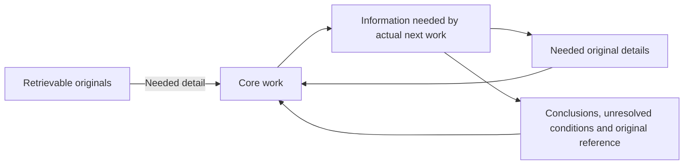

# Purpose-driven native context

The responding model chooses the information needed for its decision. It preserves necessary long originals and answers. Original storage and inclusion in a model request have separate lifetimes. Core authenticates declared use; the gateway applies protocol-supported use without changing native originals or server answers. Unsupported choices preserve the request.

The optional macOS gateway installer requires Python 3.14 or newer with `compression.zstd` before enabling the provider and launch agent. Core installation, hooks and gateway removal retain the Python 3.11 minimum. A gateway that cannot decode supported native request encodings must not be enabled. Gateway installation and affected removal reject a symlinked Codex configuration before service changes, preserving the link and its target. Gateway refresh validates marked provider blocks against the unchanged prior installation and listener binding before any file or service change. Edited, partial or unbound blocks are preserved and stop refresh. Registered refresh also verifies the existing launch-agent path and digest; a changed, missing or unbound agent stops refresh. Gateway installation refuses a symlinked launch-agent file.

The gateway keeps native headers within each configured provider origin. Unambiguous same-origin redirects retain the existing transport behavior; cross-origin, HTTPS-to-HTTP, or ambiguous native redirect targets return HTTP 502 without forwarding credentials or an unsafe redirect to the native client. The gateway forwards every path of a configured provider; it reduces only the known request endpoints of clients in its installation scope. An unknown provider path returns 404, and an unreachable model server or refused redirect returns 502 with the reason in the provider's error format. Validated redirect headers are relayed as absolute URLs resolved against the upstream base, so the native client cannot reinterpret them against the HTTP loopback address. Successful upstream response bytes remain unchanged.



## Claude generation intake boundary

The installed Gateway calls `prepare_native_request` before selecting a Claude generation or token-count request. This explicit native lifecycle operation resolves an already staged hook observation against the committed native transcript through Core's existing positive-origin resolver. It creates no input from wire text and supplies no human attribution of its own. Unknown actors remain pending until a later located human input supersedes them, notifications keep their preceding authority, and changed or ambiguous originals remain unaccepted. `prepare_native_request` reports storage failures as `unavailable` and raises unexpected errors; the gateway then forwards the original request and records the reason. The subsequent `select_request` and public state reads remain pure.

UserPromptSubmit can run before its native row is appended. When a valid retained selection exists and the new native row is already committed, resolving only at PreToolUse or Stop would resend previously omitted content until the first tool or final response. The generation boundary may now resolve that row before applying the same retained selection, including turns with no tools. It neither judges unprocessed material nor requires a new semantic judgment for each input; necessary new relookup results remain unselected and intact. Existing tool and Stop lifecycle reconciliation remains idempotent. Core still checks the actual current wire input before any exclusion; a newer native input cannot authorize rewriting an older request.

Core recognizes an ordinary Claude SDK prompt as context-only only when the native row positively carries an `entrypoint` of `sdk-cli` or `claude-desktop`, `userType=external`, `promptSource=sdk` and `turnOrigin=sdk`, has no contradictory origin, meta, sidechain or tool-result classification, and uniquely matches its staged transport within the authenticated append window. An app event that Claude desktop delivers while Claude works, a `queued_command` attachment without origin, is non-human context too but no content original: a context binding to it is rejected, and the request passes unchanged. Core stores an immutable context intake separately from human observations, retaining the original observation time, transport identity, byte row, inode and frozen native-prefix reference without copying the prompt. SDK resolution creates no `user-input-observed` event and changes neither the latest human input nor its canonical proof.

The separate `context_input_binding` API authenticates current or historical content-only inputs for context dispositions and source-use judgments. A current binding rejects pending transport and requires the exact original native row, full message including siblings, and matching wire message. Historical SDK binding authenticates its frozen original prefix rather than searching later repeated prompts. Public reads and selectors remain pure. The current non-human context marker, which an SDK turn or a queued app event sets, closes human semantic mutation, execution-route readiness and completion authority, including attempts to reuse a prior human ID. A notification preserves that marker; generic raw-input writes cannot clear it. Only lifecycle reconciliation of a positively identified native human clears the marker and restores ordinary human intake authority. The human-only `completion_assessment.response_input_binding` API retains its existing contract.

The native host can send a generation request before its input or completed publication row becomes visible in the transcript. When a valid retained disposition needs that original and the actual request supports its representation, `prepare_native_request` waits for the named source condition for at most two seconds, checking every 50 milliseconds without holding a ledger transaction. Before nominating either an input or carrier wait, Core authenticates the retained input and original prefix, inspects the actual selected wire target, and uses the selector's current-input protection and same-side native/wire ordering for both results and executed calls. For pending input, the authenticated staged append boundary and correlated wire prompt supply only exclusion coordinates. Retained producer inspection uses the existing historical use/judgment authentication loop and cannot admit current input, project substitutions, emit observations or write state; ordinary selection still requires its current binding. The shared producer-protection calculation retains `keep` in client composition and `keep` or needed `replace` in server clearing. An explicit combined input/result scope requires the existing native server beta even when the unsigned client prefix is rewriteable. Core checks the existing server policy, selected-prefix tool-name closure, protected recent-pair suffix and carrier, and uniform input scope when server clearing is needed. A changed, absent or protected target creates no native dependency. A remaining eligible prefix can still require current input or its surviving replacement carrier. A crossed input boundary or unrepresentable clearing scope prevents the wait. The eligibility result retains the actual representation and native source dependencies after all target, producer and scope guards. Any eligible choice can require pending current input; a pending publication result is required only when an eligible replacement observation names that carrier. An independent eligible omission does not wait for the carrier of a protected replacement. The dry scope calculation submits no policy and does not admit its wire capsule as completed native proof. A wire prompt or exact Core-issued publication capsule only identifies a condition worth waiting for; it supplies no actor or completed-result authority. Positive committed input goes through existing lifecycle reconciliation, and the unchanged admission path authenticates the committed native input, whole result, wire message and original prefix before applying the disposition. An empty selection, unsupported protocol, missing or changed source, already committed unknown/contradictory origin, different transport or missing exact publication identity does not trigger the wait. A deadline preserves unresolved input and the request. Public `select_request` and state reads neither wait nor reconcile native state.

## Select material for actual continued work

When actual continued work requires changing the input representation of already-used material, follow this procedure through the current receipt's `context_selection`. This is not a separate duty for every lookup. Its `native_dir` identifies the native transcript directory; the receipt supplies the exact ledger root, platform and session. For existing material, use the post-use selection below. For a new source whose continued use requires explicit selection, the retrieval helper can bind its purpose inside the already-needed lookup. It accepts the current authenticated content `input_event_id`. For a Claude receipt with `intake_status=pending-native-origin`, omit that argument: the operation authenticates the current human or separated SDK context input after native tool-intake reconciliation. Never substitute another session or cached receipt.

State the concrete decision that requires this lookup. Retrieval can record its purpose and original location; it does not decide how long the body will remain necessary. Execute an applicable binding inside the already-needed retrieval:

```text
python3 <installed-shared-directory>/source_lookup.py <original-path> --pointer <needed-field> --purpose <consuming-decision> --root <receipt-root> --platform <receipt-platform> --session-id <receipt-session> --native-dir <context-selection-native-dir> --expected-input-event-id <current-input-event>
```

Use `--line`, `--record`, `--find`, `--offset` or `--length` for a needed source selection, or `--full` when the whole text is required. A selected value has no automatic output cap. The helper returns the selected original with `use_reference`; it records only the source coordinates, purpose and native-call identity. It makes no second original copy. Multiple independent selections can share one native tool call. When more than one pending native call makes the producer ambiguous, pass its actual `--call-id`; do not guess.

After reading the result, the responding model compares its contents with the next actual decision and publishes `disposition=keep|replace|omit`. It chooses `keep` when the decision requires original details, `replace` when a conclusion, unresolved conditions and retrieval reference must reach that decision, or `omit` when neither the used body nor a replacement capsule has a current need. Every disposition requires a nonempty `summary` describing the conclusion and uncertainty, and a nonempty `next_need` describing the condition requiring retrieval. Core retains these judgments for `omit`; the gateway does not forward their summary, reference or authentication fingerprints as a replacement. A possible future need retains a retrievable original. The model reassesses use when the work changes; age, size, a final answer and a later human input never choose omission automatically.

Submit these post-use judgments within an already-required work registration or answer-review operation using `--context-use-judgments-json`. The operation commits its normal record and the judgments together or neither. Its `expected-input-event-id` is the current exact receipt. A judgment array is:

```json
[{"use_reference":"<returned-source-use-reference>","disposition":"replace","summary":"The conclusion and remaining uncertainty needed next.","next_need":"The changed condition requiring original detail."}]
```

Core verifies that the original result existed before the judgment. A later judgment changes the current disposition for that same source use; explicit `keep` reopens the unchanged original after either `replace` or `omit`, while immutable original judgments remain stored. Publication neither chooses the judgment nor authorizes business work. An input-selection change changes the next generation request. Combine it with another required action when one remains. Otherwise publish the changed selection directly before the next generation, using the existing native tool interface:

```text
python3 <installed-shared-directory>/context_lifecycle.py --root <receipt-root> --platform <receipt-platform> --session-id <receipt-session> --native-dir <context-selection-native-dir> --expected-input-event-id <current-input-event> --use-judgments-json <post-use-judgment-array>
```

For a pending Claude receipt, omit the event argument; the operation verifies the authenticated current content input after native tool reconciliation. Batch independent changes. Do not invoke an operation merely to repeat an unchanged receipt or audit fact. A tool-based state update may require another generation call; include its usage in the effectiveness measurement. No separate review model supplies the judgment. When the model does not publish a judgment, the body remains intact.

For each generation request, Core checks the original executed tool result and its current authenticated post-use judgment. A supported `replace` substitutes the exact producer observation object with its declared conclusion and uncertainty, purpose, remaining need, use reference and original retrieval location and pointer. A supported `omit` substitutes only that exact producer object with the empty JSON object `{}`, preserving enclosing stdout, JSON or SDK wrappers, other producers, necessary siblings and the executed result envelope. Ambiguous, changed, signed or unsupported objects remain intact. Core's mutation observations retain the original locator and `disposition=omit`; the gateway does not reinject that audit provenance into model input. The model retrieves original detail when its next decision requires it.

## Publish a conclusion for existing material

For already-read material, the responding model supplies `summary`, its conclusion and uncertainty, and `next_need`, the condition requiring the original. Identify an original with `record` and `block_index` or a uniquely resolving `locate_text`. Do not copy its full body into the selection.

The same `disposition=keep|replace|omit`, `summary` and `next_need` judgment applies to existing material. Coordinate-based callers that omit `disposition` retain their established replacement meaning. For default full-refresh publication, the responding model supplies the full current array; `keep` supersedes an earlier replacement or omission for the selected material. An `omit` judgment retains its conclusion and retrieval condition internally and sends no replacement capsule.

```json
[{"kind":"output","locate_text":"a unique literal identifying the used original","disposition":"replace","summary":"The conclusion and unresolved conditions needed next.","next_need":"The condition requiring the original again."}]
```

For a required Codex route registration, the responding model obtains the exact receipt root, platform, session and input ID, declared boundary reference and route candidate through [task-router's next-action procedure](../task-router/SKILL.md#select-the-next-action) and its linked [Core response-projection contract](../session-intent-analyzer/references/ledger-schema.md#core-response-projection). Use those existing values in the same installed shared directory's `response_route.py` invocation. To change only supplied locations, add both arguments to that already-required operation:

```text
--context-selection-json <changed-selection-array> --context-selection-mode update
```

The Python caller likewise passes `context_selection_mode='update'` with its explicit `context_selection` to `record_response_route`. Update mode requires Codex and an explicit array; it retains unaffected originating decisions under the source-local rules below. Default `--context-selection-mode replace` preserves the full-refresh behavior, including clearing the current selection with an empty array. Core commits the route and selection in one transaction or neither; an invalid selection, origin or current binding cannot leave only the route committed. The combined caller requires no separate publication invocation or extra generation call. Content use grants no execution authority.

When another required native tool action remains, the existing-material operation can share that invocation:

```text
python3 <installed-shared-directory>/context_lifecycle.py --root <receipt-root> --codex-dir <native-dir> --expected-input-event-id <receipt-input-event> --selection-json <current-selection-array>
```

For Codex, the default `--selection-mode replace` operation refreshes the full current array; an empty array clears it. When only particular source locations have changed need, the responding model supplies those choices through the same installed shared directory and current receipt with `--selection-mode update`:

```text
python3 <installed-shared-directory>/context_lifecycle.py --root <receipt-root> --platform codex --session-id <receipt-session> --native-dir <context-selection-native-dir> --expected-input-event-id <current-receipt-input-event> --selection-mode update --selection-json <changed-selection-array>
```

Core applies only the supplied locations and retains each unaffected choice's exact originating declaration and reference. It validates that original decision, historical input and original native file prefix rather than reauthoring the choice under the current input. A targeted `keep` restores that original body; an empty update retains the current choices. Invalid or changed origins, duplicate/overlapping choices within one update, and a partial overlap that narrows an existing whole-exchange choice are rejected atomically. An explicit whole-exchange update can supersede the earlier individual output choices for that pair. The model still judges actual changed need; age, a later human input and the existence of a previous omission do not classify material automatically. Claude replacement publication remains a separate operation below and does not accept Codex update mode.

`kind=output` selects one tool-result block; `exchange` selects a complete executed call/result pair; `assistant` selects a prior answer block; `message` selects prior text. Codex supports these four explicit kinds. For `omit`, its adapter removes the chosen plaintext output block while retaining the call/result envelope and necessary siblings; a scalar or otherwise empty output keeps an empty string body. An explicit whole-exchange omission removes both items only after unique native/wire pairing and a judgment that neither arguments nor results remain needed. Prior text omission removes selected plaintext blocks and removes an empty supported message after grouping all choices, without index drift. Unknown selected metadata and opaque signed content remain intact.

Claude supports `output` for one tool-result content block and `assistant` or `message` for unsigned native text; it rejects `exchange`, signed thinking and unknown blocks. Its output omission empties `tool_result.content` while retaining `tool_use_id`, result envelope and sibling blocks. Prior text omission removes only supported unsigned text, retaining a message with necessary siblings or removing an otherwise empty supported message. The adapter preserves unknown message metadata. Claude coordinates retain the native JSONL record and content block index, while the adapter matches a unique semantic wire block and verifies the executed pair for output. Both platforms protect the latest human/current-turn message even when equal earlier text disappeared, retain source/native ordering, and preserve unknown blocks. The default full-refresh array replaces the current selection, so include earlier applicable choices only after comparing them with the next need; an empty full-refresh array clears it. The model publishes a changed selection through the caller above because it controls the next request, without repeating unchanged records or adding a judgment model.

Claude native normalization and owner checks consume one row snapshot. The native host can append messages during a Core operation; the normalizer does not reread that live path. The next operation verifies any later rows separately. Pair verification treats only an absent tool-use caller and the exact `caller={"type":"direct"}` transport default as equivalent. Tool name, arguments, IDs, uniqueness, order, non-direct callers and canonical original fingerprints remain unchanged.

For Claude existing material, use the same `context_lifecycle.py` operation with `--platform claude --session-id <receipt-session> --native-dir <context-selection-native-dir>` and the receipt root. Pass its exact `--expected-input-event-id` when observed; omit that argument only for a pending-native-origin receipt. Core resolves the canonical current human after native tool-intake reconciliation and rejects an absent or mismatched binding. An authenticated current selection carries across later human inputs while each request revalidates the current native and wire human. Literal lookup uses the same platform/session arguments with `--locate-text` and an optional `--locate-kind`; it returns coordinates without echoing the body. No retrieval-purpose record is required for existing material.

Desktop can place host guidance and the submitted prompt in separate native user-message blocks. Core correlates the trusted hook prompt with the whole text or one unique complete plaintext block, then authenticates the full native and wire message with every sibling retained. Duplicate matches, substring-only matches and unknown actor metadata remain unsupported. The intake procedure in session-intent-analyzer's ledger schema owns reconciliation and ordered supersession of earlier unresolved observations; selecting a matching text block does not establish its actor or grant execution authority.

## Apply and observe

Codex Responses and supported unsigned Claude Messages requests with explicitly disabled thinking can apply authenticated post-use judgments. Core verifies canonical human input, native owner, the original executed call, the selected observation and post-use judgment. The adapter retains tool identifiers and necessary siblings. Claude's explicitly scoped per-process gateway uses the existing subscription authentication. CLI adoption does not establish Desktop adoption.

Codex body selection requires a stateless full-prefix request. A `previous_response_id` or `conversation` key, including a null, false, empty or unknown value, returns `state=preserved`, `reason=stateful-request-selection-unsupported` and no mutation observations from the manual selector, direct post-use selector and composed selector. The gateway leaves server-owned history and the complete request unchanged.

Manual selections and source-use judgments retain separate scopes. Core authenticates both current declarations before composing overlapping changes. An explicit `keep` in either scope protects the overlapping block from destructive `replace` or `omit` in the other scope, without inventing chronological precedence. The selector applies independent nonoverlapping changes and returns `selected-with-preserved-context-conflict`, or preserves the request with `context-disposition-conflict` when no change remains. Preserved conflicts never count as selected-block observations. The responding model resolves incompatible current declarations in the same existing APIs; originals and both judgment histories remain stored, and no additional review call or authority record is created.

Claude thinking binds earlier messages, system and tools to the reasoning prefix. Preserving signature bytes while rewriting earlier text or tool results does not preserve that binding. Before any eligible client substitution, one shared pure guard rejects requests containing `thinking`, `redacted_thinking`, `compaction` or any top-level signed content block. Rewriting also requires explicit `thinking.type=disabled`: enabled, adaptive, between-tools, missing or unknown configuration cannot establish disabled thinking. The configuration guard applies before the first signed response, because the native host retains the original prefix for later requests and missing configuration can mean thinking is on by default. The guard uses no model-name allowlist and changes no native reasoning setting. See the [preserved-thinking contract](https://platform.claude.com/docs/en/build-with-claude/preserved-thinking) and [thinking configuration](https://platform.claude.com/docs/en/build-with-claude/thinking).

Client existing-material and post-use rewriting return `state=preserved`, `reason=signed-prefix-selection-unsupported` and no selected-block observations for an eligible rewrite under that guard. The gateway forwards the complete original raw body without re-encoding it. Native originals, Core declarations, signed blocks and server answers remain intact. Requests with no eligible change retain their existing preservation reason. Unsigned requests with explicitly disabled thinking continue to support authenticated substitution. Explicitly disabled thinking is a supported input condition, not a gateway fallback or a change to native defaults.

For signed or default-thinking requests whose native `anthropic-beta` header already includes `context-management-2025-06-27`, the gateway may request documented [server context editing](https://platform.claude.com/docs/en/build-with-claude/context-editing). Core authenticates the whole-result manual `output`/`omit` declarations and current response-use judgments through the same procedures above. An active producer `keep` or `replace` protects its enclosing result; a producer-subbody omission alone does not authorize clearing that whole result. The provider clears by included tool name outside a recent-pair retention window. Every included result before that window requires an authenticated whole-result omission or supported replacement. An older unselected or protected invocation makes that name ineligible; a later necessary invocation can remain in a verified retained suffix. Unpaired or ambiguous chronology prevents recent-suffix mapping. Other tool names are excluded from clearing. Unknown policies, server-tool structures and signed compaction requests remain unchanged. An existing native thinking policy is retained; the gateway adds no thinking edit.

For a whole tool-result `replace` under signed or default thinking, the responding model can publish the required conclusion and uncertainty through the native result of the same already-needed selection operation. Add `--project-replacements` to that Claude `context_lifecycle.py --selection-json` or `--selection-file` invocation; the Python caller passes `project_replacements=True` to `record_disposition`. The selected whole results must already exist. Core discovers one unique current pending native publication call after those results and records its canonical call identity in the distinct Claude `context-disposition.v5` declaration. An ambiguous or absent call is rejected. The flag alone supplies no publication provenance. Default/false retains the existing return and v3 declaration; Codex selection/update behavior is independent.

The operation returns `replacement_context`, a `context-replacement-output.v1` object containing the declaration reference and each replaced result's summary, remaining need and original retrieval location. The native host records that object inside the operation's actual tool result. At the next request, Core authenticates the declared original file prefix, selected records, historical/current human bindings and the unique completed publication pair. It requires the exact single replacement object in both the native result and its unchanged wire result before making that whole result eligible for server clearing. Missing, changed, duplicated or unsupported publication results preserve the original. Core does not insert the capsule into a signed client prefix or borrow a different call's output.

The existing server policy then clears only exactly representable original results while the needed replacement remains in its untouched native carrier. The carrier remains protected, including against an overlapping omit choice. The name-prefix route excludes distinct carrier names; the global-prefix route retains every carrier in its suffix. A later same-name carrier or necessary result can instead fall inside an authenticated recent-pair suffix. An older unselected invocation of an included name prevents selecting that name; an unselected or protected invocation after a selected prefix starts the retained suffix. Another producer's active `keep` or `replace` protects its enclosing whole result. Tool inputs remain retained for replacement. `server-context-replace-requested` and the carrier coordinates report only the requested policy; the same-request provider `applied_edits` and a subsequent native answer are separate observations required to establish application and preserved usefulness. This operation neither creates human authority nor implements arbitrary signed-text exclusion or API signed compaction.

To omit a completed tool's arguments as well as its result, the responding model explicitly declares `clear_tool_inputs: true` on that whole `kind=output, disposition=omit` choice. Its summary and next-need judgment cover both the arguments and result. The flag is a boolean; omission of the flag or `false` retains output-only scope. Core finds the unique executed pair in the same owner-verified snapshot and stores its call record, block index and canonical digest. The model supplies no call proof. Each subsequent request revalidates that binding and the unique exact native/wire pair. A changed call or unsupported client-only path preserves input. Even unsigned client selection does not silently apply only half of an explicitly combined scope; it requires the existing server beta.

The provider's `clear_tool_inputs` flag covers every included tool name. The gateway requests it only when every eligible result explicitly declares the combined scope. Mixed eligible input scopes return `server-context-input-scope-unrepresentable` without broadening any declaration. Protected or unselected invocations retain the existing tool-name exclusion. Arbitrary signed text and other tool inputs remain outside this operation. Signed client messages and the original call/result records stay unchanged; provider `applied_edits` remains required before claiming application.

The requested `clear_tool_uses_20250919` policy uses an input trigger of one token, the explicit common `clear_tool_inputs` scope and the protected names. When every invocation of an included name is selected, `keep.tool_uses=0` retains the existing exact scope. Otherwise the adapter requires unique full native/wire call and completed-result matches with matching call order and matching completed-result order. Native interleaved pairs may appear as grouped assistant calls and user results on the wire. It excludes names with older unselected results, selects only the representable prefix before the first protected result of an included name, and sets `keep.tool_uses` to the count of all completed pairs from that boundary onward. This includes excluded-name pairs inside the suffix; excluded pairs before it contribute no count. Duplicate, open, crossed or reordered pairs preserve the unsupported scope. After the same full pairing and chronology authentication, the adapter also considers the initial global prefix of selected whole results. Its alternative includes every tool name (`exclude_tools=[]`) and keeps every later pair, so no unselected or protected body before the retained suffix can clear. The adapter compares only these two public representations: the named plan's guaranteed-clear set comes from included-name order with its keep count under the more-retaining filtered counting convention. The global route must contain that entire set and either add guaranteed selected targets or remove ambiguous target coverage; otherwise the adapter retains the named plan. An older unselected global pair stops the global route, while the named fallback can still exclude its tool name and apply independent exactly representable choices. Later selected results behind the global hole remain in the suffix unless the named fallback independently supports them. Mixed input-clear scopes among the final eligible results remain unrepresentable. Stored choices, source messages and actor authority do not change. The public specification does not state whether excluded names contribute to keep counting. Counting the entire suffix protects it under either counting order and may retain additional selected originals. The adapter reports no selected observation or carrier dependency for a target its own suffix keeps. Readiness uses the same scope owner; an exact prospective publication contributes only exclusion/count coordinates in dry inspection and cannot authorize a policy or native completion. The public [context editing specification](https://platform.claude.com/docs/en/build-with-claude/context-editing) defines recent-pair keep and oldest-first clearing; provider `applied_edits` remains necessary to observe actual clearing. Messages, system, tools, thinking settings and client tool arguments remain unchanged; only the provider's authorized input view changes. The gateway never adds a beta header or claims account entitlement. `server-context-omit-requested` and `provider_application=requested` identify only a policy request. The separate server `context_management.applied_edits` observation establishes whether clearing occurred; count and input-token observations do not establish arbitrary selected-text support or whole-task savings. A name scope that cannot represent the selection returns `server-context-name-scope-unrepresentable`. API-key-only compaction flags do not establish a subscribed Desktop compaction capability, and CLI observation does not establish Desktop uptake.

Absent or unverifiable selections preserve input with a bounded reason. Storage failure or an unexpected processing error stops the request before the generation server. An output limit, compaction, fixed retry or extra exception prompt does not substitute for purpose-based selection.

The component installer preserves unrelated settings and local changes, confirms shutdown, stages coherent dependencies, starts the candidate once, checks readiness and commits configuration. A failed candidate restores affected artifacts and service state. A new host launch may be required to adopt changed transport configuration. A registered provider or successful installation does not establish adoption by an existing native process; its receipt and actual request observations must support that claim.

The service records request shapes and identities, selected source references, raw server usage and response hashes. It retains no extra conversation or credential bodies. Match original, reference and absence across several later requests; verify that needed originals remain retrievable. Count each server response once and leave missing usage unknown. A cache hit or one smaller request does not prove exclusion.

The service forwards compressed native response bytes unchanged and observes gzip/zstd SSE from a decoded copy, including subsequent compression frames. Unknown, corrupt or incomplete encoding leaves observation incomplete. Provider `applied_edits` and usage come from the response; requesting a policy does not establish application.

## Signed API compaction controller

`claude_context_adapter.prepare_signed_compaction(request, cut, native_betas=...)` provides a pure host-side controller for the documented on-demand API. The response model chooses the closed prefix cut from its actual next need. The host supplies its existing request and advertised `compact-2026-09-04` beta; the controller adds neither a beta nor an output cap. The returned plan exposes `request`, a same-model/system/tools/thinking summary request. It removes only generation controls that the summarization API rejects. An existing threshold-compaction policy must be retired by the host before preparation. The current human input, live mid-conversation system instructions, closed tool pairs and unchanged kept turns are protected.

The host sends that request through its own authorized native transport and obtains that exact call's response. The response model compares the returned summary against the original objective, constraints, uncertainty and needed source access. Only after accepting that comparison does the host call `plan.adopt(response, current_request, native_betas=..., summary_accepted=True)`. Adoption verifies unchanged history and model/system/tools/thinking configuration, preserves the returned signed block exactly, replaces only its summarized prefix, and returns the continuation request with the tail unchanged. The host, rather than this pure controller, authenticates response provenance and observes provider acceptance and preserved thinking. A boolean judgment or a fixture signature does not authenticate either.

This source controller does not install a request/response loop inside Claude Desktop. Native `/compact`, arbitrary exclusion of earlier signed text, whole-tool-result server clearing, and API signed compaction remain distinct paths. A subscribed host without the native beta or ownership of that loop retains the unmet integration condition; Gateway does not borrow native credentials or manufacture a summarization call. For any actual signed-compaction response, usage accounting includes `usage.iterations` once, including observed TTL and thinking counters; zero top-level reply counters do not make summarization free. Missing iteration fields and billing remain unknown.
