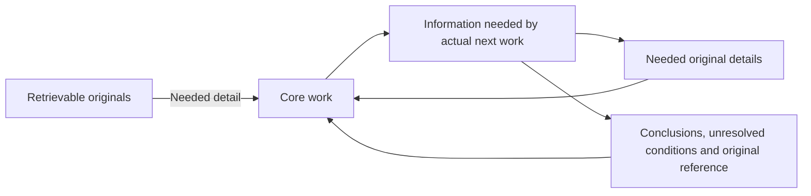

# Purpose-driven context selection

The response model chooses the information needed for its decision. It preserves necessary long originals and answers. Original storage and inclusion in a model request have separate lifetimes. Core code authenticates declared use; the context gateway applies protocol-supported use without changing the originals in the host's transcript or server answers.



## Claude generation intake boundary

The installed gateway calls `prepare_native_request` before selecting a Claude generation or token-count request. This explicit lifecycle operation resolves an already staged hook observation against the host's committed transcript through Core code's existing positive-origin resolver. It creates no input from wire text and supplies no human attribution of its own. Changed or ambiguous originals remain unaccepted. The subsequent `select_request` and public state reads remain pure.

The host's prompt-submit event (`UserPromptSubmit`) can run before its row is appended to the host's transcript; the event name does not show who sent the prompt. When a valid retained selection exists and the new transcript row is already committed, resolving only at PreToolUse or Stop would resend previously omitted content until the first tool or final response. `prepare_native_request` may resolve that row at the generation boundary before applying the same retained selection, including turns with no tools. It neither judges unprocessed material nor requires a new semantic judgment for each input; necessary new relookup results remain unselected and intact. Existing tool and Stop lifecycle reconciliation remains idempotent. Core code still checks the actual current wire input before any exclusion; a newer input in the transcript cannot authorize rewriting an older request.

Core code recognizes an ordinary Claude Code SDK prompt as context-only only when the transcript row positively carries an `entrypoint` of `sdk-cli` or `claude-desktop`, `userType=external`, `promptSource=sdk` and `turnOrigin=sdk`, has no contradictory origin, meta, sidechain or tool-result classification, and uniquely matches its staged transport within the authenticated append window. The `promptSource` field and a `queued_command` attachment describe how Claude Code delivered a prompt or app event, not its sender. An app event that Claude desktop delivers while the response model works, a `queued_command` attachment without origin, is context too but no content original: a context binding to it is rejected, and the current binding stays with the input Core code recorded as current. On Claude Code, Core code records an input as the current input only from the host's human-origin markers; those markers do not prove that the human user sent it. Core code stores an immutable context intake separately from observations of those marked inputs, retaining the original observation time, transport identity, byte row, inode and frozen transcript-prefix reference without copying the prompt. SDK resolution creates no `input-observed` event and changes neither the latest input Core code recorded as current nor its canonical proof.

The separate `context_input_binding` API authenticates current or historical content-only inputs for context dispositions and source-use judgments. A current binding rejects pending transport and requires the exact original transcript row, full message including siblings, and matching wire message. Historical SDK binding authenticates its frozen original prefix rather than searching later repeated prompts. Public reads and selectors remain pure. The current non-human context marker, which an SDK turn sets, closes human semantic mutation, execution-route readiness and completion authority, including attempts to reuse a prior human ID. A queued app event sets no marker and keeps the current human input and route. A notification preserves the marker; generic raw-input writes cannot clear it. Only lifecycle reconciliation of a positively identified human row in the transcript clears the marker and restores ordinary human intake authority. The human-only `completion_assessment.response_input_binding` API retains its existing contract.

The host can send a generation request before its input or completed publication row becomes visible in the transcript. When a valid retained disposition needs that original and the actual request supports its representation, `prepare_native_request` waits for the named source condition for at most two seconds, checking every 50 milliseconds without holding a ledger transaction. Before nominating either an input or carrier wait, Core code authenticates the retained input and original prefix, inspects the actual selected wire target, and uses the selector's current-input protection and same-side transcript/wire ordering for both results and executed calls. For pending input, the authenticated staged append boundary and correlated wire prompt supply only exclusion coordinates. Retained producer inspection uses the existing historical use/judgment authentication loop and cannot admit current input, project substitutions, emit observations or write state; ordinary selection still requires its current binding. The shared producer-protection calculation retains `keep` in client composition and `keep` or needed `replace` in server clearing. An explicit combined input/result scope requires the server beta that the host already sends even when the unsigned client prefix is rewriteable. Core code checks the existing server policy, selected-prefix tool-name closure, protected recent-pair suffix and carrier, and uniform input scope when server clearing is needed. A changed, absent or protected target creates no dependency on a transcript row. A remaining eligible prefix can still require current input or its surviving replacement carrier. A crossed input boundary or unrepresentable clearing scope prevents the wait. The eligibility result retains the actual representation and its dependencies on transcript rows after all target, producer and scope guards. Any eligible choice can require pending current input; a pending publication result is required only when an eligible replacement observation names that carrier. An independent eligible omission does not wait for the carrier of a protected replacement. The dry scope calculation submits no policy and does not admit its wire capsule as proof of a completed transcript row. A wire prompt or exact publication capsule issued by Core code only identifies a condition worth waiting for; it supplies no actor or completed-result authority. Positive committed input goes through existing lifecycle reconciliation, and the unchanged admission path authenticates the committed input in the transcript, whole result, wire message and original prefix before applying the disposition. An empty selection, unsupported protocol, missing or changed source, already committed unknown/contradictory origin, different transport or missing exact publication identity does not trigger the wait. A deadline preserves unresolved input and the request. Public `select_request` and state reads neither wait nor reconcile staged input with the transcript.

## Select material for actual continued work

The session metadata's `context_selection.native_dir` identifies the host's configuration directory; the session metadata supplies `ledger_root`, `platform` and `session_id`. For existing material, use the post-use selection below. For a new source whose continued use requires explicit selection, the retrieval helper can bind its purpose inside the already-needed lookup. It accepts the current authenticated content input ID. Read that ID, `<input_event_id>` in the commands below, from the intent ledger with session-intent-analyzer's `scripts/session_intent_ledger.py` and those session metadata fields: the `value` that `--read-state --pointer /current_context_input_event_id` returns when that lookup succeeds with a nonempty value, otherwise the `input_event_id` that `--read-intent` returns. Core code binds content operations to the input that this rule chooses. For Claude Code, when `--read-state --pointer /intake_status` returns `pending-native-origin`, omit that argument: the operation authenticates the current human or separated SDK context input that Core code reconciled before this tool call.

State the concrete decision that requires this lookup. Retrieval can record its purpose and original location. Execute an applicable binding inside the already-needed retrieval:

```text
python3 <installed-shared-directory>/source_lookup.py <original-path> --pointer <needed-field> --purpose <consuming-decision> --root <ledger_root> --platform <platform> --session-id <session_id> --native-dir <context_selection.native_dir> --expected-input-event-id <input_event_id>
```

Use `--full` when the whole text is required. The helper returns the selected original with `use_reference`; it records only the source coordinates, purpose and tool-call identity. When more than one pending tool call makes the producer ambiguous, pass its actual `--call-id`; do not guess.

After reading the result, the response model compares its contents with the next actual decision and publishes `disposition=keep|replace|omit`. It chooses `keep` when the decision requires original details, `replace` when a conclusion, unresolved conditions and retrieval reference must reach that decision, or `omit` when neither the used body nor a replacement capsule has a current need. Every disposition requires a nonempty `summary` describing the conclusion and uncertainty, and a nonempty `next_need` describing the condition requiring retrieval. Core code retains these judgments for `omit`; the gateway does not forward their summary, reference or authentication fingerprints as a replacement. The response model reassesses use when the work changes; age, size, a final answer and a later human input never choose omission automatically.

Submit these post-use judgments within an already-required response route registration or response review operation using `--context-use-judgments-json`. The operation commits its normal record and the judgments together or neither. Its `expected-input-event-id` is the `input_event_id` that `--read-intent` returns. A judgment array is:

```json
[{"use_reference":"<returned-source-use-reference>","disposition":"replace","summary":"The conclusion and remaining uncertainty needed next.","next_need":"The changed condition requiring original detail."}]
```

Core code verifies that the original result existed before the judgment. A later judgment changes the current disposition for that same source use; explicit `keep` reopens the unchanged original after either `replace` or `omit`, while immutable original judgments remain stored. Publication neither chooses the judgment nor authorizes work. An input-selection change changes the next generation request. Combine it with another required action when one remains. Otherwise publish the changed selection directly before the next generation request, through a tool call:

```text
python3 <installed-shared-directory>/context_lifecycle.py --root <ledger_root> --platform <platform> --session-id <session_id> --native-dir <context_selection.native_dir> --expected-input-event-id <input_event_id> --use-judgments-json <post-use-judgment-array>
```

For Claude Code, while `--read-state --pointer /intake_status` returns `pending-native-origin`, omit `--expected-input-event-id`; the operation verifies the authenticated current content input that Core code reconciled before this tool call. Batch independent changes. A tool-based state update may require another generation call; include its usage in any effectiveness measurement. No separate review model supplies the judgment.

For each generation request, Core code checks the original executed tool result and its current authenticated post-use judgment. A supported `replace` substitutes the exact producer observation object with its declared conclusion and uncertainty, purpose, remaining need, use reference and original retrieval location and pointer. A supported `omit` substitutes only that exact producer object with the empty JSON object `{}`, preserving enclosing stdout, JSON or SDK wrappers, other producers, necessary siblings and the executed result envelope. Ambiguous, changed, signed or unsupported objects remain intact. Core code's mutation observations retain the original locator and `disposition=omit`; the gateway does not reinject them into model input. The response model retrieves original detail when its next decision requires it.

## Publish a conclusion for existing material

For already-read material, the response model supplies `summary`, its conclusion and uncertainty, and `next_need`, the condition requiring the original. Identify an original with `record` and `block_index` or a uniquely resolving `locate_text`. Do not copy its full body into the selection.

The same `disposition=keep|replace|omit`, `summary` and `next_need` judgment applies to existing material. Coordinate-based callers that omit `disposition` retain their established replacement meaning. For default full-refresh publication, the response model supplies the full current array; `keep` supersedes an earlier replacement or omission for the selected material. An `omit` judgment retains its conclusion and retrieval condition internally and sends no replacement capsule.

```json
[{"kind":"output","locate_text":"a unique literal identifying the used original","disposition":"replace","summary":"The conclusion and unresolved conditions needed next.","next_need":"The condition requiring the original again."}]
```

For a required Codex route registration, the response model obtains `ledger_root`, `platform` and `session_id` from the session metadata, the input ID that `--read-intent` returns, the declared boundary reference and the route candidate through [task-router's next-action procedure](../task-router/SKILL.md#select-the-next-action) and its linked [Core response-projection contract](../session-intent-analyzer/references/ledger-schema.md#core-response-projection). Use those existing values in the same installed shared directory's `response_route.py` invocation. To change only supplied locations, add both arguments to that already-required operation:

```text
--context-selection-json <changed-selection-array> --context-selection-mode update
```

The Python caller likewise passes `context_selection_mode='update'` with its explicit `context_selection` to `record_response_route`. Update mode requires Codex and an explicit array; it retains unaffected originating decisions under the source-local rules below. Default `--context-selection-mode replace` preserves the full-refresh behavior, including clearing the current selection with an empty array. Core code commits the route and selection in one transaction or neither; an invalid selection, origin or current binding cannot leave only the route committed. Content use grants no execution authority.

When another required tool call remains, the existing-material operation can share that call:

```text
python3 <installed-shared-directory>/context_lifecycle.py --root <ledger_root> --codex-dir <context_selection.native_dir> --expected-input-event-id <input_event_id> --selection-json <current-selection-array>
```

For Codex, the default `--selection-mode replace` operation refreshes the full current array; an empty array clears it. When only particular source locations have changed need, the response model supplies those choices through the same installed shared directory and current session metadata with `--selection-mode update`:

```text
python3 <installed-shared-directory>/context_lifecycle.py --root <ledger_root> --platform codex --session-id <session_id> --native-dir <context_selection.native_dir> --expected-input-event-id <input_event_id> --selection-mode update --selection-json <changed-selection-array>
```

Core code applies only the supplied locations and retains each unaffected choice's exact originating declaration and reference. It validates that original decision, historical input and original transcript file prefix rather than reauthoring the choice under the current input. A targeted `keep` restores that original body; an empty update retains the current choices. Invalid or changed origins, duplicate/overlapping choices within one update, and a partial overlap that narrows an existing whole-exchange choice are rejected atomically. An explicit whole-exchange update can supersede the earlier individual output choices for that pair. The response model still judges actual changed need; age, a later human input and the existence of a previous omission do not classify material automatically. Claude Code replacement publication remains a separate operation below and does not accept Codex update mode.

`kind=output` selects one tool-result block; `exchange` selects a complete executed call/result pair; `assistant` selects a prior answer block; `message` selects prior text. Codex supports these four explicit kinds. For `omit`, its adapter removes the chosen plaintext output block while retaining the call/result envelope and necessary siblings; a scalar or otherwise empty output keeps an empty string body. An explicit whole-exchange omission removes both items only after unique transcript/wire pairing and a judgment that neither arguments nor results remain needed. Prior text omission removes selected plaintext blocks and removes an empty supported message after grouping all choices, without index drift. Unknown selected metadata and opaque signed content remain intact.

Claude Code supports `output` for one tool-result content block and `assistant` or `message` for unsigned transcript text; it rejects `exchange`, signed thinking and unknown blocks. Its output omission empties `tool_result.content` while retaining `tool_use_id`, result envelope and sibling blocks. Prior text omission removes only supported unsigned text, retaining a message with necessary siblings or removing an otherwise empty supported message. The adapter preserves unknown message metadata. Claude Code coordinates retain the transcript's JSONL record and content block index, while the adapter matches a unique semantic wire block and verifies the executed pair for output. The adapters protect the latest user-role prompt even when equal earlier text disappeared, retain source/transcript ordering, and preserve unknown blocks. On Codex, this is the latest user-role message carrying the `user.text` content kind that Codex writes; on Claude Code, it is the user-role message bound to the input Core code recorded as current or to the context input of an SDK-started turn. The default full-refresh array replaces the current selection, so include earlier applicable choices only after comparing them with the next need; an empty full-refresh array clears it. The response model publishes a changed selection through the command above because it controls the next request, without repeating unchanged records or adding a judgment model.

Normalization and owner checks of a Claude Code transcript consume one row snapshot. The host can append messages during a Core code operation; the normalizer does not reread that live path. The next operation verifies any later rows separately. Pair verification treats only an absent tool-use caller and the exact `caller={"type":"direct"}` transport default as equivalent. Tool name, arguments, IDs, uniqueness, order, non-direct callers and canonical original fingerprints remain unchanged.

For existing material in a Claude Code session, use the same `context_lifecycle.py` operation with `--root <ledger_root> --platform claude --session-id <session_id> --native-dir <context_selection.native_dir>`. Pass the current input ID that [Select material for actual continued work](#select-material-for-actual-continued-work) reads from the intent ledger as `--expected-input-event-id`; omit that argument only while `--read-state --pointer /intake_status` returns `pending-native-origin`. Core code resolves the bound input and rejects an absent or mismatched binding. The bound input is the current input that Core code recorded, or on Claude Code the separated context input of an SDK-started turn. The recorded input is, on Claude Code, an input whose transcript row carries the host's human-origin markers, and on Codex, every prompt that Codex's prompt-submit event (`UserPromptSubmit`) delivers. An authenticated current selection carries across the next inputs that Core code records while each request revalidates the bound input in the transcript and on the wire. Literal lookup uses the same platform/session arguments with `--locate-text` and an optional `--locate-kind`; it returns coordinates without echoing the body. No retrieval-purpose record is required for existing material.

Desktop can place host guidance and the submitted prompt in separate user-message blocks of the transcript. Core code correlates the trusted hook prompt with the whole text or one unique complete plaintext block, then authenticates the full transcript and wire message with every sibling retained. Duplicate matches, substring-only matches and unknown actor metadata remain unsupported. The intake procedure in session-intent-analyzer's ledger schema defines reconciliation and ordered supersession of earlier unresolved observations; selecting a matching text block does not establish its actor or grant execution authority.

## Apply and observe

Codex Responses and supported unsigned Claude Messages requests with explicitly disabled thinking can apply authenticated post-use judgments. Core code verifies the current human or separated SDK context input, the transcript's owner, the original executed call, the selected observation and post-use judgment. The adapter retains tool identifiers and necessary siblings. The explicitly scoped per-process gateway for Claude Code uses the existing subscription authentication. CLI adoption does not establish Desktop adoption.

Codex body selection requires a stateless full-prefix request. A `previous_response_id` or `conversation` key, including a null, false, empty or unknown value, returns `state=preserved`, `reason=stateful-request-selection-unsupported` and no mutation observations from the Core code that applies the response model's existing-material selection to model input, the direct post-use selector and the composed selector. The gateway leaves server-owned history and the complete request unchanged.

The response model's existing-material selections and its source-use judgments retain separate scopes. Core code authenticates both current declarations before composing overlapping changes. An explicit `keep` in either scope protects the overlapping block from destructive `replace` or `omit` in the other scope, without inventing chronological precedence. The selector applies independent nonoverlapping changes and returns `selected-with-preserved-context-conflict`, or preserves the request with `context-disposition-conflict` when no change remains. Preserved conflicts never count as selected-block observations. The response model resolves incompatible current declarations in the same existing APIs; originals and both judgment histories remain stored, and no additional review call or authority record is created.

Claude thinking binds earlier messages, system and tools to the reasoning prefix. Preserving signature bytes while rewriting earlier text or tool results does not preserve that binding. Before any eligible client substitution, one shared pure guard rejects requests containing `thinking`, `redacted_thinking`, `compaction` or any top-level signed content block. Rewriting also requires explicit `thinking.type=disabled`: enabled, adaptive, between-tools, missing or unknown configuration cannot establish disabled thinking. The configuration guard applies before the first signed response, because the host retains the original prefix for later requests and missing configuration can mean thinking is on by default. The guard uses no model-name allowlist and changes no reasoning setting of the host. See the [preserved-thinking contract](https://platform.claude.com/docs/en/build-with-claude/preserved-thinking) and [thinking configuration](https://platform.claude.com/docs/en/build-with-claude/thinking).

Client existing-material and post-use rewriting return `state=preserved`, `reason=signed-prefix-selection-unsupported` and no selected-block observations for an eligible rewrite under that guard. The gateway forwards the complete original raw body without re-encoding it. Originals in the transcript, declarations stored by Core code, signed blocks and server answers remain intact. Requests with no eligible change retain their existing preservation reason. Unsigned requests with explicitly disabled thinking continue to support authenticated substitution. Explicitly disabled thinking is a supported input condition, not a gateway fallback or a change to the host's defaults.

For signed or default-thinking requests whose `anthropic-beta` header from the host already includes `context-management-2025-06-27`, the gateway may request documented [server context editing](https://platform.claude.com/docs/en/build-with-claude/context-editing). Core code authenticates the response model's whole-result `output`/`omit` existing-material selections and its current response-use judgments through the same procedures above. An active producer `keep` or `replace` protects its enclosing result; a producer-subbody omission alone does not authorize clearing that whole result. The provider clears by included tool name outside a recent-pair retention window. Every included result before that window requires an authenticated whole-result omission or supported replacement. An older unselected or protected invocation makes that name ineligible; a later necessary invocation can remain in a verified retained suffix. Unpaired or ambiguous chronology prevents recent-suffix mapping. Other tool names are excluded from clearing. Unknown policies, server-tool structures and signed compaction requests remain unchanged. An existing thinking policy from the host is retained; the gateway adds no thinking edit.

For a whole tool-result `replace` under signed or default thinking, the response model can publish the required conclusion and uncertainty through the tool result of the same already-needed selection operation. Add `--project-replacements` to that `--platform claude` `context_lifecycle.py --selection-json` or `--selection-file` invocation; the Python caller passes `project_replacements=True` to `record_disposition`. The selected whole results must already exist. Core code discovers one unique current pending publication call after those results and records its canonical call identity in the distinct Claude Code `context-disposition.v5` declaration. An ambiguous or absent call is rejected. The flag alone supplies no publication provenance. Default/false retains the existing return and v3 declaration; Codex selection/update behavior is independent.

The operation returns `replacement_context`, a `context-replacement-output.v1` object containing the declaration reference and each replaced result's summary, remaining need and original retrieval location. The host records that object inside the operation's actual tool result. At the next request, Core code authenticates the declared original file prefix, selected records, the historical and current input bindings (to the input that Core code recorded or to the context input of an SDK-started turn), and the unique completed publication pair. It requires the exact single replacement object in both the transcript result and its unchanged wire result before making that whole result eligible for server clearing. Missing, changed, duplicated or unsupported publication results preserve the original. Core code does not insert the capsule into a signed client prefix or borrow a different call's output.

The existing server policy then clears only exactly representable original results while the needed replacement remains in its untouched carrier. The carrier remains protected, including against an overlapping omit choice. The name-prefix route excludes distinct carrier names; the global-prefix route retains every carrier in its suffix. A later same-name carrier or necessary result can instead fall inside an authenticated recent-pair suffix. An older unselected invocation of an included name prevents selecting that name; an unselected or protected invocation after a selected prefix starts the retained suffix. Another producer's active `keep` or `replace` protects its enclosing whole result. Tool inputs remain retained for replacement. `server-context-replace-requested` and the carrier coordinates report only the requested policy; the same-request provider `applied_edits` and a subsequent answer are separate observations required to establish application and preserved usefulness. This operation neither creates human authority nor implements arbitrary signed-text exclusion or API signed compaction.

To omit a completed tool's arguments as well as its result, the response model explicitly declares `clear_tool_inputs: true` on that whole `kind=output, disposition=omit` choice. Its summary and next-need judgment cover both the arguments and result. The flag is a boolean; omission of the flag or `false` retains output-only scope. Core code finds the unique executed pair in the same owner-verified snapshot and stores its call record, block index and canonical digest. The response model supplies no call proof. Each subsequent request revalidates that binding and the unique exact transcript/wire pair. A changed call or unsupported client-only path preserves input. Even unsigned client selection does not silently apply only half of an explicitly combined scope; it requires the existing server beta.

The provider's `clear_tool_inputs` flag covers every included tool name. The gateway requests it only when every eligible result explicitly declares the combined scope. Mixed eligible input scopes return `server-context-input-scope-unrepresentable` without broadening any declaration. Protected or unselected invocations retain the existing tool-name exclusion. Arbitrary signed text and other tool inputs remain outside this operation. Signed client messages and the original call/result records stay unchanged; provider `applied_edits` remains required before claiming application.

The requested `clear_tool_uses_20250919` policy uses an input trigger of one token, the explicit common `clear_tool_inputs` scope and the protected names. When every invocation of an included name is selected, `keep.tool_uses=0` retains the existing exact scope. Otherwise the adapter requires unique full transcript/wire call and completed-result matches with matching call order and matching completed-result order. Interleaved pairs in the transcript may appear on the wire as grouped assistant calls and tool results that Claude Code sends to the generative backend under the user role. It excludes names with older unselected results, selects only the representable prefix before the first protected result of an included name, and sets `keep.tool_uses` to the count of all completed pairs from that boundary onward. This includes excluded-name pairs inside the suffix; excluded pairs before it contribute no count. Duplicate, open, crossed or reordered pairs preserve the unsupported scope. After the same full pairing and chronology authentication, the adapter also considers the initial global prefix of selected whole results. Its alternative includes every tool name (`exclude_tools=[]`) and keeps every later pair, so no unselected or protected body before the retained suffix can clear. The adapter compares only these two public representations: the named plan's guaranteed-clear set comes from included-name order with its keep count under the more-retaining filtered counting convention. The global route must contain that entire set and either add guaranteed selected targets or remove ambiguous target coverage; otherwise the adapter retains the named plan. An older unselected global pair stops the global route, while the named fallback can still exclude its tool name and apply independent exactly representable choices. Later selected results behind the global hole remain in the suffix unless the named fallback independently supports them. Mixed input-clear scopes among the final eligible results remain unrepresentable. Stored choices, source messages and actor authority do not change. The public specification does not state whether excluded names contribute to keep counting. Counting the entire suffix protects it under either counting order and may retain additional selected originals. The adapter reports no selected observation or carrier dependency for a target its own suffix keeps. Readiness uses the same scope calculation; an exact prospective publication contributes only exclusion/count coordinates in dry inspection and cannot authorize a policy or a completed transcript row. The public [context editing specification](https://platform.claude.com/docs/en/build-with-claude/context-editing) defines recent-pair keep and oldest-first clearing; provider `applied_edits` remains necessary to observe actual clearing. Messages, system, tools, thinking settings and client tool arguments remain unchanged; the generative backend's API edits only its model input under the policy the context gateway requested. The gateway never adds a beta header or claims account entitlement. `server-context-omit-requested` and `provider_application=requested` identify only a policy request. The separate server `context_management.applied_edits` observation establishes whether clearing occurred; count and input-token observations do not establish arbitrary selected-text support or whole-task savings. A name scope that cannot represent the selection returns `server-context-name-scope-unrepresentable`. API-key-only compaction flags do not establish a subscribed Desktop compaction capability, and CLI observation does not establish Desktop uptake.

Absent or unverifiable selections preserve input with a bounded reason. When ledger storage fails or an unexpected error occurs during selection, the gateway forwards the original request unchanged and records the reason. An output limit, compaction, fixed retry or extra exception prompt does not substitute for purpose-based selection.

The gateway forwards compressed response bytes unchanged and observes gzip/zstd SSE from a decoded copy, including subsequent compression frames. Unknown, corrupt or incomplete encoding leaves observation incomplete. Provider `applied_edits` and usage come from the response; requesting a policy does not establish application.
