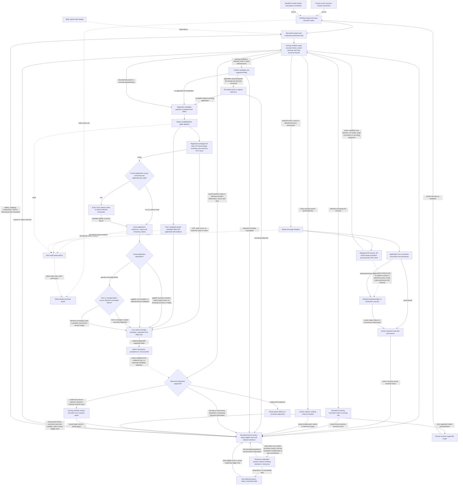
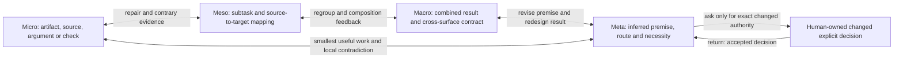

# Ghost-ALICE OS System Architecture

This document organizes the system vision and design tracks of Ghost-ALICE OS. Ghost-ALICE OS is not a general-purpose operating system or a standalone agent runtime. It is an agent governance operating layer that manages the work boundary, verification, session intent, install state, and platform-specific hook behavior of an AI agent session.

Documentation boundary: this repository document is the compact architecture map. The Wiki explains the same current ownership and return paths in depth. The four-layer model below describes work responsibilities; micro, meso, macro and meta describe the focus of a repair.
## Contents

- [0. Purpose and Non-Purpose](#0-purpose-and-non-purpose)
- [1. Four-Layer Model (System Skeleton)](#1-four-layer-model-system-skeleton)
- [2. Spectrum Adaptation Principle (Adaptive Activation)](#2-spectrum-adaptation-principle-adaptive-activation)
- [3. Non-Functional Constraints](#3-non-functional-constraints)
- [4. Design Decisions](#4-design-decisions)
- [5. Mapping to Existing Components](#5-mapping-to-existing-components)

---

## 0. Purpose and Non-Purpose

### 0.1 Purpose

When a user throws a request in natural language, Ghost-ALICE OS automatically performs the following.

- Identifies the domain breadth of the request and the requester profile
- Determines and composes the required skills semantically
- Activates the appropriate verification layer at the same time as production
- Runs the debugging loop together when the requester gets stuck
- Delivers the agreed output to the requester and receives the requester's feedback as system evolution input

The final goal is to automate the boundary setting, decomposition, verification, and feedback loop of repeatable knowledge work. The domains span a wide range of work categories, including development, research, document work, operations work, and market research.

### 0.2 Non-Purpose (what this system does not solve)

- It does not replace the final judgment of external experts (lawyers, patent attorneys, external auditors, medical experts). A domain that needs a human gate calls the gate explicitly inside the system
- It does not perform automation that the user explicitly refused
- It does not perform unauthorized collection or transmission of external data

### 0.3 User Spectrum (no single assumption)

This system does not assume a single requester profile. The same system handles all of the following.

- A non-coding business-team member requesting a dataset validation tool
- A senior developer requesting NeRF code debugging
- A researcher requesting English polishing of a paper abstract
- A marketer requesting a competitor market-share survey
- A one-line chore that anyone throws, such as a calendar entry
- A PM requesting review of a regulation-based proposal draft

The domain is not a single one either. The same system handles everything from single-domain work (documents only, research only, development only, marketing only) to multi-domain cross-cutting work.

---

## 1. Four-Layer Model (System Skeleton)

The four roles—decomposition, production with verification, criterion judgment, and governance support—describe responsibilities, not a compulsory sequence. Governance protects the current work throughout; report-only evolution is a separate terminal consumer. A production or verification mismatch can reopen the affected artifact, mapping, composition, route or inferred premise in the same work. Compose may return to decomposition when the decomposition is wrong. It must preserve the user's approved objective.

### Ownership and current work

Core reconciles the current request with continuing authorized work before selecting execution or nonexecution. A status question can receive a short answer while approved implementation continues. A bounded discussion with no currently selected execution has no AP publication obligation. An actually executed read-only review/report or positive closure still follows its owning verification; read-only does not mean nonexecution.

Normal Core hook transport preserves the firing native cwd as Core context and explicit AP target overrides. AP owns project discovery: Claude uses an absolute CLI project directory before payload cwd; Codex uses payload cwd and ignores the Claude-specific hint. Installation source and project-trust paths do not select an AP target; isolated bindings retain their owned project target. Pretool and Stop resolve that target and read OFF before accessing Core authority. OFF returns quiet continue without capture context or authority reads/writes; an active target proceeds to the existing qualified-selection checks. Target selection grants no authority.

This call graph preserves each handler's actual native invocation semantics. The workflow executes selected requests and returns actual matched results to its policy; AP recording does not grant or deny native tool permission. Business observation uses its own authority and limits. The first-five checkpoint remains addressed after reassessment; a new contradiction or stopping condition can reopen the premise. Recording recovery retains its stricter unchanged-failure park rule.

For an active AP target and applicable current qualified selection, the registered v2 pretool automatically prepares the selected bindings before the tool. Reuse its valid AP receipt/origin; an explicit returned preparation helper is used only for an applicable unfulfilled dependency. Compatible accepted proof is reused with its original source and verification time. A failed prepare does not revoke business authority: perform only independently justified work, report uncaptured proof honestly, and never relabel it as proof captured by a later receipt. Both preparation and publication/application failures use bounded diagnostic repair; an unchanged failure parks dependent recording. A retry requires a relevant recording or dependency change. `none` and `blocked` permit no AP capture or advancement. Domain checks and native permissions retain their owners.

Solid edges name calls, control, authority or result returns. Dashed edges name dependencies, human constraints, audit or report input. Neither audit nor evolution grants permission or automatically enters production. The diagram's AP edge consumes Core's `publication_route: none | prepare | publish | blocked`; the mere existence of an admitted run or accumulated backlog cannot activate it. A missing/stale route blocks dependent capture or advancement, not existing human authorization or native tool permission.

### Bidirectional focus

These connections are examples, not required adjacent steps. Move directly to the focus where the mismatch and next decision live; return to narrower work when that resolves the uncertainty. Reconsider inferred premises inside existing authority. Ask the human only for a decision the human owns, such as changed explicit scope or publication authority. Necessity review may reject speculative extra work; it cannot drop unfinished approved work.

### Responsibilities

| Owner | Responsibility and return path |
| --- | --- |
| Core intake | Observe digest-only input and record compressed semantic changes through the public SQLite ledger API. Compatibility JSON is an export, not runtime authority. |
| Core task-router | Own reusable `routing-surface.v1` complexity/focus/verification/boundary projection and propose `response-route.v1` current qualified selection. Reopen affected routing when owner evidence contradicts it. |
| Owning workflow | Lock required boundaries, produce the output and perform its domain checks. Return unsupported criteria to the affected cause; a selector cannot waive owning verification. |
| Core completion | Select per-criterion reuse, affected verification or cause/recording repair. Aggregate priority summarizes decisions; it does not order all checks to rerun. |
| Core delivery policy | Select the supported delivery scope and applicable control/metadata-only repair, assembled answer, corrected answer, withdrawal or partial status. Core may assemble the permitted payload; the owning workflow/native host performs actual visible delivery while preserving usable prior visible business content. |
| Autopilot | Consume actual current-ready qualified selection and Core publication decision, record criterion outcomes, and determine unit advancement. Applied request is distinct from whole-unit completion. |
| Governance support | Preserve authorization, credentials, exact owner/session/source/hash/lineage/criterion/proof and strict audit throughout the work. |
| Skill-evolution | Consume intake/audit for a report-only terminal recommendation. Adoption requires its own authorized owning workflow. |

Snapshot helpers read identity and storage. They do not infer admission or native permission; audit records do not supply current routing authority.

## 2. Spectrum Adaptation Principle (Adaptive Activation)

The philosophy is a quality floor, not a fixed script. Core task-router owns the shared work judgment; domain owners select evidence and verification appropriate to their criteria. They can return a mismatch to the router instead of creating competing complexity scales.

### 2.1 Activation Dimensions

Complexity includes source selection, source-to-target mapping, combined behavior, format/schema constraints and recovery cost. Tool count, domain count and node count alone do not decide it. Level 1 uses light confirmation. Level 2 and above use bounded checkpoints; level 3 may need independent checks. Each check must resolve a live uncertainty whose possible results change the next decision. Independent consensus follows its selected owning skill, not a mandatory stage for all work.

### 2.2 Evidence and continuation

New input refreshes request identity and routing, not unchanged proof. Retain proof with its original source and verification time. Changed criteria, relevant artifacts or dependencies reopen only affected proof. Missing proof remains unavailable; another valid criterion or an applied recording request cannot establish whole-unit completion.

A first recording-only failure permits bounded repair while preserving business evidence. The same unchanged failure parks that recording branch until a decision-relevant recording or dependency change. Independent authorized work continues. Never repeat business operations or unchanged checks merely to repair records, format or delivery.

### 2.3 Over-Engineering Prevention Principle

Actual current and prior human instructions supply the authorization envelope: objective, prohibitions, allowed actions and targets, side effects and resources. Retained authority facts preserve their human source; trusted system/project constraints retain their identified source. Intake compresses semantic facts and the router selects current work without granting authority. Distinguish human-owned criteria and resource choices from agent-derived interpretations and bounded local plans; an absent explicit resource cap is not an approved human limit. Renew a narrower implementation contract only inside actual authority, without weakening acceptance criteria or inferring permission from focus expansion. Request an exact human-owned decision before crossing its boundary. Actual grant renews only the affected plan and granted scope; denial parks it; no response leaves it waiting. Continue other eligible authorized work.

A failed repair round requires a corrective change and a completed relevant observation of the same unresolved failure. Initial failure is zero. Group by unresolved failure, affected criterion, stage and target; explain what each result changes about cause, mapping, design or verification. Unknown causes cannot justify relabeling/reset, and identical error text cannot combine unrelated business and recording failures. Preserve cumulative attempts and the addressed first-five checkpoint across agents and handoffs. Demonstrated resolution followed by recurrence is a linked new incident. Five failed rounds is the maximum before the first mandatory premise reassessment, not a minimum retry count or whole-task limit. Once addressed, cumulative six or seven alone do not retrigger that checkpoint. New relevant contradiction or a current stopping condition can require reassessment. Continuation requires a distinguishable hypothesis, a discriminating check, an explicit additional-attempt or resource allowance and a stopping condition inside remaining parent resources. Reassessment resets neither attempts nor resources; exhaustion parks the affected continuation. Five alone does not require human escalation.

Before a discretionary check, name the unresolved criterion or competing explanation, why the method discriminates, and attainable outcomes mapped to different specified actions, acceptance judgments or boundary decisions. Mere potential to find something is insufficient. Stochastic repeats require uncertainty, sampling and stopping rules. Mandatory owning checks remain required; unavailable proof or unresolved required criteria prevent completion. Reuse valid unchanged passing proof at its original source and time; reopen only affected proof after observed change, contradiction or explicit recheck. Unknown already-executed business state calls for bounded affected observation, not automatic business replay; not-yet-executed required work still needs its actual action. Inconclusive checks give no business pass/fail verdict or failed-business-repair increment, but observation and recording attempts consume their bounded resources.

Retain decisions in existing work context and handoffs; no counter hook, classifier, compulsory per-conversation record or new mandatory report is required. Recording-specific typed recovery parks an identical unchanged failure without waiting for five rounds. Preserve known business proof when only recording fails. Exclude parked and human-waiting branches until an actual relevant reopening event. If no eligible work remains, use valid proof for all required criteria and resolve relevant contrary evidence before owning completion verification; otherwise report honest partial/waiting status.

The owning workflow calls the selected business action or corrective change and receives its actual result; declared action output may itself supply the verification observation. Domain verification returns actual observations, source and time to the workflow for criterion judgment. The applicable registered v2 pretool automatically prepares AP origin/receipt before the tool and returns current qualified command context. Reuse that valid prepared result; use an explicit returned preparation helper only when the applicable dependency remains genuinely unfulfilled. A recording gap affects capture/publication/application recordability; AP pretool continues and native tool permission remains with its host. Required or discriminating business observation follows its own authority and resource bounds; recording recovery rules govern recording attempts only. Preserve valid proof and its original source/time, including when recording is unavailable.

For a candidate closure, the owning workflow obtains or reuses supported proof. Applicable AP publication uses the exact current qualified selection, prepared AP receipt and actual returned publish command to leave a pending-adapter request. Native candidate/final dispatch invokes its actually registered handlers: the completion guard checks candidate fields and applicable skill evidence; the privileged AP Stop adapter revalidates publication, proof, ownership and dependencies. Only accepted current publication reaches the exact Core criterion writer within the shared authority transaction. Missing, stale or invalid publication returns a recording diagnostic without a criterion write. Actual application status and remaining criteria determine unit recording/completion claims. The handlers retain their actual native invocation semantics. Core owns delivery policy and may assemble the permitted payload; the workflow/native host performs visible delivery. Candidate claims use the supported current scope, while actual recording/application and visibility results govern further repair and closure claims. Preserve already-visible unchanged business content for applicable control-only repair. Return an admissible affected step to the workflow, or honest partial/waiting status when no eligible continuation remains.

---

## 3. Non-Functional Constraints

### 3.1 Korean Tone
English is canonical. Reader-facing Korean documentation uses a consistent respectful, polite register; Korean skill instructions and formal reports default to plain declarative style unless the user specifies otherwise. Control fields and enum values stay English. Do not use Markdown bold in output bodies; use structure or □ / ○ / - markers.

### 3.2 Non-Coding Contributor Friendliness
SKILL.md is a living doc, and contributions should come from outside coding roles too. That is, the frontmatter, CI, and compliance checklist must not become an absolute entry barrier for non-coding contributors. Non-coding feedback is received in natural language, and governance support reports proposed improvements. Applying a candidate requires separately authorized owning work; report-only evolution never auto-edits production.

### 3.3 Deployment Surface Separation
Ghost-ALICE OS core separates the publicly releasable governance layer from per-organization private profiles. Per-organization data is managed as separate profile/assets, and the core documents do not require any specific private deployment premise.

### 3.4 Connection to Per-Deployment Assets

- The public core documents describe only generic extension points
- Tenant profile, private integration, and per-organization tech-stack decisions are managed outside the public core
- An addon capability must pass the core governance gate, but addon names and internal operating premises are not enumerated in the public core documents

---

## 4. Design Decisions

This chapter defines the current representation, owners and operating conditions.

### Request Decomposition Engine
- task-router decomposes the request into meaningful work units, reconciles continuing authorized work and selects production, verification and lifecycle skills. It owns the reusable routing projection and current response-route candidate.
- Clarification belongs to the workflow that encounters a decisive missing requirement. Brainstorming handles design discovery when selected; a bounded clarification does not require that skill for every domain.
- Skill matching compares the available description text semantically. Owning instruction bodies supply procedures; metadata alone does not satisfy a required workflow.

### Semantic Calling Graph Representation
- The `calls` graph expresses static, sparse skill relationships.
- Type enum: hard | soft | union | meta | external-hard | external-union.
- Instruction bodies and runtime procedures express verification attachment, debugging loops and same-work repair returns.
- The frontmatter YAML list is the source of truth for catalog serialization.

### Selected Adversarial Verification Protocol

These agent counts and consensus rules apply only when `adversarial-verification` is the selected owning workflow. Its `verification-complexity` field configures that protocol; it does not replace Core task complexity or require consensus for all level-2 or level-3 work. Section 2.1 governs shared checkpoint selection.
- Number of agents: verification-complexity-level-1 exempt, verification-complexity-level-2 fixed at 3 (internal-logic, external-fact, internal-fact), verification-complexity-level-3 at 5 (fixed 3 + dynamic selection of 2 from a pool of 4). Pool: external-logic, edge-case, prior-art, incentive
- Consensus rule: unanimity (default) / majority / weighted. Caller-specified, unanimity when unspecified
- Adversarial round termination condition: after each complete 3-5-agent cycle, stop when no decision-relevant uncertainty remains and another round cannot produce a relevant state delta. Do not continue only to satisfy a round-count minimum. Unresolved disagreement fails closed to meta-judge/human escalation. A finite safety cap of 50 rounds remains
- Action on consensus failure: the meta-judge writes a deadlock-report and passes it to a human. The meta-judge has no decision authority
- Implementation: adversarial-verification/SKILL.md

### Complexity Classification and Verification Policy
- Resolution method: Core task-router owns the shared complexity/focus/verification/boundary projection; domain owners retain criterion-specific verification and can reopen the affected projection
- task-complexity-level-1/2/3 classification overview: defined in section 2.1 of this document
- Per-domain verification intensity: decided by each skill's internal rules
- Over-engineering prevention: enforced by section 2.3 of this document

### Runtime Value Judgment
- Resolution method: hook-internal values are judged by work impact before display. A value matters when it can change the next focus layer, work boundary, verification burden, or recovery path
- `agent_visibility.profile` remains a user-screen verbosity preference. It is not the primary design axis for model reasoning or quality governance
- Routine values stay complete in the strict audit log, but they should not drive focus or model-facing hints unless they affect work quality
- Forced/risk/gate values and failed verification bypass profile reduction because they can change the next work decision

## 5. Mapping to Existing Components

This organizes where the current implementation components fit in the four-layer model.

| component | location | note |
|------|------|------|
| task-router/SKILL.md | layer 1 runtime implementation | AGENTS.md rule 0 forces the call. Scans the skill descriptions in the system-reminder and matches production, verification, and lifecycle skills. Lifecycle includes necessity-gate |
| session-intent-analyzer/SKILL.md | layer 1 intake and governance state | Records digest-only user-input observations and accumulates compressed session intent. It is the first user-input intake after pending-merge precheck and feeds task-router directly, with a separate report-only skill-evolution branch |
| boundary-contract/SKILL.md | layer 1 / layer 2 boundary lock | Declares objective, non-goals, allowed surfaces, prohibited surfaces, acceptance criteria, and stop conditions before implementation or verification work |
| tool-checkpoint | PreToolUse / BeforeTool governance checkpoint | Hook-owned retry surface and input-lineage deduplication with strict audit. It is not user-input intake, an arbitrary payload classifier, or native tool permission policy |
| verification-before-completion/SKILL.md | layer 3 completion evidence gate | Requires criterion/evidence mapping; reuse valid original proof and perform only decision-relevant affected verification before closure |
| io-trace hook and prompt surface | governance transparency layer | PostToolUse audit log with an optional, decision-relevant `[io-trace]` summary. It records file/tool access metadata without storing raw prompts or secrets |
| skill-evolution/SKILL.md | layer 4 report-only evolution input | Consumes session intent and io-trace patterns to produce Instinct candidate reports. It does not automatically modify skills |
| compact-handoff/SKILL.md | governance continuity support | Preserves evidence, state, and next actions across context compaction without changing hook behavior |
| agent-security-scan/SKILL.md | governance audit support | Performs report-only static scans of settings, hooks, skills, MCP config, credential surfaces, and exposure risks |
| necessity-gate/SKILL.md | governance (layer 4), step 7 gate | Work-necessity verification. Fires on an initialization event. Blocks speculative, padding, and manufactured work. Preserves unfinished approved work while rejecting speculative additions |
| skill-catalog/skills.json | layer 1 input | Semantic calling candidate search index. Semantic matching input; no embedding service is required |
| skill-catalog/schema.json | layer 1 / layer 2 interface | The 6 calls-type enum values are fixed; see the Semantic Calling Graph Representation decision in section 4 |
| frontmatter calls | layer 2 semantic calling graph | hard/soft/union/meta are static expressions. Used as a hint during dynamic synthesis |
| scripts/build_catalog.py | governance (layer 4) | Index build |
| scripts/validate_skills.py | governance (layer 4) | One format-verification layer. Different from the domain verification of the output. Phase 1 to 5 automatic verification. For manual items, refer to the automatic/manual columns of the table in official-docs/derived/skill-compliance-checklist.md |
| scripts/validate_entrypoints.py | governance (layer 4) | Entry-point smoke test. Checks task-router and using-coding-convention existence, body, catalog registration, platform-port rule 0 consistency, and SSOT-to-port title parity as a CI gate |
| _shared/install_hooks.py | governance (layer 4) | Automatic UserPromptSubmit hook install. Idempotently merges the task-router reminder hook into Claude Code's settings.json and Codex's hooks.json + config.toml feature flag. Auto-called from install.sh/install.ps1. Reinforces rule 0 against loss after context compaction with the hook payload, and a session without hook payload evidence falls back to each platform bootstrap's hookless/manual fallback |
| .github/workflows/skill-validation.yml | governance (layer 4) | PR merge gate. Skill consistency verification (Phase 1 to 5) |
| .github/workflows/skill-gate-contract.yml | governance (layer 4) | PR merge gate. Session gate contract consistency verification (session-gates.json ↔ SSOT synchronization) |
| .github/PULL_REQUEST_TEMPLATE.md | governance (layer 4) | Coding-role PR channel |
| official-docs/derived/skill-compliance-checklist.md | governance (layer 4) | Format-layer verification of the skill itself. Different from output domain verification |
| coding-convention/* (14 of them) | layer 2 production, verification, and debugging pool | brainstorming → layer 1, systematic-debugging → layer 2 coder mode, verification-before-completion → layer 3 |
| domain and addon skill cluster | layer 2 production and verification | For the current list, refer to `skill-catalog/skills.json` and addon manifests. The description of each core skill is in the `README.md` entry table. To prevent drift, this architecture map does not carry a hard-coded skill count |
| merge-companion | governance (layer 4) | User-change isolation and merge gate. Install-time snapshot/diff, the `~/.ghost-alice/pending-merges/<platform>/manifest.json` SSOT, the SessionStart hook + 5 fallback layer triggers. adversarial-verification with no exception |
| hooks/post-merge | governance (layer 4) | Re-runs `install.sh --platform codex` only when a Codex copy-mode install is detected (`~/.codex` exists). Symlink/junction platforms are already live after `git pull`, so the hook exits without reinstalling them |
| merge-companion/scripts/manifest_io.py | governance (layer 4) | manifest read/write/append/mark_decided. Atomic write (tempfile + os.replace) + POSIX flock (Windows best-effort) |
| merge-companion/scripts/snapshot.py | governance (layer 4) | Install-time file_hash capture. sha256 deterministic. Symlink filtering is the caller's responsibility |
| merge-companion/scripts/diff_collector.py | governance (layer 4) | snapshot vs current comparison, isolated backup of user changes, manifest entry append, automatic READ-ME-FIRST.md generation (the pending-merge-readme layer of the eight-surface activation guarantee) |

Defined boundaries
- compliance checklist Phase 1 to 5 is "format verification of the skill itself". Separated from the domain verification of the output.
- validate_skills.py is a frontmatter linter. It is a different component from the runtime verification system.

## Repair entry, result and return paths

The connected master links sourced goals and authority, owning policy requests, actual native/tool results, bounded repair, pending publication, guarded criterion application and human feedback. Focus may move directly between micro artifacts, meso mappings, macro composition and meta inferred premises; every repair returns to the affected owning work.

```mermaid
flowchart TB
  H[Actual current human input] --> I[Session intent intake with source attribution]
  HP[Actual prior human instructions and decisions] --> F[Retained human facts and original source]
  F --> I
  T[Identified applicable system and project instructions] --> I
  I --> R[Reconcile current input and continuing authorized work; select focus and verification burden]
  R --> W[Owning workflow or agent]
  T --> W
  W -->|fresh entry or actual relevant remapping only| M[Map goal and criteria to source; actual authority; applicable limits; declared bounded local plan]
  M --> B{Boundary contract required?}
  B -->|yes| BO[Boundary owner maps sourced proposed actions, targets, consequences and limits; grants no human authority]
  F --> BO
  T --> BO
  BO --> POL_IN
  B -->|no| POL_IN
  POL_OUT -->|end this invocation; return selected request/status for dispatch| W
  W --> K{Actual selected step?}
  K -->|owning completion procedure selected with supported proof| CAND
  K -->|bounded discussion without selected execution| FINAL
  K -->|returned partial or waiting status; no admissible eligible continuation| FINAL[Supported payload or honest partial/control status]
  K -->|supported proof reuse selected by policy| E[Proof for exact criterion and target; original source and verification time]
  K -->|exact human-owned decision missing| HQ[Request exact decision; park only its dependent branch while waiting]
  HQ -->|actual request| HH[Human]
  HH -->|actual scoped grant, denial or decisive answer| HR[Match response to outstanding request; no response is not a result]
  HR -->|owning workflow resumes actual matched human answer| POL_RESUME
  K -->|authorized action, owning check or affected observation| REQ[Declared method, target, bounded resources and action-output verification classification]
  REQ --> NT[Native tool-stage dispatch according to actual registered handlers]
  NT --> CP[Applicable Core constraints and native host permission]
  NT --> APRE[Registered AP pretool handler when enabled]
  APRE -->|AP-owned target resolution and read-only OFF check; active before Core authority access| SEL[AP consumes actual current qualified Core projection; no authority grant]
  APRE -.->|OFF: quiet continue only; no capture context or authority access; actual native permission still required| EXEC
  SEL --> ACAP[Applicable v2 prospective preparation captures AP receipt and origin before tool]
  ACAP --> NOTICE[Prepared context and returned commands, or specific recording diagnostic]
  NOTICE -->|attach preparation context or diagnostic to the outstanding tool request; no implicit policy re-entry| W
  CP -->|actual permission allows execution| EXEC{Declared executor}
  CP -->|actual permission denial| OBS[Actual matched observation or execution state with provenance]
  APRE -.->|continue even on recording failure; does not grant or deny tool permission| EXEC
  EXEC -->|business action or corrective change| X[Implementation executor]
  EXEC -->|separate verification or affected observation| V[Domain verification owner]
  X -->|actual action output, failure or uncertain state| OBS
  V -->|actual completed or inconclusive observation| OBS
  OBS -->|owning workflow matches actual result to its outstanding request| POL_RESUME
  K -->|selected Core transport repair| TRANSPORT[Core transport owner performs bounded envelope repair; preserve business and AP proof]
  TRANSPORT -->|actual repair result or scoped unavailable status| POL_RESUME
  K -->|recording-only recovery| AREC[Applicable bounded AP recording command; no business replay]
  AREC -->|owning workflow matches actual recording result| POL_RESUME
  E -->|valid owning completion proof when completion is selected| CAND[Owning completion workflow prepares truthful candidate and supported fields]
  CAND --> PUB{AP-enabled current qualified publication applicable?}
  PUB -->|yes; actual prepared receipt and returned command available| APU[Publish supported proof or compatible original reference using AP receipt]
  APU -->|accepted request| PEND[Pending-adapter publication; no criterion met write]
  APU -->|owning workflow returns actual recording diagnostic| POL_RESUME
  PUB -->|no applicable publication| FINAL
  PUB -->|required recording remains unavailable| PART[Retain supported business proof; recover admissible affected recording or report honest partial]
  PART -->|owner submits actual unresolved recording state| POL_RESUME
  PEND --> FINAL
  FINAL --> NF[Native candidate/final-stage dispatch according to actual registered handlers]
  NF --> CG[Core completion guard validates candidate fields and actual required skill evidence]
  NF --> AS[Registered privileged AP Stop handler when applicable]
  AS -->|AP-owned target resolution and read-only OFF check; active before Core authority access| AV[Revalidate current publication, proof, ownership and dependencies]
  AS -->|OFF: quiet no-op; no authority reads or writes| ENV
  AV -->|accepted current validated publication| CW[Core exact owned-criterion writer within shared authority transaction]
  AV -->|missing, stale or invalid publication; no criterion write| APP
  CW -->|guarded update or actual failure| APP[Actual AP application references, status and remaining criteria]
  APP --> APPLY{Actual application disposition?}
  APPLY -->|applied; business criteria remain; preserve applied references and original proof; no recovery or replay| ENV
  APPLY -->|applied; unit criteria complete| ENV
  APPLY -->|actual affected proof invalidation; reopen only affected business verification| ENV
  APPLY -->|genuine recording failure| RECFAIL{First or relevant changed recording failure versus identical unchanged failure?}
  RECFAIL -->|first or changed; bounded diagnostic preserves business proof| ENV
  RECFAIL -->|identical unchanged; park dependent recording; no publish command or answer replay| ENV
  CG -->|actual guard result| ENV[Core native transport boundary: project Codex Stop/SubagentStop supported host fields; retain other native formats]
  CG -.->|full output and internal records; strict audit only| AUDIT[Full strict hook audit; never grants authority]
  APP -.->|full output and internal records; strict audit only| AUDIT
  ENV -->|outgoing host envelope only: continue, decision, reason, stopReason, suppressOutput, systemMessage for Codex Stop/SubagentStop| PARSER[Actual native host parser; its result is not assumed observable]
  W -->|actual host/tool output or selected owning transport observation; source and time| NOBS{Matched transport observation supports a disposition?}
  PARSER -.->|only actual supplied host/tool result evidence; no automatic feedback telemetry| NOBS
  NOBS -->|evidenced accepted native disposition| ND[Native supported delivery or corrective disposition]
  NOBS -->|evidenced protocol rejection; preserve business and AP proof| POL_RESUME
  NOBS -->|missing or inconclusive disposition; unresolved transport observation| POL_RESUME
  AUDIT -.->|diagnostic source only; no business proof refresh| TRANSPORT
  ND -->|owner matches actual native corrective requirement and visibility| POL_RESUME
  ND -->|host-supported delivery| OUT[Actual visible supported payload or status]
  OUT --> HH
  HH -->|actual next input or feedback| I

  subgraph POLICY[Owning bounded decision policy; returns requests and accepts only actual matched results]
  POL_IN[Fresh workflow call: owning sourced mapping from actual user facts and trusted constraints; actual authority, declared local plan, evidence and remaining resources] --> POL_SELECT{Eligible remaining branch?}
  POL_SELECT -->|none| POL_ALL{All required criteria have valid proof and no unresolved relevant contrary evidence?}
  POL_ALL -->|yes| POL_READY[Return ready for owning completion procedure; not a completion verdict]
  POL_ALL -->|no| POL_PARTIAL[Return honest partial or waiting status]
  POL_SELECT -->|yes; exclude parked and human-waiting branches| POL_STATE{Selected work state?}
  POL_STATE -->|required action not yet executed| POL_PLAN[Plan bounded action or corrective change; classify direct action-output verification versus later check]
  POL_STATE -->|existing work or already-executed action| POL_EVIDENCE{Interpret actual retained evidence for criterion and target}
  POL_STATE -->|exact human-owned decision or decisive input missing| POL_HUMAN[Return exact human request and waiting state]
  POL_EVIDENCE -->|valid unchanged passing proof| POL_PROOF[Return supported criterion with original source and time; retain unresolved conditions]
  POL_EVIDENCE -->|business result known; recording alone unresolved| POL_OBSPLAN[Select only affected observation or recording recovery]
  POL_EVIDENCE -->|already-executed business state unknown| POL_OBSPLAN
  POL_EVIDENCE -->|required existing-state verification not performed| POL_CHECKPLAN[Select owning verification with declared method and discriminating outcomes]
  POL_EVIDENCE -->|confirmed noncompliance from actual relevant observation| POL_GROUP[Identify unresolved failure, affected criterion, stage and target]
  POL_PLAN --> POL_AUTH{Inside actual authority and remaining applicable limits?}
  POL_AUTH -->|yes| POL_ACTION[Return action request and its verification classification]
  POL_AUTH -->|proposed boundary crossing| POL_HUMAN
  POL_AUTH -->|exhausted or no admissible step| POL_PARK[Return parked affected continuation with unresolved state]
  POL_CHECKPLAN --> POL_CHECKGATE{Required owning check, or specified outcomes discriminate different next decisions?}
  POL_CHECKGATE -->|yes; authorized and within remaining limits| POL_VERIFY[Return verification request; applicable prospective capture precedes actual observation; use actual pretool preparation]
  POL_CHECKGATE -->|proposed boundary crossing| POL_HUMAN
  POL_CHECKGATE -->|no qualifying discretionary check; exhausted; or required check unavailable| POL_PARK
  POL_OBSPLAN --> POL_OBSGATE{Selected affected step is authorized and within remaining resources; observation is required or discriminating; for recording recovery only, its owning rule permits the attempt?}
  POL_OBSGATE -->|yes| POL_OBS[Return bounded observation or recording request]
  POL_OBSGATE -->|proposed boundary crossing| POL_HUMAN
  POL_OBSGATE -->|no admissible selected step; exhausted; or selected recording recovery has an identical unchanged failure| POL_PARK
  POL_ACTION --> POL_OUT[Return selected request or status to the owning workflow]
  POL_VERIFY --> POL_OUT
  POL_OBS --> POL_OUT
  POL_HUMAN --> POL_OUT
  POL_PROOF --> POL_OUT
  POL_READY --> POL_OUT
  POL_PARTIAL --> POL_OUT
  POL_PARK --> POL_OUT
  POL_RESUME[Later workflow call: actual result matched to outstanding request, with source and time] --> POL_KIND{What actually returned?}
  POL_KIND -->|action output directly satisfies declared verification method| POL_RESULT{Actual criterion observation?}
  POL_KIND -->|completed action still needs an affected check| POL_CHECKPLAN
  POL_KIND -->|actual action failure| POL_SUFFICIENT{Does actual failure evidence satisfy the declared observation method?}
  POL_SUFFICIENT -->|yes| POL_RESULT
  POL_SUFFICIENT -->|no; execution state known| POL_CHECKPLAN
  POL_SUFFICIENT -->|execution state unknown| POL_OBSPLAN
  POL_KIND -->|action execution uncertain or check inconclusive| POL_OBSPLAN
  POL_KIND -->|actual separate verification observation| POL_RESULT
  POL_KIND -->|actual observation or recording result| POL_EVIDENCE
  POL_KIND -->|actual scoped human grant or decisive answer| POL_RENEW[Renew only affected plan and granted authority; retain criteria, attempts and parent limits]
  POL_KIND -->|actual human denial| POL_PARK
  POL_KIND -->|successful partial application; retain applied criteria and proof; select eligible remaining business work| POL_SELECT
  POL_KIND -->|actual native completion or application finding| POL_EVIDENCE
  POL_KIND -->|actual native protocol rejection; preserve business and AP proof; plan only Core transport repair| POL_PLAN
  POL_KIND -->|actual Core transport repair result; interpret only affected transport state| POL_EVIDENCE
  POL_KIND -->|missing or inconclusive native disposition; no rejection or business verdict| POL_OBSPLAN
  POL_KIND -->|actual native permission denial; no business execution| PERMD{Exact human-owned permission decision available?}
  PERMD -->|yes| POL_HUMAN
  PERMD -->|no admissible decision or alternative| POL_PARK
  POL_RENEW --> POL_SELECT
  POL_RESULT -->|pass| POL_PROOF
  POL_RESULT -->|confirmed noncompliance| POL_GROUP
  POL_RESULT -->|unavailable or inconclusive| POL_OBSPLAN
  POL_GROUP --> POL_ROUND{Corrective change plus completed relevant observation established the same unresolved failure?}
  POL_ROUND -->|yes| POL_COUNT[Increment cumulative failed repair rounds]
  POL_ROUND -->|no; initial failure is zero| POL_KEEP[Preserve actual evidence without failed-repair increment]
  POL_COUNT --> POL_TRIGGER{New reassessment trigger?}
  POL_KEEP --> POL_TRIGGER
  POL_TRIGGER -->|first five reached and checkpoint unaddressed; new relevant contradiction; or current stopping condition| POL_REASSESS[Reassess implicated premise; retain cumulative attempts and addressed checkpoint]
  POL_TRIGGER -->|none| POL_LEARN[Explain what result changes about cause, mapping, design or verification]
  POL_LEARN -->|admissible corrected plan inside remaining allowance| POL_PLAN
  POL_LEARN -->|no discriminating next step or exhausted allowance| POL_PARK
  POL_LEARN -->|owning workflow returns actual relevant artifact, mapping, composition, route or inferred premise mismatch for scoped focus/route reopening; preserve human objective, authority, attempts and resource bounds| R
  POL_REASSESS -->|owning workflow returns actual relevant artifact, mapping, composition, route or inferred premise mismatch for scoped focus/route reopening; preserve human objective, authority, attempts and resource bounds| R
  POL_REASSESS --> POL_NEXT{Distinguishable hypothesis and check plus explicit bounded continuation inside remaining parent resources?}
  POL_NEXT -->|yes; checkpoint addressed; no count or resource reset| POL_PLAN
  POL_NEXT -->|no; affected continuation exhausted| POL_PARK
  end
```

The owning workflow calls the selected business action or corrective change and receives its actual result; declared action output may itself supply the verification observation. Domain verification returns actual observations, source and time to the workflow for criterion judgment. The applicable registered v2 pretool automatically prepares AP origin/receipt before the tool and returns current qualified command context. Reuse that valid prepared result; use an explicit returned preparation helper only when the applicable dependency remains genuinely unfulfilled. A recording gap affects capture/publication/application recordability; AP pretool continues and native tool permission remains with its host. Required or discriminating business observation follows its own authority and resource bounds; recording recovery rules govern recording attempts only. Preserve valid proof and its original source/time, including when recording is unavailable.

For a candidate closure, the owning workflow obtains or reuses supported proof. Applicable AP publication uses the exact current qualified selection, prepared AP receipt and actual returned publish command to leave a pending-adapter request. Native candidate/final dispatch invokes its actually registered handlers: the completion guard checks candidate fields and applicable skill evidence; the privileged AP Stop adapter revalidates publication, proof, ownership and dependencies. Only accepted current publication reaches the exact Core criterion writer within the shared authority transaction. Missing, stale or invalid publication returns a recording diagnostic without a criterion write. Actual application status and remaining criteria determine unit recording/completion claims. The handlers retain their actual native invocation semantics. Core owns delivery policy and may assemble the permitted payload; the workflow/native host performs visible delivery. Candidate claims use the supported current scope, while actual recording/application and visibility results govern further repair and closure claims. Preserve already-visible unchanged business content for applicable control-only repair. Return an admissible affected step to the workflow, or honest partial/waiting status when no eligible continuation remains.

A successfully applied request preserves its application references and original proof even when business criteria remain pending. Remaining work returns to current eligible selection inside existing authority; it does not enter recording recovery, republish unchanged proof or replay the answer. An actual recording failure permits a scoped first or changed diagnostic; an identical unchanged failure parks dependent recording without a publish command or answer replay. A relevant recording or dependency change can reopen only the affected parked branch.

Core owns the native hook transport boundary. For Codex Stop and SubagentStop, the host envelope contains only `continue`, `decision`, `reason`, `stopReason`, `suppressOutput` and `systemMessage`; other stages retain their applicable native format. The strict audit retains the full hook output and internal domain records independently of this projection. The native parser consumes the host envelope; Core projection does not observe or manufacture native parser feedback. The owning workflow matches actual host/tool output or a selected transport observation to its request, source and time. Only evidenced protocol rejection can select bounded Core transport repair while preserving valid business proof and AP publication/application state. Missing expected disposition remains an unresolved transport observation, not proof of rejection, business failure or an AP recording retry.
