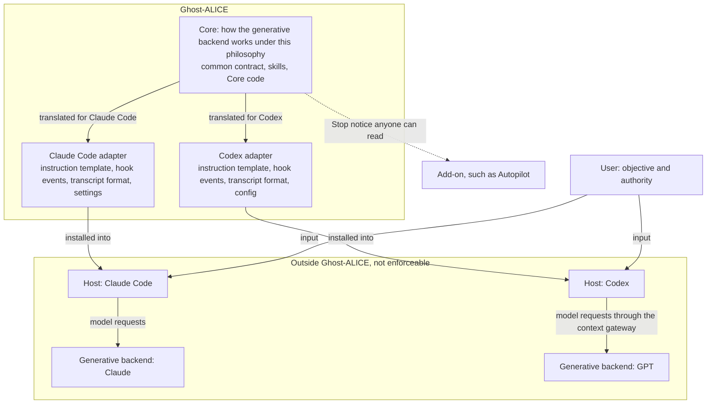
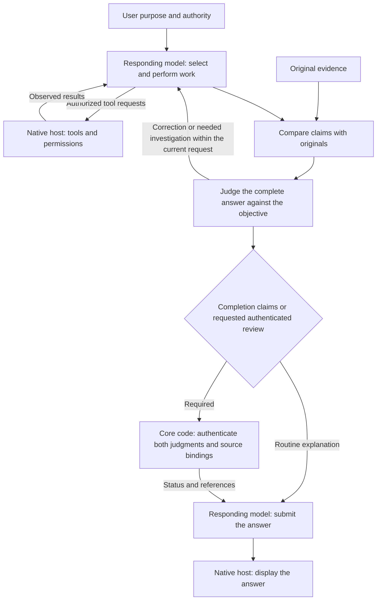
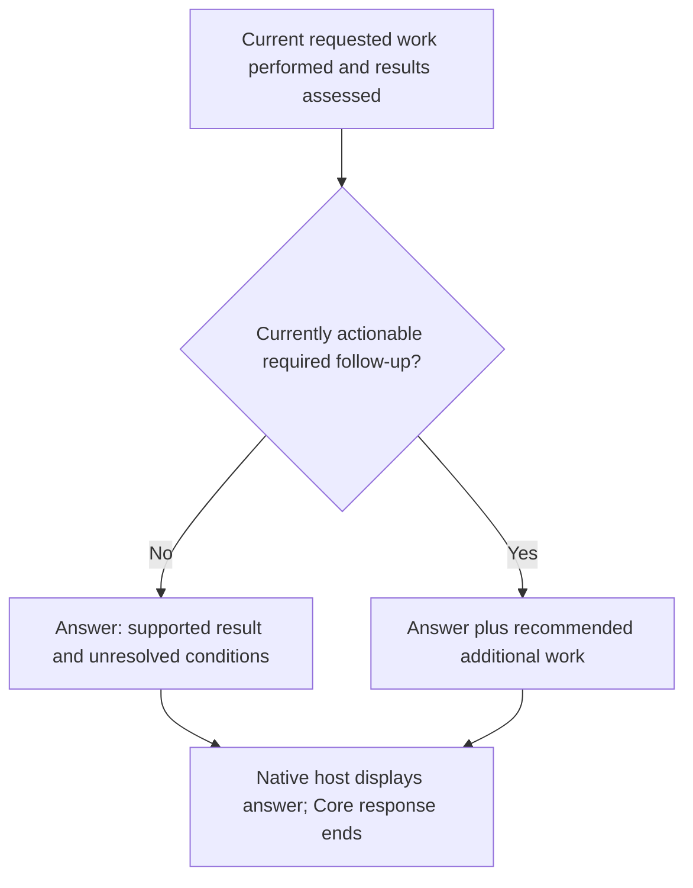
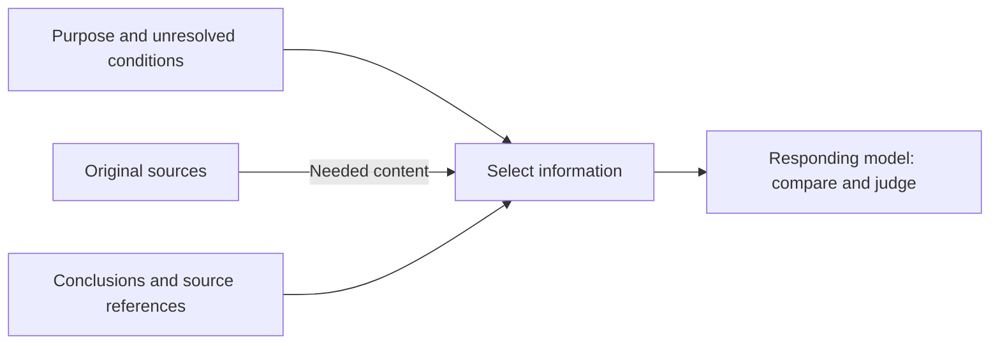
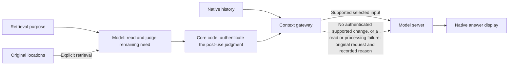

# Ghost-ALICE Core Architecture

언어: 🇺🇸 English | [🇰🇷 한국어](architecture_ko.md)

Ghost-ALICE Core is the collection of how the generative backend works under this philosophy: the common contract, the skills, and the Core code (hooks, ledger and context gateway). An adapter translates Core for one host, such as Claude Code or Codex: the instruction template, hook event names, transcript format and configuration. The host runs the generative backend and its tools, and the responding model follows Core's instructions, performs authorized work and judges its results. The [design philosophy](https://github.com/AidALL/ghost-alice/wiki/Design-Principles) makes the user's purpose the standard for judgment; agreement between procedures or records alone does not prove success.

## Structure and boundaries

Core and the adapters are Ghost-ALICE; the hosts and the generative backends are not, so Ghost-ALICE instructs and records but cannot force them. The user and the add-ons also stand outside. Host formats that still sit in Core code, such as Codex configuration, Claude tool names and the Codex patch format, belong to the adapters. The wiki's [design principles: structure boundaries](https://github.com/AidALL/ghost-alice/wiki/Design-Principles#structure-boundaries) explains why each boundary sits where it does.

## Responsibilities and flow

While a request runs, each participant has one responsibility.

| Participant | Responsibility |
| --- | --- |
| User | Supplies the objective, constraints and authority. |
| Responding model | Follows Core's instructions: selects and performs work, compares claims with originals, then judges the complete answer. |
| Adapter | Translates Core's instructions, hook events, transcripts and configuration for its host. |
| Native host | Executes tools, enforces permissions, constructs model requests and displays answers. |
| Core code | Binds work, sources and both judgments to the exact native input, and records and authenticates them. |

The model chooses the next judgment target: micro for an individual result, meso for a subtask or mapping, macro for the integrated outcome and dependencies, or meta for necessity or premise. The task complexity level follows from the work's verification burden; whether the evidence supports full or partial completion is a separate judgment. A mismatch starts investigation; it does not identify the cause. Unresolved conditions prevent their dependent claims or actions while independent authorized work can continue. The wiki page [Verification and Evidence](https://github.com/AidALL/ghost-alice/wiki/Verification-and-Evidence) describes these decisions.

## Response boundary

The model performs the work already authorized by the current request before final delivery. At the response boundary, the model asks whether a currently actionable required follow-up remains. No means an answer with the supported result and any unresolved conditions. Yes means that answer plus recommended additional work, its reason and the next needed information. Core can authenticate this feedback but does not schedule a new request or return from answer delivery to work selection. No actionable follow-up does not establish whole completion: required conditions may still depend on missing authority or external support.

A later user request starts the next native model invocation; Core schedules none. That new invocation rechecks the current objective, original criteria and constraints before selecting work.

## Context and original evidence

Use existing originals through their source locations. Preserve a separate body only when a required comparison or recovery depends on it and its original may change or disappear. Long passages, answers and tool results are retrieved when their contents are needed. Ghost-ALICE selects information for the recipient's current decision. Once that decision is made, later handoffs carry the current conclusion, uncertainty, unresolved work and source locations. Current summaries replace obsolete summaries. The audit history stays in separate records for the period each record's rule sets: [Runtime State Retention](docs/reference/repository-structure.md#runtime-state-retention) lists the rules.

Healthy hooks supply current receipts and changed decision-relevant conditions. The common contract and owning skills supply procedures; hooks do not repeat their bodies. Review preparation and recording return references rather than echoing the submitted answer. The complete answer remains available for an explicit later comparison.

The native host independently retains conversation history and builds model requests. Selecting a concise Ghost-ALICE handoff does not remove earlier native messages. Prompt caching, compaction and lower token counts do not by themselves demonstrate that obsolete source bodies have been excluded. Usage observations and native display checks establish only what their original records show.

The context gateway applies supported explicit content choices at the server boundary. When actual continued work requires changing the input representation of used material, the model compares that material with the next decision. It does not predict a lifetime or add a judgment call to every lookup. Core code authenticates the native session, current input and original material independently of work authority. The gateway substitutes explicitly judged bodies with conclusions, unresolved conditions and an original retrieval reference when the protocol supports that change. It preserves needed or unjudged general source bodies and sends server answers unchanged. Original history remains available for explicit retrieval.

The [native context procedure](_shared/context_lifecycle.md#apply-and-observe) owns when the gateway may substitute a body in the request and when it may ask the model server to clear whole tool results. The [session gate notes](docs/policies/session-gate-matrix.md#notes) list source edits, installed bytes and native execution as separate claims.

The gateway records why it leaves a request unchanged: no authenticated supported input change, a failed read, or an unexpected processing error. In each case it forwards the original request. Selection only removes material, so a selection the gateway cannot complete never stops transmission. A request from outside the installation scope or for an endpoint without reduction support also goes upstream unchanged. The gateway returns HTTP 404 for a request whose provider path is not in its configuration. When a redirect from the model server leaves the provider's origin or has an ambiguous target, or the gateway cannot reach the model server, it returns HTTP 502 with the reason. Two gateway failures fail the requests sent through it. First, launchd, the macOS service manager, does not restart the gateway service after it exits, so requests fail until the service starts again. Second, a request fails when the gateway cannot save that request's usage record to the usage-record file.

Installation preserves the listener binding, confirms service shutdown before replacing files and enables the provider after readiness. A failed candidate is recovered from preserved artifacts and service state.

## Evidence and native delivery

The model makes two distinct judgments: each claim against original evidence, and the complete answer against the user's objective and constraints. Core code authenticates ownership, input bindings and source integrity; IDs and hashes do not determine semantic truth. The native host displays the model's answer. Core code's Stop hook checks the submitted review records; it does not generate missing judgments or schedule another task.

The [verification procedure](coding-convention/verification-before-completion/SKILL.md) owns evidence selection and completion claims. Its [response review procedure](coding-convention/verification-before-completion/references/response-review.md#prepare-and-record-the-response-review) owns the recording handoff. Other documents refer to that procedure rather than duplicating its commands.

Supported results retain their original evidence, verification times and correction links. A changed relevant target or criterion, a contrary observation, an explicit recheck or a materially broader claim reopens only the affected evidence. A recording or delivery defect does not justify replaying unchanged business work. An accurate partial answer may be accepted as an answer while required work remains incomplete. The wiki page [Focus and Recovery](https://github.com/AidALL/ghost-alice/wiki/Focus-and-Recovery) describes unresolved conditions and the model's next judgment.

## Necessary-work declaration

The responding model declares current necessary unprocessed work, its reason and the next needed information in the route that Core code stores. Core code authenticates the selected criteria, current human, declared boundary and original-source references without copying their bodies. Changed originals hold only dependent feedback rows while preserving work and proof. Core code records this declaration and schedules none of the work it names; only a later user request starts that work.
