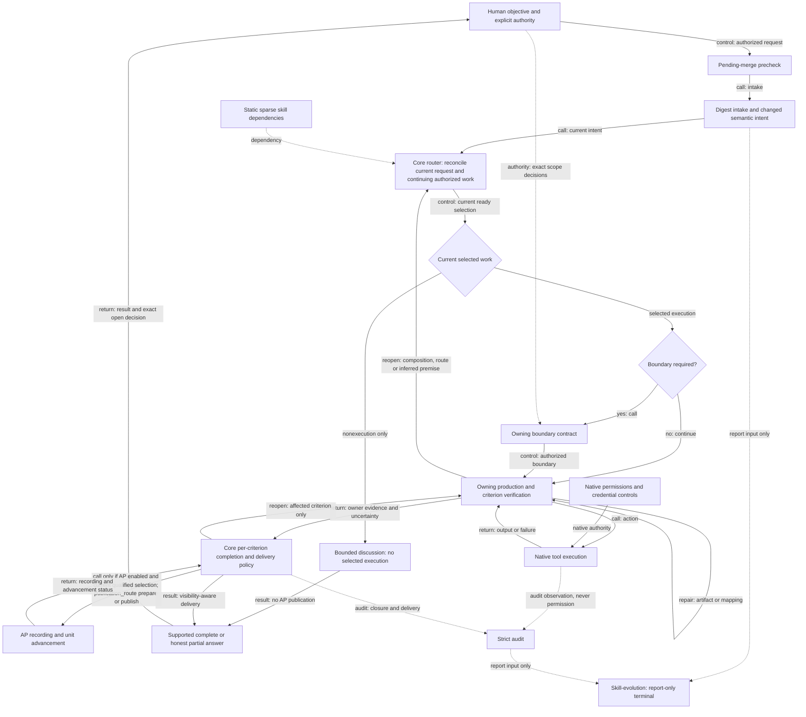
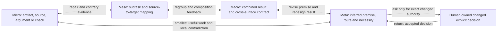

# Ghost-ALICE OS System Architecture

This document organizes the system vision and design tracks of Ghost-ALICE OS. Ghost-ALICE OS is not a general-purpose operating system or a standalone agent runtime. It is an agent governance operating layer that manages the work boundary, verification, session intent, install state, and platform-specific hook behavior of an AI agent session.

Documentation boundary: this repository document is the compact architecture map. Long-form design background lives in the Wiki. The "four-layer model" below describes the knowledge-work lifecycle axis; Wiki pages may use Layer 0-5 wording for the runtime governance stack. Those are different axes, not competing layer counts.
## Contents

- [0. Purpose and Non-Purpose](#0-purpose-and-non-purpose)
- [1. Four-Layer Model (System Skeleton)](#1-four-layer-model-system-skeleton)
- [2. Spectrum Adaptation Principle (Adaptive Activation)](#2-spectrum-adaptation-principle-adaptive-activation)
- [3. Non-Functional Constraints](#3-non-functional-constraints)
- [4. Design Decisions](#4-design-decisions)
- [5. Mapping to Existing Components](#5-mapping-to-existing-components)

---

## 0. Purpose and Non-Purpose

### 0.1 Purpose

When a user throws a request in natural language, Ghost-ALICE OS automatically performs the following.

- Identifies the domain breadth of the request and the requester profile
- Determines and composes the required skills semantically
- Activates the appropriate verification layer at the same time as production
- Runs the debugging loop together when the requester gets stuck
- Delivers the agreed output to the requester and receives the requester's feedback as system evolution input

The final goal is to automate the boundary setting, decomposition, verification, and feedback loop of repeatable knowledge work. The domains span a wide range of work categories, including development, research, document work, operations work, and market research.

### 0.2 Non-Purpose (what this system does not solve)

- It does not replace the final judgment of external experts (lawyers, patent attorneys, external auditors, medical experts). A domain that needs a human gate calls the gate explicitly inside the system
- It does not perform automation that the user explicitly refused
- It does not perform unauthorized collection or transmission of external data

### 0.3 User Spectrum (no single assumption)

This system does not assume a single requester profile. The same system handles all of the following.

- A non-coding business-team member requesting a dataset validation tool
- A senior developer requesting NeRF code debugging
- A researcher requesting English polishing of a paper abstract
- A marketer requesting a competitor market-share survey
- A one-line chore that anyone throws, such as a calendar entry
- A PM requesting review of a regulation-based proposal draft

The domain is not a single one either. The same system handles everything from single-domain work (documents only, research only, development only, marketing only) to multi-domain cross-cutting work.

---

## 1. Four-Layer Model (System Skeleton)

The four roles—decomposition, production with verification, criterion judgment, and governance support—describe responsibilities, not a compulsory sequence. Governance protects the current work throughout; report-only evolution is a separate terminal consumer. A production or verification mismatch can reopen the affected artifact, mapping, composition, route or inferred premise in the same work. Compose may return to decomposition when the decomposition is wrong. It must preserve the user's approved objective.

### Ownership and current work

Core reconciles the current request with continuing authorized work before selecting execution or nonexecution. A status question can receive a short answer while approved implementation continues. A bounded discussion with no currently selected execution has no AP publication obligation. An actually executed read-only review/report or positive closure still follows its owning verification; read-only does not mean nonexecution.

Solid edges name calls, control, authority or result returns. Dashed edges name dependencies, human constraints, audit or report input. Neither audit nor evolution grants permission or automatically enters production. The diagram's AP edge consumes Core's `publication_route: none | prepare | publish | blocked`; the mere existence of an admitted run or old backlog cannot activate it. A missing/stale route blocks dependent capture or advancement, not existing human authorization or native tool permission.

### Bidirectional focus

These connections are examples, not required adjacent steps. Move directly to the focus where the mismatch and next decision live; return to narrower work when that resolves the uncertainty. Reconsider inferred premises inside existing authority. Ask the human only for a decision the human owns, such as changed explicit scope or publication authority. Necessity review may reject speculative extra work; it cannot drop unfinished approved work.

### Responsibilities

| Owner | Responsibility and return path |
| --- | --- |
| Core intake | Observe digest-only input and record compressed semantic changes through the public SQLite ledger API. Compatibility JSON is an export, not runtime authority. |
| Core task-router | Own reusable `routing-surface.v1` complexity/focus/verification/boundary projection and propose `response-route.v1` current qualified selection. Reopen affected routing when owner evidence contradicts it. |
| Owning workflow | Lock required boundaries, produce the output and perform its domain checks. Return unsupported criteria to the affected cause; a selector cannot waive owning verification. |
| Core completion | Select per-criterion reuse, affected verification or cause/recording repair. Aggregate priority summarizes decisions; it does not order all checks to rerun. |
| Core delivery | Repair visible unchanged payload with control/metadata only; assemble one complete answer for final-only, unknown or absent usable prior delivery. Correct actually changed claims and withdraw unsupported ones. |
| Autopilot | Consume actual current-ready qualified selection and Core publication decision, record criterion outcomes, and determine unit advancement. Applied request is distinct from whole-unit completion. |
| Governance support | Preserve authorization, credentials, exact owner/session/source/hash/lineage/criterion/proof and strict audit throughout the work. |
| Skill-evolution | Consume intake/audit for a report-only terminal recommendation. Adoption requires its own authorized owning workflow. |

The standalone per-input classifier and its downstream gate are retired without a renamed equivalent. Legacy model judgments and audit records remain readable history and confer no current routing or native permission authority. Snapshot helpers read identity/storage; they do not infer admission or security judgments.

## 2. Spectrum Adaptation Principle (Adaptive Activation)

The philosophy is a quality floor, not a fixed script. Core task-router owns the shared work judgment; domain owners select evidence and verification appropriate to their criteria. They can return a mismatch to the router instead of creating competing complexity scales.

### 2.1 Activation Dimensions

Complexity includes source selection, source-to-target mapping, combined behavior, format/schema constraints and recovery cost. Tool count, domain count and node count alone do not decide it. Level 1 uses light confirmation. Level 2 and above use bounded checkpoints; level 3 may need independent checks. Each check must resolve a live uncertainty whose possible results change the next decision. Independent consensus follows its selected owning skill, not a mandatory stage for all work.

### 2.2 Evidence and continuation

New input refreshes request identity and routing, not unchanged proof. Retain proof with its original source and verification time. Changed criteria, relevant artifacts or dependencies reopen only affected proof. Missing proof remains unavailable; another valid criterion or an applied recording request cannot establish whole-unit completion.

A first recording-only failure permits bounded repair while preserving business evidence. The same unchanged failure parks that recording branch until a decision-relevant recording or dependency change. Independent authorized work continues. Never repeat business operations or unchanged checks merely to repair records, format or delivery.

### 2.3 Over-Engineering Prevention Principle

Stop a check when no possible result can change the next decision. Stop repeated checking when it adds no relevant state delta. These stop rules do not terminate unfinished authorized production. Preserve distinctions among a supported business outcome, recording/application status, whole-unit completion and host delivery scope.

---

## 3. Non-Functional Constraints

### 3.1 Korean Tone
English is canonical. Reader-facing Korean documentation uses a consistent respectful, polite register; Korean skill instructions and formal reports default to plain declarative style unless the user specifies otherwise. Control fields and enum values stay English. Do not use Markdown bold in output bodies; use structure or □ / ○ / - markers.

### 3.2 Non-Coding Contributor Friendliness
SKILL.md is a living doc, and contributions should come from outside coding roles too. That is, the frontmatter, CI, and compliance checklist must not become an absolute entry barrier for non-coding contributors. Non-coding feedback is received in natural language, and governance support reports proposed improvements. Applying a candidate requires separately authorized owning work; report-only evolution never auto-edits production.

### 3.3 Deployment Surface Separation
Ghost-ALICE OS core separates the publicly releasable governance layer from per-organization private profiles. Per-organization data is managed as separate profile/assets, and the core documents do not require any specific private deployment premise.

### 3.4 Connection to Per-Deployment Assets

- The public core documents describe only generic extension points
- Tenant profile, private integration, and per-organization tech-stack decisions are managed outside the public core
- An addon capability must pass the core governance gate, but addon names and internal operating premises are not enumerated in the public core documents

---

## 4. Design Decisions

This chapter records the design decisions reflected in the current implementation and document contracts.

### Request Decomposition Engine
- Resolution method: task-router semantically scans the skill descriptions in the system-reminder and matches production, verification, and lifecycle skills. The answer to the "classifier vs decomposer vs hybrid" question is "semantic skill matching + one Core-owned routing projection"
- Clarification questions: the brainstorming skill handles them. task-router only performs matching
- Semantic calling algorithm: the LLM directly compares the description text loaded into the system-reminder. No separate embedding or vector DB
- No undecided items

### Semantic Calling Graph Representation
- Resolution method: because the `calls` graph is kept static and sparse, extensions such as validates/validated-by/debugs/augments were unnecessary
- Current type enum: hard | soft | union | meta | external-hard | external-union
- Dynamic relationships (verification attachment, debugging loop, and so on) are not placed on the calls graph and are expressed by the body prose and the runtime
- Graph serialization: a frontmatter YAML list adopted as the single source of truth
- No undecided items

### Consensus Protocol
- Number of agents: verification-complexity-level-1 exempt, verification-complexity-level-2 fixed at 3 (internal-logic, external-fact, internal-fact), verification-complexity-level-3 at 5 (fixed 3 + dynamic selection of 2 from a pool of 4). Pool: external-logic, edge-case, prior-art, incentive
- Consensus rule: unanimity (default) / majority / weighted. Caller-specified, unanimity when unspecified
- Adversarial round termination condition: after each complete 3-5-agent cycle, stop when no decision-relevant uncertainty remains and another round cannot produce a relevant state delta. Do not continue only to satisfy a round-count minimum. Unresolved disagreement fails closed to meta-judge/human escalation. A finite safety cap of 50 rounds remains
- Action on consensus failure: the meta-judge writes a deadlock-report and passes it to a human. The meta-judge has no decision authority
- Implementation: adversarial-verification/SKILL.md

### Complexity Classification and Verification Policy
- Resolution method: Core task-router owns the shared complexity/focus/verification/boundary projection; domain owners retain criterion-specific verification and can reopen the affected projection
- task-complexity-level-1/2/3 classification overview: defined in section 2.1 of this document
- Per-domain verification intensity: decided by each skill's internal rules
- Over-engineering prevention: enforced by section 2.3 of this document

### Runtime Value Judgment
- Resolution method: hook-internal values are judged by work impact before display. A value matters when it can change the next focus layer, work boundary, verification burden, or recovery path
- `agent_visibility.profile` remains a user-screen verbosity preference. It is not the primary design axis for model reasoning or quality governance
- Routine values stay complete in the strict audit log, but they should not drive focus or model-facing hints unless they affect work quality
- Forced/risk/gate values and failed verification bypass profile reduction because they can change the next work decision

## 5. Mapping to Existing Components

This organizes where the current implementation components fit in the four-layer model.

| component | location | note |
|------|------|------|
| task-router/SKILL.md | layer 1 runtime implementation | AGENTS.md rule 0 forces the call. Scans the skill descriptions in the system-reminder and matches production, verification, and lifecycle skills. Lifecycle includes necessity-gate |
| session-intent-analyzer/SKILL.md | layer 1 intake and governance state | Records digest-only user-input observations and accumulates compressed session intent. It is the first user-input intake after pending-merge precheck and feeds task-router directly, with a separate report-only skill-evolution branch |
| boundary-contract/SKILL.md | layer 1 / layer 2 boundary lock | Declares objective, non-goals, allowed surfaces, prohibited surfaces, acceptance criteria, and stop conditions before implementation or verification work |
| tool-checkpoint | PreToolUse / BeforeTool governance checkpoint | Hook-owned retry surface and input-lineage deduplication with strict audit. It is not user-input intake, an arbitrary payload classifier, or native tool permission policy |
| verification-before-completion/SKILL.md | layer 3 completion evidence gate | Requires criterion/evidence mapping; reuse valid original proof and perform only decision-relevant affected verification before closure |
| io-trace hook and prompt surface | governance transparency layer | PostToolUse audit log with an optional, decision-relevant `[io-trace]` summary. It records file/tool access metadata without storing raw prompts or secrets |
| skill-evolution/SKILL.md | layer 4 report-only evolution input | Consumes session intent and io-trace patterns to produce Instinct candidate reports. It does not automatically modify skills |
| compact-handoff/SKILL.md | governance continuity support | Preserves evidence, state, and next actions across context compaction without changing hook behavior |
| agent-security-scan/SKILL.md | governance audit support | Performs report-only static scans of settings, hooks, skills, MCP config, credential surfaces, and exposure risks |
| necessity-gate/SKILL.md | governance (layer 4), step 7 gate | Work-necessity verification. Fires on an initialization event. Blocks speculative, padding, and manufactured work. Preserves unfinished approved work while rejecting speculative additions |
| skill-catalog/skills.json | layer 1 input | Semantic calling candidate search index. Semantic matching input; no embedding service is required |
| skill-catalog/schema.json | layer 1 / layer 2 interface | The 6 calls-type enum values are fixed; see the Semantic Calling Graph Representation decision in section 4 |
| frontmatter calls | layer 2 semantic calling graph | hard/soft/union/meta are static expressions. Used as a hint during dynamic synthesis |
| scripts/build_catalog.py | governance (layer 4) | Index build |
| scripts/validate_skills.py | governance (layer 4) | One format-verification layer. Different from the domain verification of the output. Phase 1 to 5 automatic verification. For manual items, refer to the automatic/manual columns of the table in official-docs/derived/skill-compliance-checklist.md |
| scripts/validate_entrypoints.py | governance (layer 4) | Entry-point smoke test. Checks task-router and using-coding-convention existence, body, catalog registration, platform-port rule 0 consistency, and SSOT-to-port title parity as a CI gate |
| _shared/install_hooks.py | governance (layer 4) | Automatic UserPromptSubmit hook install. Idempotently merges the task-router reminder hook into Claude Code's settings.json and Codex's hooks.json + config.toml feature flag. Auto-called from install.sh/install.ps1. Reinforces rule 0 against loss after context compaction with the hook payload, and a session without hook payload evidence falls back to each platform bootstrap's hookless/manual fallback |
| .github/workflows/skill-validation.yml | governance (layer 4) | PR merge gate. Skill consistency verification (Phase 1 to 5) |
| .github/workflows/skill-gate-contract.yml | governance (layer 4) | PR merge gate. Session gate contract consistency verification (session-gates.json ↔ SSOT synchronization) |
| .github/PULL_REQUEST_TEMPLATE.md | governance (layer 4) | Coding-role PR channel |
| official-docs/derived/skill-compliance-checklist.md | governance (layer 4) | Format-layer verification of the skill itself. Different from output domain verification |
| coding-convention/* (14 of them) | layer 2 production, verification, and debugging pool | brainstorming → layer 1, systematic-debugging → layer 2 coder mode, verification-before-completion → layer 3 |
| domain and addon skill cluster | layer 2 production and verification | For the current list, refer to `skill-catalog/skills.json` and addon manifests. The description of each core skill is in the `README.md` entry table. To prevent drift, this architecture map does not carry a hard-coded skill count |
| merge-companion | governance (layer 4) | User-change isolation and merge gate. Install-time snapshot/diff, the `~/.ghost-alice/pending-merges/<platform>/manifest.json` SSOT, the SessionStart hook + 5 fallback layer triggers. adversarial-verification with no exception |
| hooks/post-merge | governance (layer 4) | Re-runs `install.sh --platform codex` only when a Codex copy-mode install is detected (`~/.codex` exists). Symlink/junction platforms are already live after `git pull`, so the hook exits without reinstalling them |
| merge-companion/scripts/manifest_io.py | governance (layer 4) | manifest read/write/append/mark_decided. Atomic write (tempfile + os.replace) + POSIX flock (Windows best-effort) |
| merge-companion/scripts/snapshot.py | governance (layer 4) | Install-time file_hash capture. sha256 deterministic. Symlink filtering is the caller's responsibility |
| merge-companion/scripts/diff_collector.py | governance (layer 4) | snapshot vs current comparison, isolated backup of user changes, manifest entry append, automatic READ-ME-FIRST.md generation (the pending-merge-readme layer of the eight-surface activation guarantee) |

Defined boundaries
- compliance checklist Phase 1 to 5 is "format verification of the skill itself". Separated from the domain verification of the output.
- validate_skills.py is a frontmatter linter. It is a different component from the runtime verification system.
