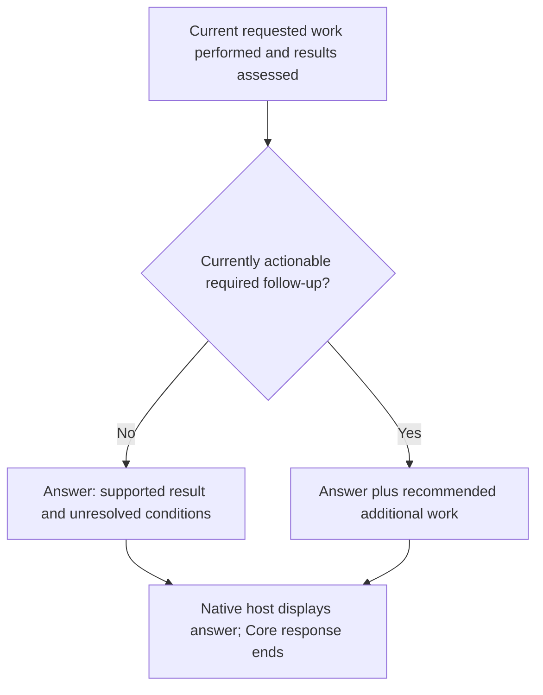
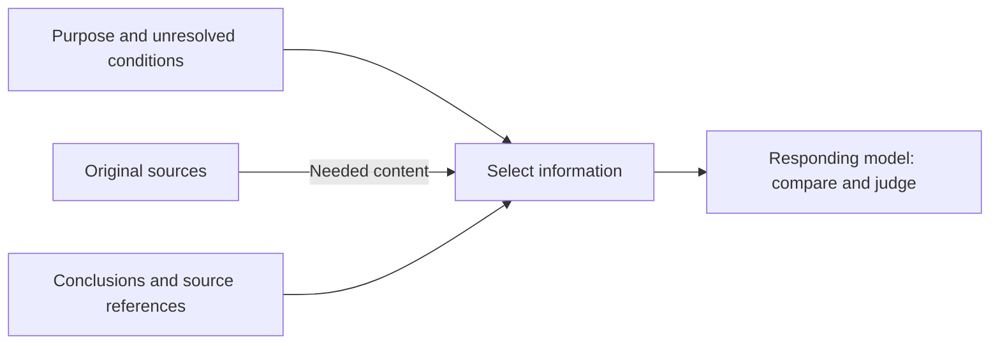
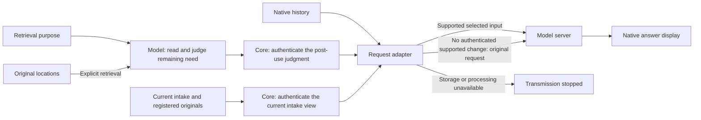

# Ghost-ALICE Core Architecture

언어: 🇺🇸 English | [🇰🇷 한국어](architecture_ko.md)

Core supplies shared instructions, native input bindings and authenticated work and evidence records for the model responding in a conversation. The responding model performs authorized work and judges its results. The [design philosophy](https://github.com/AidALL/ghost-alice/wiki/Design-Principles) makes the user's purpose the standard for judgment; agreement between procedures or records alone does not prove success.

## Responsibilities and flow

| Participant | Responsibility |
| --- | --- |
| User | Supplies the objective, constraints and authority. |
| Responding model | Selects and performs work, compares claims with originals, then judges the complete answer. |
| Native host | Executes tools, enforces permissions, constructs model requests and displays answers. |
| Core | Supplies the shared procedure, binds work, sources and both judgments to the exact native input, and authenticates their records. |

The model chooses the next judgment target: micro for an individual result, meso for a subtask or mapping, macro for the integrated outcome and dependencies, or meta for necessity or premise. Verification depth and whether the evidence supports full or partial completion are separate decisions. A mismatch starts investigation; it does not identify the cause. Unresolved conditions prevent their dependent claims or actions while independent authorized work can continue. The wiki page [Verification and Evidence](https://github.com/AidALL/ghost-alice/wiki/Verification-and-Evidence) describes these decisions.

## Response boundary

The model performs the work already authorized by the current request before final delivery. Its internal work and correction loop does not require Autopilot. At the response boundary, the model asks whether a currently actionable required follow-up remains. No means an answer with the supported result and any unresolved conditions. Yes means that answer plus recommended additional work, its reason and the next needed information. Core can authenticate this feedback but does not schedule a new request or return from answer delivery to work selection. No actionable follow-up does not establish whole completion: required conditions may still depend on missing authority or external support.

A later user request can start another native model invocation. Optional Autopilot can also request one within an approved plan after checking the current need, stop control, dependencies and boundary. That new invocation rechecks the current objective, original criteria and constraints before selecting work. Request submission, host receipt, actual execution and business completion remain separate observations.

## Context and original evidence

Use existing originals through their source locations. Preserve a separate body only when a required comparison or recovery depends on it and its original may change or disappear. Long passages, answers and tool results are retrieved when their contents are needed. Ghost-ALICE selects information for the recipient's current decision. Once that decision is made, later handoffs carry the current conclusion, uncertainty, unresolved work and source locations. Current summaries replace obsolete summaries; audit history is retained separately.

Healthy hooks supply current receipts and changed decision-relevant conditions. The common contract and owning skills supply procedures; hooks do not repeat their bodies. Review preparation and recording return references rather than echoing the submitted answer. The complete answer remains available for an explicit later comparison.

The native host independently retains conversation history and builds model requests. Selecting a concise Ghost-ALICE handoff does not remove earlier native messages. Prompt caching, compaction and lower token counts do not by themselves demonstrate that obsolete source bodies have been excluded. Usage observations and native display checks establish only what their original records show.

A configured request adapter applies supported explicit content choices at the server boundary. When actual continued work requires changing the input representation of used material, the model compares that material with the next decision. It does not predict a lifetime or add a judgment call to every lookup. Core authenticates the native session, current input and original material independently of work authority and Autopilot's continuation decision. The adapter substitutes explicitly judged bodies with conclusions, unresolved conditions and an original retrieval reference when the protocol supports that change. It preserves needed or unjudged general source bodies and sends server answers unchanged. Original history remains available for explicit retrieval.

The Codex adapter also keeps a current view of intake control. After authenticating the latest receipt and exact current human, it can omit superseded pure intake receipts from a configured request. Compound instructions and uncertain origins remain intact, and original records remain retrievable. General source bodies still require the model's purpose-based selection; this control view adds no judgment call.

Claude client substitution requires unsigned content and explicitly disabled thinking. Editing preceding messages would break their signed reasoning prefix. With an existing native context-management capability, the gateway can instead request server clearing for authenticated whole tool-result omissions that the provider's tool-name policy represents exactly. It preserves signed history and reasoning settings, protects necessary results of the same tool, and observes provider application separately from the request. Arbitrary text and producer-subbody replacement remain unsupported under signed thinking. The [native context procedure](_shared/context_lifecycle.md#apply-and-observe) owns these support conditions. Source conformance, installation and actual native adoption remain distinct observations.

The adapter distinguishes an absent selection from a failed read or processing error. Without an authenticated supported input change, it preserves the request with an observable reason. A read failure or unexpected processing error stops transmission.

Installation preserves the listener binding, confirms service shutdown before replacing files and enables the provider after readiness. A failed candidate is recovered from preserved artifacts and service state.

## Evidence and native delivery

The model makes two distinct judgments: each claim against original evidence, and the complete answer against the user's objective and constraints. Core authenticates ownership, input bindings and source integrity; IDs and hashes do not determine semantic truth. The native host displays the model's answer. Core's Stop guard checks the submitted review records; it does not generate missing judgments or schedule another task.

The [verification procedure](coding-convention/verification-before-completion/SKILL.md) owns evidence selection and completion claims. Its [response review procedure](coding-convention/verification-before-completion/references/autopilot-publication.md#prepare-and-record-the-response-review) owns the recording handoff. Other documents refer to that procedure rather than duplicating its commands.

Supported results retain their original evidence, verification times and correction links. A changed criterion, artifact or contrary observation reopens only the affected evidence. A recording or delivery defect does not justify replaying unchanged business work. An accurate partial answer may be accepted as an answer while required work remains incomplete. The wiki page [Focus and Recovery](https://github.com/AidALL/ghost-alice/wiki/Focus-and-Recovery) describes unresolved conditions and the model's next judgment.

## Optional Autopilot extension

The responding model declares current necessary unprocessed work, its reason and the next needed information in Core's existing route. Core authenticates the selected criteria, current human, declared boundary and original-source references without copying their bodies. Changed originals hold only dependent feedback rows while preserving work and proof. Core can record this judgment independently of Autopilot.

Installing Ghost-ALICE Autopilot adds supported-criterion application and continuation within an approved plan. It consumes current necessary-work feedback, checks the frozen boundary and dependencies, and sends only eligible next information. An unmet criterion alone creates no continuation request. The [Autopilot architecture](https://github.com/AidALL/ghost-alice-autopilot/blob/main/README.md#how-autopilot-extends-core) owns the combined flow, its added hooks and the native host's conditional delivery of that request.
