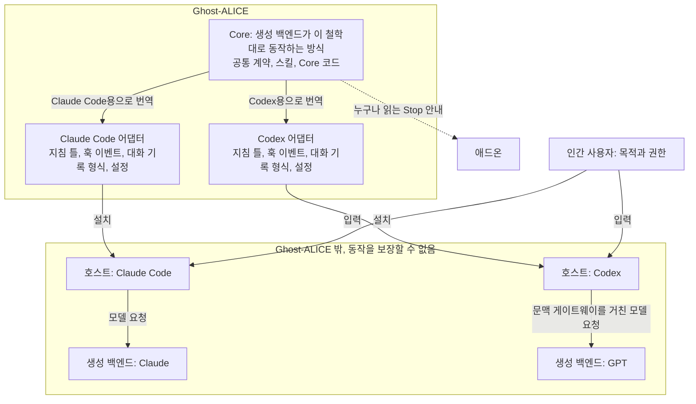
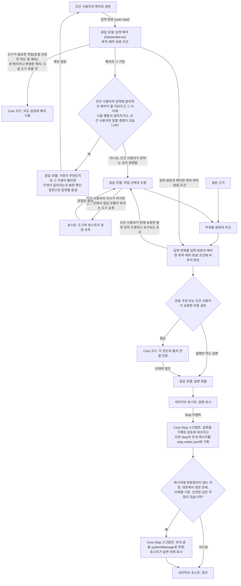
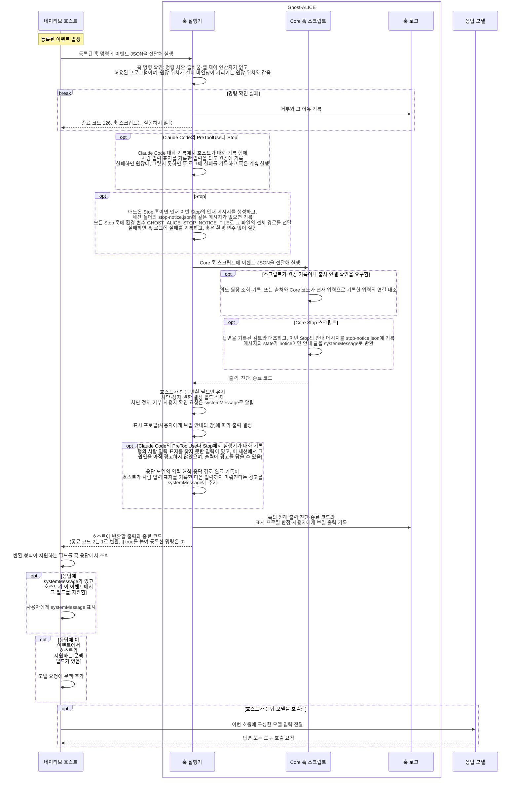
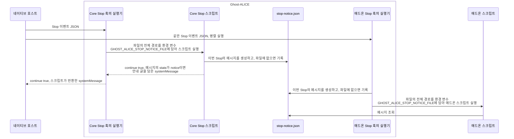
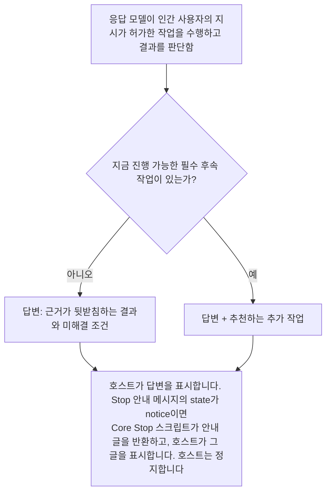
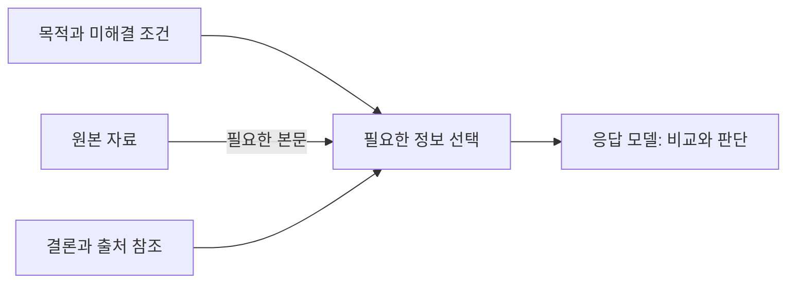
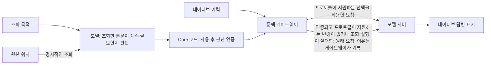

# Ghost-ALICE Core 아키텍처

[🇺🇸 English](architecture.md) | [🇰🇷 한국어](architecture_ko.md)

Ghost-ALICE Core는 생성 백엔드가 이 철학대로 동작하는 방식의 모음입니다. 공통 계약, 스킬, Core 코드(훅, 원장, 문맥 게이트웨이)로 이뤄집니다. 어댑터는 Core를 Claude Code나 Codex 같은 호스트 하나의 형식으로 번역하는 층이며, 지침 틀, 훅 이벤트 이름, 대화 기록 형식, 설정을 담당합니다. 호스트는 생성 백엔드와 도구를 실행하고, 응답 모델은 Core의 지침을 따라 인간 사용자의 지시가 허가한 작업을 수행하고 결과를 판단합니다. [설계 철학](https://github.com/AidALL/ghost-alice/wiki/설계-원칙)은 인간 사용자의 목적을 판단의 기준으로 삼으며, 절차나 기록이 서로 일치한다는 사실만으로 성공을 입증하지 않습니다.

## 구조와 경계



Core와 어댑터가 Ghost-ALICE이고, 호스트와 생성 백엔드는 그 밖에 있습니다. 그래서 Ghost-ALICE는 둘의 동작을 보장할 수 없고, 둘이 열어 둔 한계 안에서 지시하고 기록합니다. 사용자와 애드온도 밖에 있습니다. Core 코드의 문맥 게이트웨이는 macOS에서만 동작합니다. 사용자가 [등록 명령](docs/ko/getting-started/installation.md#python-계약)으로 게이트웨이를 등록하면 게이트웨이가 Codex의 모델 요청을 중계하고, 등록하지 않으면 Codex는 모델 요청을 생성 백엔드에 직접 전달합니다. Codex 설정, Claude 도구 이름, Codex 패치 형식처럼 아직 Core 코드 안에 있는 호스트 형식은 어댑터의 몫입니다. 경계마다 왜 그 자리에 있는지는 위키의 [설계 원칙: 구조의 경계](https://github.com/AidALL/ghost-alice/wiki/설계-원칙#구조의-경계)가 설명합니다.

## 책임과 흐름

요청을 처리하는 동안 참여자마다 책임이 하나씩 있습니다.

| 참여자 | 책임 |
| --- | --- |
| 인간 사용자 | 목적·제약·권한을 제공합니다. |
| 응답 모델 | Core의 지침을 따라 모든 입력에서 인간 사용자가 원하는 것을 해석하고, 작업을 선택하고 수행하며, 주장을 원본과 비교한 뒤 답변 전체를 판단합니다. |
| 어댑터 | Core의 지침, 훅 이벤트, 대화 기록, 설정을 자기 호스트에 맞게 옮깁니다. |
| 호스트 | 도구를 실행하고 호스트의 권한 규칙을 적용하며, 모델 요청을 구성하고 답변을 표시합니다. |
| Core 코드 | 작업·출처·두 판단을 Core 코드가 현재 입력으로 기록한 입력에 연결하고 기록·인증합니다. Claude Code에서는 호스트가 대화 기록 행에 사람 입력 표지를 기록한 입력이고, Codex에서는 Codex의 프롬프트 제출 이벤트(`UserPromptSubmit`)가 전달한 모든 프롬프트입니다. |



모델은 다음 판단 대상을 선택합니다. micro는 개별 결과, meso는 하위 작업이나 대응 관계, macro는 통합 결과와 의존 관계, meta는 필요성이나 전제를 가리킵니다. 작업 복잡도 수준은 일의 검증 부담에서 정해지며, 근거가 전체 완료나 부분 완료를 뒷받침하는지는 따로 판단합니다. 불일치는 조사의 출발점이며 원인을 확정하지 않습니다. 미해결 조건은 그 조건에 의존하는 주장이나 작업을 막지만, 그 조건에 의존하지 않고 인간 사용자의 지시가 허가한 작업은 계속할 수 있습니다. 위키의 [검증과 증거](https://github.com/AidALL/ghost-alice/wiki/검증과-증거) 페이지가 이 판단을 설명합니다.

## 훅 호출

네이티브 호스트는 Core 훅과 애드온 훅의 등록된 명령을 모두 훅 실행기 `_shared/hook_profile_gate.py`로 실행하고, 실행기는 호출마다 훅 로그 `~/.ghost-alice/session-logs/<host>/<session>/strict-hook-output.jsonl`에 기록합니다. 이 기록이 실패하면 실행기는 가능하면 그 실패를 보존 실패 기록 `~/.ghost-alice/state-retention-failures.jsonl`에 기록하고, 훅의 출력을 평소대로 호스트에 전달합니다. 등록된 명령에는 원장 위치를 비롯한 설치 위치를 담은 값(설치 바인딩)이 들어 있습니다. 그림은 켜져 있고 설치 바인딩이 올바른 Core 훅의 호출 한 번을 따릅니다. 애드온 훅에서도 실행기는 같은 단계를 거치고, Core 훅 스크립트 자리에서 Ghost-ALICE 밖에 있는 애드온 스크립트를 실행합니다.



Stop에서 Core 코드의 Stop 스크립트는 답변을 기록된 검토와 대조하고, Core 코드가 현재 입력으로 기록한 입력과 답변에 대한 Stop 안내 메시지 하나를 생성합니다. 스크립트는 실행기가 환경 변수 `GHOST_ALICE_STOP_NOTICE_FILE`에 설정한 경로, 곧 훅 로그가 있는 세션 폴더 `~/.ghost-alice/session-logs/<host>/<session>/`의 `stop-notice.json`에 메시지를 기록합니다. 스크립트는 `continue: true`를 반환합니다. 메시지가 다음 네 가지 가운데 하나라도 알리면 메시지의 `state`는 `notice`입니다: 기록된 검토가 뒷받침하지 않는 주장, 답변을 대조하며 찾은 문제, 부분 완료 블록이 미해결로 남긴 기준, 응답 모델이 응답 경로에 선언한 남은 작업. 이때 스크립트는 안내 글을 `systemMessage`로도 반환하고, 호스트는 그 글을 답변 뒤에 표시합니다. 네 가지가 하나도 없는 답변이면 메시지의 `state`는 `quiet`이고, 스크립트는 `systemMessage`를 반환하지 않습니다. 완료 블록과 선언된 남은 작업이 없고 그 입력에 기록된 검토도 없는 설명 답변이 그런 답변입니다. 짝이 없는 코드 울타리 앞에 완료 블록이 없으면 그 울타리 안의 예시 블록은 완료 블록으로 판정되므로, 그 답변에는 안내가 표시됩니다. 스크립트는 Core 코드가 현재 입력으로 기록한 입력에 대해 등록된 응답 경로에서 응답 모델이 선언한 항목만 남은 작업으로 작성합니다. 선언된 항목이 가리키지 않는 기준은 남은 작업에 작성하지 않습니다. 안내 글의 고정 문구는 영어입니다. 스크립트는 응답 모델이 작성한 주장, 미해결 이유, 선언된 항목의 이유와 다음에 요구되는 정보를 수정 없이 안내 글에 작성하고, 주장은 처음 160자까지 작성합니다. 안내 글의 예입니다.

```text
Ghost-ALICE Stop notice: the recorded review does not support 1 of 2 claims.
- Not supported (criterion c2): the report was checked
- Remaining work: unknown; the response model made no declaration for this input
```

실행기는 애드온 Stop 훅을 실행하기 전에 같은 Core 코드로 이번 Stop의 메시지를 생성하고, 파일에 같은 메시지가 기록되어 있지 않으면 그 메시지를 기록합니다. 이어서 실행기는 파일의 전체 경로를 환경 변수 `GHOST_ALICE_STOP_NOTICE_FILE`에 담아 애드온의 스크립트를 실행합니다. 호스트는 한 이벤트의 Stop 훅들의 실행 순서를 보장하지 않습니다. Claude Code는 이 훅들을 병렬로 실행합니다. Core 코드의 Stop 스크립트와 애드온 훅의 실행기는 같은 Stop 이벤트 JSON과 같은 원장으로 메시지를 생성합니다. 그 JSON에 답변 글이 들어 있으면 두 메시지가 같으므로, 먼저 실행된 쪽이 메시지를 기록하고, 나중에 실행된 쪽은 파일에서 같은 메시지를 조회하고 파일을 변경하지 않습니다. 애드온 인스톨러는 애드온 훅을 PostToolUse와 SessionStart에만 등록하므로, 설치된 Ghost-ALICE에는 애드온 Stop 훅이 없습니다.



## 답변 종료 경계

응답 모델은 인간 사용자의 지시가 이미 허가한 작업을 수행한 뒤 최종 답변을 전달합니다. 답변 종료 시점에 응답 모델은 지금 진행 가능한 필수 후속 작업이 있는지 판단합니다. 아니오이면 근거가 뒷받침하는 결과와 미해결 조건을 답변하고, 예이면 그 답변에 추천하는 추가 작업·이유·다음 필요 정보를 포함합니다. Core 코드는 응답 모델이 작업 선택 기록에 선언한 남은 작업을 인증할 수 있지만 새 요청을 예약하거나 답변 표시에서 작업 선택으로 되돌아가지 않습니다. 진행 가능한 후속 작업이 없다는 판단만으로 전체 완료가 성립하지는 않습니다. 필수 조건이 인간 사용자만 내릴 수 있는 결정이나 외부 지원을 기다리고 있을 수 있습니다.



이후에 호스트가 `user` 역할로 전달한 프롬프트로 다음 모델 호출이 시작됩니다. Core 코드는 호출을 예약하지 않습니다. 그 호출에서 응답 모델은 현재 목표·원래 기준·제약을 다시 확인한 뒤 작업을 선택합니다.

## 문맥과 원본 근거

기존 원본은 출처 위치로 참조합니다. 별도 본문은 요구되는 비교나 복구가 그 내용에 의존하고 원본이 변경되거나 사라질 수 있을 때만 보존합니다. 긴 원문·답변·도구 결과도 그 내용이 요구될 때 조회합니다. Ghost-ALICE는 수신자의 현재 판단에 요구되는 정보를 선택합니다. 그 판단을 내린 뒤의 인계는 현재 결론·불확실성·미해결 작업·출처 위치를 전달합니다. 현재 요약은 이전 요약을 교체합니다. 감사 이력은 별도 기록에 남고, 각 기록의 규칙이 정한 기간만큼 보존됩니다. [런타임 상태 보존](docs/ko/reference/repository-structure.md#런타임-상태-보존)이 그 규칙을 나열합니다.



정상 훅은 현재 영수증과 다음 판단에 영향을 주는 변경 조건을 제공합니다. 절차는 공통 계약과 소유 스킬이 제공하며, 훅은 그 전문을 반복하지 않습니다. 답변 검토의 준비·기록은 제출한 답변을 다시 반환하지 않고 참조를 반환합니다. 답변 전문은 이후의 명시적인 비교를 위해 보존됩니다.

네이티브 호스트는 대화 이력을 별도로 보존하고 모델 요청을 구성합니다. Ghost-ALICE 인계를 간결하게 선택해도 이전 네이티브 메시지가 제거되지는 않습니다. 캐싱·압축·토큰 감소만으로 불필요한 원문이 제외되었다고 판단할 수 없습니다. 사용량 관찰과 답변 표시 검사는 원본 기록이 보여주는 범위만 입증합니다.

문맥 게이트웨이는 지원되는 명시적 내용 선택을 서버 전송 경계에 적용합니다. 실제 후속 작업에서 사용한 자료의 입력 표현을 바꿀 필요가 생기면, 모델은 그 자료를 다음 판단에 필요한 정보와 비교합니다. 미래의 사용 기간을 예측하거나 모든 조회에 별도 판정 호출을 추가하지 않습니다. Core 코드는 작업 권한과 별개로 네이티브 세션·현재 입력·원본 자료를 인증합니다. 게이트웨이는 프로토콜이 해당 변경을 지원할 때 명시적인 사용 후 판단이 있는 본문을 결론·미해결 조건·원문 조회 참조로 대체합니다. 계속 필요한 일반 원문과 판단하지 않은 일반 원문은 유지하고, 서버 답변은 그대로 전달합니다. 원본 이력은 명시적으로 조회할 수 있습니다.

게이트웨이가 요청 안의 본문을 대체할 수 있는 조건과 모델 서버에 도구 결과 전체의 제외를 요청할 수 있는 조건은 [네이티브 문맥 절차](_shared/context_lifecycle.md#apply-and-observe)가 정합니다. [세션 게이트 참고 사항](docs/ko/policies/session-gate-matrix.md#참고)은 소스 수정, 설치된 바이트, 네이티브 실행을 서로 다른 주장으로 나열합니다.

게이트웨이는 요청을 변경하지 않은 이유를 기록합니다. 이유는 인증되고 프로토콜이 지원하는 입력 변경이 없음, 조회 실패, 예기치 않은 실행 오류 가운데 하나입니다. 어느 경우든 원래 요청을 보냅니다. 선택은 자료를 빼는 일일 뿐이므로, 게이트웨이가 선택을 마치지 못해도 전송을 중단하지 않습니다. 설치 범위 밖에서 온 요청과 축소를 지원하지 않는 경로의 요청도 변경하지 않고 보냅니다. 게이트웨이는 설정에 없는 provider 경로로 온 요청에는 HTTP 404를 반환합니다. 모델 서버가 보낸 리다이렉트의 대상이 provider 출처 안에 있고 분명하면, 게이트웨이는 HTTP 전송 계층인 Python `urllib`이 상태와 메서드별 규칙에 따라 그 리다이렉트를 따라가게 하고, 네이티브 클라이언트의 머리글과 자격 증명을 그 출처 안에서만 보냅니다. `urllib`이 그런 리다이렉트를 따라가지 않으면(예: POST 요청에 대한 상태 307이나 308) 게이트웨이는 그 리다이렉트를 네이티브 클라이언트에 전달하고, 위치를 그 리다이렉트를 받은 요청의 URL 기준 절대 URL로 변환하여 클라이언트가 루프백 주소 기준으로 해석하지 않게 합니다. 리다이렉트 대상이 provider 출처를 벗어나거나, HTTPS에서 HTTP로 전환되거나, 모호할 때, 또는 게이트웨이가 모델 서버에 닿지 못할 때 게이트웨이는 이유를 provider의 오류 형식으로 담은 HTTP 502를 반환하고, 그 리다이렉트를 따라가지도 네이티브 클라이언트에 전달하지도 않습니다. 성공한 상위 응답의 바이트는 변경 없이 네이티브 클라이언트에 전달됩니다. launchd(macOS의 서비스 관리자)는 종료된 게이트웨이 서비스를 다시 시작하지 않으므로, 서비스가 다시 시작될 때까지 게이트웨이를 거치는 요청이 실패합니다. 게이트웨이가 요청의 사용 기록을 사용 기록 파일에 저장하지 못하면, 가능하면 그 실패를 보존 실패 기록에 기록하고 요청을 전달합니다.

설치 과정은 리스너 바인딩을 유지하고, 파일 교체 전에 서비스 종료를 확인하며, 준비가 확인된 뒤 provider를 활성화합니다. 설치 후보가 실패하면 보존한 파일과 서비스 상태로 복구합니다.



## 근거와 네이티브 표시

모델은 각 주장을 원본 근거와 비교하는 판단과 답변 전체를 인간 사용자의 목적·제약에 비추어 평가하는 판단을 구분하여 수행합니다. Core 코드는 소유권·입력 연결·출처 무결성을 인증하며, 식별자와 해시가 의미적 진실을 결정하지는 않습니다. 네이티브 호스트가 모델의 답변을 표시합니다. Core 코드의 Stop 스크립트는 답변을 기록된 검토와 대조하며, 누락된 판단을 생성하거나 다음 작업을 예약하지 않습니다.

[검증 절차](coding-convention/verification-before-completion/SKILL.md)는 근거 선택과 완료 주장을 소유합니다. 그 [답변 검토 절차](coding-convention/verification-before-completion/references/response-review.md#prepare-and-record-the-response-review)는 기록의 인계를 소유합니다. 다른 문서는 명령을 복제하지 않고 해당 절차를 참조합니다.

근거가 뒷받침하는 결과는 원본 근거·검증 시각·정정 연결을 유지합니다. 검사 대상이나 기준의 변경, 반대 관찰, 인간 사용자가 명시적으로 요청한 재검사 또는 실질적으로 넓어진 주장은 영향받은 근거만 다시 검토하게 합니다. 기록·표시 결함 때문에 변하지 않은 실제 업무를 다시 실행하지 않습니다. 응답 모델은 정확한 부분 답변을 답변으로 전달할 수 있지만 필수 작업은 여전히 미완료일 수 있습니다. 위키의 [판단 범위와 복구](https://github.com/AidALL/ghost-alice/wiki/판단-범위와-복구) 페이지가 미해결 조건과 모델의 다음 판단을 다룹니다.

## 필요한 작업의 선언

응답 모델은 현재 요구되는 미처리 작업, 그 이유, 다음에 요구되는 정보를 Core 코드가 저장하는 응답 경로에 선언합니다. Core 코드는 선택된 기준·Core 코드가 현재 입력으로 기록한 입력·선언된 경계·원본 참조를 인증하며 원문을 복사하지 않습니다. 원본이 변경되면 Core 코드는 응답 모델이 작업 선택 기록에 선언한 남은 작업의 항목 가운데 그 원본에 의존하는 항목만 보류하고, 작업과 근거는 보존합니다. Core 코드는 이 선언을 기록할 뿐 선언된 작업을 예약하지 않습니다. 그 작업은 이후에 호스트가 `user` 역할로 전달한 프롬프트로만 시작됩니다. Core 코드의 Stop 스크립트는 선언된 항목을 Stop 안내 메시지에 작성합니다. 호스트는 안내 글로 그 항목을 표시하고, 누구나 `stop-notice.json`에서 그 항목을 조회할 수 있습니다.
