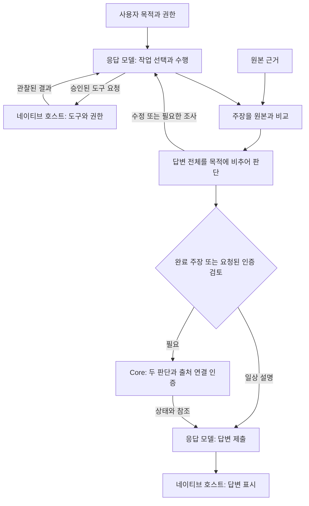
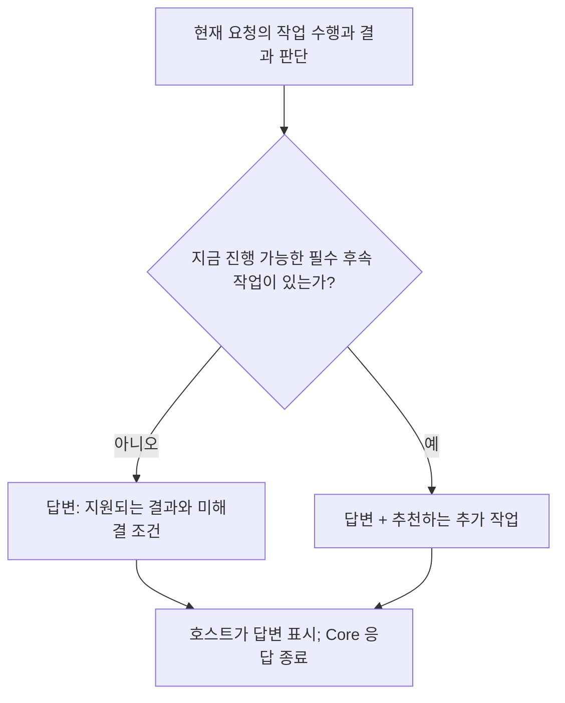
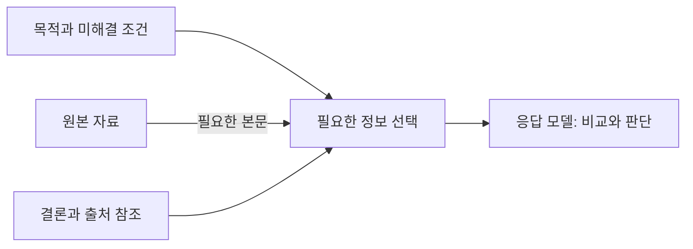
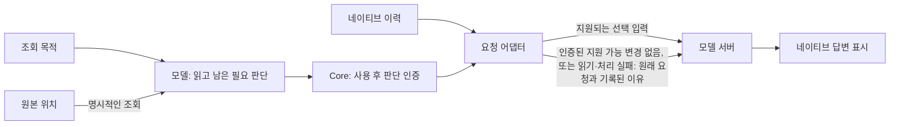

# Ghost-ALICE Core 아키텍처

Language: [🇺🇸 English](architecture.md) | 🇰🇷 한국어

Core는 대화에 응답하는 모델에 공통 지침·네이티브 입력 연결·인증된 작업과 근거 기록을 제공합니다. 승인된 작업의 수행과 결과 판단은 응답 모델이 담당합니다. [설계 철학](https://github.com/AidALL/ghost-alice/wiki/설계-원칙)은 사용자 목적을 판단의 기준으로 삼으며, 절차나 기록이 서로 일치한다는 사실만으로 성공을 입증하지 않습니다.

## 책임과 흐름

| 참여자 | 책임 |
| --- | --- |
| 사용자 | 목적·제약·권한을 제공합니다. |
| 응답 모델 | 작업을 선택하고 수행하며, 주장을 원본과 비교한 뒤 답변 전체를 판단합니다. |
| 네이티브 호스트 | 도구 실행·권한 적용·모델 요청 구성·답변 표시를 담당합니다. |
| Core | 공통 절차를 제공하고 작업·출처·두 판단을 정확한 네이티브 입력에 연결하며 기록을 인증합니다. |

모델은 다음 판단 대상을 선택합니다. micro는 개별 결과, meso는 하위 작업이나 대응 관계, macro는 통합 결과와 의존 관계, meta는 필요성이나 전제를 가리킵니다. 검증 깊이와 근거가 전체 완료 또는 부분 완료를 지원하는지는 별도로 판단합니다. 불일치는 조사의 출발점이며 원인을 확정하지 않습니다. 미해결 조건은 그 조건에 의존하는 주장이나 작업을 막지만, 독립적으로 승인된 작업은 계속할 수 있습니다. 위키의 [검증과 증거](https://github.com/AidALL/ghost-alice/wiki/검증과-증거) 페이지가 이 판단을 설명합니다.

## 답변 종료 경계

모델은 현재 요청에서 이미 승인된 작업을 수행한 뒤 최종 답변을 전달합니다. 이 요청 안에서의 수행·수정 흐름에는 Autopilot이 필요하지 않습니다. 답변 종료 시점에 모델은 지금 진행 가능한 필수 후속 작업이 있는지 판단합니다. 아니오이면 지원되는 결과와 미해결 조건을 답변하고, 예이면 그 답변에 추천하는 추가 작업·이유·다음 필요 정보를 포함합니다. Core는 이 피드백을 인증할 수 있지만 새 요청을 예약하거나 답변 표시에서 작업 선택으로 되돌아가지 않습니다. 진행 가능한 후속 작업이 없다는 판단만으로 전체 완료가 성립하지는 않습니다. 필수 조건이 권한이나 외부 지원을 기다리고 있을 수 있습니다.

이후 사용자의 새 요청으로 다음 모델 호출이 시작될 수 있습니다. 선택적 Autopilot도 승인 계획 안에서 현재 필요·중지·의존 조건·경계를 확인한 뒤 호스트에 후속 요청을 보낼 수 있습니다. 새 호출은 현재 목표·원래 기준·제약을 다시 확인한 뒤 작업을 선택합니다. 요청 제출·호스트 수신·실제 실행·업무 완료는 서로 다른 관찰로 남습니다.

## 문맥과 원본 근거

기존 원본은 출처 위치로 참조합니다. 별도 본문은 필요한 비교나 복구가 그 내용에 의존하고 원본이 바뀌거나 사라질 수 있을 때 보존합니다. 긴 원문·답변·도구 결과도 내용이 필요한 경우에 조회합니다. Ghost-ALICE는 수신자의 현재 판단에 필요한 정보를 선택합니다. 해당 판단이 끝나면 이후 인계에는 현재 결론·불확실성·미해결 작업·출처 위치를 전달합니다. 현재 요약은 이전 요약을 교체합니다. 감사 이력은 별도 기록에 남고, 각 기록의 규칙이 정한 기간만큼 보존됩니다. [런타임 상태 보존](docs/ko/reference/repository-structure.md#runtime-state-retention)이 그 규칙을 나열합니다. 예를 들어 훅 세션 로그는 14일 보존하고, Core 원장은 행을 기한 없이 유지합니다.

정상 훅은 현재 영수증과 다음 판단에 영향을 주는 변경 조건을 제공합니다. 절차는 공통 지침과 소유 스킬이 제공하며 훅에서 그 전문을 반복하지 않습니다. 답변 검토의 준비·기록은 제출한 답변을 다시 반환하는 대신 참조를 반환합니다. 답변 전문은 이후 명시적인 비교를 위해 보존합니다.

네이티브 호스트는 대화 이력을 별도로 보존하고 모델 요청을 구성합니다. Ghost-ALICE 인계를 간결하게 선택해도 이전 네이티브 메시지가 제거되지는 않습니다. 캐싱·압축·토큰 감소만으로 불필요한 원문이 제외되었다고 판단할 수 없습니다. 사용량 관찰과 답변 표시 검사는 원본 기록이 보여주는 범위만 입증합니다.

설정된 요청 어댑터는 지원되는 명시적 내용 선택을 서버 전송 경계에 적용합니다. 실제 후속 작업에서 사용한 자료의 입력 표현을 바꿀 필요가 생기면, 모델은 그 자료를 다음 판단에 필요한 정보와 비교합니다. 미래의 사용 기간을 예측하거나 모든 조회에 별도 판정 호출을 추가하지 않습니다. Core는 작업 권한 및 Autopilot의 계속 여부 결정과 별개로 네이티브 세션·현재 입력·원본 자료를 인증합니다. 어댑터는 프로토콜이 해당 변경을 지원할 때 명시적인 사용 후 판단이 있는 본문을 결론·미해결 조건·원문 조회 참조로 대체합니다. 계속 필요한 일반 원문과 판단하지 않은 일반 원문은 유지하고, 서버 답변은 그대로 전달합니다. 원본 이력은 명시적으로 조회할 수 있습니다.

Claude의 클라이언트 측 치환에는 서명 없는 내용과 명시적으로 꺼진 사고 설정이 필요합니다. 앞선 메시지를 수정하면 사고 서명이 연결된 문맥이 깨집니다. 네이티브 요청에 기존 문맥 관리 기능이 있을 때는 인증된 도구 결과 전체의 제외를 서버에 요청할 수 있습니다. 도구 이름으로 표현한 정책이 선택한 결과와 정확히 일치해야 합니다. 게이트웨이는 서명된 기록과 추론 설정을 보존하고 같은 도구의 필요한 결과를 보호하며, 서버의 실제 적용을 요청과 별도로 관측합니다. 서명된 사고 문맥에서 임의의 본문이나 결과 일부를 치환하는 기능은 지원하지 않습니다. 지원 조건은 [네이티브 문맥 절차](_shared/context_lifecycle.md#apply-and-observe)가 소유합니다. 소스 계약·설치·실제 네이티브 적용은 별개의 관찰입니다.

어댑터는 요청을 바꾸지 않은 이유를 기록합니다. 이유는 인증된 지원 가능 입력 변경이 없음, 읽기 실패, 예기치 않은 처리 오류입니다. 어느 경우든 원래 요청을 보냅니다. 선택은 자료를 빼는 일일 뿐이므로, 어댑터가 선택을 마치지 못해도 전송을 중단하지 않습니다. 설치 범위 밖에서 온 요청과 줄이기를 지원하지 않는 경로의 요청도 바꾸지 않고 보냅니다. 오류를 돌려주는 경우는 모르는 제공자 경로와 모델 서버에 닿지 못한 경우뿐이며, 오류에는 이유가 담깁니다.

설치 과정은 연결 정보를 유지하고, 파일 교체 전에 서비스 종료를 확인하며, 준비가 확인된 뒤 공급자를 활성화합니다. 설치 후보가 실패하면 보존한 파일과 서비스 상태로 복구합니다.

## 근거와 네이티브 표시

모델은 각 주장을 원본 근거와 비교하는 판단과 답변 전체를 사용자 목적·제약에 비추어 평가하는 판단을 구분하여 수행합니다. Core는 소유권·입력 연결·출처 무결성을 인증하며, 식별자와 해시가 의미적 진실을 결정하지는 않습니다. 네이티브 호스트가 모델의 답변을 표시합니다. Core의 Stop 가드는 제출된 검토 기록을 검사하며 누락된 판단을 만들거나 다음 작업을 예약하지 않습니다.

[검증 절차](coding-convention/verification-before-completion/SKILL.md)는 근거 선택과 완료 주장을 소유합니다. 그 [답변 검토 절차](coding-convention/verification-before-completion/references/autopilot-publication.md#prepare-and-record-the-response-review)는 기록의 인계를 소유합니다. 다른 문서는 명령을 복제하지 않고 해당 절차를 참조합니다.

지원된 결과는 원본 근거·검증 시각·정정 연결을 유지합니다. 기준·관련 산출물의 변경이나 반대 관찰은 영향받는 근거만 다시 검토하게 합니다. 기록·표시 결함 때문에 변하지 않은 실제 업무를 다시 실행하지 않습니다. 정확한 부분 답변은 답변으로서 인정될 수 있지만 필수 작업은 여전히 미완료일 수 있습니다. 위키의 [판단 범위와 복구](https://github.com/AidALL/ghost-alice/wiki/판단-범위와-복구) 페이지가 미해결 조건과 모델의 다음 판단을 다룹니다.

## 선택적인 Autopilot 확장

응답 모델은 실제 필요한 미처리 작업·그 이유·다음 필요 정보를 기존 Core 경로에 선언합니다. Core는 선택된 기준·현재 사용자 입력·선언된 경계·원본 참조를 인증하며 원문을 복사하지 않습니다. 원본이 바뀌면 그 원본에 의존하는 피드백 항목만 보류하고 작업과 근거는 보존합니다. Core는 Autopilot 없이도 이 판단을 기록할 수 있습니다.

Ghost-ALICE Autopilot을 설치하면 지원된 기준의 반영과 승인 계획 안의 계속 작업이 추가됩니다. 현재 필요한 미처리 정보에서 계속할 대상을 선택하고 고정된 경계·의존 조건을 확인한 뒤 실행 가능한 다음 필요 정보만 보냅니다. 미충족 기준만으로 후속 요청을 만들지는 않습니다. 통합 흐름·추가 훅·해당 요청의 조건부 호스트 전달은 [Autopilot 아키텍처](https://github.com/AidALL/ghost-alice-autopilot/blob/main/README_ko.md#autopilot-설치로-확장되는-core-흐름)에서 설명합니다.
