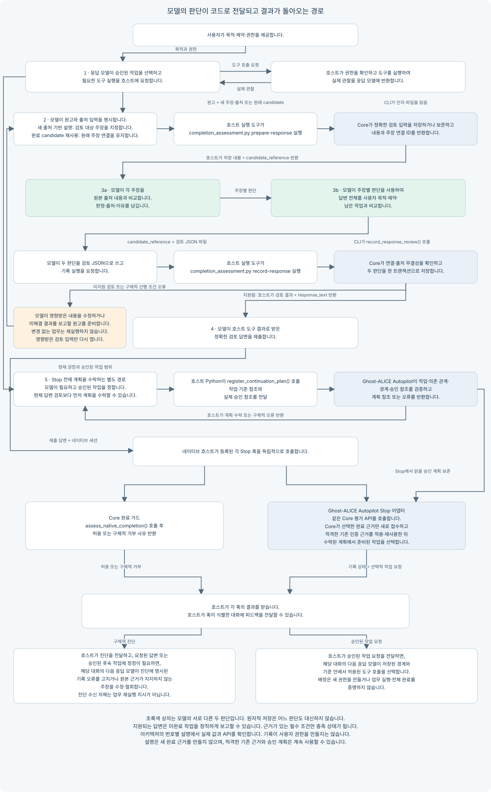

# Ghost-ALICE 아키텍처

언어: [English](architecture.md) | 한국어

Ghost-ALICE는 어시스턴트가 사용자 요청을 승인된 작업으로 구체화하고, 결과를 원본 근거와 비교하고, 관련 오류를 수정하고, 실제 달성한 결과를 정확히 전달하도록 돕습니다. 개발·연구·문서·운영 작업에 같은 원리를 적용합니다. 어시스턴트는 남은 불확실성에 따라 판단 범위와 검증 깊이를 선택하며, 절차나 반복 검사 수를 늘리는 것 자체를 목표로 삼지 않습니다.

## 누가 행동하는가

사용자는 목적·제약·권한을 제공합니다. 응답 모델은 요청을 해석하고 의미를 판단합니다. Core와 Ghost-ALICE Autopilot은 지침과 실행 코드이며 별도의 추론 모델이 아닙니다. 네이티브 호스트는 도구와 등록된 훅을 실행하고 결과를 대화에 전달하는 Codex 또는 Claude Code 프로세스입니다.

| 주체 | 담당 행동 |
| --- | --- |
| 현재 대화의 응답 모델 | 승인된 작업 선택, 호스트 도구 요청, 주장과 원본 출처의 비교, 답변 전체와 사용자 목적의 비교, 필요하고 이미 승인된 후속 작업 제안. |
| Core Python 코드 | 현재 입력과 선택 작업 기록, 검토할 정확한 답변·출처 내용 저장, 모델 판단의 형식·연결 검증과 기록, 네이티브 완료 처리기를 위한 기록 인증. |
| Ghost-ALICE Autopilot Python 코드 | 모델이 제출한 승인 계획 검증·저장, 수락된 근거 보존, 보호된 완료 기준 갱신 요청, 기록된 선행 조건을 충족한 작업 선택. |
| 네이티브 호스트 | 도구 요청 검증과 권한 집행, 요청 명령·등록 훅 실행, 도구 관찰과 훅 피드백을 해당 대화에 전달. |

위임된 모델은 명시적으로 배정된 하위 작업을 수행하고 부모에게 결과를 반환합니다. Stop 훅의 후속 작업 요청은 다른 경로입니다. 어댑터는 네이티브 세션이 식별한 대화로 전달할 요청을 호스트에 반환하며, 위임 모델을 생성하거나 다음 작업의 실행을 입증하지 않습니다.

## 작업·검토·반환 경로

그림은 실행 경로의 개요입니다. 번호가 있는 전달을 아래에서 설명합니다. 초록색 두 검토 단계는 응답 모델의 판단입니다. 코드가 판단 기록을 저장하거나 검증한다고 그 의미 판단을 수행하는 것은 아닙니다.

### 1. 작업을 선택하고 실행 요청

네이티브 입력 훅은 원문을 저장하지 않고 사용자 입력의 다이제스트와 세션 이벤트를 기록합니다. Codex 접수는 바로 확정합니다. Claude 접수는 관찰을 먼저 보존하고, 신뢰된 후속 PreToolUse 또는 Stop 래퍼가 추가된 네이티브 발신 기록과 대조한 뒤 사용자 입력을 확정합니다. 작업 알림은 마지막 사용자 경로를 유지하며 미확정 관찰은 pending 상태로 남습니다.

모델은 session-intent-analyzer에 따라 필요한 의미 변화를 압축해 기록하고, task-router에 따라 현재 작업과 조건을 선택합니다. 호스트 실행 도구를 통해 선택 내용과 정확한 영수증의 루트·플랫폼·세션·입력 이벤트를 `response_route.record_response_route()`에 전달합니다. Core는 소유권·승인 상태·현재 입력을 확인한 뒤 저장한 경로를 반환합니다. 경로는 선택을 기록하며 권한은 사용자 지시에서 나옵니다.

모델은 작업에 필요한 도구를 요청하고, 호스트는 허용된 호출을 실행하여 실제 관찰을 반환합니다. 해당 사전 훅은 출처를 보존하고 사후 훅은 엄격한 감사를 남깁니다. 저장된 계획이나 도구 요청만으로 업무가 성공했다고 판단하지 않습니다.

### 2. 답변과 원본 출처를 Core에 전달

모델은 완전한 답변 원고와 원본 관찰 파일의 절대 경로를 준비합니다. 새 출처 기반 설명에서는 원고에 실제로 포함된 검토 대상 문장·구절을 JSON 문자열 배열로 명시합니다. 완료·부분 완료 답변에서는 완료 블록이 주장 연결을 제공합니다. 기존 완료 candidate를 재사용하는 설명은 담당 재사용 절차에 따라 원래 주장 연결과 출처를 유지합니다. 모델은 이 입력으로 호스트 실행 도구에 Core의 `prepare-response`를 요청합니다. 코드는 자연어에서 주장을 추정하지 않습니다.

| 전달 | 실제로 넘기는 값 | 수신 코드의 행동과 반환 |
| --- | --- | --- |
| 모델 → 호스트 실행 도구 → `completion_assessment.py prepare-response` | `--response-file`의 원고 경로. 새 출처 기반 설명은 `--source`의 원본 경로와 `--claims-file`의 검토 대상 문자열 배열을 제공합니다. 완료 근거는 원래 검증 시각을 제공하며, 완료 candidate 재사용은 담당 절차에 따라 `--claims-file` 없이 원래 주장 연결을 유지합니다. 신뢰할 수 있는 현재 런타임이 Core 모듈 루트를 제공하고, 현재 영수증이 원장 루트·플랫폼·세션을 제공합니다. | `main()`이 원고를 읽고 `prepare_response_review(source, response_text=..., source_paths=..., claim_statements=...)`를 호출합니다. Core는 출처 내용과 정확한 답변을 저장하고, 저장된 내용·`bindings[*].binding_id`·`candidate_reference`를 JSON으로 반환합니다. 호스트는 이 JSON을 도구 관찰로 모델에 돌려줍니다. |
| 모델 → 호스트 실행 도구 → `completion_assessment.py record-response` | `--candidate`의 반환 참조와 `--judgment-file`이 가리키는 모델의 `{claims, response}` 판단 파일. | `main()`이 JSON을 읽고 `record_response_review()`를 호출합니다. Core는 현재 연결과 출처 무결성을 확인한 뒤 두 판단을 한 트랜잭션으로 기록합니다. 상태·기록 참조를 반환하며 필요한 판단 모두가 답변을 뒷받침할 때만 정확한 `response_text`를 포함합니다. |

여기서 *검토 입력 기록*은 저장된 답변·출처 사본·현재 작업 맥락입니다. API는 이를 candidate라고 부릅니다. binding ID는 판단 대상인 정확한 주장이나 답변을, source ID는 저장된 출처를 식별합니다. ID는 기록을 연결하며, 근거가 주장을 뒷받침하거나 모순되거나 미해결로 남기는 이유는 모델의 비교와 설명이 제공합니다. 저장 기록은 덮어쓰지 않습니다. 답변이나 출처가 바뀌면 새 검토 입력 기록이 필요합니다.

실행 가능한 연결·명령과 원본 근거·완료 candidate 재사용 방법은 [담당 검토 절차](coding-convention/verification-before-completion/references/autopilot-publication.md#prepare-and-record-the-response-review)를 따릅니다. 위 표는 그 절차를 복제하지 않고 실제 전달 관계를 설명합니다.

### 3. 두 의미 판단을 구분하여 수행

모델은 도구 결과로 돌아온 Core의 검토 입력을 읽고 다음 비교를 순서대로 수행합니다.

| 판단 | 모델이 읽는 내용 | 모델이 결정하는 내용 |
| --- | --- | --- |
| 주장과 원본 출처의 대조 | 개별 주장과 반대 관찰을 포함한 원본 출처 내용. | 해당 주장이 supported·unsupported·unavailable 중 무엇인지, 관련 출처 참조와 그 이유. |
| 답변 전체와 목적의 대조 | 저장된 답변 전체, 주장별 판단, 사용자의 목적·제약. | 요청 범위에 정확히 응답하는지, 누락·충돌이 없는지, 남은 작업을 정직하게 보고하는지. |

그다음 모델은 판단 객체를 만들고 2번의 기록 호출을 요청합니다. 원자적 저장은 두 판단을 함께 보존하는 동작이며 세 번째 의미 판단이 아닙니다. 유효한 unsupported 판단도 기록할 수 있지만 Core는 그 답변을 승인된 본문으로 반환하지 않습니다. 모델은 해당 답변을 수정하거나 새 검토를 통해 미해결 결과를 보고합니다.

정확한 답변은 미완료 작업을 설명할 수도 있으며, 응답이 뒷받침된다고 미완료 조건이 충족되지는 않습니다. 새 출처 기반 설명은 모델이 지정한 각 주장에 대해 별도의 `claims` 판단 목록을 기록한 뒤 `response`에서 답변 전체를 판단하며, 완료 candidate 재사용은 원래 근거의 주장 연결을 유지합니다. 설명 답변은 완료 기준·완료 블록·새 검증 시각·Ghost-ALICE Autopilot 접수를 새로 만들지 않습니다. 제공된 대화만으로 답할 수 있는 일반 응답은 도구 없는 종결 절차를 따릅니다.

### 4. 답변 제출과 독립 Stop 결과

첫 답변에서 모델은 Core가 반환한 정확한 검토 답변을 제출합니다. 정정 답변에서는 모델이 [Apply and deliver](coding-convention/verification-before-completion/references/autopilot-publication.md#apply-and-deliver)에 따라 제출할 내용을 선택하고 검토합니다. 호스트는 독립적으로 등록된 Stop 훅을 각각 호출합니다. Core 완료 가드와 Ghost-ALICE Autopilot 어댑터는 각각 `native_completion.assess_native_completion()`에서 현재 입력·답변에 연결된 결과를 받습니다. 어느 훅도 다른 훅보다 먼저 실행될 필요는 없습니다.

Core 평가는 현재 경로·답변 전체·원본 출처·기록된 판단을 확인하여 인증된 충족 범위 또는 누락된 선행 조건을 반환합니다. 완료 가드는 그 결과를 호스트의 허용·거부 출력으로 바꿉니다. 빠진 본문을 작성하거나 출처가 모델 주장대로 해석되는지 판단하지는 않습니다.

Ghost-ALICE Autopilot의 Stop 경로는 `autopilot_mode.main()` → `adapter_payload_from_env()` → `apply_completion_v2()` → `advance_continuation()`이며, `_format_payload_for_hook()`가 호스트 형식으로 결과를 만듭니다. 완료 기록과 후속 작업 선택은 별개입니다. 어댑터는 Core가 접수를 선택한 완료 근거만 새로 접수합니다. `response-no-publication`인 설명 답변은 새 근거를 만들지 않으며, 원래 출처·시각을 유지한 기존 인증 근거를 적용하거나 재사용할 수 있습니다. 현재 권한·의존 관계·기준 상태가 허용하면 수락된 계획의 준비된 후속 작업도 선택할 수 있습니다. 다른 조건이 미해결이어도 근거가 있는 조건은 적용할 수 있습니다. 작업 단위 전체는 필요한 모든 조건이 충족돼야 완료됩니다.

### 5. 승인된 후속 작업의 등록과 전달

추가 작업이 필요하면 응답 모델은 실제 사용자 승인 범위에서 계획을 정합니다. 계획 수락은 현재 답변 검토보다 먼저 가능하며, Stop에서 그 계획의 작업을 선택하기 전에는 이루어져야 합니다. 사용 가능한 검토 결과는 계획에 반영하지만 API 수락의 필수 선행 조건은 아닙니다. 호스트 Python 실행을 요청하여 `autopilot_continuation.register_continuation_plan()`에 현재 세션·입력, 작업, 의존 관계, 허용 대상, 정확한 소유 기준 참조와 사용자 승인 위치를 전달합니다. 이 API에는 전용 CLI가 없습니다. 어댑터는 입력을 검증하고 승인 계획 참조 또는 오류를 반환합니다. 계획을 저장했다고 권한이 생기거나 작업이 실행되지는 않습니다.

Stop에서 `advance_continuation()`은 저장된 계획과 현재 기준 상태를 읽습니다. 실행 조건을 충족한 작업이 있으면 배정을 기록하고 경계·기준 참조를 포함한 작업 프롬프트를 반환합니다. 포맷터는 이를 호스트에 Stop 작업 요청으로 돌려줍니다. 호스트가 그 피드백을 네이티브 훅 세션이 식별한 대화에 전달한 경우에만 해당 대화의 다음 응답 모델이 요청을 받고 도구 호출을 선택합니다. 영수증은 대화를 식별하며 동일한 모델 인스턴스의 지속을 뜻하지 않습니다.

## 오류·미해결 작업·보존한 근거

모델은 먼저 불일치가 목적이나 필수 의존 관계에 영향을 주는지 판단합니다. 필요하고 승인된 수정은 해당 주장·행동·하위 작업·의존 관계·가정을 바꿀 수 있습니다. 관련 없는 세부 사항은 미해결로 남기거나 재량 작업에서 제외할 수 있지만, 명시적인 요구를 빼서 성공으로 만들지는 않습니다. [판단 범위 그림](https://github.com/AidALL/ghost-alice/wiki/operating-model-fallback-and-escalation_ko#판단-범위와-검증-부담)은 조사를 넓히거나 좁히는 판단을 설명합니다. [대조 그림](https://github.com/AidALL/ghost-alice/wiki/design-philosophy-floor-not-ceiling_ko#대조와-피드백)과 [근거 절차](https://github.com/AidALL/ghost-alice/wiki/operating-model-closed-loop-reasoning_ko)는 추론 방법을 설명합니다.

현재 경로가 없으면 경로 API로, 검토 필드가 잘못되면 검토 절차로 수정합니다. 반대 근거가 있으면 지원되지 않는 주장을 수정하거나 철회합니다. 기록만 실패하면 업무 결과를 유지하고 의존하는 적용만 보류합니다. 같은 업무를 다시 실행하거나 이미 보이는 동일 답변을 반복하도록 요구하지 않습니다. 동일한 기록 실패는 관련 조건이 바뀔 때까지 보류합니다.

새 입력에는 새 경로 연결이 필요하지만 원래 검증 시각을 갱신하거나 변하지 않은 근거를 무효화하지 않습니다. 실제로 관련 산출물·의존 관계·조건이 바뀌면 영향받은 근거만 다시 검토합니다. 검토와 접수는 원본 출처·시각·기존 기록을 보존합니다. Core의 접수 연결은 출처 준비가 검토 스냅샷보다 앞섰음을 확인하며, 과거 업무가 언제 실행됐는지를 입증하지는 않습니다.

Core 전달 도우미는 제공된 호스트 정보에서 정정 답변의 형태를 선택합니다. 모델은 그 정보로 이미 표시된 같은 답변을 보존하거나, 최종 응답만 표시하는 경우 하나의 전체 답변을 조립하거나, 주장이 바뀌면 수정 본문을 제출합니다. 이전 답변의 표시 여부를 알아내기 위한 도구 호출은 하지 않습니다.

## 기록이 입증하는 범위

| 관찰 | 입증하는 내용 |
| --- | --- |
| 소스 수정 | 지정한 파일 내용이 바뀌었습니다. |
| 통과한 검사 | 해당 대상·시각의 검사에서 보존된 통과 관찰을 얻었습니다. |
| 관리 설치 | 선택한 소스 바이트가 기록된 대상에 배포됐습니다. 네이티브 로딩에는 별도 관찰이 필요합니다. |
| 근거 접수 수락 | Ghost-ALICE Autopilot이 기록할 근거를 수락했습니다. 기준 적용은 이후의 보호된 동작입니다. |
| 완료 기준 적용 | 지정한 소유 기준이 충족 상태가 됐습니다. 다른 기준과 후속 작업은 별개입니다. |
| Stop 작업 요청 반환 | 어댑터가 적격 작업을 선택·기록했습니다. 호스트 전달과 업무 실행에는 각각의 관찰이 필요합니다. |

SQLite는 세션 의도·승인 작업·기준·응답 경로를 관리합니다. Ghost-ALICE Autopilot은 출처·접수·적용·배정 기록을 따로 보존합니다. 호환용 JSON 내보내기와 탐색 포인터는 이 저장소를 대신하지 않습니다.

[세션 게이트 매트릭스](docs/ko/policies/session-gate-matrix.md)는 조건별 담당 절차를 연결합니다. [설치기 아키텍처](docs/ko/reference/installer-architecture.md)는 배포·훅 등록을 설명합니다. 화면 안내를 줄여도 훅 실행이나 엄격한 감사는 줄이지 않습니다.
