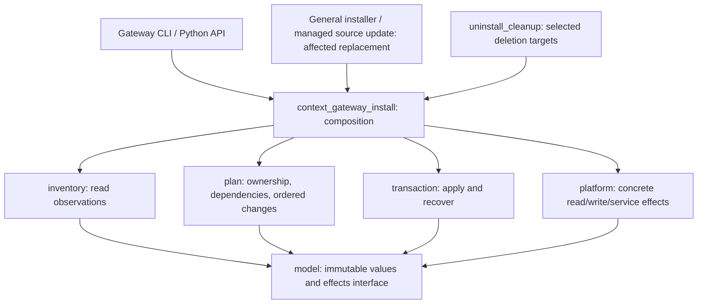
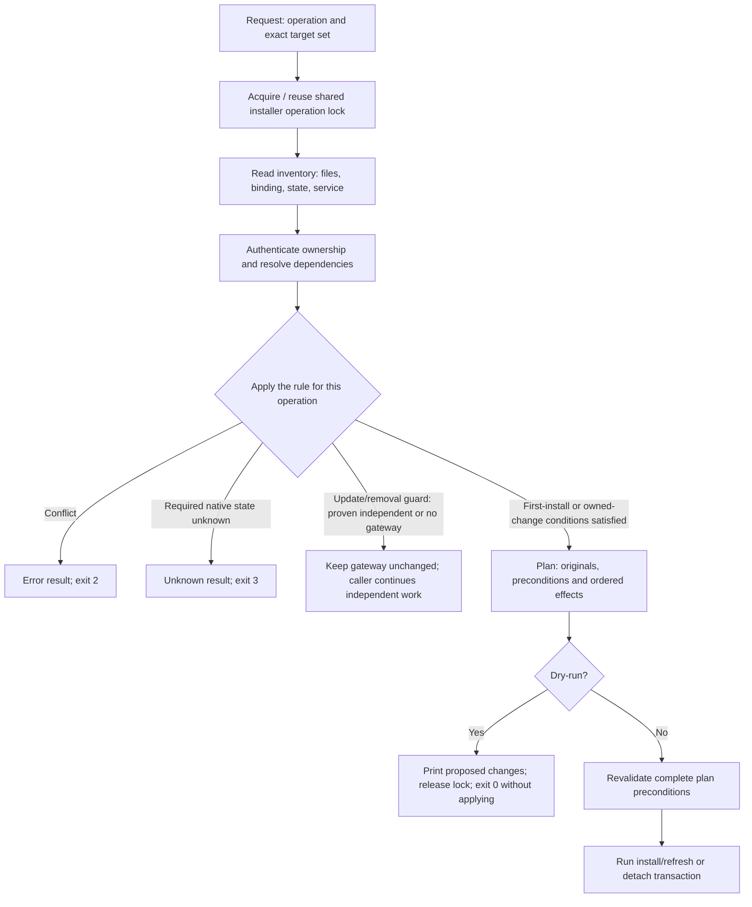
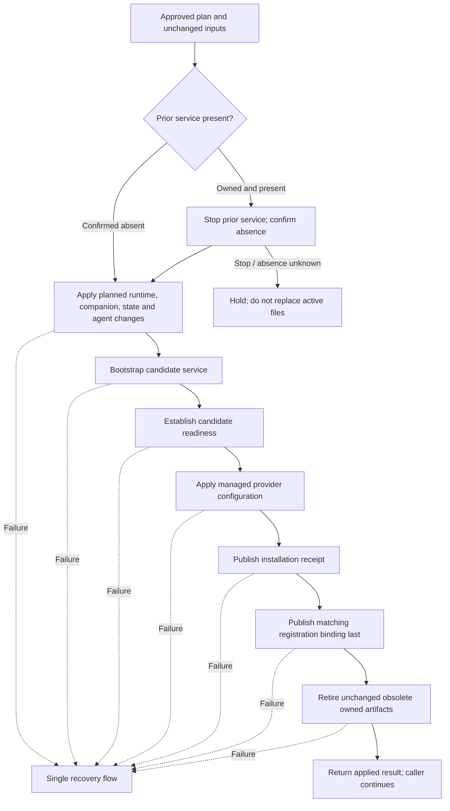
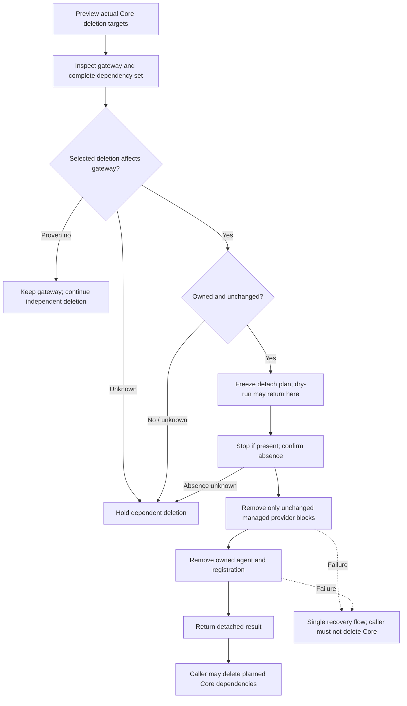
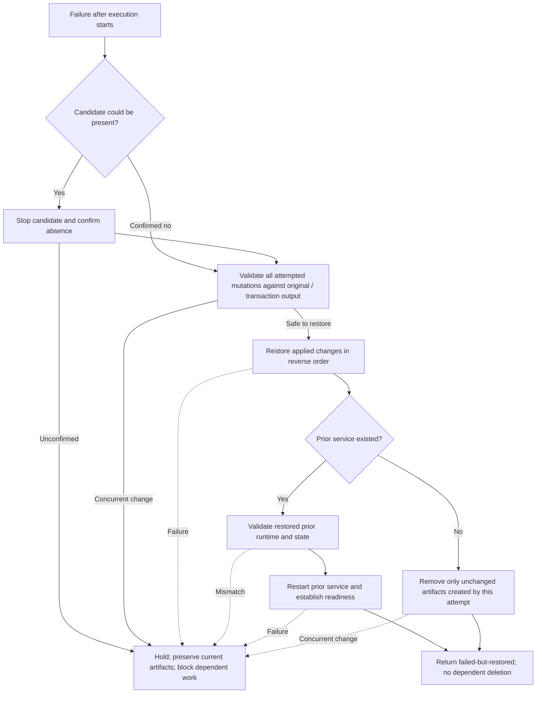

# Gateway installer lifecycle design

[🇰🇷 한국어](../../ko/coding-convention/specs/2026-10-15-gateway-installer-design.md) | 🇺🇸 English

Status: implemented in the source checkout; local acceptance and remote publication are separate stages. No installer deployment or native-service restart has targeted the actual user HOME during this restructuring. Existing source links continue to expose this checkout's installer files.

## Scope

Restructure installation, refresh, removal and recovery for the optional context gateway, including the general installer's replacement of gateway dependencies and Core cleanup's deletion of those dependencies. Core response processing, context selection, native hooks and Autopilot business logic are outside this change. Their installer callers may change; their feature behavior must remain unchanged. Subscription authentication, model selection and native thinking settings remain unchanged.

The existing Core and Autopilot publication remains one sole-author commit per repository. This design adds no release, remote review request, persistent installation backup or new checkout. Existing recovery material and unrelated user changes remain intact. Removal of obsolete generated files follows the same ownership and transaction rules as other mutations.

## Current callers and structural cause

The observations below describe the source inspected for this design, before production restructuring.

- `_shared/context_gateway_install.py:install` combines source inspection, ownership checks, provider rendering, filesystem preparation, native service control, receipt publication and rollback.
- Its `detach_for_uninstall` separately implements discovery, dependency checks, service control and another rollback loop. Missing registration has a separate native discovery branch that can confuse unavailable discovery with confirmed absence and checks argv without the ledger dependency in state.
- `_shared/uninstall_cleanup.py:build_report` previews actual removal targets and invokes detachment before its own destructive cleanup. This ordering must be retained.
- `installer_lib/install.sh:install` can replace the installed skills `_shared` tree and `_sync_runtime_shared_core` can replace the runtime `_shared` tree. These are additional gateway dependency mutation routes; restructuring only the gateway's explicit install function would leave them outside service coordination.
- `installer_lib/source_health.sh:update_source_checkout` performs the managed source checkout update. When installed runtime directories link into that checkout, this route can also change live gateway dependencies and must enter the same coordination before changing affected source files. Arbitrary external edits to a source checkout are not made transactional by the installer.
- `_shared/install_transaction.py` already stages filesystem replacement. A new service coordinator must reuse its filesystem mechanisms where applicable, with explicit reversible results, rather than establish a second independent rollback owner around a completed opaque operation.

The source implementation now uses `ReplacementBatch` in `_shared/install_transaction.py` for reversible file-tree swaps and `SourceUpdate` in `_shared/installer_source_update.py` for reversible Git updates. The gateway transaction invokes their `publish` and `restore` operations. Unrelated operations retain their own filesystem/Git transaction without gateway service changes. Shell/PowerShell entrypoints delegate these effects; they do not implement another gateway recovery loop. The bootstrap updater's old-checkout rescue path is allowed only after gateway absence is established when the coordination helper is missing.

## Required behavior

1. Inspect the complete selected operation before modifying affected installed artifacts. Inspection errors remain errors; absent, present and unknown are different observations.
2. Establish ownership separately from discovery. Finding a service or matching a label does not authorize stopping it or replacing its files.
3. Resolve dependencies from the supported service definition, state and authenticated receipt. Include runtime imports, companion ledger helpers, interpreter, ledger root, state, native configuration roots and service/log paths where the operation can affect them. A platform name or an argv-only search does not prove independence.
4. Keep an unrelated gateway unchanged when sufficient observations prove that the selected operation cannot affect it. Unknown dependencies block only operations whose independence cannot be established.
5. Produce one explicit plan containing the complete affected set, originals, modes, preconditions, changes, order and recovery actions. Dry-run returns that plan without service or installed-artifact changes.
6. Confirm native service absence before modifying its active dependency files. A stop attempt without confirmed absence does not enter the file mutation phase.
7. Start a candidate from its staged runtime and state, then establish readiness before connecting a newly enabled provider. During refresh, retain the existing listener port and scope.
8. Publish ownership only after successful application. The registration binding is the final ownership commit token. If multiple metadata writes are interrupted, subsequent inspection must detect disagreement and hold the affected operation.
9. Give one transaction coordinator responsibility for stopping, applying, recovering and restarting. An adapter must never independently decide to retry, roll back, ignore an error or resume Core deletion.
10. Recover only artifacts still matching this transaction's output. Revalidate the restored runtime before restarting the prior service. A concurrent edit remains untouched and prevents an uncertified restart.
11. Clean a failed first installation only after candidate absence and restoration are confirmed, and only for unchanged artifacts created by that attempt. Preserve prior installations, existing logs, recovery data and independent concurrent content.

## Modules and contracts

All proposed gateway modules remain under `_shared/`, beside the existing entrypoint. The `context_gateway_*` prefix keeps these responsibilities separate from the general installer's existing transaction API.

| Module | Responsibility and input → output | Forbidden responsibility |
| --- | --- | --- |
| `context_gateway_model.py` | Immutable values: request, artifact snapshot, service observation, dependency set, decision, mutation, plan and execution result. Defines the effects interface used by the transaction. | Filesystem/service calls, ownership decisions and global mutable execution state. |
| `context_gateway_inventory.py` | Request + read adapter → inventory. Read source/target bytes once; retain originals, modes, identities, lexical/resolved paths, parsed values and explicit unknown observations. | Writing files, treating discovery as ownership or choosing rollback. |
| `context_gateway_plan.py` | Request + inventory → `no-op`, `blocked` or a complete operation plan. Own ownership authentication, dependency policy, provider block comparison/rendering and ordering constraints. | Reading new files, native commands or executing a plan. |
| `context_gateway_transaction.py` | Plan + effects interface → applied/restored/held result. Own all phase transitions, precondition revalidation, mutation journal, reverse recovery and prior-service restart. | Rediscovering a different target, inventing ownership, silently accepting unknown state or extending the plan. |
| `context_gateway_platform.py` | Explicit path/domain/arguments → one filesystem, lock, native-service or readiness operation with a typed result. Separate read operations from mutation operations. | Calling policy, registering ownership on its own, whole-operation rollback or swallowing errors. |
| `context_gateway_install.py` | Preserve the current CLI and Python entrypoints. Normalize arguments, assemble collaborators, invoke inventory → planning → execution, translate results for callers. | Duplicated ownership checks, nested recovery loops or direct service/file mutations. |

`context_gateway_transaction` consumes the effects interface in `context_gateway_model`; the entrypoint supplies `context_gateway_platform`. The transaction therefore does not import the concrete platform adapter. `context_gateway_plan` imports only the model and standard-library parsing/rendering utilities. Lower modules never import the entrypoint or their callers.

Arrows in this diagram represent code dependencies and composition, not runtime phase order. Both inventory and transaction receive an effects object from the entrypoint and depend on its model interface, not on an import of the concrete platform module. The inventory is passed to the planner, and the plan is passed to the transaction by the entrypoint. The planner does not call the inventory; the transaction does not call the planner.

## Inputs and state ownership

- The request identifies the operation and explicit source, shared directories, runtime, native configuration homes, ledger, state, agent and actual mutation/removal roots. No historical session coordinate supplies installer authority.
- The authenticated registration locates the installation receipt. The receipt supplies component baselines and owned coordinates; state and the service definition must agree with those coordinates. Malformed or mismatched records produce a blocked decision, not a new baseline.
- A snapshot includes absence or original bytes, mode, leaf type and identity. Parent directory links remain supported; linked leaf artifacts being changed are preserved. Comparing both lexical and resolved paths prevents dependency checks from missing linked runtime roots.
- Service observations distinguish confirmed absence, registered/present service and unknown state. Presence alone does not prove readiness, ownership or dependency independence. Native command failure, unsupported output, malformed arguments and unavailable state remain unknown.
- The plan names every write, delete and service transition, including ownership metadata and obsolete-file retirement. Source bytes used for multiple targets are fixed by the inventory. An execution-time discrepancy returns to planning after recovery; execution never silently expands its target set.
- The transaction journal is the single owner of originals and applied effects. Reuse the existing installer's recovery layout; do not add another persistent backup mechanism or create backups in the actual user installation during this task. Existing retained recovery records are preserved. Exception recovery is not advertised as a guarantee of atomic multi-file commit across abrupt process or host failure; interrupted metadata must instead be detected and held by the next inspection.

## Exact comparison and operation-specific decisions

The planner compares two explicit sets: M, the paths/trees this operation will write, replace or delete, and D, the paths/trees required by the existing gateway. D includes the service runtime and its imported helpers, interpreter, ledger, state/configuration and service/log destinations. Overlap is evaluated with both lexical and resolved paths, including ancestor removal and linked runtimes. A platform label, service label or the mere existence of a path does not establish overlap or independence.

| Term | Exact meaning | Example |
| --- | --- | --- |
| Independent | All dependencies needed for the comparison are known and no selected mutation overlaps D. This result leaves the existing gateway unchanged; it does not skip the caller's unrelated work. | Removing an independent Claude installation while the gateway uses a separate Codex runtime and ledger. |
| Affected | At least one selected mutation overlaps D. The planner must coordinate that change with the service lifecycle. | Replacing the runtime `_shared` used by the service, or deleting its ledger root. |
| Unknown | A required observation is unavailable or its schema cannot establish the dependency/ownership fact. Unknown does not mean absent, independent or owned. | Native discovery fails, state is unreadable, the service arguments are malformed, or a registration cannot locate its receipt. |
| Conflict | Available observations establish a mismatch with an ownership baseline or a requested target. | An installed component/provider has a user edit, a receipt digest differs from registration, or an unowned service occupies the target. |

The plan's permission to mutate is operation-specific. It is not a general inference from "affected".

| Request | Allowed change | Independent / absent behavior | Blocked condition |
| --- | --- | --- | --- |
| First gateway installation | Required capability is present, selected Core/ledger inputs are valid, no unowned service/provider/agent occupies the target, and occupied target files match the source or an explicitly permitted baseline. Create a new owned installation. | Confirmed service absence is an installation precondition, not a no-op result. | Unowned occupied targets, conflicting edits or unknown service state. |
| Gateway refresh | The registration authenticates the prior receipt, state, agent and component baselines; preserve the listener binding and apply the selected replacement plan. | An absent prior service can still be refreshed from valid owned files; it must not be confused with first installation. | Missing ownership, changed managed artifacts or unknown service state. |
| General Core payload/source update | First compute M. If it overlaps D, coordinate the owned service around precisely that replacement and update its affected ownership baselines. | No installed gateway or proven disjoint dependencies means the caller performs its own update without gateway service/config changes. | An affected gateway is unowned, conflicting or cannot be scoped. |
| Core removal / gateway detach | First compute actual deletion roots M. If the owned gateway depends on them, detach it successfully before the caller deletes those roots. | A proven unrelated gateway stays active while the independent removal proceeds. Confirmed absence with no local installation signals requires no gateway detach. | Unowned affected service, modified managed configuration or unproven independence. |

## Data model use in the execution flow

`context_gateway_model.py` declares data types; it does not invoke an AI model and is not an execution stage. The other modules import those types. The arrows below identify the values actually passed between modules:

```mermaid
flowchart LR
    E["install: normalize arguments"] -->|"Request: operation + exact paths"| I["inventory: read through platform"]
    I -->|"Inventory: snapshots + service observations"| P["plan: compare ownership and M against D"]
    P -->|"Decision: blocked / independent / planned"| E2["install: return or execute"]
    E2 -->|"Plan: preconditions + ordered effects + originals"| T["transaction: execute through effects interface"]
    T -->|"ExecutionResult: applied / restored / held"| E3["install: format output and exit"]
```

An independent result is available only to the general update/removal guard routes described in the table. A first-install request always produces either a new-install plan or an error.

## Common entry order

The existing general installer lock must be reused or passed as an owned lock context; nesting a second lock acquisition would deadlock. All cooperating mutation paths use the same lock scope. A lock does not replace artifact comparisons because external editors do not participate in it.

Dry-run is an explicit caller option, not an automatic decision by the installer. It answers "what would this request change?" with the same validated plan that execution would use: stop/start actions, file writes/deletions, preserved targets and recovery order. Returning the plan ends that invocation; it neither waits for approval nor schedules another run. A later execution is a separate invocation that reacquires/reuses the lock and reinspects current state. A dry-run that discovers a conflict or unavailable required observation returns an error, not a successful executable plan.

## Terminal results and exit codes

These are the gateway CLI and Python error contracts. The filesystem transaction CLI preserves gateway error identifiers/codes when wrapping them. General shell/PowerShell installers may aggregate a component failure into their existing overall failure result; the structured component error retains its phase and identifier. The Python API returns a typed result or raises a typed error with the same code/outcome so its caller cannot continue dependent deletion after failure.

| Exit | Outcome / error identifier | Installed artifacts and next action |
| --- | --- | --- |
| 0 | `applied`, `independent`, or `dry-run` | Completed the requested local stage, left an unrelated gateway unchanged, or printed a validated unapplied plan. Output distinguishes these cases. |
| 2 | `blocked` / `GATEWAY_PRECONDITION` | Conflict, unsupported input or missing ownership. Do not apply the plan; return the error and release an owned lock. |
| 3 | `held` / `GATEWAY_SERVICE_UNCONFIRMED` | Required native state or service absence cannot be established before artifact replacement. Do not replace files or delete dependent Core targets. Release the lock and terminate; do not retry or resume automatically. |
| 4 | `restored` / `GATEWAY_OPERATION_RESTORED` | Application failed after effects began; the prior artifacts/service were restored and checked. The requested operation still failed, so its caller must not continue dependent deletion. |
| 5 | `held` / `GATEWAY_RECOVERY_UNCONFIRMED` | Failure after effects began cannot be safely recovered, for example candidate shutdown or concurrent-edit checks fail. Preserve current/recovery artifacts, block dependent work, release the lock and terminate. Do not claim that nothing changed. |

Every error includes its phase, stable identifier and concise cause. "Held" is a terminal failure of the current invocation, not a background queue or an indefinite wait. A later retry requires a new invocation and fresh inspection. In particular, an uncertain initial stop exits 3 without active dependency replacement; an uncertain candidate stop during recovery exits 5 because candidate artifacts may already have changed.

## Installation and refresh order

First install and refresh share the execution engine. Their differences are explicit plan data: first install has no prior service to restore; refresh has authenticated originals and retains the listener binding. A general Core update, including a managed source update through a linked runtime, uses this same coordination whenever it replaces a live gateway dependency. A Core update does not enable an uninstalled gateway or request a new provider configuration. A source updater must determine the affected checkout paths before its working-tree mutation, rather than invoke the guard after its Git update has already changed a linked runtime.

## Detachment and removal order

The Core cleanup caller must use the exact previewed deletion roots, not raw manifest membership or platform labels. Existing receipt, state, usage logs and recovery material retain their owning preservation rules. The caller cannot treat an uncertain detach as success or delete dependent Core files after a recovery result.

Selected-skill uninstall first resolves addon exclusions and collects every selected deletion root. Both shell implementations submit that complete set to the gateway guard before deleting the first skill. A remaining unrelated skill does not bypass coordination for the ledger companion. Managed source updates inventory both endpoints of a rename so that removing an old dependency cannot appear independent. Non-macOS callers reach the absent/independent decision without requesting a Unix user ID or constructing a launchctl domain.

## Missing-registration branch

| Observation | Decision |
| --- | --- |
| Local provider/service artifacts exist without authenticated registration. | Hold affected cleanup; discovery does not grant detachment authority. |
| Native service absence is positively established and there are no local installation signals. | No applicable gateway; independent caller cleanup can continue. |
| Native discovery errors or service/dependency data cannot be interpreted completely. | Unknown; hold removal whose independence is unproven. |
| Present unregistered service has sufficient native/service/state observations proving all relevant dependencies independent of the selected roots. | Preserve that gateway and allow only the independent caller operation. |
| Present unregistered service depends on a selected root. | Hold dependent deletion; do not stop an unowned service. |

An argv-only check is insufficient because the ledger and native directories are read from state and runtime helpers are imported transitively. Any new supported service/config shape must extend the inventory and policy together; unfamiliar fields that can affect dependencies cannot silently establish independence.

## Single recovery order

An uncertain stop before file replacement has its own held result and never claims restoration. If a stop was positively established and a later observation fails, recovery may restore the prior service only after validating its artifacts. A concurrently edited runtime is never restarted as a certified prior runtime.

## Sequence review and implementation gates

| Ordering constraint | Design judgment |
| --- | --- |
| Inspect and plan before installed-artifact mutation. | All routes use inventory → policy/plan → transaction. Lock acquisition is control coordination, not deployment. |
| Confirm absence before replacing active dependencies. | Explicit gate before the shared apply phase, including general installer payload replacement. |
| Readiness before enabling a newly configured provider. | Candidate readiness precedes provider application. |
| Installation receipt before matching registration. | Registration is the final ownership publication token; interrupted pairs fail authentication. |
| Gateway detachment before Core dependency deletion. | Cleanup consumes a successful detach or proven independence; held/restored results block dependent deletion. |
| Candidate absence before rollback, restored runtime validation before restart. | Both precede their dependent effects in the recovery flow. |
| Artifact cleanup after ownership publication; first-install cleanup after safe recovery. | Retirement is journaled; failure uses the same recovery owner. |
| Exactly one recovery owner, with downward module dependencies. | Transaction owns the phase machine; platform and filesystem primitives expose effects/results without hidden whole-operation recovery. |

The sequence table records design judgments. Executable coverage is in `_shared/test_context_gateway_install.py`, `_shared/test_context_gateway_uninstall.py`, `_shared/test_gateway_payload_update.py` and `_shared/test_gateway_installer_faults.py`. The subprocess fixture uses a private HOME/config/state, a private launchctl simulator and an actual loopback gateway process. It exercises native discovery/stop/start failures, partial writes, readiness failure, concurrent edits and uncertain recovery, including exit codes. General payload replacement and a linked checkout update have their own participant/recovery coverage. Local observations do not establish actual user-installation adoption, remote CI acceptance or whole-upgrade completion. Intermediate remote automatic review remains stopped during local development; final publication follows the existing CI and automatic-review conditions.
