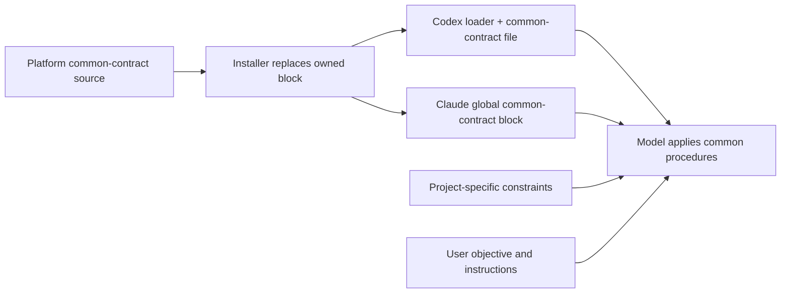

# Installation And Update Guide

언어: 🇺🇸 English | [🇰🇷 한국어](../ko/getting-started/installation.md)

This guide is the command reference for installing, updating, checking, and repairing Ghost-ALICE OS. Public guidance uses OS-native entrypoints with the same long flag surface.

- macOS, Linux, WSL, or Git Bash: `bash install.sh ...`
- Windows Command Prompt or PowerShell: `.\install.cmd ...`

On Windows, `install.cmd` keeps the native wrapper path, Python 3.11+ installer contract, UTF-8 console setup, and `-NoProfile -ExecutionPolicy Bypass`. This handles PowerShell execution policy blocks and does not change the user or machine execution policy.

The Windows installer needs PowerShell 7.6 or newer. Windows PowerShell 5.1 is retired: under an older PowerShell the installer prints the requirement and stops. Install PowerShell with `winget install --id Microsoft.PowerShell --exact`, then rerun `.\install.cmd`.

## Core and Ghost-ALICE Autopilot together

After cloning this repository, use the platform-auto-detect installation:

```bash
bash install.sh --addon autopilot
```

For Windows Command Prompt or PowerShell, use `.\install.cmd --addon autopilot`. The detailed options below let you select a specific agent platform or manage each installation separately.

## Contents

- [Quick Install](#quick-install)
- [Install Official Addons](#install-official-addons)
- [Official Addon List](#official-addon-list)
- [Install One Official Addon To One Platform](#install-one-official-addon-to-one-platform)
- [Install Custom Addons](#install-custom-addons)
- [Install One Platform](#install-one-platform)
- [Check Status](#check-status)
- [Update](#update)
- [Common Commands](#common-commands)
- [Runtime And Platform Reference](#runtime-and-platform-reference)
- [Uninstall](#uninstall)
- [Troubleshooting](#troubleshooting)

## Quick Install

macOS, Linux, WSL, or Git Bash:

```bash
git clone https://github.com/AidALL/ghost-alice.git ~/ghost-alice
cd ~/ghost-alice
bash install.sh --addon autopilot
```

Windows Command Prompt:

```cmd
git clone https://github.com/AidALL/ghost-alice.git %USERPROFILE%\ghost-alice
cd %USERPROFILE%\ghost-alice
.\install.cmd --addon autopilot
```

## Install Official Addons

Official addons use short aliases and install from the Ghost-ALICE core checkout.

macOS, Linux, WSL, or Git Bash:

```bash
bash install.sh --addon autopilot
```

Windows Command Prompt or PowerShell:

```cmd
.\install.cmd --addon autopilot
```

Windows Command Prompt and PowerShell use the same official alias through `.\install.cmd --addon autopilot`.

Run this from the Ghost-ALICE core checkout. Normal users do not clone the autopilot addon repository or run an installer inside that repository; the core installer fetches the official addon package. This install example is not a full runtime compatibility claim; read the addon repository `compatibility-matrix.json` before making one.

For platform-specific commands, see [Install one official addon to one platform](#install-one-official-addon-to-one-platform).

Addon-specific behavior, state files, pause/resume controls, and removal details live in each addon repository. The core checkout owns the common install command.

## Official Addon List

| Addon | Purpose | macOS / Linux / WSL | Windows Command Prompt / PowerShell | Details |
| --- | --- | --- | --- | --- |
| autopilot | Continue explicitly approved autonomous runs one work item at a time | `bash install.sh --addon autopilot` | `.\install.cmd --addon autopilot` | [AidALL/ghost-alice-autopilot](https://github.com/AidALL/ghost-alice-autopilot) |

Core `0.5.1` and Ghost-ALICE Autopilot `0.5.1` use the routing and managed completion APIs. Ghost-ALICE Autopilot requires Core `0.5.1` or later. Source checks, native runtime validation and publication establish separate evidence.

## Install One Official Addon To One Platform

```bash
bash install.sh --platform codex --addon autopilot
```

```cmd
.\install.cmd --platform codex --addon autopilot
```

## Install Custom Addons

Custom, tenant, or local development addons use `--addon-source PATH|URL`.

```bash
bash install.sh --addon-source /path/to/addon-repo
```

```cmd
.\install.cmd --addon-source C:\path\to\addon-repo
```

For git URL addon sources, `--addon-tag` selects the branch or tag to clone into the local addon source cache.

## Install One Platform

The following commands install Core only. Add `--addon autopilot` to include Ghost-ALICE Autopilot for the selected platform.

| Target | macOS / Linux / WSL | Windows Command Prompt / PowerShell |
| --- | --- | --- |
| Claude Code | `bash install.sh --platform claude` | `.\install.cmd --platform claude` |
| Codex | `bash install.sh --platform codex` | `.\install.cmd --platform codex` |

To choose interactively:

```bash
bash install.sh --prompt-platform
```

```cmd
.\install.cmd --prompt-platform
```

## Check Status

Doctor is a read-only strict diagnostic. Use it before changing a suspicious install. The `hook-rejections` line lists the hook commands the Ghost-ALICE hook runner refused to run in the last 14 days, one line per session with the count and the last refusal's time, hook and reason, and it does not change `overall`.

```bash
bash install.sh --doctor
bash install.sh --status
```

```cmd
.\install.cmd --doctor
.\install.cmd --status
```

The healthy target is `overall: ok`.

## Update

Update the local clone through the installer so source-local edits are stashed before a fast-forward.

```bash
cd ~/ghost-alice
bash install.sh --update-source
```

```cmd
cd %USERPROFILE%\ghost-alice
.\install.cmd --update-source
```

If the local installer lacks the update option, follow [bootstrap update recovery](./troubleshooting.md#git-update-recovery).

If source update stops with conflicts, divergent branches, or non-fast-forward state, do not rerun the installer repeatedly. Follow [troubleshooting](./troubleshooting.md) first.

`--update-source` updates the Core source checkout; it does not update the addon package. Reinstall Core and Ghost-ALICE Autopilot together, then check the installed state. The bootstrap updater may reinstall Core only, so follow it with this same paired command.

```bash
bash install.sh --addon autopilot
bash install.sh --doctor
bash install.sh --status
```

```cmd
.\install.cmd --addon autopilot
.\install.cmd --doctor
.\install.cmd --status
```

### Install Source

The install record `~/.ghost-alice/installed-payload.json` names the checkout the installation came from, the install source. Install and `--repair` compare that checkout with the one they run from before they change anything. When the recorded checkout no longer exists, for example after a fresh clone at another path, the installer records the new checkout as the install source without asking. When both checkouts exist, such as a second clone or a git worktree, the installer shows both folders. At a terminal it asks whether this checkout replaces the install source and stops unless the answer is yes; elsewhere it stops with exit code 2. To move the installation to another checkout on purpose, run the installer there with `--adopt-source`; its first placement records that checkout as the install source. `--repair` never moves the installation: from another checkout it stops with exit code 2 and names that install command.

```bash
cd /path/to/new-checkout
bash install.sh --adopt-source
```

```cmd
cd C:\path\to\new-checkout
.\install.cmd --adopt-source
```

The installer sets the repository's git hook path (`core.hooksPath`, which every worktree of the repository shares) to the install source's `hooks` folder. After a merge or pull in the install source, its post-merge hook goes on with the install for every detected host. A merge or pull in another worktree of the same repository runs the same hook from the install source, never that worktree's own hook file; the hook prints one line and installs nothing. A worktree's own hook setting (`git config --worktree core.hooksPath`) still comes first. Only an install you run replaces the install source; a merge never does, and a merge never fails because of the hook. The full uninstall of the last host puts back the hook path from before the install, unless the path changed since.

## Common Commands

| Purpose | macOS / Linux / WSL | Windows Command Prompt / PowerShell |
| --- | --- | --- |
| List skills | `bash install.sh --list` | `.\install.cmd --list` |
| Show install state | `bash install.sh --status` | `.\install.cmd --status` |
| Run protected diagnostic | `bash install.sh --doctor` | `.\install.cmd --doctor` |
| Safe source update | `bash install.sh --update-source` | `.\install.cmd --update-source` |
| Install official autopilot addon | `bash install.sh --addon autopilot` | `.\install.cmd --addon autopilot` |
| Install custom addon source | `bash install.sh --addon-source /path/to/addon-repo` | `.\install.cmd --addon-source C:\path\to\addon-repo` |
| Selective core install | `bash install.sh task-router verification-before-completion` | `.\install.cmd task-router verification-before-completion` |
| Full uninstall | `bash install.sh --uninstall` | `.\install.cmd --uninstall` |
| Selective uninstall | `bash install.sh --platform codex --uninstall task-router` | `.\install.cmd --platform codex --uninstall task-router` |
| Clean false pending entries | `bash install.sh --platform claude --cleanup-pending` | `.\install.cmd --platform claude --cleanup-pending` |

## Runtime And Platform Reference

### Agent Visibility Profile

The default profile is `dynamic`. The profile controls how much governance surface is shown to the user; it does not disable hooks, strict-grade logs, or Work-Impact Projection.

| Profile | macOS / Linux / WSL | Windows Command Prompt / PowerShell |
| --- | --- | --- |
| strict | `bash install.sh --visibility strict` | `.\install.cmd --visibility strict` |
| dynamic | `bash install.sh --visibility dynamic` | `.\install.cmd --visibility dynamic` |
| minimal | `bash install.sh --visibility minimal` | `.\install.cmd --visibility minimal` |

`--agent-visibility` remains an accepted compatibility alias. Prefer `--visibility` in new docs and commands.

### Slash Commands By Platform

Ghost-ALICE installs `/visibility strict|dynamic|minimal` as a Claude Code workspace command. On Codex and every other platform, use `_shared/agent_visibility_cli.py` to inspect or change the same profile.

### Python Contract

The installer requires Python 3.11 or newer for every command, `--help` and `--list` included: `install.sh` only finds or prepares Python and hands the arguments to `_shared/installer/cli.py`. If Python 3.11+ is missing, it attempts automatic preparation where possible.

The optional macOS native context gateway requires Python 3.14 or newer with `compression.zstd`. Its registration command, `bash install.sh gateway --codex-dir <dir> --ledger-root <dir> --state-dir <dir> --launch-agent <plist>`, checks that capability first, then writes the launch agent, `state.json` and the Codex provider blocks and records the service in the install record. It copies no module: the service runs the runtime `_shared` the installer published, so install Core first. This component requirement does not change the Core installer and hook minimum of Python 3.11. If Codex `config.toml`, the launch agent or a state file is a symlink, registration and detachment stop before changing the service and preserve the link and its target. A refresh keeps the listener's port and scope while the three service files are as the install record says; a file changed outside the installer stops the command before any change, and an existing launch agent, state directory entry or provider block the record does not name is preserved. If a first registration fails and the candidate service is confirmed stopped, rollback removes that attempt's new state artifacts and record entry so a new attempt can proceed. An uncertain stop or concurrent artifact change preserves recovery material for review. After the registration, `bash install.sh` alone updates the installation; `bash install.sh gateway detach --confirm` unregisters the service and keeps its state directory. When launchd runs a gateway service that the install record does not name, install and `--repair` leave that service as it is and print one warning that names the registration command; the registration records the service and restarts it on the new code.

- macOS: if Homebrew is available, `brew install python3`
- Linux / WSL: available package managers such as `apt-get`, `dnf`, `yum`, or `pacman`
- Windows: `winget`, `choco`, then `scoop`

If Python 3.11+ is still unavailable, installation stops and prints manual recovery guidance.

### PowerShell Contract

`.\install.cmd` runs the Windows installer with PowerShell 7 (`pwsh.exe`), and with Windows PowerShell (`powershell.exe`) when `pwsh.exe` is absent. The Windows installer needs PowerShell 7.6 or newer, the 7.6 LTS line. Under an older PowerShell, Windows PowerShell 5.1 included, it prints `PowerShell 7.6 or newer is required` with the install command `winget install --id Microsoft.PowerShell --exact` and stops with exit code 1; the installer never installs PowerShell itself. After that check, it sets UTF-8 console input and output, prepares Python 3.11+ and passes every argument in order to `_shared/installer/cli.py`, the same installer that `install.sh` runs, so Windows accepts the same long flags.

On macOS and other POSIX hosts, installed hooks try `GHOST_ALICE_PYTHON` first, then Python from the runtime `PATH` and common installation locations, and finally the interpreter used by the installer. Each candidate must pass the Python 3.11+ check. This final fallback lets a desktop app run hooks even when its `PATH` omits the installer's Python directory. It does not change the host's global Python or `PATH`; rerun the installer if that interpreter moves and no other candidate is available.

### Node.js Contract

Claude Code and Codex hook-enabled installs require a resolvable Node.js runtime because the `tool-checkpoint` PreToolUse gate runs `ghost-alice-hook.mjs`. The installer checks configured runtimes, the platform registration and `PATH`, including the configured Codex runtime fallback. It blocks hook installation only when the target platform requires hooks and no usable Node runtime resolves.

### Platform Update Behavior

| Platform | OS | Install mode | Install path | Skill body updates auto-reflect |
| --- | --- | --- | --- | --- |
| Claude Code | macOS / Linux / WSL | symlink | `~/.claude/skills/` | yes |
| Claude Code | Windows | junction | `~/.claude/skills/` | yes |
| Codex | macOS / Linux / WSL | copy | `~/.agents/skills/` | no |
| Codex | Windows | copy | `~/.agents/skills/` | no |
| All platforms | Git Bash on Windows | copy fallback | varies | no |

Auto-reflection applies to skill bodies such as `SKILL.md`, `references/`, and `scripts/`. Hooks, bootstrap files, permission policy, and `_shared/` are installer-managed runtime surfaces, so rerun the installer when they change.

Installation on disk and adoption by a running host are separate. After a hook command changes, confirm its native trust entry and observe a subsequent native callback; use the host's reload or full restart controls if it retains the previous registration. See [native hook trust and reload](./troubleshooting.md#native-hook-trust-and-reload). Do not repeat unchanged business verification to check host adoption.

### Core and optional Autopilot transitions

Core installation and addon removal are separate operations. A fresh Core installation supplies the instructions, input/source bindings, work and review records, and Core hooks. It does not register Autopilot continuation. Updating Core without an addon option preserves an already installed addon; `--addon-skip` skips addon installation and does not request its removal.

| Operation | Example for Codex | Managed scope |
| --- | --- | --- |
| Fresh Core install or Core update | `bash install.sh --platform codex` | Core; preserve existing addon files and registrations on update |
| Add or update Autopilot | `bash install.sh --platform codex --addon autopilot` | Core plus manifest-selected addon skill and privileged adapters |
| Remove Autopilot while retaining Core | `bash install.sh --platform codex --uninstall --addon autopilot-mode` | Detach recorded addon/adapter hooks before removing verified addon targets |
| Remove one platform | `bash install.sh --platform codex --uninstall` | That platform's addons and Core; retain shared assets needed by other installed platforms |

Core authenticates the model's recommended follow-up work independently of Autopilot. Only the optional approved continuation path requests another host invocation. Removing Autopilot retains Core records and does not turn unmet criteria into completed criteria. Per-addon removal keeps modified files and its sidecar/removal marker for review or retry, while detaching its managed executable registrations. This is a configuration/file operation; ongoing-host adoption and cancellation of already delivered work are separate observations.

Full/platform removal archives pending merge originals and last-platform installation recovery copies under unique `~/.ghost-alice/uninstall-backup/<platform>/support-state/` directories. It keeps previous archives, source checkouts, conversation/session evidence, intent ledgers, audit traces and secrets. See [uninstall cleanup](./uninstall.md) for ownership and shared-file rules.

For Claude, the installer records which manifest-selected addon `Skill(...)` grants it actually added in `~/.ghost-alice/addon-permissions/claude.json`. Addon removal clears one owned occurrence and preserves preexisting grants and extra user occurrences. A legacy grant without ownership evidence requires manual review. For Codex, addon removal clears unchanged owned hook trust hashes and moves surviving Core/user trust tables with their hook positions, preserving their metadata. A trust collision or configuration write failure prevents successful file removal; see [uninstall cleanup](./uninstall.md).

### Installed Surfaces

A full install deploys:

- core skills from `skill-catalog/skills.json`
- coding-convention workflow skills
- optional addon skills through official `--addon` aliases or custom `--addon-source`
- `_shared/` utilities
- platform hook settings
- Node-backed hook dispatcher assets under `~/.ghost-alice/hooks/`
- Claude Code permission allowlist
- Claude `${CLAUDE_CONFIG_DIR:-~/.claude}/CLAUDE.md` global bootstrap
- Codex `~/.codex/AGENTS.md` loader and managed `~/.codex/ghost-alice-governance.md` common contract
- the install record `~/.ghost-alice/installed-payload.json`: one file for both hosts that names every install location, its source and the fingerprints of copied files, written in the same step as each placement
- `~/.ghost-alice/rollbacks/<txid>/`: the files one placement replaced, the install record as it was before, and the placement's journal; the next locked installer command restores a placement that stopped halfway, and the newest 20 finished folders are kept
- support state for install-state, pending merges, and uninstall reports

An installation that registered the optional context gateway: the install record's `service` section names the service's code root, `~/.ghost-alice/runtime/current`, and its three service files. The runtime placement (`_shared` and the companion script `session-intent-analyzer/scripts/session_intent_ledger.py`) stops the service before its files change and starts it after. The Codex copy `~/.agents/skills/_shared` and the Claude links are install targets, not the service's code, so their placement calls no service effect. `bash install.sh` alone is the update; no gateway refresh precedes it. The install prints one `Context gateway:` line with the service's runtime root and whether the service is running. An installation an earlier installer registered gets its `service` section once from the gateway's installation receipt, at the first install, repair or uninstall.

The installer owns only the marked Ghost-ALICE block in each global rule file. It refreshes that block while preserving adjacent user text. If the destination is a markerless user-owned file, installation leaves it unchanged, writes `<rule-file>.ghost-alice-proposed`, and status/doctor does not report the proposal as an installed global rule.

### Common Governance and Project Instructions

Ghost-ALICE common governance applies across projects and task domains. On a normal Codex route, the current-session assistant reads the common contract at the path rendered into the managed `~/.codex/AGENTS.md` loader. The installer writes that contract to the sibling `ghost-alice-governance.md`. Claude Code receives the common contract directly in the managed portion of `${CLAUDE_CONFIG_DIR:-~/.claude}/CLAUDE.md`. Project instruction files add project-specific constraints; they do not supply a second copy of the common procedures. User instructions and project-specific constraints retain precedence.



If Codex cannot read the named common file, the assistant reports that missing input and stops only work that requires it. Answers fully supported by supplied conversation can use the loader's no-tool rule. Status and doctor check the loader and its declared companion together. The installer preserves adjacent user text and markerless user-owned rule files; it refuses to replace a Codex common contract through a symlink. A proposal is not an installed contract. The installer does not change unrelated projects' instruction budgets or rewrite their local rules.


### merge-companion

When an update detects user-modified installed files, the installer isolates those candidates in a pending merge queue.

- manifest: `~/.ghost-alice/pending-merges/<platform>/manifest.json`
- backup: `~/.ghost-alice/pending-merges/<platform>/`
- install state: `~/.ghost-alice/install-state/<platform>.json`

On the next Claude/Codex session, the hook reports pending entries. When you ask to review them, or when work changes an affected skill, `merge-companion` asks whether each should be merged, discarded, or deferred.

## Uninstall

Uninstall uses the installer-owned install-state manifest and removes only the Ghost-ALICE managed block from the platform global rule file. User-authored text remains in place.

```bash
bash install.sh --uninstall
```

```cmd
.\install.cmd --uninstall
```

See [uninstall cleanup](./uninstall.md) for the full cleanup contract.

## Troubleshooting

When an update is blocked during `git pull`, a merge conflict, or an installer rerun, start with [troubleshooting](./troubleshooting.md).

The GitHub Wiki `install-troubleshooting` page links to the online source guide, which can be read without updating a local checkout.
