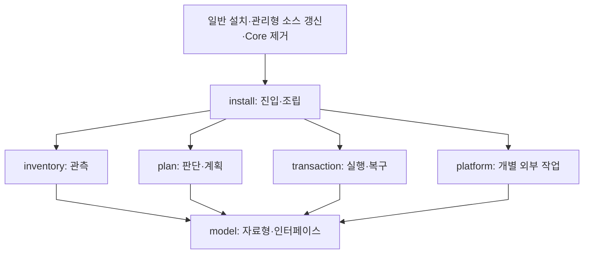
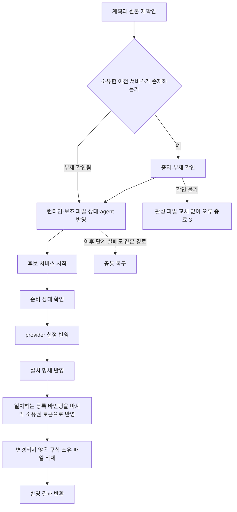

# 게이트웨이 설치 생명주기 설계

Language: [🇺🇸 English](../../../coding-convention/specs/2026-10-15-gateway-installer-design.md) | 🇰🇷 한국어

상태: 소스 체크아웃에 구현한 구조입니다. 로컬 검증, 원격 게시와 실제 사용자 설치본 반영은 각각 별도 단계입니다. 이번 재편에서 실제 사용자 HOME을 대상으로 설치나 네이티브 서비스 재시작을 실행하지 않았습니다. 기존 소스 링크를 통하는 인스톨러 파일은 이 체크아웃의 변경을 그대로 가리킵니다.

## 범위와 원인

선택적 컨텍스트 게이트웨이의 설치·갱신·해제·실패 복구와 이를 호출하는 일반 설치·제거 접점을 재편합니다. Core의 응답 처리·컨텍스트 선택·네이티브 훅과 애드온 로직은 범위 밖입니다. 구독 인증, 모델 선택과 네이티브 thinking 설정도 유지합니다. 저장소별 단독 기여 단일 커밋이라는 기존 게시 조건을 유지하며, 추가 원격 리뷰·release·새 checkout·별도의 영구 백업 체계를 만들지 않습니다. 기존 복구 자료와 무관한 사용자 변경은 보존합니다.

재편 전 `_shared/context_gateway_install.py`의 설치 함수는 소스 조사, 소유권 확인, 설정 생성, 파일 준비, 서비스 제어와 복구를 함께 처리했습니다. 해제 함수에는 별도의 조사·의존성 판단·복구 절차가 있었습니다. 등록이 없는 서비스의 조회 실패를 부재로 취급할 수 있었고, argv만 비교하여 상태 파일의 ledger 의존성을 놓칠 수 있었습니다.

전용 게이트웨이 설치 함수 외에도 일반 인스톨러의 `_shared` 교체와 런타임 동기화, 링크된 체크아웃의 관리형 소스 업데이트가 서비스 의존 파일을 바꿉니다. 따라서 이 경로들도 서비스 조정에 참여합니다. `_shared/uninstall_cleanup.py`는 실제 삭제 예정 대상을 먼저 구하고 게이트웨이 해제 후 의존 파일을 삭제하는 순서를 유지합니다.

일반 파일 교체의 `ReplacementBatch`와 Git 업데이트의 `SourceUpdate`는 되돌릴 수 있는 파일·Git 작업을 제공합니다. 게이트웨이 트랜잭션이 그 작업의 `publish`와 `restore`를 호출합니다. 무관한 작업은 서비스 변경 없이 기존 파일·Git 트랜잭션으로 실행합니다. 조정 도우미가 없는 구버전 체크아웃의 bootstrap 복구 경로는 게이트웨이 부재를 확인한 경우에만 Git 변경을 진행합니다. 인스톨러 밖에서 수행하는 임의의 소스 편집까지 트랜잭션으로 바뀌는 것은 아닙니다.

## 모듈 경계

| 모듈 | 입력과 출력·책임 | 맡지 않는 책임 |
| --- | --- | --- |
| `context_gateway_model.py` | 요청·파일 원본·서비스 관측값·의존성·판정·변경 계획·실행 결과와 effects 인터페이스의 자료형을 정의합니다. | 파일·서비스 접근, 소유권 판단과 AI 모델 호출을 하지 않습니다. |
| `context_gateway_inventory.py` | 요청과 읽기 어댑터로부터 원본 바이트·권한·파일 식별자·표기/실제 경로·관측 실패를 수집합니다. | 파일 변경, 발견만으로 소유권 부여, 복구 선택을 하지 않습니다. |
| `context_gateway_plan.py` | 요청과 관측값을 받아 무관·차단·실행 계획을 만듭니다. 소유권 인증, 의존성 비교, 관리 설정 비교·생성과 순서를 담당합니다. | 추가 파일 읽기나 네이티브 명령 실행을 하지 않습니다. |
| `context_gateway_transaction.py` | 계획과 effects 인터페이스를 받아 반영·복원·확인 불가 결과를 만듭니다. 단계 전이와 역순 복구, 이전 서비스 재시작을 단독으로 담당합니다. | 대상을 다시 찾거나 계획의 범위를 임의로 넓히지 않습니다. |
| `context_gateway_platform.py` | 명시한 경로·도메인·인수에 대해 개별 파일·잠금·서비스·준비 상태 작업을 수행합니다. 읽기와 변경을 구분합니다. | 정책 판단이나 전체 작업의 독자적 재시도·복구를 하지 않습니다. |
| `context_gateway_install.py` | 기존 CLI/Python 진입점에서 인수를 정규화하고 관측→계획→실행을 연결하여 결과를 반환합니다. | 중복 소유권 검사, 별도의 복구 루프나 직접 서비스 변경을 하지 않습니다. |

`model.py`는 실행 단계가 아니라 다른 모듈이 사용하는 자료형의 정의입니다. AI 모델이나 별도 판단 모델을 추가하지 않습니다. `plan`은 model과 표준 파서만 참조합니다. 관측과 실행 모듈은 model의 인터페이스를 통해 전달받은 어댑터를 사용하며, 구체적인 platform 모듈은 진입점이 조립합니다. 하위 모듈은 진입점이나 호출자를 다시 참조하지 않습니다.

위 화살표는 코드 의존관계와 조립 관계입니다. 실제 자료 전달 순서는 다음과 같습니다. 계획 모듈이 조사 모듈을 호출하거나 실행 모듈이 계획 모듈을 재호출하지 않습니다.

## 비교 대상과 분기 조건

계획 모듈은 이번 작업이 쓰거나 교체하거나 삭제할 경로·트리 집합 M과 기존 게이트웨이가 필요로 하는 경로·트리 집합 D를 비교합니다. D에는 서비스 런타임과 import하는 보조 파일, Python 실행 파일, ledger, 상태·네이티브 설정과 서비스·로그 경로가 포함됩니다. 표기 경로와 링크를 해석한 실제 경로, 상위 디렉터리 제거와 링크된 런타임을 함께 비교합니다. 플랫폼 이름이나 서비스 label, 경로가 존재한다는 사실만으로 무관함이나 소유권을 인정하지 않습니다.

| 판정 | 의미·예 |
| --- | --- |
| 무관 | 필요한 의존성을 모두 알며 M과 D가 겹치지 않습니다. 별도 Claude 설치를 지우지만 게이트웨이의 Codex 런타임·ledger는 그대로인 경우입니다. 게이트웨이만 유지하고 호출자의 독립 작업은 진행합니다. |
| 영향 있음 | M의 변경이 D의 파일·트리에 영향을 줍니다. 사용 중인 `_shared` 교체나 ledger 제거가 해당합니다. 이 사실만으로 변경 권한을 부여하지는 않습니다. |
| 불명 | 필요한 관측을 얻지 못하거나 형식을 해석하여 의존성·소유권을 확인할 수 없습니다. 서비스 조회 실패, 읽을 수 없는 상태, 잘못된 인수 등이 해당합니다. 부재·무관·소유함으로 취급하지 않습니다. |
| 충돌 | 관측 결과와 소유권 기준 또는 요청 대상의 불일치가 확인됐습니다. 사용자 수정, 등록과 설치 명세의 해시 불일치, 소유권 없는 서비스의 대상 점유 등이 해당합니다. |

| 요청 | 변경 가능한 조건 | 무관·부재 처리 | 차단 조건 |
| --- | --- | --- | --- |
| 새 게이트웨이 설치 | 실행 환경과 Core·ledger 입력이 유효하고, 서비스·provider·agent에 소유권 없는 점유가 없어야 합니다. 기존 대상 파일은 소스 또는 명시적으로 허용한 기준과 일치해야 합니다. | 서비스 부재는 새 설치의 선행 조건이며 작업 생략을 뜻하지 않습니다. | 무단 점유, 로컬 수정 충돌 또는 서비스 상태 불명입니다. |
| 게이트웨이 갱신 | 등록이 이전 명세·상태·agent·파일 기준을 인증해야 합니다. 기존 포트와 scope를 유지합니다. | 서비스가 현재 꺼져 있어도 소유한 파일이 유효하면 갱신할 수 있습니다. 새 설치와 구분합니다. | 소유권 누락, 관리 파일 변경 또는 서비스 상태 불명입니다. |
| 일반 Core 파일·소스 갱신 | M을 먼저 구합니다. D에 영향이 있으면 소유한 서비스를 중지하고 해당 변경에 참여시킨 뒤 파일 기준을 갱신합니다. | 게이트웨이가 없거나 무관함이 확인되면 호출자 갱신만 진행합니다. 없는 게이트웨이를 새로 활성화하지 않습니다. | 영향받는 서비스가 소유권 불명·충돌 상태이거나 영향 범위를 확정할 수 없는 경우입니다. |
| Core 제거·게이트웨이 해제 | 실제 삭제할 M을 먼저 구합니다. 게이트웨이가 이에 의존하면 소유권 확인과 해제 성공 후 의존 파일을 삭제합니다. | 무관한 게이트웨이는 켜 둡니다. 로컬 설치 신호가 없고 부재가 확인되면 해제 작업이 필요 없습니다. | 영향받는 서비스의 소유권 불명, 관리 설정 수정 또는 무관함을 입증하지 못한 경우입니다. |

새 설치는 항상 설치 계획 또는 오류를 반환합니다. 일반 갱신·제거의 guard가 사용하는 무관·게이트웨이 없음 분기로 새 설치를 생략하지 않습니다.

## 상태와 원본의 소유

요청은 작업 종류와 소스·설치 디렉터리·런타임·네이티브 설정·ledger·상태·agent·실제 변경/제거 경로를 명시합니다. 과거 세션 좌표를 설치 권한으로 사용하지 않습니다. 등록 바인딩은 설치 명세의 위치와 해시를 인증합니다. 명세의 소유 경로는 상태와 서비스 정의에 일치해야 합니다. 잘못된 자료를 새로운 정상 기준으로 삼지 않습니다.

원본 관측값은 파일 부재 또는 바이트·권한·말단 종류·식별자를 포함합니다. 부모 디렉터리 링크는 지원하며 변경할 말단 파일의 링크는 보존합니다. 소스 바이트는 한 번 수집하여 여러 대상에 같은 내용을 사용합니다. 계획에는 소유권 메타데이터와 구식 파일 삭제도 포함하여 모든 변경을 열거합니다. 실행 중 불일치가 생기면 복구 후 재조사해야 하며 계획을 몰래 확대하지 않습니다.

서비스의 확인된 부재, 등록/존재, 불명은 서로 다른 관측값입니다. 존재만으로 준비 완료·소유권·의존성 무관함을 입증하지 않습니다. 명령 오류, 해석할 수 없는 출력이나 인수, 읽을 수 없는 상태는 불명으로 남깁니다.

원본과 적용 작업은 하나의 트랜잭션 journal이 관리합니다. 기존 인스톨러의 복구 형식을 사용하며 별도 영구 백업 체계를 추가하지 않습니다. 이번 작업에서 실제 사용자 설치본에 백업을 만들지 않습니다. 예외 복구가 프로세스·호스트의 갑작스러운 종료까지 원자적 다중 파일 반영을 보장한다는 뜻은 아닙니다. 메타데이터 반영이 중단되면 다음 조사에서 불일치를 감지하고 해당 작업을 차단합니다.

## 공통 진입·미리보기

요청 정규화→공용 설치 잠금 확보/재사용→관측→작업별 소유권·의존성 판단→계획 고정 순서입니다. 이미 호출자가 보유한 잠금을 중복 획득하지 않습니다. 협력하는 변경 경로는 같은 잠금 범위를 사용합니다. 외부 편집자는 잠금에 참여하지 않으므로 파일 원본 비교도 유지합니다.

`--dry-run`은 호출자가 명시하는 옵션입니다. 같은 선행 조건을 확인하고 중지·시작, 파일 쓰기·삭제, 보존 대상과 복구 순서를 계획으로 출력한 뒤 종료합니다. 실제 반영이나 승인 대기, 나중 실행 예약을 하지 않습니다. 나중에 실행하려면 별도 호출에서 현재 상태를 다시 조사합니다. 충돌이나 필수 관측 불명이 있으면 미리보기도 성공한 실행 계획을 반환하지 않습니다.

## 설치·갱신 순서

새 설치와 갱신은 같은 실행기를 사용하며 이전 원본과 서비스의 유무를 계획 자료로 구분합니다. 일반 파일 교체와 링크된 소스의 관리형 업데이트도 활성 의존 파일에 영향이 있으면 같은 조정을 거칩니다. 소스 업데이트는 Git의 작업 파일 변경 전에 영향을 구하며, 변경 후에 서비스를 검사하지 않습니다. 일반 Core 갱신이 새 provider를 켜지는 않습니다.

## 제거·해제 순서

실제 Core 삭제 예정 경로→게이트웨이와 전체 의존성 조사→영향 판단→소유권과 원본 확인→해제 계획→서비스 중지·부재 확인→변경되지 않은 관리 provider 블록만 제거→소유한 agent·등록 제거→해제 결과 반환→호출자의 의존 파일 삭제 순서입니다. 미리보기는 해제 계획에서 종료합니다.

무관함이 확인되면 서비스를 유지하고 독립 삭제만 진행합니다. 영향이 불명하거나 영향받는 서비스가 소유권 불명·수정 상태이면 의존 삭제를 차단합니다. 정리 호출자는 매니페스트의 단순 포함 여부나 플랫폼 label 대신 실제 삭제 예정 경로를 사용합니다. 기존 명세·상태·사용 로그·복구 자료에는 각각의 보존 규칙을 적용합니다. 해제 실패 후 복원이 됐더라도 요청한 해제는 실패했으므로 의존 파일을 삭제하지 않습니다.

선택한 스킬을 제거할 때는 addon 의존성에 따른 제외를 먼저 판단하고 전체 삭제 예정 경로를 모읍니다. 셸과 PowerShell 모두 첫 스킬 삭제 전에 그 전체 집합을 게이트웨이 확인 절차에 전달합니다. 무관한 스킬이 남아 있어도 ledger 보조 파일의 의존성 확인을 생략하지 않습니다. 관리형 소스 업데이트는 이름 변경 전후 경로를 모두 조사하여 기존 의존 파일의 삭제를 무관한 변경으로 분류하지 않습니다. macOS 이외의 호출자는 Unix 사용자 ID나 launchctl 도메인을 요구하지 않고 부재·무관 판정에 도달합니다.

등록이 없을 때도 로컬 provider·서비스 흔적이 있으면 소유권 없는 해제를 하지 않습니다. 로컬 신호가 없고 네이티브 부재가 확인되면 해제가 필요 없습니다. 미등록 서비스가 존재하면 서비스 정의와 상태로 전체 의존성을 확인하여 무관한 작업만 허용합니다. 대상 경로에 의존하거나 의존성 정보를 해석하지 못하면 삭제를 차단합니다. argv만으로 판단하지 않으며, 모르는 서비스·상태 설정을 무관함의 근거로 삼지 않습니다.

## 공통 복구와 종료 코드

변경 후 실패하면 후보 서비스가 존재할 가능성을 먼저 처리합니다. 후보 중지·부재 확인→시도한 모든 변경이 원본 또는 이번 출력과 일치하는지 확인→역순 복원→이전 런타임과 상태 확인→이전 서비스 재시작·준비 확인 순서입니다. 새 설치라면 중지와 복원이 확인된 뒤 이번 시도에서 만든 변경되지 않은 파일·디렉터리만 정리합니다. 기존 로그·복구 자료와 독립적인 사용자 파일을 삭제하지 않습니다.

동시 수정이 있으면 덮어쓰지 않고 복구 불명으로 종료합니다. 바뀐 이전 런타임을 정상 원본으로 간주해 재시작하지 않습니다. 파일 교체 전 중지 확인 실패는 복원 성공으로 보고하지 않습니다. 중지를 확인한 뒤 후속 관측이 실패한 경우에만 원본 검사 후 이전 서비스 복원을 시도할 수 있습니다.

| 코드 | 결과·고정 오류 식별자 | 의미 |
| --- | --- | --- |
| 0 | `applied`, `independent`, `dry-run` | 해당 단계 반영, 무관한 게이트웨이 유지, 반영하지 않은 계획 출력을 구분하여 반환합니다. |
| 2 | `blocked` / `GATEWAY_PRECONDITION` | 충돌·지원하지 않는 입력·소유권 누락 등으로 계획을 적용하지 않습니다. |
| 3 | `held` / `GATEWAY_SERVICE_UNCONFIRMED` | 활성 의존 파일 교체 전 필요한 서비스 상태·부재를 확인하지 못했습니다. 교체와 의존 삭제를 하지 않고 종료합니다. |
| 4 | `restored` / `GATEWAY_OPERATION_RESTORED` | 반영 실패 후 이전 파일과 서비스를 복원·확인했습니다. 요청한 작업은 실패했으므로 의존 삭제를 진행하지 않습니다. |
| 5 | `held` / `GATEWAY_RECOVERY_UNCONFIRMED` | 변경 후 후보 중지 불명·동시 수정·복원 실패 등으로 복구를 확인하지 못했습니다. 현재/복구 자료를 보존하고 의존 작업을 중단합니다. 아무것도 바뀌지 않았다고 보고하지 않습니다. |

이 표는 게이트웨이 CLI와 Python 오류 계약입니다. 파일 트랜잭션 CLI도 게이트웨이 오류를 포장할 때 단계·코드를 유지합니다. 일반 셸·PowerShell 인스톨러는 기존 전체 실패 결과와 구조화된 컴포넌트 원인을 유지합니다. Python 호출자는 같은 코드·결과의 오류를 받아 의존 삭제를 중단합니다. 모든 오류에 단계와 간결한 원인을 포함합니다.

`held`는 현재 호출의 실패 종료입니다. 백그라운드 대기, 자동 재시도나 자동 재개를 뜻하지 않습니다. 잠금은 소유한 범위에서 해제합니다. 나중 재시도는 새 호출과 재조사가 필요합니다. 최초 중지 불명은 교체 전이므로 3이며, 후보 파일을 반영한 뒤 복구 중 중지 불명은 5입니다.

## 순서 검토와 검증 범위

조사·계획이 실제 변경보다 먼저이고, 서비스 부재 확인이 활성 의존 파일 교체보다 먼저입니다. 후보 준비 확인 후 새 provider를 연결하고 설치 명세 후 등록 바인딩을 반영합니다. 성공한 해제 또는 입증된 무관함이 있어야 의존 Core 파일을 삭제합니다. 복구는 후보 부재를 먼저 확인하고 원본 복원·확인 후 이전 서비스를 재시작합니다. 구식 파일 삭제도 journal에 포함하며 새 설치의 실패 정리는 안전한 복원 뒤에 수행합니다. 복구 책임자는 하나이고 모듈 의존성은 아래로만 향합니다.

실행 검증은 `_shared/test_context_gateway_install.py`, `_shared/test_context_gateway_uninstall.py`, `_shared/test_gateway_payload_update.py`, `_shared/test_gateway_installer_faults.py`가 담당합니다. 별도 프로세스 환경은 전용 HOME·설정·상태와 launchctl 시뮬레이터를 사용하며 실제 loopback 게이트웨이 프로세스를 띄웁니다. 서비스 조회·중지·시작 오류, 부분 쓰기, 준비 실패, 동시 수정과 복구 불명 및 종료 코드를 확인합니다. 일반 파일 교체와 링크된 소스 업데이트의 복구도 별도로 확인합니다. 이 로컬 결과가 실제 사용자 설치본의 채택, 원격 CI 또는 전체 업그레이드 완료를 뜻하지는 않습니다. 로컬 개발 중 중간 원격 자동 리뷰는 호출하지 않습니다. 최종 게시 이후의 CI·자동 리뷰는 기존 게시 조건을 따릅니다.
