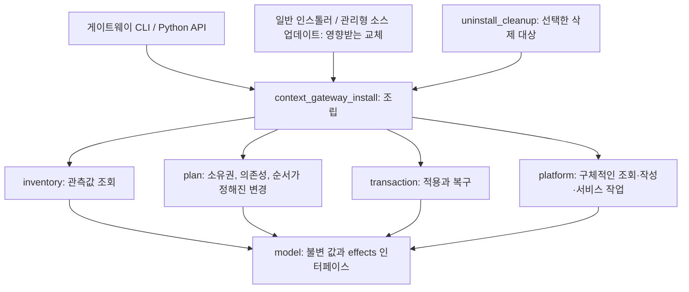
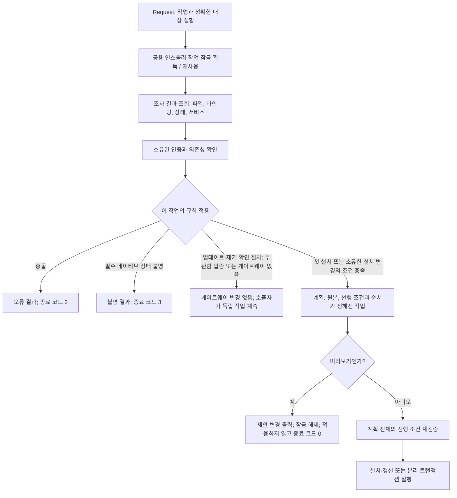
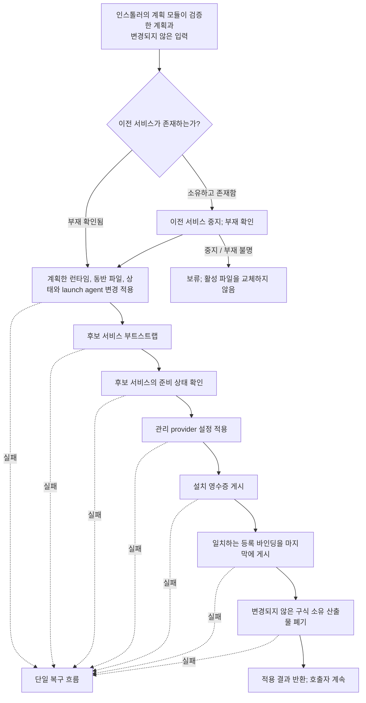
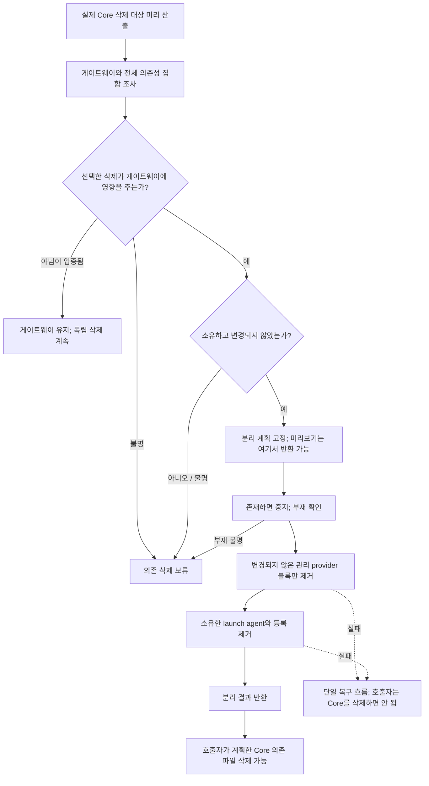
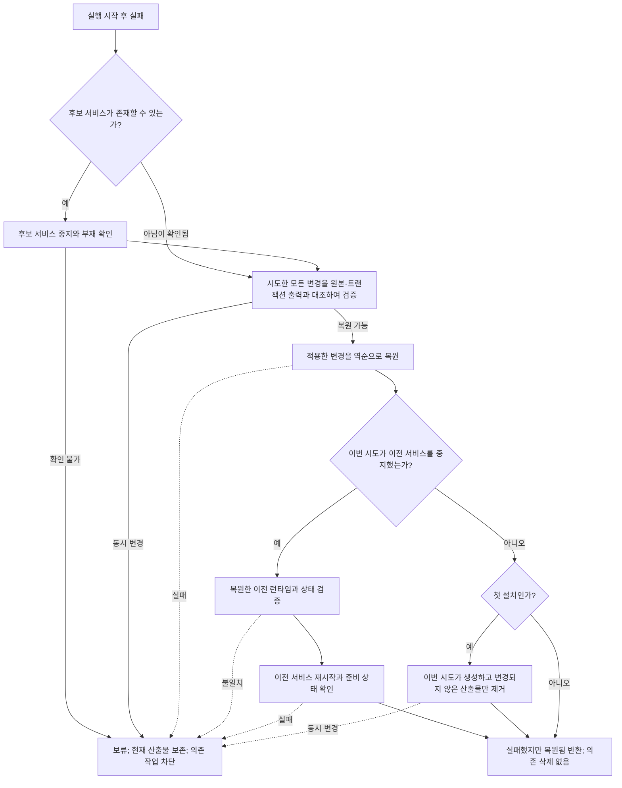

# 게이트웨이 설치 생명주기 설계

[🇺🇸 English](../../../coding-convention/specs/2026-10-15-gateway-installer-design.md) | [🇰🇷 한국어](./2026-10-15-gateway-installer-design.md)

상태: 소스 체크아웃에 구현되었습니다. 로컬 검증(프로젝트 시험과 로컬 CI가 체크아웃에서 통과한 단계)과 원격 게시는 별도 단계입니다. 이번 재편 중 인스톨러 배포나 네이티브 서비스 재시작을 실제 사용자 HOME에 실행하지 않았습니다. 기존 소스 링크는 이 체크아웃의 인스톨러 파일을 계속 가리킵니다.

## 범위

선택적 문맥 게이트웨이의 설치, 갱신, 제거와 복구를 재편합니다. 범위에는 일반 인스톨러가 게이트웨이 의존 파일을 교체하는 경로와 Core 제거 작업이 그 의존 파일을 삭제하는 경로가 포함됩니다. Core의 답변 로직, 문맥 선택, 네이티브 훅과 애드온 로직은 이 변경의 범위 밖입니다. 이 로직을 호출하는 인스톨러 코드는 변경될 수 있지만, 로직의 기능 동작은 변경하지 않습니다. 구독 인증, 모델 선택과 네이티브 thinking 설정도 변경하지 않습니다.

게시 단위는 저장소별 단독 저자 커밋 하나입니다. 이 설계는 배포, 원격 리뷰 요청, 영구 설치 백업이나 새 체크아웃을 추가하지 않습니다. 기존 복구 자료와 이 작업이 수행하지 않은 로컬 변경을 보존합니다. 그 변경은 체크아웃에 이미 있었으며, 변경한 주체를 git이 기록하지 않습니다. 구식 생성 파일의 삭제도 다른 변경과 같은 소유권·트랜잭션 규칙을 따릅니다.

## 현재 호출자와 구조적 원인

아래 관찰은 운영 코드를 재편하기 전에 이 설계를 위해 조사한 소스를 설명합니다.

- `_shared/context_gateway_install.py:install`은 소스 조사, 소유권 확인, provider 렌더링, 파일 시스템 준비, 네이티브 서비스 제어, 영수증 게시와 롤백을 한 함수에서 수행합니다.
- 같은 모듈의 `detach_for_uninstall`은 탐색, 의존성 확인, 서비스 제어와 또 하나의 롤백 루프를 별도로 구현합니다. 등록 누락에는 별도의 네이티브 탐색 분기가 있으며, 이 분기는 탐색 실패를 확인된 부재로 오인할 수 있고 상태 파일에 기록된 원장 의존성은 확인하지 않고 argv만 확인합니다.
- `_shared/uninstall_cleanup.py:build_report`는 실제 제거 대상을 미리 산출하고, 자신의 파괴적 삭제 전에 분리를 호출합니다. 이 순서는 유지해야 합니다.
- `_shared/installer/transaction.py:install_shared`는 설치된 스킬의 `_shared` 트리를, `sync_runtime_shared`는 런타임 `_shared` 트리를 교체할 수 있습니다. 두 함수는 게이트웨이 의존 파일을 변경하는 추가 경로이므로, 게이트웨이의 전용 설치 함수만 재편하면 두 경로는 서비스 조정 밖에 남습니다.
- `_shared/installer/source.py:update_source`는 관리형 소스 체크아웃 업데이트를 수행합니다. 설치된 런타임 디렉터리가 그 체크아웃으로 링크되면 이 경로도 실행 중인 게이트웨이의 의존 파일을 변경할 수 있으므로, 영향받는 소스 파일을 변경하기 전에 같은 조정에 참여해야 합니다. 인스톨러는 소스 체크아웃의 임의 외부 편집을 트랜잭션에 포함하지 않습니다.
- `_shared/install_transaction.py`는 이미 파일 시스템 교체를 스테이징합니다. 새 서비스 조정자는 적용 가능한 곳에서 이 파일 시스템 메커니즘을 재사용하고 복원 가능한 결과를 명시적으로 반환해야 하며, 이미 종료된 불투명한 작업 주위에 독립된 두 번째 롤백 책임자를 추가하지 않습니다.

소스 구현은 복원 가능한 파일 트리 교체에 `_shared/install_transaction.py`의 `ReplacementBatch`를, 복원 가능한 Git 업데이트에 `_shared/installer_source_update.py`의 `SourceUpdate`를 사용합니다. 게이트웨이 트랜잭션이 두 클래스의 `publish`와 `restore` 작업을 호출합니다. 무관한 작업은 게이트웨이 서비스를 변경하지 않고 자체 파일 시스템·Git 트랜잭션을 유지합니다. 셸과 PowerShell 진입점은 이 작업을 위임하며 별도의 게이트웨이 복구 루프를 구현하지 않습니다. 조정 도우미가 없는 구버전 체크아웃에서 부트스트랩 업데이트 도구의 복구 경로는 게이트웨이 부재를 확인한 뒤에만 실행합니다.

## 요구 동작

1. 영향받는 설치 산출물을 변경하기 전에 선택한 작업 전체를 조사합니다. 조사 오류는 오류로 유지하며, 부재·존재·불명은 서로 다른 관측값입니다.
2. 소유권은 탐색과 별도로 확인합니다. 서비스를 찾거나 레이블이 일치해도 그 서비스를 중지하거나 파일을 교체할 권한은 생기지 않습니다.
3. 의존성은 지원하는 서비스 정의, 상태와 인증된 영수증에서 확인합니다. 작업이 영향을 줄 수 있는 범위에서 런타임이 가져오는 모듈, 원장 동반 도우미, 인터프리터, 원장 루트, 상태, 네이티브 설정 루트와 서비스·로그 경로를 포함합니다. 플랫폼 이름이나 argv만 검색한 결과는 무관함을 입증하지 않습니다.
4. 선택한 작업이 게이트웨이에 영향을 줄 수 없음을 충분한 관측이 입증하면 무관한 게이트웨이를 변경하지 않습니다. 불명인 의존성은 무관함을 확인할 수 없는 작업만 차단합니다.
5. 영향받는 전체 집합, 원본, 권한, 선행 조건, 변경, 순서와 복구 작업을 담은 명시적 계획 하나를 생성합니다. 미리보기는 서비스나 설치 산출물을 변경하지 않고 그 계획을 반환합니다.
6. 활성 의존 파일을 변경하기 전에 네이티브 서비스의 부재를 확인합니다. 중지를 시도했지만 부재를 확인하지 못하면 파일 변경 단계로 진입하지 않습니다.
7. 스테이징한 런타임과 상태로 후보 서비스를 시작하고, 새로 활성화하는 provider를 연결하기 전에 준비 상태를 확인합니다. 갱신에서는 기존 리스너의 포트와 `scope` 값을 유지합니다.
8. 소유권은 적용에 성공한 뒤에만 게시합니다. 등록 바인딩이 소유권을 확정하는 마지막 토큰입니다. 여러 메타데이터 작성이 중단되면 다음 조사가 불일치를 감지하고 해당 작업을 보류해야 합니다.
9. 중지, 적용, 복구와 재시작의 책임은 트랜잭션 조정자 하나가 맡습니다. 어댑터는 재시도, 롤백, 오류 무시나 Core 삭제 재개를 독자적으로 결정하지 않습니다.
10. 이 트랜잭션의 출력과 아직 일치하는 산출물만 복구합니다. 이전 서비스를 재시작하기 전에 복원한 런타임을 다시 검증합니다. 동시 편집은 변경하지 않고 유지하며, 검증되지 않은 재시작을 막습니다.
11. 실패한 첫 설치는 후보 서비스의 부재와 복원을 확인한 뒤에만, 그 시도가 생성하고 변경되지 않은 산출물만 삭제합니다. 이전 설치, 기존 로그, 복구 자료와 독립적인 동시 변경 내용은 보존합니다.

## 모듈과 계약

제안한 게이트웨이 모듈은 모두 기존 진입점과 같은 `_shared/` 아래에 있습니다. `context_gateway_*` 접두사는 이 책임을 일반 인스톨러의 기존 트랜잭션 API와 구분합니다.

| 모듈 | 책임과 입력 → 출력 | 맡지 않는 책임 |
| --- | --- | --- |
| `context_gateway_model.py` | 불변 값: 요청, 산출물 스냅숏, 서비스 관측값, 의존성 집합, 판정, 변경, 계획과 실행 결과. 트랜잭션이 사용하는 effects 인터페이스를 정의합니다. | 파일 시스템·서비스 호출, 소유권 판단과 전역 가변 실행 상태. |
| `context_gateway_inventory.py` | 요청 + 조회 어댑터 → 조사 결과. 소스와 대상 바이트를 한 번만 조회하고 원본, 권한, 식별자, 표기·실제 경로, 파싱한 값과 명시적인 불명 관측값을 보관합니다. | 파일 작성, 탐색 결과를 소유권으로 취급하는 판단, 롤백 선택. |
| `context_gateway_plan.py` | 요청 + 조사 결과 → `no-op`, `blocked` 또는 완전한 작업 계획. 소유권 인증, 의존성 정책, provider 블록 비교·렌더링과 순서 제약을 담당합니다. | 새 파일 조회, 네이티브 명령, 계획 실행. |
| `context_gateway_transaction.py` | 계획 + effects 인터페이스 → 적용·복원·보류 결과. 모든 단계 전이, 선행 조건 재검증, 변경 저널, 역순 복구와 이전 서비스 재시작을 담당합니다. | 다른 대상의 재탐색, 근거 없는 소유권 부여, 불명 상태의 암묵적 수용, 계획 확장. |
| `context_gateway_platform.py` | 명시한 경로·도메인·인수 → 타입이 정해진 결과를 반환하는 파일 시스템, 잠금, 네이티브 서비스 또는 준비 상태 작업 하나. 조회 작업과 변경 작업을 구분합니다. | 정책 호출, 독자적인 소유권 등록, 작업 전체의 롤백, 오류 무시. |
| `context_gateway_install.py` | 현재 CLI와 Python 진입점을 유지합니다. 인수를 정규화하고, 협력 모듈을 조립하고, 조사 → 계획 → 실행을 호출하고, 결과를 호출자용 형식으로 변환합니다. | 중복 소유권 검사, 중첩 복구 루프, 직접 서비스·파일 변경. |

`context_gateway_transaction`은 `context_gateway_model`의 effects 인터페이스를 사용하며, 진입점이 `context_gateway_platform`을 공급합니다. 따라서 트랜잭션은 구체적인 플랫폼 어댑터를 가져오지 않습니다. `context_gateway_plan`은 `context_gateway_model`과 표준 라이브러리의 파싱·렌더링 도구만 가져옵니다. 하위 모듈은 진입점이나 자신의 호출자를 가져오지 않습니다.

이 다이어그램의 화살표는 코드 의존과 조립 관계이며 실행 단계의 순서가 아닙니다. inventory와 transaction은 둘 다 진입점에서 effects 객체를 전달받으며, 구체적인 platform 모듈을 가져오지 않고 model의 인터페이스에 의존합니다. 진입점은 조사 결과를 계획 모듈에, 계획을 트랜잭션에 전달합니다. 계획 모듈은 inventory를 호출하지 않으며, 트랜잭션은 계획 모듈을 호출하지 않습니다.

## 입력과 상태 소유

- 요청은 작업 종류와 명시적인 소스, 설치된 `_shared` 디렉터리, 런타임, 네이티브 설정 홈, 원장, 상태, launch agent와 실제 변경·제거 루트를 지정합니다. 과거 세션 좌표는 인스톨러 권한의 근거가 되지 않습니다.
- 인증된 등록이 설치 영수증의 위치를 지정합니다. 영수증은 구성 요소 기준값과 소유 좌표를 제공하며, 상태와 서비스 정의는 그 좌표와 일치해야 합니다. 형식이 잘못되었거나 일치하지 않는 기록은 새 기준값이 아니라 차단 판정을 생성합니다.
- 스냅숏은 부재 또는 원본 바이트, 권한, 말단 종류와 식별자를 포함합니다. 부모 디렉터리 링크는 계속 지원하며, 변경 대상인 말단 산출물이 링크이면 그 링크를 보존합니다. 표기 경로와 링크를 해석한 실제 경로를 모두 비교하므로 의존성 확인이 링크된 런타임 루트를 놓치지 않습니다.
- 서비스 관측값은 확인된 부재, 등록·존재하는 서비스와 불명 상태를 구분합니다. 존재만으로는 준비 상태, 소유권이나 의존성의 무관함을 입증하지 않습니다. 네이티브 명령 실패, 지원하지 않는 출력, 잘못된 인수와 조회할 수 없는 상태는 불명으로 유지합니다.
- 계획은 소유권 메타데이터와 구식 파일 폐기를 포함하여 모든 작성, 삭제와 서비스 전이를 지정합니다. 여러 대상에 사용하는 소스 바이트는 조사 결과가 고정합니다. 실행 중 불일치가 생기면 복구 후 계획 단계로 복귀하며, 실행 단계는 대상 집합을 암묵적으로 확장하지 않습니다.
- 원본과 적용한 작업의 유일한 책임자는 트랜잭션 저널입니다. 기존 인스톨러의 복구 구조를 재사용하며, 이번 작업에서 별도의 영구 백업 체계를 추가하거나 실제 사용자 설치본에 백업을 생성하지 않습니다. 기존에 보관한 복구 기록은 보존합니다. 예외 복구는 프로세스나 호스트의 갑작스러운 종료에도 여러 파일을 원자적으로 확정한다는 보장이 아닙니다. 중단된 메타데이터는 다음 조사가 감지하고 보류해야 합니다.

## 정확한 비교와 작업별 판정

계획 모듈은 명시적인 두 집합을 비교합니다. M은 이번 작업이 작성, 교체 또는 삭제할 경로·트리이고, D는 기존 게이트웨이가 요구하는 경로·트리입니다. D에는 서비스 런타임과 그 런타임이 가져오는 도우미, 인터프리터, 원장, 상태·설정과 서비스·로그 경로가 포함됩니다. 겹침은 표기 경로와 실제 경로로 판정하며, 상위 디렉터리 제거와 링크된 런타임도 포함합니다. 플랫폼 레이블, 서비스 레이블이나 경로의 존재만으로는 겹침이나 무관함이 성립하지 않습니다.

| 용어 | 정확한 의미 | 예 |
| --- | --- | --- |
| 무관 | 비교에 요구되는 의존성을 모두 알고, 선택한 변경 중 D와 겹치는 것이 없습니다. 이 결과는 기존 게이트웨이를 변경하지 않으며 호출자의 무관한 작업을 생략하지 않습니다. | 게이트웨이가 별도의 Codex 런타임과 원장을 사용하는 동안 독립된 Claude 설치를 제거합니다. |
| 영향 있음 | 선택한 변경 중 하나 이상이 D와 겹칩니다. 계획 모듈은 그 변경을 서비스 생명주기와 조정해야 합니다. | 서비스가 사용하는 런타임 `_shared`를 교체하거나 그 원장 루트를 삭제합니다. |
| 불명 | 요구되는 관측을 얻을 수 없거나, 그 스키마로 의존성·소유권 사실을 확인할 수 없습니다. 불명은 부재, 무관이나 소유를 뜻하지 않습니다. | 네이티브 탐색이 실패하거나, 상태를 조회할 수 없거나, 서비스 인수가 잘못되었거나, 등록이 영수증의 위치를 찾지 못합니다. |
| 충돌 | 확보한 관측이 소유권 기준값이나 요청 대상과의 불일치를 확인합니다. | 설치된 구성 요소·provider에 외부 변경(설치 뒤 인스톨러가 찾은, 인스톨러의 기록에 없는 변경. 변경한 주체를 인스톨러가 기록하지 않음)이 있거나, 영수증 해시가 등록과 다르거나, 소유하지 않은 서비스가 대상을 점유합니다. |

계획의 변경 권한은 작업별로 정해집니다. "영향 있음"에서 일반적으로 추론하는 권한이 아닙니다.

| 요청 | 허용하는 변경 | 무관·부재 동작 | 차단 조건 |
| --- | --- | --- | --- |
| 첫 게이트웨이 설치 | 요구되는 실행 환경을 갖추고, 선택한 Core·원장 입력이 유효하며, 소유하지 않은 서비스·provider·launch agent가 대상을 점유하지 않고, 점유된 대상 파일이 소스나 인간 사용자가 명시적으로 허가한 기준값과 일치합니다. 소유한 새 설치를 생성합니다. | 확인된 서비스 부재는 설치의 선행 조건이며, 작업을 생략하는 결과가 아닙니다. | 소유하지 않은 점유 대상, 충돌하는 편집 또는 불명인 서비스 상태. |
| 게이트웨이 갱신 | 등록이 이전 영수증, 상태, launch agent와 구성 요소 기준값을 인증합니다. 리스너의 포트와 `scope` 값을 유지하고 선택한 교체 계획을 적용합니다. | 이전 서비스가 부재해도 유효한 소유 파일로 갱신할 수 있으며, 이 경우를 첫 설치로 혼동하지 않습니다. | 소유권 누락, 변경된 관리 산출물 또는 불명인 서비스 상태. |
| 일반 Core 파일·소스 업데이트 | 먼저 M을 계산합니다. M이 D와 겹치면 정확히 그 교체 전후에 소유한 서비스를 조정하고, 영향받는 소유권 기준값을 갱신합니다. | 설치된 게이트웨이가 없거나 의존성이 겹치지 않음이 입증되면, 호출자가 게이트웨이 서비스·설정을 변경하지 않고 자체 업데이트를 실행합니다. | 영향받는 게이트웨이를 소유하지 않았거나, 충돌이 있거나, 영향 범위를 확정할 수 없음. |
| Core 제거 / 게이트웨이 분리 | 먼저 실제 삭제 루트 M을 계산합니다. 소유한 게이트웨이가 그 루트에 의존하면, 호출자가 그 루트를 삭제하기 전에 게이트웨이 분리에 성공해야 합니다. | 무관함이 입증된 게이트웨이는 독립된 제거가 진행되는 동안 실행 상태를 유지합니다. 부재가 확인되고 로컬 설치 신호가 없으면 게이트웨이를 분리하지 않습니다. | 소유하지 않은 영향받는 서비스, 수정된 관리 설정 또는 입증되지 않은 무관함. |

## 실행 흐름의 데이터 모델 사용

`context_gateway_model.py`는 자료형을 선언합니다. AI 모델을 호출하지 않으며 실행 단계도 아닙니다. 다른 모듈은 이 자료형을 가져옵니다. 아래 화살표는 모듈 사이에 실제로 전달되는 값을 나타냅니다.

```mermaid
flowchart LR
    E["install: 인수 정규화"] -->|"Request: 작업 + 정확한 경로"| I["inventory: platform을 통한 조회"]
    I -->|"Inventory: 스냅숏 + 서비스 관측값"| P["plan: 소유권 비교와 M 대 D 비교"]
    P -->|"Decision: 차단 / 무관 / 계획"| E2["install: 반환 또는 실행"]
    E2 -->|"Plan: 선행 조건 + 순서가 정해진 작업 + 원본"| T["transaction: effects 인터페이스로 실행"]
    T -->|"ExecutionResult: 적용 / 복원 / 보류"| E3["install: 출력 형식 변환과 종료"]
```

무관 결과는 위 표의 일반 업데이트·제거 확인 경로에서만 사용할 수 있습니다. 첫 설치 요청은 항상 새 설치 계획이나 오류를 생성합니다.

## 공통 진입 순서

기존 일반 인스톨러 잠금은 재사용하거나 소유한 잠금 컨텍스트로 전달해야 합니다. 같은 잠금을 중첩하여 다시 획득하면 이미 보유한 잠금이므로 실패합니다. 협력하는 모든 변경 경로는 같은 잠금 범위를 사용합니다. 외부 편집자는 잠금에 참여하지 않으므로 잠금이 산출물 비교를 대체하지 않습니다.

미리보기는 호출자가 명시하는 옵션이며, 인스톨러가 자동으로 결정하지 않습니다. 미리보기는 "이 요청이 무엇을 변경하는가?"라는 질문에 실행이 사용할 것과 같은 검증된 계획으로 답합니다. 그 계획은 중지·시작 작업, 파일 작성·삭제, 보존 대상과 복구 순서입니다. 계획을 반환하면 그 호출은 종료되며, 승인을 기다리거나 다음 실행을 예약하지 않습니다. 이후의 실행은 잠금을 다시 획득하거나 재사용하고 현재 상태를 다시 조사하는 별도 호출입니다. 충돌이나 조회할 수 없는 필수 관측을 발견한 미리보기는 성공한 실행 계획이 아니라 오류를 반환합니다.

## 최종 결과와 종료 코드

아래는 게이트웨이 CLI와 Python 오류 계약입니다. 파일 시스템 트랜잭션 CLI는 게이트웨이 오류를 감쌀 때 오류 식별자와 코드를 보존합니다. 일반 셸·PowerShell 인스톨러는 구성 요소 실패를 기존 전체 실패 결과에 포함할 수 있으며, 구조화된 구성 요소 오류는 단계와 식별자를 유지합니다. Python API는 같은 코드·결과를 가진 타입이 정해진 결과를 반환하거나 타입이 정해진 오류를 발생시키므로, 호출자는 실패 후 의존 삭제를 계속할 수 없습니다.

| 종료 코드 | 결과 / 오류 식별자 | 설치 산출물과 다음 동작 |
| --- | --- | --- |
| 0 | `applied`, `independent` 또는 `dry-run` | 요청한 로컬 단계를 완료했거나, 무관한 게이트웨이를 변경하지 않았거나, 검증했지만 적용하지 않은 계획을 출력했습니다. 출력은 세 경우를 구분합니다. |
| 2 | `blocked` / `GATEWAY_PRECONDITION` | 충돌, 지원하지 않는 입력 또는 소유권 누락입니다. 계획을 적용하지 않고, 오류를 반환하고 소유한 잠금을 해제합니다. |
| 3 | `held` / `GATEWAY_SERVICE_UNCONFIRMED` | 산출물을 교체하기 전에 필수 네이티브 상태나 서비스 부재를 확인할 수 없습니다. 파일을 교체하거나 의존 Core 대상을 삭제하지 않습니다. 잠금을 해제하고 종료하며, 자동으로 재시도하거나 재개하지 않습니다. |
| 4 | `restored` / `GATEWAY_OPERATION_RESTORED` | 변경이 시작된 뒤 적용이 실패했고, 이전 산출물과 서비스를 복원하고 확인했습니다. 요청한 작업은 실패했으므로 호출자는 의존 삭제를 계속하면 안 됩니다. |
| 5 | `held` / `GATEWAY_RECOVERY_UNCONFIRMED` | 변경이 시작된 뒤의 실패를 안전하게 복구할 수 없습니다. 예를 들어 후보 서비스 중지나 동시 편집 확인이 실패한 경우입니다. 현재 산출물과 복구 산출물을 보존하고, 의존 작업을 차단하고, 잠금을 해제하고 종료합니다. 아무것도 변경되지 않았다고 주장하지 않습니다. |

모든 오류는 단계, 고정 식별자와 간결한 원인을 포함합니다. `held`는 현재 호출의 최종 실패이며, 백그라운드 대기열이나 무기한 대기가 아닙니다. 이후의 재시도에는 새 호출과 새 조사가 요구됩니다. 특히 최초 중지가 불확실하면 활성 의존 파일을 교체하지 않고 종료 코드 3으로 종료합니다. 복구 중 후보 서비스 중지가 불확실하면 후보 산출물이 이미 변경되었을 수 있으므로 종료 코드 5로 종료합니다.

## 설치와 갱신 순서

첫 설치와 갱신은 같은 실행 엔진을 사용합니다. 두 작업의 차이는 명시적인 계획 데이터입니다. 첫 설치에는 복원할 이전 서비스가 없고, 갱신에는 인증된 원본이 있으며 리스너의 포트와 `scope` 값을 유지합니다. 링크된 런타임을 통한 관리형 소스 업데이트를 포함한 일반 Core 업데이트는 실행 중인 게이트웨이의 의존 파일을 교체하는 경우 이 조정을 사용합니다. Core 업데이트는 설치되지 않은 게이트웨이를 활성화하거나 새 provider 설정을 요청하지 않습니다. 소스 업데이트 도구는 Git 업데이트가 링크된 런타임을 이미 변경한 뒤에 확인 절차를 호출하지 않고, 체크아웃 파일을 변경하기 전에 영향받는 체크아웃 경로를 결정해야 합니다.

## 분리와 제거 순서

Core 제거 호출자는 매니페스트에 포함되었다는 사실이나 플랫폼 레이블이 아니라, 미리 산출한 정확한 삭제 루트를 사용해야 합니다. 기존 영수증, 상태, 사용 로그와 복구 자료에는 각 소유자의 보존 규칙을 적용합니다. 호출자는 불확실한 분리를 성공으로 취급하거나, 복구 결과 뒤에 의존 Core 파일을 삭제할 수 없습니다.

선택한 스킬의 제거는 먼저 애드온 제외 대상을 확정하고 선택한 삭제 루트를 모두 수집합니다. bash와 PowerShell 구현은 모두 첫 스킬을 삭제하기 전에 그 전체 집합을 게이트웨이 확인 절차에 전달합니다. 무관한 스킬이 남아 있어도 원장 동반 파일의 조정을 생략하지 않습니다. 관리형 소스 업데이트는 이름 변경의 이전 경로와 새 경로를 모두 조사하므로, 기존 의존 파일의 삭제가 무관한 변경으로 분류되지 않습니다. macOS 이외의 호출자는 Unix 사용자 ID를 요청하거나 launchctl 도메인을 구성하지 않고 부재·무관 판정에 도달합니다.

## 등록 누락 분기

| 관측 | 판정 |
| --- | --- |
| 인증된 등록 없이 로컬 provider·서비스 산출물이 존재합니다. | 영향받는 제거 작업을 보류합니다. 탐색은 분리 권한을 부여하지 않습니다. |
| 네이티브 서비스 부재가 확실히 확인되고 로컬 설치 신호가 없습니다. | 해당하는 게이트웨이가 없습니다. 독립된 호출자 제거 작업은 계속할 수 있습니다. |
| 네이티브 탐색이 오류를 반환하거나 서비스·의존성 데이터를 완전히 해석할 수 없습니다. | 불명입니다. 무관함이 입증되지 않은 제거를 보류합니다. |
| 존재하는 미등록 서비스에 대한 네이티브·서비스·상태 관측이, 해당하는 모든 의존성이 선택한 루트와 무관함을 입증합니다. | 그 게이트웨이를 보존하고 독립된 호출자 작업만 허용합니다. |
| 존재하는 미등록 서비스가 선택한 루트에 의존합니다. | 의존 삭제를 보류합니다. 소유하지 않은 서비스는 중지하지 않습니다. |

원장과 네이티브 디렉터리는 상태 파일에서 조회하고 런타임 도우미는 전이적으로 가져오므로, argv만 확인하는 방식으로는 부족합니다. 새로 지원하는 서비스·설정 형식은 inventory와 정책을 동시에 확장해야 하며, 의존성에 영향을 줄 수 있는 알 수 없는 필드가 무관함을 암묵적으로 성립시키지 않습니다.

## 단일 복구 순서

파일 교체 전의 불확실한 중지는 별도의 보류 결과를 가지며 복원을 주장하지 않습니다. 중지가 확실히 확인된 뒤 이후의 관측이 실패하면, 복구는 산출물을 검증한 뒤에만 이전 서비스를 복원할 수 있습니다. 동시에 편집된 런타임은 검증된 이전 런타임으로 재시작하지 않습니다.

## 순서 검토와 구현 관문

| 순서 제약 | 설계 판단 |
| --- | --- |
| 설치 산출물을 변경하기 전에 조사와 계획을 수행합니다. | 모든 경로가 inventory → 정책·계획 → transaction 순서를 사용합니다. 잠금 획득은 제어 조정이며 배포가 아닙니다. |
| 활성 의존 파일을 교체하기 전에 부재를 확인합니다. | 공통 적용 단계 앞의 명시적 관문입니다. 일반 인스톨러의 파일 교체도 이 관문을 거칩니다. |
| 새로 설정한 provider를 활성화하기 전에 준비 상태를 확인합니다. | 후보 서비스의 준비 상태 확인이 provider 적용보다 먼저입니다. |
| 일치하는 등록보다 설치 영수증을 먼저 게시합니다. | 등록이 마지막 소유권 게시 토큰입니다. 중단된 쌍은 인증에 실패합니다. |
| Core 의존 파일을 삭제하기 전에 게이트웨이를 분리합니다. | 제거 작업은 성공한 분리나 입증된 무관함을 입력으로 사용하며, 보류·복원 결과는 의존 삭제를 차단합니다. |
| 롤백 전에 후보 서비스의 부재를 확인하고, 재시작 전에 복원한 런타임을 검증합니다. | 두 확인 모두 복구 흐름에서 각자의 의존 작업보다 먼저입니다. |
| 산출물 폐기는 소유권 게시 뒤에, 첫 설치 산출물 삭제는 안전한 복구 뒤에 실행합니다. | 폐기는 저널에 기록하며, 실패는 같은 복구 책임자가 맡습니다. |
| 복구 책임자는 정확히 하나이며 모듈 의존은 아래로만 향합니다. | 트랜잭션이 단계 전이 구조를 소유합니다. platform과 파일 시스템 기본 작업은 숨은 전체 작업 복구 없이 작업과 결과를 노출합니다. |

순서 표는 설계 판단을 기록합니다. 실행 가능한 검증은 `_shared/test_context_gateway_install.py`, `_shared/test_context_gateway_uninstall.py`, `_shared/test_gateway_payload_update.py`, `_shared/test_gateway_installer_faults.py`에 있습니다. 하위 프로세스 픽스처는 전용 HOME·설정·상태, 전용 launchctl 시뮬레이터와 실제 루프백 게이트웨이 프로세스를 사용합니다. 이 픽스처는 네이티브 탐색·중지·시작 실패, 부분 작성, 준비 실패, 동시 편집과 불확실한 복구를 종료 코드까지 검증합니다. 일반 파일 교체와 링크된 체크아웃 업데이트는 각자의 참여자·복구 검증을 가집니다. 로컬 관측은 실제 사용자 설치본의 채택, 원격 CI 승인이나 업그레이드 전체의 완료를 입증하지 않습니다. 로컬 개발 중에는 중간 원격 자동 리뷰를 중지한 상태로 유지합니다. 최종 게시는 인간 사용자가 결정하며, 기존 CI 조건과 원격 자동 검토 조건을 따릅니다.
