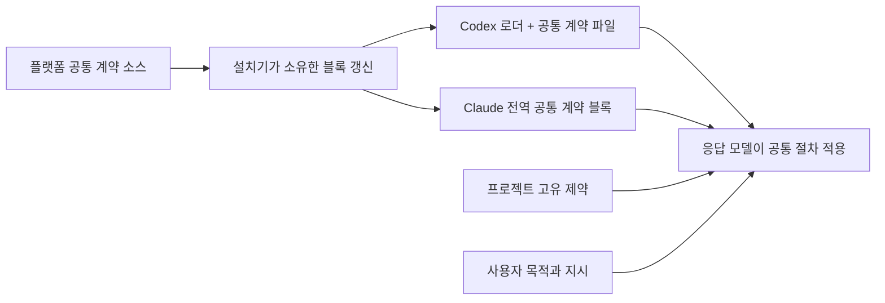

# Installation And Update Guide

Language: [🇺🇸 English](../../getting-started/installation.md) | 🇰🇷 한국어

이 문서는 Ghost-ALICE OS의 설치, 업데이트, 상태 점검과 복구 명령을 안내합니다. 운영체제별 기본 실행 명령에서도 같은 긴 옵션 이름을 사용합니다.

- macOS, Linux, WSL, Git Bash: `bash install.sh ...`
- Windows Command Prompt 또는 PowerShell: `.\install.cmd ...`

Windows에서는 `install.cmd`가 기본 래퍼를 통해 설치기를 실행합니다. Python 3.11 이상을 요구하고 콘솔을 UTF-8로 설정하며 `-NoProfile -ExecutionPolicy Bypass`를 사용합니다. PowerShell 실행 정책으로 인한 차단을 처리하되 사용자나 컴퓨터의 실행 정책은 변경하지 않습니다.

Windows 설치기에는 PowerShell 7.6 이상이 필요합니다. Windows PowerShell 5.1은 은퇴했습니다. 더 낮은 PowerShell에서는 설치기가 요구 사항을 출력하고 멈춥니다. `winget install --id Microsoft.PowerShell --exact`로 PowerShell을 설치한 뒤 `.\install.cmd`를 다시 실행해 주세요.

## Core와 Ghost-ALICE Autopilot 함께 설치

저장소를 복제한 뒤 아래 명령으로 에이전트 플랫폼을 자동 감지하여 함께 설치해 주세요.

```bash
bash install.sh --addon autopilot
```

Windows Command Prompt 또는 PowerShell에서는 `.\install.cmd --addon autopilot`을 사용해 주세요. 아래 상세 옵션으로 특정 에이전트 플랫폼을 선택하거나 설치를 개별적으로 관리하실 수 있습니다.

## Contents

- [Quick Install](#quick-install)
- [Install Official Addons](#install-official-addons)
- [Official Addon List](#official-addon-list)
- [Install One Official Addon To One Platform](#install-one-official-addon-to-one-platform)
- [Install Custom Addons](#install-custom-addons)
- [Install One Platform](#install-one-platform)
- [Check Status](#check-status)
- [Update](#update)
- [Common Commands](#common-commands)
- [Runtime And Platform Reference](#runtime-and-platform-reference)
- [Uninstall](#uninstall)
- [Troubleshooting](#troubleshooting)

## Quick Install

macOS, Linux, WSL, Git Bash:

```bash
git clone https://github.com/AidALL/ghost-alice.git ~/ghost-alice
cd ~/ghost-alice
bash install.sh --addon autopilot
```

Windows Command Prompt:

```cmd
git clone https://github.com/AidALL/ghost-alice.git %USERPROFILE%\ghost-alice
cd %USERPROFILE%\ghost-alice
.\install.cmd --addon autopilot
```

## Install Official Addons

공식 애드온은 짧은 별칭으로 지정하며 복제한 Ghost-ALICE Core 저장소에서 설치합니다.

macOS, Linux, WSL, Git Bash:

```bash
bash install.sh --addon autopilot
```

Windows Command Prompt 또는 PowerShell:

```cmd
.\install.cmd --addon autopilot
```

Windows Command Prompt와 PowerShell에서도 `.\install.cmd --addon autopilot`로 같은 공식 별칭을 사용합니다.

이 명령은 복제한 Ghost-ALICE Core 저장소에서 실행해 주세요. Core 설치기가 공식 애드온 패키지를 가져오므로 Ghost-ALICE Autopilot 저장소를 따로 복제하거나 그 안에서 설치기를 실행하실 필요는 없습니다. 설치 예시가 전체 실행 환경의 호환성을 입증하지는 않습니다. 지원 범위는 애드온 저장소의 `compatibility-matrix.json`에서 확인해 주세요.

한 플랫폼만 설치하는 명령은 [플랫폼별 공식 애드온 설치](#install-one-official-addon-to-one-platform)를 확인해 주세요.

애드온별 동작, 상태 파일, 일시정지·재개와 제거 안내는 각 애드온 저장소에서 제공합니다. 공통 설치 명령은 Core 저장소에서 실행합니다.

## Official Addon List

| Addon | 용도 | macOS / Linux / WSL | Windows Command Prompt / PowerShell | Details |
| --- | --- | --- | --- | --- |
| autopilot | 명시적으로 승인된 자율 실행을 작업 항목 단위로 이어갑니다 | `bash install.sh --addon autopilot` | `.\install.cmd --addon autopilot` | [AidALL/ghost-alice-autopilot](https://github.com/AidALL/ghost-alice-autopilot) |

Core `0.5.1`과 Ghost-ALICE Autopilot `0.5.1`은 routing과 managed completion API를 사용합니다. Ghost-ALICE Autopilot에는 Core `0.5.1` 이상이 필요합니다. 소스 검사, native runtime 검증과 게시는 서로 다른 근거를 제공합니다.

## Install One Official Addon To One Platform

```bash
bash install.sh --platform codex --addon autopilot
```

```cmd
.\install.cmd --platform codex --addon autopilot
```

## Install Custom Addons

사용자 정의, 조직 전용이나 로컬 개발 애드온은 `--addon-source PATH|URL`로 지정합니다.

```bash
bash install.sh --addon-source /path/to/addon-repo
```

```cmd
.\install.cmd --addon-source C:\path\to\addon-repo
```

Git URL로 애드온 소스를 지정하면 `--addon-tag`로 로컬 소스 캐시에 복제할 브랜치나 태그를 선택합니다.

## Install One Platform

다음 명령은 Core만 설치합니다. 선택한 플랫폼에 Ghost-ALICE Autopilot도 설치하시려면 `--addon autopilot`을 추가해 주세요.

| 대상 | macOS / Linux / WSL | Windows Command Prompt / PowerShell |
| --- | --- | --- |
| Claude Code | `bash install.sh --platform claude` | `.\install.cmd --platform claude` |
| Codex | `bash install.sh --platform codex` | `.\install.cmd --platform codex` |

대화형으로 선택하시려면 다음 명령을 사용해 주세요.

```bash
bash install.sh --prompt-platform
```

```cmd
.\install.cmd --prompt-platform
```

## Check Status

Doctor는 상태를 변경하지 않는 엄격한 진단입니다. 설치 상태가 의심스러우면 변경 전에 doctor를 실행해 주세요.

```bash
bash install.sh --doctor
bash install.sh --status
```

```cmd
.\install.cmd --doctor
.\install.cmd --status
```

정상 목표는 `overall: ok`입니다.

## Update

설치기를 통해 복제한 저장소를 갱신해 주세요. 이 경로는 소스를 fast-forward하기 전에 로컬 변경을 stash에 보관합니다.

```bash
cd ~/ghost-alice
bash install.sh --update-source
```

```cmd
cd %USERPROFILE%\ghost-alice
.\install.cmd --update-source
```

로컬 설치기가 업데이트 옵션을 제공하지 않으면 [부트스트랩 업데이트 복구](./troubleshooting.md#git-update-recovery)를 따라 주세요.

소스 갱신이 충돌, 갈라진 브랜치나 fast-forward 불가 상태에서 멈추면 설치기를 반복 실행하지 마세요. 먼저 [문제 해결](./troubleshooting.md)을 확인해 주세요.

`--update-source`는 Core 저장소의 소스를 갱신하며 애드온 패키지를 갱신하지 않습니다. 다음 명령으로 Core와 Ghost-ALICE Autopilot을 함께 다시 설치하고 설치 상태를 확인해 주세요. 부트스트랩 업데이트가 Core만 다시 설치하더라도 같은 명령으로 두 패키지를 함께 설치해 주세요.

```bash
bash install.sh --addon autopilot
bash install.sh --doctor
bash install.sh --status
```

```cmd
.\install.cmd --addon autopilot
.\install.cmd --doctor
.\install.cmd --status
```

### 설치 원본

설치 기록 `~/.ghost-alice/installed-payload.json`은 설치본을 만든 체크아웃, 즉 설치 원본을 기록합니다. 설치와 `--repair`는 아무것도 바꾸기 전에 기록의 체크아웃과 자신이 실행되는 체크아웃을 비교합니다. 기록된 체크아웃이 더는 없으면(다른 경로에 다시 clone한 경우) 설치기는 묻지 않고 새 체크아웃을 설치 원본으로 기록합니다. 두 번째 clone이나 git worktree처럼 두 체크아웃이 모두 있으면 설치기는 두 폴더를 출력합니다. 터미널에서는 이 체크아웃으로 설치 원본을 교체할지 묻고, 교체를 승인하지 않으면 종료합니다. 터미널이 아니면 종료 코드 2로 종료합니다. 다른 체크아웃으로 설치본을 의도적으로 옮기려면 그 체크아웃에서 `--adopt-source`를 붙여 설치기를 실행해 주세요. 설치기는 첫 배치에서 그 체크아웃을 설치 원본으로 기록합니다. `--repair`는 설치본을 옮기지 않습니다. 다른 체크아웃에서 실행하면 종료 코드 2로 종료하고 그 설치 명령을 안내합니다.

```bash
cd /path/to/new-checkout
bash install.sh --adopt-source
```

```cmd
cd C:\path\to\new-checkout
.\install.cmd --adopt-source
```

설치기는 저장소의 git 훅 경로(`core.hooksPath`, 저장소의 모든 worktree가 함께 조회하는 설정)를 설치 원본의 `hooks` 폴더로 작성합니다. 설치 원본에서 merge나 pull을 하면 설치 원본의 post-merge 훅이 감지한 모든 호스트에 설치를 이어서 실행합니다. 같은 저장소의 다른 worktree에서 merge나 pull을 하면 git은 그 worktree의 훅 파일이 아니라 설치 원본의 같은 훅을 실행하고, 훅은 한 줄만 출력하고 설치하지 않습니다. worktree 자신의 훅 설정(`git config --worktree core.hooksPath`)이 있으면 git은 그 설정을 먼저 조회합니다. 설치 원본을 교체하는 것은 사용자가 실행한 설치뿐이며 merge는 교체하지 않습니다. 훅 때문에 merge가 실패하지도 않습니다. 마지막 호스트의 전체 제거는 설치 전의 훅 경로를 다시 작성하며, 설치 뒤에 바뀐 값은 그대로 둡니다.

## Common Commands

| 용도 | macOS / Linux / WSL | Windows Command Prompt / PowerShell |
| --- | --- | --- |
| 스킬 목록 | `bash install.sh --list` | `.\install.cmd --list` |
| 설치 상태 확인 | `bash install.sh --status` | `.\install.cmd --status` |
| 보호 진단 실행 | `bash install.sh --doctor` | `.\install.cmd --doctor` |
| 안전한 소스 갱신 | `bash install.sh --update-source` | `.\install.cmd --update-source` |
| 공식 Ghost-ALICE Autopilot 설치 | `bash install.sh --addon autopilot` | `.\install.cmd --addon autopilot` |
| 사용자 정의 애드온 설치 | `bash install.sh --addon-source /path/to/addon-repo` | `.\install.cmd --addon-source C:\path\to\addon-repo` |
| 선택한 Core 스킬 설치 | `bash install.sh task-router verification-before-completion` | `.\install.cmd task-router verification-before-completion` |
| 전체 제거 | `bash install.sh --uninstall` | `.\install.cmd --uninstall` |
| 선택 제거 | `bash install.sh --platform codex --uninstall task-router` | `.\install.cmd --platform codex --uninstall task-router` |
| 잘못된 미결 항목 정리 | `bash install.sh --platform claude --cleanup-pending` | `.\install.cmd --platform claude --cleanup-pending` |

## Runtime And Platform Reference

### Agent Visibility Profile

기본 표시 프로필은 `dynamic`입니다. 사용자에게 보이는 거버넌스 메시지의 양만 조절하며 훅, 엄격한 감사 로그와 Work-Impact Projection은 끄지 않습니다.

| 프로필 | macOS / Linux / WSL | Windows Command Prompt / PowerShell |
| --- | --- | --- |
| strict | `bash install.sh --visibility strict` | `.\install.cmd --visibility strict` |
| dynamic | `bash install.sh --visibility dynamic` | `.\install.cmd --visibility dynamic` |
| minimal | `bash install.sh --visibility minimal` | `.\install.cmd --visibility minimal` |

`--agent-visibility`도 호환성을 위한 별칭으로 사용할 수 있습니다. 새 문서와 명령에서는 `--visibility`를 사용해 주세요.

### Slash Commands By Platform

Ghost-ALICE는 Claude Code 작업 공간 명령으로 `/visibility strict|dynamic|minimal`을 설치합니다. Codex를 비롯한 다른 플랫폼에서는 `_shared/agent_visibility_cli.py`로 같은 프로필을 확인하거나 변경해 주세요.

### Python Contract

설치기는 `--help`와 `--list`를 포함한 모든 명령에 Python 3.11 이상을 요구합니다. `install.sh`는 Python을 찾거나 준비한 뒤 인수를 그대로 `_shared/installer/cli.py`에 넘깁니다. 해당 버전이 없으면 가능한 환경에서 자동 준비를 시도합니다.

선택적인 macOS 네이티브 컨텍스트 gateway에는 `compression.zstd`를 제공하는 Python 3.14 이상이 필요합니다. 등록 명령 `bash install.sh gateway --codex-dir <dir> --ledger-root <dir> --state-dir <dir> --launch-agent <plist>`는 먼저 이 기능을 확인한 뒤 launch agent, `state.json`, Codex provider 블록을 작성하고 설치 기록에 서비스를 기록합니다. 등록 명령은 모듈을 복사하지 않습니다. 서비스는 설치기가 게시한 런타임 `_shared`를 실행하므로 Core를 먼저 설치합니다. Core 설치기와 훅의 최소 요구 버전은 Python 3.11로 유지됩니다. Codex `config.toml`, launch agent, 상태 파일이 심볼릭 링크이면 등록과 분리는 서비스를 변경하기 전에 종료하고 링크와 원본을 보존합니다. 갱신은 서비스 파일 세 개가 설치 기록과 같은 동안 리스너의 포트와 scope를 유지합니다. 설치기 밖에서 바뀐 파일이 있으면 명령은 아무것도 바꾸기 전에 종료하고, 기록이 지정하지 않은 launch agent, 상태 디렉터리 항목, provider 블록은 보존합니다. 첫 등록이 실패하고 후보 서비스의 중지가 확인되면 해당 시도가 새로 작성한 상태 자료와 기록 항목을 되돌려 다음 등록을 진행할 수 있습니다. 중지를 확인할 수 없거나 자료가 동시에 변경되면 복구 자료를 보존하고 검토를 요청합니다. 등록 뒤에는 `bash install.sh`만으로 설치본을 갱신합니다. `bash install.sh gateway detach --confirm`은 서비스 등록을 해제하고 상태 디렉터리를 남깁니다. 설치 기록에 없는 게이트웨이 서비스를 launchd가 실행 중이면, 설치와 `--repair`는 그 서비스를 그대로 두고 등록 명령을 안내하는 경고 한 줄을 출력합니다. 등록 명령은 서비스를 기록에 작성하고 새 코드로 재시작합니다.

- macOS: Homebrew가 있으면 `brew install python3`
- Linux / WSL: `apt-get`, `dnf`, `yum`, `pacman` 같은 패키지 관리자
- Windows: `winget`, `choco`, 그 다음 `scoop`

Python 3.11 이상을 준비하지 못하면 설치를 멈추고 수동 복구 안내를 제공합니다.

### PowerShell Contract

`.\install.cmd`는 PowerShell 7(`pwsh.exe`)로 Windows 설치기를 실행하고, `pwsh.exe`가 없으면 Windows PowerShell(`powershell.exe`)로 실행합니다. Windows 설치기에는 7.6 LTS 계열인 PowerShell 7.6 이상이 필요합니다. Windows PowerShell 5.1을 포함해 더 낮은 PowerShell에서는 `PowerShell 7.6 or newer is required`와 설치 명령 `winget install --id Microsoft.PowerShell --exact`를 출력하고 종료 코드 1로 멈춥니다. 설치기가 PowerShell을 직접 설치하지는 않습니다. 이 확인을 통과하면 콘솔 입출력을 UTF-8로 설정하고 Python 3.11 이상을 준비한 뒤, 모든 인수를 순서대로 `_shared/installer/cli.py`에 넘깁니다. `install.sh`가 실행하는 설치기와 같은 설치기이므로 Windows에서도 같은 긴 옵션을 씁니다.

macOS와 다른 POSIX 호스트의 설치된 훅은 `GHOST_ALICE_PYTHON`, 실행 환경의 `PATH`와 일반 설치 위치, 설치에 사용한 인터프리터 순서로 Python을 찾습니다. 각 후보는 Python 3.11 이상 검사를 통과해야 합니다. 마지막 대체 경로는 데스크톱 앱의 `PATH`에 설치용 Python 디렉터리가 없어도 훅을 실행할 수 있도록 합니다. 호스트의 전역 Python이나 `PATH`는 변경하지 않습니다. 해당 인터프리터가 이동했고 다른 후보도 없으면 설치기를 다시 실행해 주세요.

### Node.js Contract

Claude Code와 Codex의 훅 설치에는 사용 가능한 Node.js 실행 환경이 필요합니다. `tool-checkpoint`의 PreToolUse 게이트가 `ghost-alice-hook.mjs`를 실행하기 때문입니다. 설치기는 설정된 실행 환경, 플랫폼 등록과 `PATH`를 확인하며 Codex에 설정된 대체 실행 환경도 사용합니다. 훅이 필요한 대상 플랫폼에서 사용 가능한 Node를 찾지 못할 때만 훅 설치를 중단합니다.

### Platform Update Behavior

| 플랫폼 | OS | 설치 방식 | Install path | Skill body updates auto-reflect |
| --- | --- | --- | --- | --- |
| Claude Code | macOS / Linux / WSL | symlink | `~/.claude/skills/` | yes |
| Claude Code | Windows | junction | `~/.claude/skills/` | yes |
| Codex | macOS / Linux / WSL | copy | `~/.agents/skills/` | no |
| Codex | Windows | copy | `~/.agents/skills/` | no |
| All platforms | Git Bash on Windows | copy fallback | varies | no |

소스 변경의 자동 반영은 `SKILL.md`, `references/`, `scripts/` 같은 스킬 본문에 적용됩니다. 훅, 부트스트랩 파일, 권한 정책과 `_shared/`는 설치기가 관리하는 실행 파일이므로 변경 시 다시 설치해 주세요.

디스크의 설치 상태와 실행 중인 호스트의 반영은 별개입니다. 훅 명령을 바꾼 뒤에는 해당 네이티브 신뢰 항목을 확인하고 다음 실제 콜백을 관측해 주세요. 호스트가 이전 등록을 유지하면 재로드 또는 완전한 종료·재시작 절차를 사용합니다. 자세한 내용은 [네이티브 훅 신뢰와 재로드](./troubleshooting.md#native-hook-trust-and-reload)를 확인해 주세요. 호스트 반영을 확인하려고 변경 없는 업무 검증을 반복하지 않습니다.

### Core와 선택적 Autopilot 전환

Core 설치와 애드온 제거는 별도 작업입니다. 새 Core 설치는 지침, 입력·출처 연결, 작업·검토 기록과 Core 훅을 제공합니다. Autopilot의 자동 재개는 등록하지 않습니다. 애드온 옵션 없이 Core를 갱신하면 이미 설치된 애드온은 유지합니다. `--addon-skip`은 애드온 설치를 건너뛰며 기존 애드온의 제거를 요청하지 않습니다.

| 동작 | Codex 예시 | 관리 범위 |
| --- | --- | --- |
| 새 Core 설치 또는 Core 갱신 | `bash install.sh --platform codex` | Core를 설치·갱신하며 기존 애드온 파일과 등록은 유지합니다 |
| Autopilot 추가 또는 갱신 | `bash install.sh --platform codex --addon autopilot` | Core와 매니페스트가 선택한 애드온 스킬·전용 어댑터를 설치합니다 |
| Core를 유지하며 Autopilot 제거 | `bash install.sh --platform codex --uninstall --addon autopilot-mode` | 기록된 애드온·어댑터 훅을 먼저 해제하고 검증된 전용 파일을 제거합니다 |
| 한 플랫폼 제거 | `bash install.sh --platform codex --uninstall` | 해당 플랫폼의 애드온·Core를 제거하고 다른 설치 플랫폼이 사용하는 공용 파일은 유지합니다 |

Core는 모델이 추천하는 후속 작업을 Autopilot과 독립적으로 인증합니다. 선택적이고 승인된 계속 경로가 호스트에 다음 호출을 요청합니다. Autopilot을 제거해도 Core 기록은 유지되며 미충족 기준이 완료로 바뀌지 않습니다. 개별 애드온 제거는 수정된 파일과 부속 기록·제거 표시를 검토 또는 재시도를 위해 남기면서 해당 애드온의 관리되는 실행 훅 등록을 해제합니다. 이는 설정·파일 작업이며, 실행 중인 호스트의 반영과 이미 전달된 작업의 중지는 별도 관찰입니다.

전체 또는 플랫폼 제거는 미결 병합 원본과 마지막 플랫폼의 설치 복구 사본을 `~/.ghost-alice/uninstall-backup/<platform>/support-state/` 아래의 새 디렉터리에 보존합니다. 기존 보존 사본, 소스 작업 트리, 대화·세션 근거, 의도 원장, 감사 기록과 비밀 파일은 유지합니다. 소유권과 공용 파일의 처리 기준은 [제거 안내](./uninstall.md)를 확인해 주세요.

Claude 설치기는 매니페스트가 선택한 애드온의 `Skill(...)` 권한 중 실제로 추가한 항목을 `~/.ghost-alice/addon-permissions/claude.json`에 기록합니다. 애드온 제거는 소유한 권한 한 항목을 해제하며 기존 권한과 사용자가 추가한 중복 항목을 보존합니다. 소유권 근거가 없는 이전 권한은 수동 검토가 필요합니다. Codex의 애드온 제거는 변경되지 않은 소유 훅의 신뢰 해시를 정리하고, 남은 Core·사용자 신뢰 테이블을 훅 위치에 맞춰 옮기면서 메타데이터를 보존합니다. 신뢰 설정 충돌이나 설정 저장 오류가 있으면 파일 제거를 성공으로 처리하지 않습니다. 자세한 내용은 [제거 안내](./uninstall.md)를 확인해 주세요.

### Installed Surfaces

전체 설치는 다음 항목을 배포합니다.

- `skill-catalog/skills.json`의 Core 스킬
- coding-convention 작업 절차 스킬
- 공식 `--addon` 별칭이나 사용자 정의 `--addon-source`로 설치하는 선택 애드온 스킬
- `_shared/` 공용 도구
- 플랫폼 훅 설정
- `~/.ghost-alice/hooks/`의 Node 기반 훅 실행 파일
- Claude Code 권한 허용 목록
- Claude `${CLAUDE_CONFIG_DIR:-~/.claude}/CLAUDE.md` 전역 부트스트랩
- Codex `~/.codex/AGENTS.md` 로더와 관리되는 `~/.codex/ghost-alice-governance.md` 공통 계약
- 설치 기록 `~/.ghost-alice/installed-payload.json`: 두 호스트가 함께 쓰는 파일 하나이며, 배치와 같은 단계에서 설치 위치마다 출처와 복사한 파일의 지문을 기록합니다
- `~/.ghost-alice/rollbacks/<txid>/`: 배치 한 번이 교체한 원래 파일, 배치 전의 설치 기록, 배치의 저널을 보관합니다. 다음 잠금 명령이 중간에 중지된 배치를 복원하며, 완료된 폴더는 최근 20개를 유지합니다
- 설치 상태, 미결 병합과 제거 보고서의 지원 상태

선택 컨텍스트 게이트웨이를 등록한 설치본에서는 설치 기록의 `service` 섹션이 서비스의 코드 뿌리 `~/.ghost-alice/runtime/current`와 서비스 파일 세 개를 지정합니다. 런타임 배치(`_shared`와 동반 스크립트 `session-intent-analyzer/scripts/session_intent_ledger.py`)는 파일 교체 전에 서비스를 중지하고 교체 뒤에 시작합니다. Codex 복사본 `~/.agents/skills/_shared`와 Claude 링크는 설치 대상이지 서비스의 코드가 아니므로 그 배치는 서비스 효과를 호출하지 않습니다. 갱신은 `bash install.sh` 한 번이며 게이트웨이 갱신 명령을 먼저 실행하지 않습니다. 설치기는 서비스의 런타임 뿌리와 서비스 실행 여부를 `Context gateway:` 한 줄로 출력합니다. 이전 설치기가 등록한 설치본은 첫 설치, 복구 또는 제거 때 게이트웨이 설치 영수증에서 `service` 섹션을 한 번 작성합니다.

설치기는 전역 규칙 파일에서 표시된 Ghost-ALICE 블록만 관리합니다. 그 블록을 갱신하면서 주변 사용자 문구는 보존합니다. 대상이 표시 없는 사용자 파일이면 원본 대신 `<rule-file>.ghost-alice-proposed` 제안 파일을 작성하며, status와 doctor는 이를 설치된 전역 규칙으로 취급하지 않습니다.

### 공통 거버넌스와 프로젝트 지침

Ghost-ALICE 공통 거버넌스는 프로젝트와 업무 분야에 관계없이 적용됩니다. 정상 작업 경로에서 현재 세션 어시스턴트는 관리되는 `~/.codex/AGENTS.md` 로더가 지정한 공통 계약 파일을 읽습니다. 설치기는 같은 디렉터리의 `ghost-alice-governance.md`에 그 계약을 기록합니다. Claude Code에는 `${CLAUDE_CONFIG_DIR:-~/.claude}/CLAUDE.md`의 관리 블록으로 공통 계약을 직접 제공합니다. 프로젝트 지침 파일은 프로젝트 고유 제약을 추가하며, 공통 절차의 복사본을 별도로 제공하지 않습니다. 사용자 지시와 프로젝트 고유 제약이 우선합니다.



Codex가 지정된 공통 파일을 읽을 수 없으면 어시스턴트는 누락된 입력을 알리고 그 입력이 필요한 작업만 중단합니다. 제공된 대화만으로 답할 수 있으면 로더의 도구 없는 답변 규칙을 따릅니다. Status와 doctor는 로더와 로더가 지정한 공통 파일을 함께 확인합니다. 설치기는 주변 사용자 문구와 관리 표시가 없는 사용자 소유 규칙 파일을 보존하며, Codex 공통 계약의 심볼릭 링크를 통한 교체를 거부합니다. 제안 파일을 설치된 계약으로 취급하지 않습니다. 다른 프로젝트의 지침 예산이나 고유 규칙을 변경하지 않습니다.


### merge-companion

업데이트 중 사용자가 수정한 설치 파일을 발견하면 설치기는 해당 파일을 미결 병합 대기열에 보관합니다.

- manifest: `~/.ghost-alice/pending-merges/<platform>/manifest.json`
- backup: `~/.ghost-alice/pending-merges/<platform>/`
- install state: `~/.ghost-alice/install-state/<platform>.json`

다음 Claude/Codex 세션에서 훅이 미결 항목을 알립니다. 검토를 요청하거나 작업이 영향받는 스킬을 바꾸면 `merge-companion`이 각 항목을 병합, 폐기하거나 보류할지 확인합니다.

## Uninstall

제거는 설치기가 기록한 install-state 매니페스트를 사용하며 플랫폼 전역 규칙 파일에서는 관리되는 Ghost-ALICE 블록만 제거합니다. 사용자가 작성한 문구는 보존합니다.

```bash
bash install.sh --uninstall
```

```cmd
.\install.cmd --uninstall
```

전체 정리 기준은 [제거 안내](./uninstall.md)를 확인해 주세요.

## Troubleshooting

`git pull`, 병합 충돌이나 재설치 중 업데이트가 막히면 [문제 해결](./troubleshooting.md)을 먼저 확인해 주세요.

GitHub Wiki `install-troubleshooting_ko` 페이지는 로컬 저장소를 갱신하지 않고도 읽을 수 있는 온라인 소스 안내로 연결합니다.
