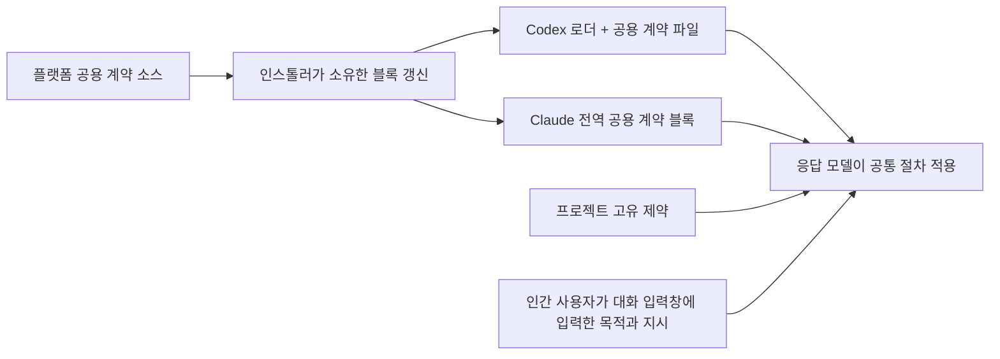

# 설치와 업데이트 안내

[🇺🇸 English](../../getting-started/installation.md) | [🇰🇷 한국어](./installation.md)

이 문서는 Ghost-ALICE OS의 설치, 업데이트, 상태 점검과 복구 명령을 안내합니다. 운영체제별 기본 실행 명령에서도 같은 긴 옵션 이름을 사용합니다.

- macOS, Linux, WSL, Git Bash: `bash install.sh ...`
- Windows 명령 프롬프트 또는 PowerShell에서 체크아웃의 인스톨러 실행: `.\install.cmd ...`. 아래 `cmd` 예시는 명령 프롬프트용입니다.

Windows에서는 `install.cmd`가 기본 래퍼를 통해 인스톨러를 실행합니다. Python 3.11 이상을 요구하고 콘솔을 UTF-8로 설정하며 `-NoProfile -ExecutionPolicy Bypass`를 사용합니다. PowerShell 실행 정책으로 인한 차단을 처리하되 사용자나 컴퓨터의 실행 정책은 변경하지 않습니다.

Windows 인스톨러에는 PowerShell 7.6 이상이 필요합니다. Windows PowerShell 5.1은 지원하지 않습니다. 더 낮은 PowerShell에서는 인스톨러가 요구 사항을 출력하고 멈춥니다. `winget install --id Microsoft.PowerShell --exact`로 PowerShell을 설치한 뒤 `.\install.cmd`를 다시 실행해 주세요.

## 목차

- [빠른 설치](#빠른-설치)
- [설치 전 프로그램 종료](#설치-전-프로그램-종료)
- [애드온 설치](#애드온-설치)
- [플랫폼 하나만 설치](#플랫폼-하나만-설치)
- [상태 확인](#상태-확인)
- [업데이트](#업데이트)
- [기존 작업 기록 옮기기](#기존-작업-기록-옮기기)
- [자주 사용하는 명령](#자주-사용하는-명령)
- [런타임과 플랫폼 참조](#런타임과-플랫폼-참조)
- [제거](#제거)
- [문제 해결](#문제-해결)

## 빠른 설치

macOS, Linux, WSL, Git Bash:

```bash
git clone https://github.com/AidALL/ghost-alice.git ~/ghost-alice
cd ~/ghost-alice
bash install.sh
```

Windows Command Prompt:

```cmd
git clone https://github.com/AidALL/ghost-alice.git %USERPROFILE%\ghost-alice
cd %USERPROFILE%\ghost-alice
.\install.cmd
```

`bash install.sh`와 `.\install.cmd`는 원격 Git 브랜치 `refs/heads/main`에서 Core를 내려받고 그 릴리스를 시작합니다. 내려받은 릴리스는 감지한 에이전트 플랫폼에 자신을 설치합니다. 인스톨러는 체크아웃의 `origin`을 사용하고, 원격 저장소 설정이 없으면 Ghost-ALICE GitHub 저장소를 사용합니다. 개발 체크아웃에 있는 파일이나 보관본의 정확한 버전을 설치하려면 해당 폴더의 설치 명령에 `--local-source`를 붙입니다. 이후 `update`는 다시 원격 `main`을 받습니다. 아래 옵션으로 특정 플랫폼을 선택하거나 설치를 개별적으로 관리하실 수 있습니다.

설치가 성공하면 `~/.ghost-alice/bin/ghost-alice`(Windows: `%USERPROFILE%\.ghost-alice\bin\ghost-alice.cmd`)로 상태 확인·갱신·제거를 실행할 수 있습니다. 설치를 완료하지 못하면, 표시된 오류에 다른 명령이 안내되어 있을 때는 그 명령을 실행해 주세요. 안내된 명령이 없으면 표시된 원인을 해결한 뒤 같은 명령을 다시 실행해 주세요. 이 인스톨러가 배치한 Core 스킬과 런타임·관리 명령은 개발 clone의 실행 파일에 의존하지 않습니다. 인스톨러는 Python 3.11+·Git·Node.js가 없을 때 자동 설치를 시도하며, 첫 프로그램 설치 전에 패키지 관리자의 자동 동의 인자 의미를 안내합니다.

구형 설치를 업그레이드할 때는 clone을 삭제하기 전에 설치된 각 호스트의 기존 Core 스킬을 모두 갱신해 주세요. 일부 스킬만 선택하면 인스톨러는 나머지를 변경하지 않습니다. 구형 Claude 스킬의 링크는 clone을 계속 가리킬 수 있고, 구형 스킬의 지시문도 clone의 정책 파일을 계속 참조할 수 있습니다. 새 인스톨러에 기존 스킬 이름을 모두 지정하거나, 아래의 고정 `update` 명령으로 기존 설치 선택을 유지하면서 갱신해 주세요. 기존 작업 기록도 그 폴더 안에 있다면 폴더를 이동하거나 삭제하기 전에 [기존 작업 기록 옮기기](#기존-작업-기록-옮기기)를 완료해 주세요.

이전 인스톨러는 자신의 설치 요청으로 이 릴리스를 시작할 수 있습니다. 그러면 이 릴리스는 설치된 파일이나 설치 기록을 변경하기 전에 설치를 종료 코드 1로 중단하고, 실행할 명령으로 `~/.ghost-alice/versions/` 아래에 보관된 패키지의 `install.sh`(Windows: `install.cmd`)를 표시합니다. 터미널에서 그 명령을 실행해 주세요. 그 명령은 원격 `main`을 내려받아 현재 설치된 Core 선택을 다시 설치하고, 기록된 설치 원본을 유지합니다. 설치된 Core 스킬이 없으면 중단된 명령이 저장한 선택을 설치합니다. 중단된 명령에 호스트나 스킬을 지정했으면 같은 `--platform` 옵션과 스킬 이름을 덧붙여 주세요. 이전 인스톨러는 이 안내 뒤에 자신의 실패 문구를 출력합니다. 업데이트가 이 안내를 표시하지 않고 완료되면 다른 명령을 실행하지 않아도 됩니다. Git이 아직 체크아웃의 `hooks` 폴더에 있는 훅을 실행하면 pull 뒤에 설치되지 않으므로, `bash install.sh` 또는 `.\install.cmd`를 한 번 실행해 주세요.

## 설치 전 프로그램 종료

터미널에서 설치·업데이트 명령을 실행하고, 먼저 관련 호스트에서 작업을 저장해 주세요. 인스톨러는 설치 파일을 변경하기 전에 이번에 선택한 플랫폼, Core가 설치된 모든 호스트, 미완료 설치와 관련된 호스트를 확인합니다. 관련 호스트 프로그램이나 기록 CLI가 실행 중이면 관찰한 프로그램 이름과 프로세스 ID(PID)를 표시하고 정상 종료를 요청할지 묻습니다. 질문이 나타난 뒤 답해 주세요. 각 질문 전에 입력한 키는 버립니다. 인스톨러는 프로세스 조회로 관련 프로그램의 부재를 확인한 뒤에만 설치를 계속합니다.

macOS에서는 데스크톱 앱과 그 앱이 실행한 내부 보조 프로그램을 종료 목록에 앱 하나로 표시합니다. Codex 앱은 `ChatGPT`로 표시될 수 있습니다. 동의하면 인스톨러가 해당 앱에 종료를 요청합니다. 별도로 실행한 CLI는 개별 PID로 표시합니다.

| 답변 | 인스톨러 동작 |
| --- | --- |
| `y` 또는 `yes` | 표시한 PID 중 여전히 관찰되는 프로그램에 정상 종료를 요청한 뒤 실제 종료 여부를 확인합니다. |
| Enter, `n`, `no` 또는 입력 끝(EOF) | 설치 파일을 변경하기 전에 설치를 취소하고 종료 코드 1을 반환합니다. |
| 그 밖의 입력 | 다시 묻습니다. |

정상 종료 요청만으로 프로그램이 종료되었다고 판단하지 않습니다. 프로그램이 계속 실행 중이거나 종료 요청이 실패하면 직접 종료한 뒤 Enter로 다시 확인하거나 `n`으로 취소해 주세요. Enter는 대기 중인 프로그램을 다시 조회하며 종료 요청을 반복하지 않습니다. 새 PID가 나타나면 새로 표시한 질문에 긍정 답변을 받아야 종료를 요청합니다. Windows의 창 없는 CLI나 지원되는 정상 종료 수단이 없는 프로그램은 직접 종료해 주세요. 관련 프로그램을 닫으면 인스톨러나 그 터미널도 종료될 수 있는 경우, 인스톨러는 중단하고 독립된 터미널에서 다시 실행하도록 안내합니다. 프로세스 조회가 실패하면 표시된 오류를 해결한 뒤 다시 확인해 주세요. 미확인 상태는 프로그램의 부재를 뜻하지 않습니다. 인스톨러는 강제 종료하지 않습니다. 비대화 실행과 post-merge 자동 설치는 질문하거나 종료를 요청하지 않으며, 관련 프로그램의 부재를 확인했을 때만 진행하고 그 밖의 경우에는 종료 코드 1로 멈춥니다. post-merge 훅은 이 설치 결과를 표시하며 Git 병합을 실패시키지 않습니다.

종료 질문은 설치되는 릴리스가 표시합니다. 이 릴리스는 내려받은 릴리스이며, `--local-source`를 지정하면 사용자가 시작한 인스톨러입니다. 시작된 명령은 내려받은 릴리스에 터미널을 전달합니다. 보관된 패키지와 호스트별 설치 프로세스는 각자의 변경 전에 질문이나 종료 요청 없이 부재를 다시 확인합니다. 이 확인은 설치 파일 변경 전에 수행하며, Python 준비와 다운로드는 앞서 실행되었을 수 있습니다. 설치 성공 뒤의 [기존 작업 기록 옮기기](#기존-작업-기록-옮기기)는 별도의 질문과 확인을 거칩니다.

## 애드온 설치

애드온은 자체 저장소나 로컬 경로에서 `--addon-source PATH|URL`로 설치합니다. 한 플랫폼에만 설치하려면 `--platform`을 더해 주세요.

```bash
bash install.sh --addon-source /path/to/addon-repo
```

```cmd
.\install.cmd --addon-source C:\path\to\addon-repo
```

Git URL로 애드온 소스를 지정하면 `--addon-tag`로 로컬 소스 캐시에 복제할 브랜치나 태그를 선택합니다.

## 플랫폼 하나만 설치

다음 명령은 Core만 설치합니다. 선택한 플랫폼에 애드온도 설치하시려면 `--addon-source PATH|URL`을 추가해 주세요.

| 대상 | macOS / Linux / WSL | Windows Command Prompt / PowerShell |
| --- | --- | --- |
| Claude Code | `bash install.sh --platform claude` | `.\install.cmd --platform claude` |
| Codex | `bash install.sh --platform codex` | `.\install.cmd --platform codex` |

대화형으로 선택하시려면 다음 명령을 사용해 주세요.

```bash
bash install.sh --prompt-platform
```

```cmd
.\install.cmd --prompt-platform
```

## 상태 확인

Doctor는 설치를 변경하지 않고 진단합니다. `overall`이 `error`일 때, 애드온 제거가 완료되지 않아 `.removing` 표시가 남았을 때, 훅 상태 확인을 마치지 못했을 때 종료 코드 1을 반환합니다. 설치 상태가 의심스러우면 변경 전에 doctor를 실행해 주세요. `hook-rejections` 줄은 Ghost-ALICE 훅 실행기가 최근 14일 동안 실행을 거부한 훅 명령을 세션마다 한 줄씩 개수와 마지막 거부의 시각·훅·이유와 함께 보이며, `overall`은 바꾸지 않습니다.

```bash
bash install.sh --doctor
bash install.sh --status
```

```cmd
.\install.cmd --doctor
.\install.cmd --status
```

정상 목표는 `overall: ok`입니다.

Doctor는 Core 정보 항목 `native-intake-waits`, `native-intake-failures`, `hook-failures`, `intake-hook-degraded`를 출력합니다. 이 목록은 기록된 대기·실패·입력 훅 오류 표지를 보고하며 `overall`과 종료 코드를 변경하지 않습니다. 입력 훅 오류 표지만으로 입력 저장 여부를 판정할 수 없습니다. [입력 경고와 doctor 목록](troubleshooting.md#입력-경고와-doctor-목록)에서 각 목록의 조회 대상을 설명합니다. Doctor와 status는 기존 이동 저널에서 정리가 남은 옛 기록 경로도 안내합니다. 이 진단은 기록을 옮기거나 삭제를 재시도하지 않으며 현재 파일의 삭제 가능 여부를 다시 판정하지 않습니다.

## 업데이트

설치한 Ghost-ALICE만 갱신하려면 어느 폴더에서든 아래 명령을 실행해 주세요. 설치된 관리 명령은 설치 기록에 적힌 원격 저장소에서 `main`을 내려받습니다. 그 릴리스의 인스톨러는 각 호스트에 이미 설치된 Core 스킬을 갱신합니다. 로컬 저장소가 없어도 실행할 수 있으며, 기존 애드온과 로컬 저장소 파일은 그대로 둡니다.

```bash
~/.ghost-alice/bin/ghost-alice update
```

```cmd
"%USERPROFILE%\.ghost-alice\bin\ghost-alice.cmd" update
```

PowerShell에서 설치본을 갱신하려면 `& "$env:USERPROFILE\.ghost-alice\bin\ghost-alice.cmd" update`를 실행해 주세요. 설치를 점검하려면 같은 명령에서 `update`를 `--doctor`나 `--status`로 바꿔 주세요.

로컬 저장소의 파일(예: `install.sh`)과 설치본을 모두 갱신하려면, 릴리스 저장소의 `main`을 추적하는 로컬 `main` 폴더에서 다음 명령을 실행해 주세요. Git이 현재 브랜치를 최신 커밋까지 앞으로 옮길 수 있거나 이미 최신이면 두 번째 명령을 실행합니다. Git이 실패하면 셸은 두 번째 명령을 실행하지 않습니다.

```bash
git pull --ff-only && ~/.ghost-alice/bin/ghost-alice update
```

```cmd
git pull --ff-only && "%USERPROFILE%\.ghost-alice\bin\ghost-alice.cmd" update
```

PowerShell 7에서 로컬 저장소와 설치본을 함께 갱신하는 명령은 `git pull --ff-only && & "$env:USERPROFILE\.ghost-alice\bin\ghost-alice.cmd" update`입니다.

등록된 설치 원본 폴더에서 Git이 새 커밋을 병합하면 [병합 훅](#설치-원본)이 두 번째 명령보다 먼저 실행될 수 있습니다. 이 훅은 감지한 모든 호스트에 기본 Core 스킬을 설치하려고 합니다. 이어서 실행하는 `update`는 그 시점의 설치 기록을 읽습니다. Git의 성공 여부와 설치 결과는 각각의 명령 출력에서 확인해 주세요.

일반 체크아웃에서 `bash install.sh`(Windows에서는 `.\install.cmd`)를 다시 실행하면 인스톨러는 원격 `main`에서 감지한 호스트의 기본 Core 스킬 전체를 설치합니다. 원격 `main`을 기본값으로 정한 [변경 #167](https://github.com/AidALL/ghost-alice/pull/167) 전에 기능 브랜치에서 설치했다면, 첫 번째 예시의 `update` 뒤에 `--ref refs/heads/main`을 한 번 붙여 주세요. 구형 관리 명령이 `Update needs its acquisition source`를 표시하면 설치 기록에 원격 주소나 브랜치가 빠져 있습니다. 인수로 두 값을 모두 지정해 주세요. 공식 저장소를 사용한다면 `update --remote https://github.com/AidALL/ghost-alice.git --ref refs/heads/main`입니다. 갱신에 성공한 뒤에는 `update`만 사용합니다.

설치 기록에 원격 저장소 주소가 없으면 `update`는 Ghost-ALICE GitHub 저장소를 사용합니다. 다른 저장소의 `main`을 받으려면 `--remote URL`을 지정해 주세요. 로컬에서 편집한 파일을 먼저 Git stash에 보관하고 체크아웃을 갱신하려면 [소스 갱신 오류](./troubleshooting.md#git-업데이트-복구)를 참고해 주세요. 보관한 버전의 재설치와 원장 위치는 [인스톨러 구조](../reference/installer-architecture.md#고정-명령정책원장-데이터)에 설명되어 있습니다.

설치된 Core 스킬의 호스트 목록(`used_by`)이 손상되면 인스톨러는 설치를 중단하고 해당 설치 기록 파일과 스킬 경로를 표시합니다.

### 기존 작업 기록 옮기기

설치 또는 업데이트에 성공하면 인스톨러는 현재 사용하는 작업 기록이 설치에 사용한 Ghost-ALICE 폴더 안에 남아 있는지 확인합니다. 해당 폴더·현재 기록 위치·새 기록 위치 `~/.ghost-alice/session-intent`를 보여 주고 기록을 옮길지 묻습니다. 기본값은 예이며 별도 명령이나 이관 플래그를 입력할 필요가 없습니다. 이 질문 전에 누른 Enter는 이동 요청으로 사용하지 않습니다. 여러 호스트가 한 위치를 함께 사용하면 인스톨러는 그 위치를 한 번 표시합니다.

| 응답 | 인스톨러의 동작 |
| --- | --- |
| Enter, `y`, `yes` | 이동을 요청한 것으로 읽고 관련 기록자가 중지되었는지 확인합니다. |
| `n`, `no` | 현재 위치를 유지합니다. |
| 입력 끝(EOF) | 현재 위치를 유지합니다. |
| 그 밖의 입력 | 다시 묻습니다. |

기록 이동 단계는 [설치 전 종료 확인](#설치-전-프로그램-종료)을 거쳤더라도 표시된 기록을 사용하는 호스트와 다른 CLI 작업을 다시 확인합니다. 기록을 옮기는 동안에는 해당 프로그램을 닫아 두세요. 인스톨러가 실행 중인 기록자를 찾으면 해당 프로그램을 중지한 뒤 Enter로 다시 확인하거나, `n`으로 현재 위치를 유지할 수 있습니다. 조회가 실패하면 표시된 설정이나 프로세스 조회 오류를 확인한 뒤 다시 시도해 주세요. 미확인 상태는 프로그램이 실행 중이라는 뜻이 아닙니다. 비대화 실행과 post-merge 자동 설치는 새 이동을 묻지 않지만, 이미 수락한 이동의 정리는 필요한 확인 뒤 자동으로 마칩니다. 나중에 터미널에서 `~/.ghost-alice/bin/ghost-alice`(Windows: `%USERPROFILE%\.ghost-alice\bin\ghost-alice.cmd`)를 실행하면 설치 성공 뒤 같은 후속 단계에서 새 이동을 요청할 수 있습니다. Doctor는 기록을 옮기지 않고 현재 위치를 안내합니다. 종료 확인과 후속 안내는 터미널 언어에 따라 한국어 또는 영어를 사용하며, 다른 설치 진행 문구는 영어로 남을 수 있습니다.

인스톨러는 설치와 기록 이동의 결과를 별도로 표시합니다. 이동을 보류하거나 취소하면 현재 위치를 계속 사용합니다. 이동 오류는 이전 위치로 복원했더라도 0이 아닌 종료 코드를 반환하므로, 표시된 복구 조건을 해결한 뒤 재시도해 주세요. 기록과 설정을 새 위치로 확정하고 서비스 재개를 완료한 뒤 인스톨러는 이전 기록 폴더를 검증하고 삭제합니다. 해당 폴더를 삭제해야 기록 이동이 완료되며, 이전 위치로 복원할 때는 그 폴더를 삭제하지 않습니다. 정리가 실패하면 새 위치와 새 기록을 유지하고 남은 경로와 원인을 표시하며, 원인을 해결한 뒤 설치를 다시 실행하여 변경 없는 잔여를 정리할 수 있도록 정리 저널을 보존합니다. 원인이 남은 채 같은 명령을 반복하면 다시 실패할 수 있습니다. 이전 폴더에 파일이 추가·변경되었거나 호스트·게이트웨이가 이전 위치를 계속 사용하면 삭제하지 않습니다. 이전 인스톨러가 남긴 폴더도 같은 후속 단계에서 그 기록이 새 위치에 보존되어 있는지 검증한 뒤 정리합니다. 그 밖의 설치 보관 자료는 별도로 표시합니다. 코드 설치 성공만으로 기록 이동이 완료된 것은 아닙니다. 확정·복구 조건은 [인스톨러 구조](../reference/installer-architecture.md#고정-명령정책원장-데이터)에서 설명합니다.

기록과 설정을 새 위치로 확정하기 전에는 이전 출처 폴더를 옮겨도 설정된 기록 경로가 바뀌지 않습니다. 이후 요청이 옛 경로를 다시 만들어 이전 기록과 새 기록이 나뉠 수 있습니다. 인스톨러는 옮긴 폴더를 검색하거나 두 이력을 자동으로 합치지 않습니다. 설치된 기록 위치가 어느 출처 폴더와 관계있는지 확인하지 못하면 관계 미확인으로 안내하며 추정한 이동을 제안하지 않습니다. `n`, `no` 또는 입력 종료로 이동을 거절하면 기록은 현재 위치에 남으며 같은 출처에서 다시 갱신할 수 있습니다. 인스톨러는 기존 보관 기준에 따라 최근 성공한 서로 다른 코드 버전 세 개를 유지합니다. 보관본을 재설치하려면 해당 버전의 코드가 현재 설치 기록을 조회할 수 있어야 합니다. 기록이 체크아웃 아래에 남아 있으면 같은 체크아웃에서 계속 갱신해도 인스톨러가 설치 기록을 스키마 `3`으로 작성할 수 있으며, 이때 스키마 `2`만 지원하는 보관본은 직접 재설치할 수 없습니다. 활성 인스톨러로 갱신을 계속하면서 이후 터미널에서 기록을 옮길지 선택할 수 있습니다.

### 설치 원본

설치 기록 `~/.ghost-alice/installed-payload-v2.json` 또는 `~/.ghost-alice/installed-payload-v3.json`은 Git 훅과 작업 기록 위치를 관리하는 개발 체크아웃을 기록합니다. 설치 기록의 커밋은 설치한 코드의 버전을 나타냅니다. 설치와 `--repair`는 설치 대상을 변경하기 전에 기록된 개발 원본과 요청한 입력 원본을 비교합니다. 인스톨러는 고정 패키지에서 실행되며 패키지는 입력 원본을 별도로 기록합니다. 기록된 체크아웃이 더는 없으면(다른 경로에 다시 복제한 경우) 인스톨러는 묻지 않고 새 체크아웃을 설치 원본으로 기록합니다. 두 번째 복제본이나 git worktree처럼 두 체크아웃이 모두 있으면 인스톨러는 두 폴더를 출력합니다. 터미널에서는 이 체크아웃으로 설치 원본을 교체할지 묻고, 인스톨러의 터미널 질문에 입력된 답(입력한 주체를 인스톨러가 확인하지 않음)이 예가 아니면 종료합니다. 터미널이 아니면 종료 코드 2로 종료합니다. `ghost-alice` 명령이나 보관 패키지의 인스톨러가 릴리스를 내려받는 동안 다른 명령이 기록된 체크아웃을 교체해도 같습니다. 이때 `update`는 종료 코드 1로 중단합니다. 인간 사용자가 설치본을 다른 체크아웃으로 이관하기로 결정하면 그 체크아웃에서 `--adopt-source`를 붙여 인스톨러를 실행해 주세요. 인스톨러는 첫 배치에서 그 체크아웃을 설치 원본으로 기록합니다. `--repair`는 설치본을 이관하지 않습니다. 다른 체크아웃에서 실행하면 종료 코드 2로 종료하고 그 설치 명령을 안내합니다.

활성 인스톨러의 보관 패키지에서 파일이 누락되면, 같은 Core 파일이 있는 체크아웃에서, 설치할 때 지정한 애드온 원본을 `--addon-source`로 지정해 `--repair`를 실행해 주세요. 이 복구가 패키지를 복원합니다. `bash install.sh update` 또는 `.\install.cmd update`는 패키지를 복원하지 않고 교체합니다. 갱신은 내려받은 릴리스를 애드온 파일 없이 활성 패키지로 보관하고 설치한 Core 스킬을 유지하며, 내려받은 릴리스의 파일 목록이 손상된 패키지의 파일 목록과 같을 때만 누락된 파일을 복원합니다. `--repair`는 활성 인스톨러가 실행합니다. 활성 패키지가 완전할 때 체크아웃의 인스톨러로 시작하면, 그 인스톨러는 이 명령의 호스트, 스킬, 애드온 원본으로 활성 인스톨러를 실행하고 종료 코드를 반환하며 체크아웃의 파일을 비교하지 않습니다. 활성 패키지에 다른 인스톨러의 복구를 실행한다는 기록이 없거나 활성 패키지의 파일이 누락되었을 때는 시작한 인스톨러가 직접 복구하며, 자신의 Core 파일과 애드온 원본이 보관된 파일 목록과 일치할 때만 복구합니다. 명령에 지정한 애드온 원본은 패키지의 애드온 파일이 누락되었을 때만 이 비교에 포함하며, 그 밖에는 패키지 자신의 애드온 파일을 포함합니다. 서로 다르면 복구를 중단하고, 같은 파일이 있는 체크아웃에서 실행하는 복구와 시작한 인스톨러의 `update` 명령을 전체 경로로 안내합니다. 이 `update`는 설치한 Core 스킬을 최신 릴리스로 교체하며 애드온 파일을 복원하지 않습니다. 패키지는 자신이 누락한 항목의 복원 원본이 될 수 없습니다. 활성 인스톨러가 직접 복구를 실행하는데 패키지의 Core 파일이 누락되었으면 복구를 종료 코드 1로 중단하고, 누락된 항목을 표시합니다. 등록된 체크아웃에 인스톨러가 있으면 그 체크아웃의 복구 명령을 안내하고, 설치 기록에 체크아웃과 설치한 Core 스킬이 있으면 활성 인스톨러의 `update` 명령도 안내합니다. 패키지의 애드온 파일이 누락되었는데 명령이 그 파일이 있는 애드온 원본을 지정하지 않았으면 복구를 종료 코드 1로 중단하고 누락된 항목과 `--addon-source`를 안내합니다. 자신의 프로그램 파일이 누락된 인스톨러는 종료 코드 1로 중단하고, 같은 Core 파일이 있는 체크아웃에서 실행하는 복구를 안내합니다. 남은 보관 파일이 수정되었을 때도 복구를 중단합니다. 패키지를 확인한 뒤 인스톨러는 선택한 호스트의 설치 기록에서 이 명령의 설정이 지정한 스킬 폴더의 Core 스킬과 공용 지원 폴더를 조회하고, 이 중 누락된 항목을 활성 패키지에서 복사합니다. 설치 기록이 그 호스트의 스킬을 다른 폴더에만 기록했으면 복구를 종료 코드 1로 중단하고 그 폴더를 안내합니다. 다음 가운데 하나에 해당하면 복구를 종료 코드 1로 중단하고 실행할 설치 명령을 안내합니다. 인스톨러가 작성한 설치 기록이 없고(설치 기록이 없거나 스키마 `1`이거나 서비스 등록만 기록한 경우) 설치 목록(`~/.ghost-alice/install-state/<호스트>.json`)을 조회할 수 없는 경우, 설치 기록에 선택한 호스트의 대상이 없고 인스톨러 항목이 없거나 그 호스트의 설치 목록이 있는 경우, 설치 기록에 호스트의 스킬은 있고 누락된 공용 지원 폴더는 없는 경우입니다. 그 폴더의 경로에 파일이 있을 때도 복구를 종료 코드 1로 중단하며, 그 파일은 유지합니다. 설치는 조회할 수 없는 설치 목록을 같은 폴더의 `<호스트>.json.<id>.bak`으로 이동하고 그 파일 없이 계속합니다. 체크아웃의 파일 내용이 같고 커밋만 달라도 기존 설치 기록의 릴리스 커밋을 유지합니다. 보관 버전 폴더 전체가 없으면 복구가 중단되고 해당 경로가 출력됩니다. 폴더 안에 `version.json` 파일만 없다면 해당 버전의 백업에서 파일 목록을 복원해 주세요. 설치 기록에 Core 스킬이 있고 기록된 체크아웃에 인스톨러가 있으면 최신 릴리스를 설치할 수 있는 해당 체크아웃의 `update` 명령도 출력됩니다. 최신 릴리스가 같은 버전 폴더를 사용한다면 누락된 파일 목록을 먼저 복원해 주세요.

복구는 온전한 패키지를 복사하지 않고 검증합니다. 스킬이나 공용 지원 폴더를 배치하기 전에 선택한 스킬 폴더의 설치 기록에 있는 모든 Core 스킬이 패키지에 있는지 확인합니다. 누락된 스킬의 이름을 각각 출력하고 종료 코드 1로 중단합니다. 설정 경로가 심볼릭 링크를 통해 같은 폴더에 도달해도 기록된 대상 경로를 사용합니다. 복구 결과에는 복원한 애드온 대상 수와 이미 경로를 차지하고 있어 유지한 애드온 대상 수도 포함됩니다. 애드온 복구가 실패하면 사유, 애드온 ID 또는 읽을 수 없는 기록 파일명과 함께 확인된 대상 경로를 출력합니다.

```bash
cd /path/to/new-checkout
bash install.sh --adopt-source
```

```cmd
cd C:\path\to\new-checkout
.\install.cmd --adopt-source
```

인스톨러는 저장소의 git 훅 경로(`core.hooksPath`, 저장소의 모든 worktree가 공유하는 설정)를 고정 폴더 `~/.ghost-alice/git-hooks`로 작성하며, 이후 설치는 이 설정을 유지합니다. 설정이나 폴더를 작성하지 못하면 설치 기록이나 호스트 파일을 변경하기 전에 설치를 중단합니다. [Git 훅 등록 실패](./troubleshooting.md#git-훅-등록-실패)를 확인해 주세요. 설치 원본에서 `git merge`나 `git pull`을 실행하면 이 폴더의 post-merge 훅이 설치된 `ghost-alice`를 실행합니다. 이 명령은 등록된 원격 저장소에서 `main`을 내려받아 감지한 모든 호스트에 설치합니다. 같은 저장소의 다른 worktree에서 `git merge`나 `git pull`을 실행하면 git은 그 worktree의 훅 파일이 아니라 같은 훅을 실행하고, 훅은 한 줄만 출력하고 설치하지 않습니다. worktree 자신의 훅 설정(`git config --worktree core.hooksPath`)이 있으면 git은 그 설정을 먼저 조회합니다. 설치 원본을 교체하는 것은 사용자가 실행한 설치뿐이며 병합은 교체하지 않습니다. 훅 때문에 병합이 실패하지도 않습니다. 관리 명령을 사용하는 마지막 대상의 제거는 설치 전의 훅 경로를 복원하며, 설치 뒤에 경로가 변경되었으면 변경된 값을 유지합니다.

## 자주 사용하는 명령

| 용도 | macOS / Linux / WSL | Windows Command Prompt / PowerShell |
| --- | --- | --- |
| 스킬 목록 | `bash install.sh --list` | `.\install.cmd --list` |
| 설치 상태 확인 | `bash install.sh --status` | `.\install.cmd --status` |
| 보호 진단 실행 | `bash install.sh --doctor` | `.\install.cmd --doctor` |
| 로컬 편집분을 stash에 보관하고 체크아웃 갱신 | `bash install.sh --update-source` | `.\install.cmd --update-source` |
| 애드온 설치 | `bash install.sh --addon-source /path/to/addon-repo` | `.\install.cmd --addon-source C:\path\to\addon-repo` |
| 선택한 Core 스킬 설치 | `bash install.sh task-router verification-before-completion` | `.\install.cmd task-router verification-before-completion` |
| 전체 제거 | `bash install.sh --uninstall` | `.\install.cmd --uninstall` |
| 선택 제거 | `bash install.sh --platform codex --uninstall task-router` | `.\install.cmd --platform codex --uninstall task-router` |
| 잘못된 미결 항목 정리 | `bash install.sh --platform claude --cleanup-pending` | `.\install.cmd --platform claude --cleanup-pending` |

## 런타임과 플랫폼 참조

### 에이전트 표시 프로필

기본 표시 프로필은 `dynamic`입니다. 사용자에게 보이는 거버넌스 메시지의 양만 조절하며 훅 설치·실행, 훅 로그(`~/.ghost-alice/session-logs/<host>/<session>/strict-hook-output.jsonl`)와 감사 기록, Work-Impact Projection은 축소하지 않습니다.

[Ghost-ALICE 입력 경고](./troubleshooting.md#입력-경고와-doctor-목록)는 어느 프로필에서나 표시됩니다.

| 프로필 | macOS / Linux / WSL | Windows Command Prompt / PowerShell |
| --- | --- | --- |
| strict | `bash install.sh --visibility strict` | `.\install.cmd --visibility strict` |
| dynamic | `bash install.sh --visibility dynamic` | `.\install.cmd --visibility dynamic` |
| minimal | `bash install.sh --visibility minimal` | `.\install.cmd --visibility minimal` |

`--agent-visibility`도 호환성을 위한 별칭으로 사용할 수 있습니다. 새 문서와 명령에서는 `--visibility`를 사용해 주세요.

### 플랫폼별 슬래시 명령

Ghost-ALICE는 Claude Code 작업 공간 명령으로 `/visibility strict|dynamic|minimal`을 설치합니다. Codex를 포함한 모든 플랫폼에서 `_shared/agent_visibility_cli.py`로 같은 프로필 값을 확인하고 변경하실 수 있습니다. Codex에는 `/visibility` 명령이 없습니다.

### Python 계약

인스톨러는 `--help`와 `--list`를 포함한 모든 명령에 Python 3.11 이상을 요구합니다. `install.sh`는 Python을 찾거나 준비하고 인수를 `_shared/installer/cli.py`에 전달하는 일만 합니다. 해당 버전이 없으면 가능한 환경에서 자동 준비를 시도합니다.

선택적인 macOS 네이티브 문맥 게이트웨이는 `compression.zstd`를 제공하는 Python 3.14 이상을 요구합니다. 등록 명령 `bash install.sh gateway --codex-dir <dir> --ledger-root <dir> --state-dir <dir> --launch-agent <plist>`는 먼저 이 기능을 확인한 뒤 launch agent, `state.json`, Codex provider 블록을 작성하고 설치 기록에 서비스를 기록합니다. 등록 명령은 모듈을 복사하지 않습니다. 서비스는 인스톨러가 게시한 런타임 `_shared`를 실행하므로 Core를 먼저 설치해 주세요. Core 인스톨러와 훅의 최소 요구 버전은 Python 3.11로 유지됩니다. Codex `config.toml`, launch agent, 상태 파일이 심볼릭 링크이면 등록과 분리는 서비스를 변경하기 전에 종료하고 링크와 원본을 보존합니다. 갱신은 서비스 파일 세 개가 설치 기록과 같은 동안 리스너의 포트와 `scope` 값을 유지합니다. 인스톨러 밖에서 변경된 파일이 있으면 명령은 무엇이든 변경하기 전에 종료하고, 기록이 지정하지 않은 launch agent, 상태 디렉터리 항목, provider 블록은 보존합니다. 첫 등록이 실패하고 후보 서비스의 중지가 확인되면, 롤백이 그 시도가 새로 작성한 상태 자료와 기록 항목을 삭제해 다음 등록을 진행할 수 있게 합니다. 중지를 확인할 수 없거나 자료가 동시에 변경되면 검토용으로 복구 자료를 보존합니다. 등록 뒤에는 [설치본 갱신 명령](#업데이트)으로 각 호스트에 이미 설치한 Core 스킬과 게이트웨이가 사용하는 런타임을 갱신합니다. `bash install.sh gateway detach --apply`는 서비스 등록을 해제하고 상태 디렉터리를 남깁니다. 설치 기록에 없는 게이트웨이 서비스를 launchd가 실행 중이면, 설치와 `--repair`는 그 서비스를 변경하지 않고 등록 명령을 안내하는 경고 한 줄을 출력합니다. 등록 명령은 서비스를 기록에 작성하고 새 코드로 재시작합니다.

- macOS: Homebrew가 있으면 `brew install python3`
- Linux / WSL: `apt-get`, `dnf`, `yum`, `pacman` 같은 패키지 관리자
- Windows: `winget`, `choco`, 그 다음 `scoop`

Python 3.11 이상을 준비하지 못하면 설치를 멈추고 수동 복구 안내를 제공합니다.

### PowerShell 계약

`.\install.cmd`는 PowerShell 7(`pwsh.exe`)로 Windows 인스톨러를 실행하고, `pwsh.exe`가 없으면 Windows PowerShell(`powershell.exe`)로 실행합니다. Windows 인스톨러에는 7.6 LTS 계열인 PowerShell 7.6 이상이 필요합니다. Windows PowerShell 5.1을 포함해 더 낮은 PowerShell에서는 `PowerShell 7.6 or newer is required`와 설치 명령 `winget install --id Microsoft.PowerShell --exact`를 출력하고 종료 코드 1로 멈춥니다. 인스톨러가 PowerShell을 직접 설치하지는 않습니다. 이 확인을 통과하면 콘솔 입출력을 UTF-8로 설정하고 Python 3.11 이상을 준비한 뒤, 모든 인수를 순서대로 `_shared/installer/cli.py`에 넘깁니다. `install.sh`가 실행하는 인스톨러와 같은 인스톨러이므로 Windows에서도 같은 긴 옵션을 씁니다.

macOS와 다른 POSIX 호스트의 설치된 훅은 `GHOST_ALICE_PYTHON`, 실행 환경의 `PATH`와 일반 설치 위치, 설치에 사용한 인터프리터 순서로 Python을 찾습니다. 각 후보는 Python 3.11 이상 검사를 통과해야 합니다. 마지막 대체 경로는 데스크톱 앱의 `PATH`에 설치용 Python 디렉터리가 없어도 훅을 실행할 수 있도록 합니다. 호스트의 전역 Python이나 `PATH`는 변경하지 않습니다. 해당 인터프리터가 이동했고 다른 후보도 없으면 인스톨러를 다시 실행해 주세요.

### Node.js 계약

Claude Code와 Codex의 훅 설치에는 사용 가능한 Node.js 실행 환경이 필요합니다. `tool-checkpoint`의 PreToolUse 게이트가 `ghost-alice-hook.mjs`를 실행하기 때문입니다. 인스톨러는 설정된 실행 환경, 플랫폼 등록과 `PATH`를 확인하며 Codex에 설정된 대체 실행 환경도 사용합니다. 훅이 필요한 대상 플랫폼에서 사용 가능한 Node를 찾지 못할 때만 훅 설치를 중단합니다.

### 플랫폼별 업데이트 동작

| 호스트 | Core 배치 | 스킬 경로 |
| --- | --- | --- |
| Claude Code | 사본 | `~/.claude/skills/` |
| Codex | 사본 | `~/.agents/skills/` |

모든 지원 OS에서 Core와 `_shared`를 사본으로 배치합니다. 개발 파일 편집만으로 설치된 Core는 변경되지 않으며 update 또는 명시적 설치가 새 코드를 배치합니다. 애드온의 링크·사본 정책은 별도로 유지됩니다. 기존 Codex `untrusted`는 해당 프로젝트의 변경을 확인받지 않으면 유지합니다.

### Core와 애드온 전환

Core 설치와 애드온 제거는 별도 작업입니다. 새 Core 설치는 지침, 입력·출처 연결, 작업·검토 기록과 Core 훅을 제공합니다. 애드온 옵션 없이 Core를 갱신하면 이미 설치된 애드온은 유지합니다. `--addon-skip`은 애드온 설치를 건너뛰며 기존 애드온의 제거를 요청하지 않습니다.

| 동작 | 명령 또는 절차 | 변경하는 대상 |
| --- | --- | --- |
| Codex에 기본 Core 스킬 설치 | `bash install.sh --platform codex` | Codex에 기본 Core 스킬 전체를 설치하고 기존 애드온을 유지합니다 |
| 각 호스트에 이미 설치된 Core 스킬 갱신 | [설치된 관리 명령으로 갱신](#업데이트) | 설치 기록에서 호스트별 Core 스킬 목록을 읽고 기존 애드온을 유지합니다 |
| 애드온 추가 또는 갱신 | `bash install.sh --platform codex --addon-source /path/to/addon-repo` | Core와 애드온 매니페스트가 선택한 스킬·관찰용 훅을 설치합니다 |
| Core를 유지하며 애드온 제거 | `bash install.sh --platform codex --uninstall --addon <addon-id>` | 기록된 애드온 훅을 먼저 해제하고 검증된 애드온 파일을 제거합니다 |
| 한 플랫폼 제거 | `bash install.sh --platform codex --uninstall` | 해당 플랫폼의 애드온·Core를 제거하고 다른 설치 플랫폼이 사용하는 공용 파일은 유지합니다 |

애드온을 제거해도 Core 기록은 유지됩니다. 개별 애드온 제거는 수정된 파일과 부속 기록·제거 표시를 검토 또는 재시도를 위해 남기면서 해당 애드온의 관리되는 실행 훅 등록을 해제합니다. 이는 설정·파일 작업이며, 실행 중인 호스트의 반영과 이미 전달된 작업의 중지는 별도 관찰입니다.

전체 또는 플랫폼 제거는 병합 대기 원본과 마지막 플랫폼의 설치 복구 사본을 `~/.ghost-alice/uninstall-backup/<platform>/support-state/` 아래의 새 디렉터리에 보존합니다. 기존 보존 사본, 소스 체크아웃, 대화·세션 근거, 현재 원장 위치의 기록, 감사 기록과 비밀 파일은 유지합니다. 소유권과 공용 파일 규칙은 [설치 제거 절차](./uninstall.md)를 확인해 주세요.

Claude Code에서 인스톨러는 매니페스트가 선택한 애드온의 `Skill(...)` 허용 규칙 중 실제로 추가한 항목을 `~/.ghost-alice/addon-permissions/claude-v2.json`에 기록합니다. 언인스톨러는 소유한 허용 규칙 한 항목을 해제하며 이 인스톨러가 추가하지 않은 기존 규칙과 나중에 추가된 중복 규칙을 보존합니다. 언인스톨러는 소유권 근거가 없는 이전 규칙을 인간 사용자가 검토하도록 보존합니다. Codex에서 언인스톨러는 변경되지 않은 소유 훅의 신뢰 해시를 삭제하고, 남은 Core 훅 신뢰 항목과 Ghost-ALICE가 설치하지 않은 훅의 신뢰 항목을 훅 위치를 따라 이동하면서 메타데이터를 보존합니다. 후자의 항목을 작성한 주체를 인스톨러가 기록하지 않습니다. 신뢰 설정 충돌이나 설정 저장 오류가 있으면 파일 제거는 성공하지 않습니다. 자세한 내용은 [설치 제거 절차](./uninstall.md)를 확인해 주세요.

### 설치 항목

전체 설치는 다음 항목을 배포합니다.

- `skill-catalog/skills.json`의 Core 스킬
- coding-convention 작업 절차 스킬
- `--addon-source`로 설치하는 선택 애드온 스킬
- `_shared/` 공용 모듈
- 플랫폼 훅 설정
- `~/.ghost-alice/hooks/`의 Node 기반 훅 실행 파일
- 고정 Git 훅 폴더 `~/.ghost-alice/git-hooks/`: `post-merge` 스크립트와, 등록된 저장소마다 이전 훅 경로를 보관하는 `repositories.json`
- Claude Code 권한 허용 목록
- Claude `${CLAUDE_CONFIG_DIR:-~/.claude}/CLAUDE.md` 전역 부트스트랩
- Codex `~/.codex/AGENTS.md` 로더와 관리되는 `~/.codex/ghost-alice-governance.md` 공용 계약
- 설치 기록 `~/.ghost-alice/installed-payload-v2.json` 또는 `~/.ghost-alice/installed-payload-v3.json`: 두 호스트가 함께 쓰는 파일 하나이며, 배치와 같은 단계에서 설치 위치마다 출처와 복사한 파일의 지문을 기록합니다
- `~/.ghost-alice/rollbacks/<txid>/`: 배치 한 번이 교체한 원래 파일, 배치 전의 설치 기록, 배치의 저널을 보관합니다. 설치 잠금을 획득하는 다음 인스톨러 명령이 중간에 중지된 배치를 복원하며, 완료된 폴더를 남기는 개수는 [런타임 상태 보존](../reference/repository-structure.md#런타임-상태-보존)이 정합니다
- 설치 상태, 병합 대기 자료와 제거 보고서의 지원 상태

선택적인 문맥 게이트웨이를 등록한 설치본에서는 설치 기록의 `service` 섹션이 서비스의 코드 루트 `~/.ghost-alice/runtime/current`와 서비스 파일 세 개를 지정합니다. 런타임 배치(`_shared`와 동반 스크립트 `session-intent-analyzer/scripts/session_intent_ledger.py`)는 파일 교체 전에 서비스를 중지하고 교체 뒤에 시작합니다. 설치와 갱신 모두 인스톨러가 이 서비스 재시작을 처리합니다. 인스톨러는 서비스의 런타임 루트와 서비스 실행 여부를 `Context gateway:` 한 줄로 출력합니다. 이전 인스톨러가 등록한 설치본은 첫 설치, 복구 또는 제거 때 게이트웨이 설치 영수증에서 `service` 섹션을 한 번 작성합니다.

인스톨러는 전역 규칙 파일에서 표지가 붙은 Ghost-ALICE 블록만 관리합니다. 그 블록을 갱신하면서 부트스트랩 밖의 글은 보존합니다. 대상이 Ghost-ALICE 표지가 없는 파일이면 원본 대신 `<rule-file>.ghost-alice-proposed` 제안 파일을 작성하며, status와 doctor는 이를 설치된 전역 규칙으로 취급하지 않습니다.

### 공통 거버넌스와 프로젝트 지침

Ghost-ALICE 공통 거버넌스는 프로젝트와 업무 분야에 관계없이 적용됩니다. Codex의 정상 작업 경로에서 응답 모델은 관리되는 `~/.codex/AGENTS.md` 로더가 지정한 공용 계약 파일을 조회합니다. 인스톨러는 같은 디렉터리의 `ghost-alice-governance.md`에 그 계약을 기록합니다. Claude Code에서는 인스톨러가 `${CLAUDE_CONFIG_DIR:-~/.claude}/CLAUDE.md`의 관리 블록에 공용 계약을 직접 기록합니다. 프로젝트 지침 파일은 프로젝트 고유 제약을 추가하며, 공통 절차의 복사본을 별도로 제공하지 않습니다. 공용 계약의 [Operating Model](https://github.com/AidALL/ghost-alice/blob/main/platforms/common-governance.md#operating-model)은 인간 사용자가 대화 입력창에 입력한 지시의 우선순위와 지시 파일에 작성된 제약을 정합니다.



Codex에서 지정된 공통 파일을 조회할 수 없으면 모델은 Ghost-ALICE 계약이 없다는 것을 사용자에게 한 번 알리고, Ghost-ALICE 원장 기록 없이 사용자의 일을 계속합니다. Codex에서 답변에 도구가 요구되지 않으면 모델은 공통 파일을 조회하지 않고 바로 답하고, 도구가 요구되는지 분명하지 않으면 그 요청을 작업으로 취급하고 공통 파일부터 조회합니다. Status와 doctor는 로더와, 로더가 지정한 공통 파일을 모두 확인합니다. 인스톨러는 부트스트랩 밖의 글과 Ghost-ALICE 표지가 없는 규칙 파일을 보존하며, Codex 공용 계약의 심볼릭 링크를 통한 교체를 거부합니다. 제안 파일을 설치된 계약으로 취급하지 않습니다. 다른 프로젝트의 지침 예산이나 고유 규칙을 변경하지 않습니다.


### merge-companion

업데이트 중 설치 파일의 외부 변경을 발견하면 인스톨러는 해당 파일을 병합 대기열에 보관합니다. 외부 변경은 설치 뒤 인스톨러가 설치본에서 찾은, 인스톨러의 기록에 없는 변경이며, 변경한 주체를 인스톨러가 기록하지 않습니다.

- 매니페스트: `~/.ghost-alice/pending-merges/<platform>/manifest.json`
- 백업: `~/.ghost-alice/pending-merges/<platform>/`
- 설치 상태: `~/.ghost-alice/install-state/<platform>.json`

다음 Claude Code/Codex 세션에서 훅이 미결 항목을 알립니다. 인간 사용자가 검토를 요청하거나 작업이 영향받는 스킬을 변경하면 응답 모델은 `merge-companion`을 따라 인간 사용자에게 각 항목을 병합, 폐기하거나 보류할지 묻습니다.

## 제거

제거는 인스톨러가 기록한 install-state 매니페스트를 사용하며 플랫폼 전역 규칙 파일에서는 관리되는 Ghost-ALICE 블록만 제거합니다. 부트스트랩 밖의 글은 보존합니다.

```bash
bash install.sh --uninstall
```

```cmd
.\install.cmd --uninstall
```

전체 정리 기준은 [제거 안내](./uninstall.md)를 확인해 주세요.

## 문제 해결

`git pull`, 병합 충돌이나 재설치 중 업데이트가 막히면 [문제 해결](./troubleshooting.md)을 먼저 확인해 주세요.
