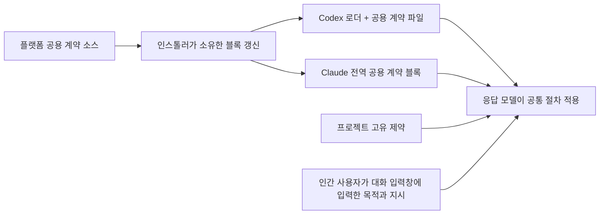

# 설치와 업데이트 안내

[🇺🇸 English](../../getting-started/installation.md) | [🇰🇷 한국어](./installation.md)

이 문서는 Ghost-ALICE OS의 설치, 업데이트, 상태 점검과 복구 명령을 안내합니다. 운영체제별 기본 실행 명령에서도 같은 긴 옵션 이름을 사용합니다.

- macOS, Linux, WSL, Git Bash: `bash install.sh ...`
- Windows Command Prompt 또는 PowerShell: `.\install.cmd ...`

Windows에서는 `install.cmd`가 기본 래퍼를 통해 인스톨러를 실행합니다. Python 3.11 이상을 요구하고 콘솔을 UTF-8로 설정하며 `-NoProfile -ExecutionPolicy Bypass`를 사용합니다. PowerShell 실행 정책으로 인한 차단을 처리하되 사용자나 컴퓨터의 실행 정책은 변경하지 않습니다.

Windows 인스톨러에는 PowerShell 7.6 이상이 필요합니다. Windows PowerShell 5.1은 지원하지 않습니다. 더 낮은 PowerShell에서는 인스톨러가 요구 사항을 출력하고 멈춥니다. `winget install --id Microsoft.PowerShell --exact`로 PowerShell을 설치한 뒤 `.\install.cmd`를 다시 실행해 주세요.

## 목차

- [빠른 설치](#빠른-설치)
- [애드온 설치](#애드온-설치)
- [플랫폼 하나만 설치](#플랫폼-하나만-설치)
- [상태 확인](#상태-확인)
- [업데이트](#업데이트)
- [자주 사용하는 명령](#자주-사용하는-명령)
- [런타임과 플랫폼 참조](#런타임과-플랫폼-참조)
- [제거](#제거)
- [문제 해결](#문제-해결)

## 빠른 설치

macOS, Linux, WSL, Git Bash:

```bash
git clone https://github.com/AidALL/ghost-alice.git ~/ghost-alice
cd ~/ghost-alice
bash install.sh
```

Windows Command Prompt:

```cmd
git clone https://github.com/AidALL/ghost-alice.git %USERPROFILE%\ghost-alice
cd %USERPROFILE%\ghost-alice
.\install.cmd
```

`bash install.sh`와 `.\install.cmd`는 에이전트 플랫폼을 자동 감지합니다. 아래 옵션으로 특정 플랫폼을 선택하거나 설치를 개별적으로 관리하실 수 있습니다.

## 애드온 설치

애드온은 자체 저장소나 로컬 경로에서 `--addon-source PATH|URL`로 설치합니다. 한 플랫폼에만 설치하려면 `--platform`을 더해 주세요.

```bash
bash install.sh --addon-source /path/to/addon-repo
```

```cmd
.\install.cmd --addon-source C:\path\to\addon-repo
```

Git URL로 애드온 소스를 지정하면 `--addon-tag`로 로컬 소스 캐시에 복제할 브랜치나 태그를 선택합니다.

## 플랫폼 하나만 설치

다음 명령은 Core만 설치합니다. 선택한 플랫폼에 애드온도 설치하시려면 `--addon-source PATH|URL`을 추가해 주세요.

| 대상 | macOS / Linux / WSL | Windows Command Prompt / PowerShell |
| --- | --- | --- |
| Claude Code | `bash install.sh --platform claude` | `.\install.cmd --platform claude` |
| Codex | `bash install.sh --platform codex` | `.\install.cmd --platform codex` |

대화형으로 선택하시려면 다음 명령을 사용해 주세요.

```bash
bash install.sh --prompt-platform
```

```cmd
.\install.cmd --prompt-platform
```

## 상태 확인

Doctor는 설치를 변경하지 않고 진단합니다. `overall`이 `error`일 때, 애드온 제거가 완료되지 않아 `.removing` 표시가 남았을 때, 훅 상태 확인을 마치지 못했을 때 종료 코드 1을 반환합니다. 설치 상태가 의심스러우면 변경 전에 doctor를 실행해 주세요. `hook-rejections` 줄은 Ghost-ALICE 훅 실행기가 최근 14일 동안 실행을 거부한 훅 명령을 세션마다 한 줄씩 개수와 마지막 거부의 시각·훅·이유와 함께 보이며, `overall`은 바꾸지 않습니다.

```bash
bash install.sh --doctor
bash install.sh --status
```

```cmd
.\install.cmd --doctor
.\install.cmd --status
```

정상 목표는 `overall: ok`입니다.

Doctor는 Core 정보 줄 `native-intake-waits`, `native-intake-failures`, `hook-failures`, `intake-hook-degraded`도 출력합니다. 이 목록은 `overall`과 종료 코드를 바꾸지 않습니다. Doctor는 기록된 대기·실패·처리 오류 표지를 보고하며, 처리 오류 표지만으로 입력의 저장 여부를 판단하지 않습니다. [입력 경고와 doctor 목록](troubleshooting.md#입력-경고와-doctor-목록)을 참고해 주세요.

## 업데이트

인스톨러를 통해 복제한 저장소를 갱신해 주세요. 이 경로는 소스를 fast-forward하기 전에 로컬 변경을 stash에 보관합니다.

```bash
cd ~/ghost-alice
bash install.sh --update-source
```

```cmd
cd %USERPROFILE%\ghost-alice
.\install.cmd --update-source
```

로컬 인스톨러가 업데이트 옵션을 제공하지 않으면 [부트스트랩 업데이트 복구](./troubleshooting.md#git-업데이트-복구)를 따라 주세요.

소스 갱신이 충돌, 갈라진 브랜치나 fast-forward 불가 상태에서 멈추면 인스톨러를 반복 실행하지 마세요. 먼저 [문제 해결](./troubleshooting.md)을 확인해 주세요.

`--update-source`는 Core 저장소의 소스를 갱신하며 애드온 패키지를 갱신하지 않습니다. Core를 다시 설치하고(설치한 애드온은 `--addon-source`를 더해) 설치 상태를 확인해 주세요. 부트스트랩 갱신기는 Core만 다시 설치할 수 있으므로 그 뒤 이 명령들을 실행해 주세요.

```bash
bash install.sh
bash install.sh --doctor
bash install.sh --status
```

```cmd
.\install.cmd
.\install.cmd --doctor
.\install.cmd --status
```

### 설치 원본

설치 기록 `~/.ghost-alice/installed-payload.json`은 설치본을 생성한 체크아웃, 즉 설치 원본을 기록합니다. 설치와 `--repair`는 무엇이든 변경하기 전에 기록된 체크아웃과 자신이 실행되는 체크아웃을 비교합니다. 기록된 체크아웃이 더는 없으면(다른 경로에 다시 복제한 경우) 인스톨러는 묻지 않고 새 체크아웃을 설치 원본으로 기록합니다. 두 번째 복제본이나 git worktree처럼 두 체크아웃이 모두 있으면 인스톨러는 두 폴더를 출력합니다. 터미널에서는 이 체크아웃으로 설치 원본을 교체할지 묻고, 인스톨러의 터미널 질문에 입력된 답(입력한 주체를 인스톨러가 확인하지 않음)이 예가 아니면 종료합니다. 터미널이 아니면 종료 코드 2로 종료합니다. 인간 사용자가 설치본을 다른 체크아웃으로 이관하기로 결정하면 그 체크아웃에서 `--adopt-source`를 붙여 인스톨러를 실행해 주세요. 인스톨러는 첫 배치에서 그 체크아웃을 설치 원본으로 기록합니다. `--repair`는 설치본을 이관하지 않습니다. 다른 체크아웃에서 실행하면 종료 코드 2로 종료하고 그 설치 명령을 안내합니다.

```bash
cd /path/to/new-checkout
bash install.sh --adopt-source
```

```cmd
cd C:\path\to\new-checkout
.\install.cmd --adopt-source
```

인스톨러는 저장소의 git 훅 경로(`core.hooksPath`, 저장소의 모든 worktree가 공유하는 설정)를 설치 원본의 `hooks` 폴더로 작성합니다. 설치 원본에서 `git merge`나 `git pull`을 실행하면 설치 원본의 post-merge 훅이 감지한 모든 호스트에 설치를 이어서 실행합니다. 같은 저장소의 다른 worktree에서 `git merge`나 `git pull`을 실행하면 git은 그 worktree의 훅 파일이 아니라 설치 원본의 같은 훅을 실행하고, 훅은 한 줄만 출력하고 설치하지 않습니다. worktree 자신의 훅 설정(`git config --worktree core.hooksPath`)이 있으면 git은 그 설정을 먼저 조회합니다. 설치 원본을 교체하는 것은 사용자가 실행한 설치뿐이며 병합은 교체하지 않습니다. 훅 때문에 병합이 실패하지도 않습니다. 마지막 호스트의 전체 제거는 설치 전의 훅 경로를 복원하며, 설치 뒤에 경로가 변경되었으면 변경된 값을 유지합니다.

## 자주 사용하는 명령

| 용도 | macOS / Linux / WSL | Windows Command Prompt / PowerShell |
| --- | --- | --- |
| 스킬 목록 | `bash install.sh --list` | `.\install.cmd --list` |
| 설치 상태 확인 | `bash install.sh --status` | `.\install.cmd --status` |
| 보호 진단 실행 | `bash install.sh --doctor` | `.\install.cmd --doctor` |
| 안전한 소스 갱신 | `bash install.sh --update-source` | `.\install.cmd --update-source` |
| 애드온 설치 | `bash install.sh --addon-source /path/to/addon-repo` | `.\install.cmd --addon-source C:\path\to\addon-repo` |
| 선택한 Core 스킬 설치 | `bash install.sh task-router verification-before-completion` | `.\install.cmd task-router verification-before-completion` |
| 전체 제거 | `bash install.sh --uninstall` | `.\install.cmd --uninstall` |
| 선택 제거 | `bash install.sh --platform codex --uninstall task-router` | `.\install.cmd --platform codex --uninstall task-router` |
| 잘못된 미결 항목 정리 | `bash install.sh --platform claude --cleanup-pending` | `.\install.cmd --platform claude --cleanup-pending` |

## 런타임과 플랫폼 참조

### 에이전트 표시 프로필

기본 표시 프로필은 `dynamic`입니다. 사용자에게 보이는 거버넌스 메시지의 양만 조절하며 훅 설치·실행, 훅 로그(`~/.ghost-alice/session-logs/<host>/<session>/strict-hook-output.jsonl`)와 감사 기록, Work-Impact Projection은 축소하지 않습니다.

[Ghost-ALICE 입력 경고](./troubleshooting.md#입력-경고와-doctor-목록)는 어느 프로필에서나 표시됩니다.

| 프로필 | macOS / Linux / WSL | Windows Command Prompt / PowerShell |
| --- | --- | --- |
| strict | `bash install.sh --visibility strict` | `.\install.cmd --visibility strict` |
| dynamic | `bash install.sh --visibility dynamic` | `.\install.cmd --visibility dynamic` |
| minimal | `bash install.sh --visibility minimal` | `.\install.cmd --visibility minimal` |

`--agent-visibility`도 호환성을 위한 별칭으로 사용할 수 있습니다. 새 문서와 명령에서는 `--visibility`를 사용해 주세요.

### 플랫폼별 슬래시 명령

Ghost-ALICE는 Claude Code 작업 공간 명령으로 `/visibility strict|dynamic|minimal`을 설치합니다. Codex를 포함한 모든 플랫폼에서 `_shared/agent_visibility_cli.py`로 같은 프로필 값을 확인하고 변경하실 수 있습니다. Codex에는 `/visibility` 명령이 없습니다.

### Python 계약

인스톨러는 `--help`와 `--list`를 포함한 모든 명령에 Python 3.11 이상을 요구합니다. `install.sh`는 Python을 찾거나 준비하고 인수를 `_shared/installer/cli.py`에 전달하는 일만 합니다. 해당 버전이 없으면 가능한 환경에서 자동 준비를 시도합니다.

선택적인 macOS 네이티브 문맥 게이트웨이는 `compression.zstd`를 제공하는 Python 3.14 이상을 요구합니다. 등록 명령 `bash install.sh gateway --codex-dir <dir> --ledger-root <dir> --state-dir <dir> --launch-agent <plist>`는 먼저 이 기능을 확인한 뒤 launch agent, `state.json`, Codex provider 블록을 작성하고 설치 기록에 서비스를 기록합니다. 등록 명령은 모듈을 복사하지 않습니다. 서비스는 인스톨러가 게시한 런타임 `_shared`를 실행하므로 Core를 먼저 설치해 주세요. Core 인스톨러와 훅의 최소 요구 버전은 Python 3.11로 유지됩니다. Codex `config.toml`, launch agent, 상태 파일이 심볼릭 링크이면 등록과 분리는 서비스를 변경하기 전에 종료하고 링크와 원본을 보존합니다. 갱신은 서비스 파일 세 개가 설치 기록과 같은 동안 리스너의 포트와 `scope` 값을 유지합니다. 인스톨러 밖에서 변경된 파일이 있으면 명령은 무엇이든 변경하기 전에 종료하고, 기록이 지정하지 않은 launch agent, 상태 디렉터리 항목, provider 블록은 보존합니다. 첫 등록이 실패하고 후보 서비스의 중지가 확인되면, 롤백이 그 시도가 새로 작성한 상태 자료와 기록 항목을 삭제해 다음 등록을 진행할 수 있게 합니다. 중지를 확인할 수 없거나 자료가 동시에 변경되면 검토용으로 복구 자료를 보존합니다. 등록 뒤에는 `bash install.sh`만으로 설치본을 갱신합니다. `bash install.sh gateway detach --apply`는 서비스 등록을 해제하고 상태 디렉터리를 남깁니다. 설치 기록에 없는 게이트웨이 서비스를 launchd가 실행 중이면, 설치와 `--repair`는 그 서비스를 변경하지 않고 등록 명령을 안내하는 경고 한 줄을 출력합니다. 등록 명령은 서비스를 기록에 작성하고 새 코드로 재시작합니다.

- macOS: Homebrew가 있으면 `brew install python3`
- Linux / WSL: `apt-get`, `dnf`, `yum`, `pacman` 같은 패키지 관리자
- Windows: `winget`, `choco`, 그 다음 `scoop`

Python 3.11 이상을 준비하지 못하면 설치를 멈추고 수동 복구 안내를 제공합니다.

### PowerShell 계약

`.\install.cmd`는 PowerShell 7(`pwsh.exe`)로 Windows 인스톨러를 실행하고, `pwsh.exe`가 없으면 Windows PowerShell(`powershell.exe`)로 실행합니다. Windows 인스톨러에는 7.6 LTS 계열인 PowerShell 7.6 이상이 필요합니다. Windows PowerShell 5.1을 포함해 더 낮은 PowerShell에서는 `PowerShell 7.6 or newer is required`와 설치 명령 `winget install --id Microsoft.PowerShell --exact`를 출력하고 종료 코드 1로 멈춥니다. 인스톨러가 PowerShell을 직접 설치하지는 않습니다. 이 확인을 통과하면 콘솔 입출력을 UTF-8로 설정하고 Python 3.11 이상을 준비한 뒤, 모든 인수를 순서대로 `_shared/installer/cli.py`에 넘깁니다. `install.sh`가 실행하는 인스톨러와 같은 인스톨러이므로 Windows에서도 같은 긴 옵션을 씁니다.

macOS와 다른 POSIX 호스트의 설치된 훅은 `GHOST_ALICE_PYTHON`, 실행 환경의 `PATH`와 일반 설치 위치, 설치에 사용한 인터프리터 순서로 Python을 찾습니다. 각 후보는 Python 3.11 이상 검사를 통과해야 합니다. 마지막 대체 경로는 데스크톱 앱의 `PATH`에 설치용 Python 디렉터리가 없어도 훅을 실행할 수 있도록 합니다. 호스트의 전역 Python이나 `PATH`는 변경하지 않습니다. 해당 인터프리터가 이동했고 다른 후보도 없으면 인스톨러를 다시 실행해 주세요.

### Node.js 계약

Claude Code와 Codex의 훅 설치에는 사용 가능한 Node.js 실행 환경이 필요합니다. `tool-checkpoint`의 PreToolUse 게이트가 `ghost-alice-hook.mjs`를 실행하기 때문입니다. 인스톨러는 설정된 실행 환경, 플랫폼 등록과 `PATH`를 확인하며 Codex에 설정된 대체 실행 환경도 사용합니다. 훅이 필요한 대상 플랫폼에서 사용 가능한 Node를 찾지 못할 때만 훅 설치를 중단합니다.

### 플랫폼별 업데이트 동작

| 플랫폼 | OS | 설치 방식 | Install path | 스킬 본문 변경 자동 적용 |
| --- | --- | --- | --- | --- |
| Claude Code | macOS / Linux / WSL | symlink | `~/.claude/skills/` | 예 |
| Claude Code | Windows | junction | `~/.claude/skills/` | 예 |
| Codex | macOS / Linux / WSL | copy | `~/.agents/skills/` | 아니오 |
| Codex | Windows | copy | `~/.agents/skills/` | 아니오 |
| 모든 플랫폼 | Windows의 Git Bash | copy-fallback | 플랫폼에 따라 다름 | 아니오 |

위 표의 자동 적용 대상은 `SKILL.md`, `references/`, `scripts/` 같은 스킬 본문입니다. 훅, 부트스트랩 파일, 권한 정책과 `_shared/`는 인스톨러가 관리하는 런타임 항목이므로, 이 항목이 변경되면 인스톨러를 다시 실행해 주세요.

디스크의 설치 상태와 실행 중인 호스트의 적용은 별개입니다. 훅 명령을 변경한 뒤에는 해당 네이티브 신뢰 항목을 확인하고 다음 실제 콜백을 관측해 주세요. 호스트가 이전 등록을 유지하면 호스트의 재로드나 완전한 종료·재시작 절차를 사용합니다. 자세한 내용은 [네이티브 훅 신뢰와 재로드](./troubleshooting.md#네이티브-훅-신뢰와-재로드)를 확인해 주세요. 호스트의 적용을 확인하려고 변경 없는 업무 검증을 반복하지 말고, [근거 재사용 규칙](../../../architecture_ko.md#근거와-네이티브-표시)에 따라 기존 근거를 재사용해 주세요.

코드를 구버전으로 되돌려도 의도 원장의 이전 상태는 복원되지 않습니다. 현재 Core 코드는 `session-intent-ledger.v1` 세션을 읽고, 해당 세션에 다음 기록을 저장할 때 `session-intent-ledger.v2`로 저장합니다. v1만 받는 구버전 코드는 그 뒤 해당 세션을 읽지 못합니다. 인스톨러가 관리하는 파일과 설치 기록을 복원하는 작업은 세션을 v1으로 변환하지 않습니다. 저장 상태 규칙은 [의도 원장 스키마](../../../session-intent-analyzer/references/ledger-schema.md#primary-store-and-transactions)를, 구버전 코드의 Claude 권한 정리 제약은 [설치 제거 절차](./uninstall.md#복구-원칙)를 확인해 주세요.

### Core와 애드온 전환

Core 설치와 애드온 제거는 별도 작업입니다. 새 Core 설치는 지침, 입력·출처 연결, 작업·검토 기록과 Core 훅을 제공합니다. 애드온 옵션 없이 Core를 갱신하면 이미 설치된 애드온은 유지합니다. `--addon-skip`은 애드온 설치를 건너뛰며 기존 애드온의 제거를 요청하지 않습니다.

| 동작 | Codex 예시 | 관리 범위 |
| --- | --- | --- |
| 새 Core 설치 또는 Core 갱신 | `bash install.sh --platform codex` | Core를 설치·갱신하며 기존 애드온 파일과 등록은 유지합니다 |
| 애드온 추가 또는 갱신 | `bash install.sh --platform codex --addon-source /path/to/addon-repo` | Core와 애드온 매니페스트가 선택한 스킬·관찰용 훅을 설치합니다 |
| Core를 유지하며 애드온 제거 | `bash install.sh --platform codex --uninstall --addon <addon-id>` | 기록된 애드온 훅을 먼저 해제하고 검증된 애드온 파일을 제거합니다 |
| 한 플랫폼 제거 | `bash install.sh --platform codex --uninstall` | 해당 플랫폼의 애드온·Core를 제거하고 다른 설치 플랫폼이 사용하는 공용 파일은 유지합니다 |

애드온을 제거해도 Core 기록은 유지됩니다. 개별 애드온 제거는 수정된 파일과 부속 기록·제거 표시를 검토 또는 재시도를 위해 남기면서 해당 애드온의 관리되는 실행 훅 등록을 해제합니다. 이는 설정·파일 작업이며, 실행 중인 호스트의 반영과 이미 전달된 작업의 중지는 별도 관찰입니다.

전체 또는 플랫폼 제거는 병합 대기 원본과 마지막 플랫폼의 설치 복구 사본을 `~/.ghost-alice/uninstall-backup/<platform>/support-state/` 아래의 새 디렉터리에 보존합니다. 기존 보존 사본, 소스 체크아웃, 대화·세션 근거, 의도 원장, 감사 기록과 비밀 파일은 유지합니다. 소유권과 공용 파일 규칙은 [설치 제거 절차](./uninstall.md)를 확인해 주세요.

Claude Code에서 인스톨러는 매니페스트가 선택한 애드온의 `Skill(...)` 허용 규칙 중 실제로 추가한 항목을 `~/.ghost-alice/addon-permissions/claude-v2.json`에 기록합니다. 언인스톨러는 소유한 허용 규칙 한 항목을 해제하며 이 인스톨러가 추가하지 않은 기존 규칙과 나중에 추가된 중복 규칙을 보존합니다. 언인스톨러는 소유권 근거가 없는 이전 규칙을 인간 사용자가 검토하도록 보존합니다. Codex에서 언인스톨러는 변경되지 않은 소유 훅의 신뢰 해시를 삭제하고, 남은 Core 훅 신뢰 항목과 Ghost-ALICE가 설치하지 않은 훅의 신뢰 항목을 훅 위치를 따라 이동하면서 메타데이터를 보존합니다. 후자의 항목을 작성한 주체를 인스톨러가 기록하지 않습니다. 신뢰 설정 충돌이나 설정 저장 오류가 있으면 파일 제거는 성공하지 않습니다. 자세한 내용은 [설치 제거 절차](./uninstall.md)를 확인해 주세요.

### 설치 항목

전체 설치는 다음 항목을 배포합니다.

- `skill-catalog/skills.json`의 Core 스킬
- coding-convention 작업 절차 스킬
- `--addon-source`로 설치하는 선택 애드온 스킬
- `_shared/` 공용 모듈
- 플랫폼 훅 설정
- `~/.ghost-alice/hooks/`의 Node 기반 훅 실행 파일
- Claude Code 권한 허용 목록
- Claude `${CLAUDE_CONFIG_DIR:-~/.claude}/CLAUDE.md` 전역 부트스트랩
- Codex `~/.codex/AGENTS.md` 로더와 관리되는 `~/.codex/ghost-alice-governance.md` 공용 계약
- 설치 기록 `~/.ghost-alice/installed-payload.json`: 두 호스트가 함께 쓰는 파일 하나이며, 배치와 같은 단계에서 설치 위치마다 출처와 복사한 파일의 지문을 기록합니다
- `~/.ghost-alice/rollbacks/<txid>/`: 배치 한 번이 교체한 원래 파일, 배치 전의 설치 기록, 배치의 저널을 보관합니다. 설치 잠금을 획득하는 다음 인스톨러 명령이 중간에 중지된 배치를 복원하며, 완료된 폴더를 남기는 개수는 [런타임 상태 보존](../reference/repository-structure.md#런타임-상태-보존)이 정합니다
- 설치 상태, 병합 대기 자료와 제거 보고서의 지원 상태

선택적인 문맥 게이트웨이를 등록한 설치본에서는 설치 기록의 `service` 섹션이 서비스의 코드 루트 `~/.ghost-alice/runtime/current`와 서비스 파일 세 개를 지정합니다. 런타임 배치(`_shared`와 동반 스크립트 `session-intent-analyzer/scripts/session_intent_ledger.py`)는 파일 교체 전에 서비스를 중지하고 교체 뒤에 시작합니다. 갱신은 `bash install.sh` 한 번이며 게이트웨이 갱신 명령을 먼저 실행하지 않습니다. 인스톨러는 서비스의 런타임 루트와 서비스 실행 여부를 `Context gateway:` 한 줄로 출력합니다. 이전 인스톨러가 등록한 설치본은 첫 설치, 복구 또는 제거 때 게이트웨이 설치 영수증에서 `service` 섹션을 한 번 작성합니다.

인스톨러는 전역 규칙 파일에서 표지가 붙은 Ghost-ALICE 블록만 관리합니다. 그 블록을 갱신하면서 부트스트랩 밖의 글은 보존합니다. 대상이 Ghost-ALICE 표지가 없는 파일이면 원본 대신 `<rule-file>.ghost-alice-proposed` 제안 파일을 작성하며, status와 doctor는 이를 설치된 전역 규칙으로 취급하지 않습니다.

### 공통 거버넌스와 프로젝트 지침

Ghost-ALICE 공통 거버넌스는 프로젝트와 업무 분야에 관계없이 적용됩니다. Codex의 정상 작업 경로에서 응답 모델은 관리되는 `~/.codex/AGENTS.md` 로더가 지정한 공용 계약 파일을 조회합니다. 인스톨러는 같은 디렉터리의 `ghost-alice-governance.md`에 그 계약을 기록합니다. Claude Code에서는 인스톨러가 `${CLAUDE_CONFIG_DIR:-~/.claude}/CLAUDE.md`의 관리 블록에 공용 계약을 직접 기록합니다. 프로젝트 지침 파일은 프로젝트 고유 제약을 추가하며, 공통 절차의 복사본을 별도로 제공하지 않습니다. 공용 계약의 [Operating Model](../../../platforms/common-governance.md#operating-model)은 인간 사용자가 대화 입력창에 입력한 지시의 우선순위와 지시 파일에 작성된 제약을 정합니다.



Codex에서 지정된 공통 파일을 조회할 수 없으면 모델은 Ghost-ALICE 계약이 없다는 것을 사용자에게 한 번 알리고, Ghost-ALICE 원장 기록 없이 사용자의 일을 계속합니다. Codex에서 답변에 도구가 요구되지 않으면 모델은 공통 파일을 조회하지 않고 바로 답하고, 도구가 요구되는지 분명하지 않으면 그 요청을 작업으로 취급하고 공통 파일부터 조회합니다. Status와 doctor는 로더와, 로더가 지정한 공통 파일을 모두 확인합니다. 인스톨러는 부트스트랩 밖의 글과 Ghost-ALICE 표지가 없는 규칙 파일을 보존하며, Codex 공용 계약의 심볼릭 링크를 통한 교체를 거부합니다. 제안 파일을 설치된 계약으로 취급하지 않습니다. 다른 프로젝트의 지침 예산이나 고유 규칙을 변경하지 않습니다.


### merge-companion

업데이트 중 설치 파일의 외부 변경을 발견하면 인스톨러는 해당 파일을 병합 대기열에 보관합니다. 외부 변경은 설치 뒤 인스톨러가 설치본에서 찾은, 인스톨러의 기록에 없는 변경이며, 변경한 주체를 인스톨러가 기록하지 않습니다.

- 매니페스트: `~/.ghost-alice/pending-merges/<platform>/manifest.json`
- 백업: `~/.ghost-alice/pending-merges/<platform>/`
- 설치 상태: `~/.ghost-alice/install-state/<platform>.json`

다음 Claude Code/Codex 세션에서 훅이 미결 항목을 알립니다. 인간 사용자가 검토를 요청하거나 작업이 영향받는 스킬을 변경하면 응답 모델은 `merge-companion`을 따라 인간 사용자에게 각 항목을 병합, 폐기하거나 보류할지 묻습니다.

## 제거

제거는 인스톨러가 기록한 install-state 매니페스트를 사용하며 플랫폼 전역 규칙 파일에서는 관리되는 Ghost-ALICE 블록만 제거합니다. 부트스트랩 밖의 글은 보존합니다.

```bash
bash install.sh --uninstall
```

```cmd
.\install.cmd --uninstall
```

전체 정리 기준은 [제거 안내](./uninstall.md)를 확인해 주세요.

## 문제 해결

`git pull`, 병합 충돌이나 재설치 중 업데이트가 막히면 [문제 해결](./troubleshooting.md)을 먼저 확인해 주세요.
