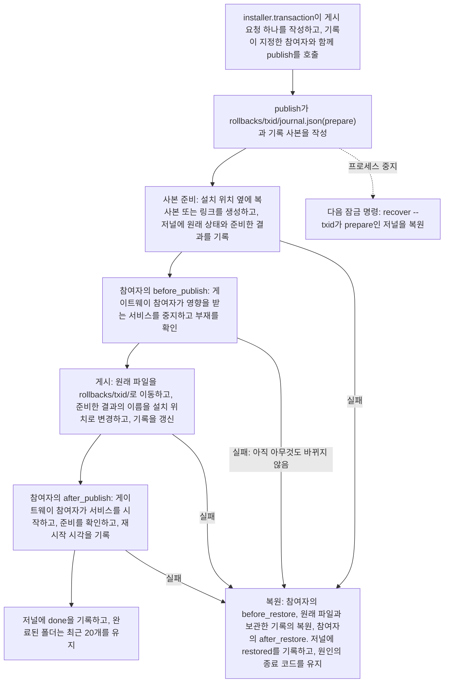
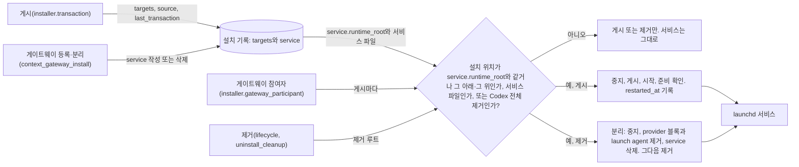

# Installer Architecture

Language: [🇺🇸 English](../../reference/installer-architecture.md) | 🇰🇷 한국어

이 문서는 기여자가 빠른 설치 안내에서 설치기 호환성 계약으로 넘어갈 때 사용하는 구조 안내입니다. 설치기, 훅 입력·출력, 설치 상태와 테스트 사이의 연결을 설명합니다.

사용자는 [설치 안내](../getting-started/installation.md)에서 실행 절차를 확인하실 수 있습니다. 기여자는 [플랫폼 호환성 계약](../policies/installer-platform-compatibility-matrix.md)에서 요구 조건과 담당 테스트를 확인합니다.
## Contents

- [읽는 순서](#읽는-순서)
- [Architecture Summary](#architecture-summary)
- [Install Flow](#install-flow)
- [Install Record](#install-record)
- [Gateway Lifecycle](#gateway-lifecycle)
- [Platform Surfaces](#platform-surfaces)
- [State And Safety Model](#state-and-safety-model)
- [Contributor Entry Points](#contributor-entry-points)
- [What Not To Infer](#what-not-to-infer)
- [Full Understanding](#full-understanding)

## 읽는 순서

1. 이 문서에서 구성 요소와 호출 방향을 파악합니다.
2. 파일 위치는 [repository structure](./repository-structure.md)에서 찾습니다.
3. 사용자에게 보이는 동작은 [installation](../getting-started/installation.md)과 [uninstall](../getting-started/uninstall.md)에서 확인합니다.
4. 계약과 필요한 검증은 [installer platform compatibility](../policies/installer-platform-compatibility-matrix.md), [tool output semantics](../policies/tool-output-semantics.md), [live smoke regression](../policies/live-smoke-regression.md)에서 확인합니다.

## Architecture Summary

설치기 구성 요소는 다음 세 계층에서 역할을 나눕니다.

| Layer | Main files | Responsibility |
| --- | --- | --- |
| Shell entrypoints | `install.sh`, `install.ps1`, `install.cmd` | `install.sh`는 UTF-8 로케일을 설정하고 Python 3.11 이상을 찾거나 설치한 뒤, 사용자의 인수를 그대로 `_shared/installer/cli.py`에 넘깁니다. `install.ps1`은 PowerShell이 7.6보다 낮으면 7.6 요구 문구를 출력하고 멈춥니다. 그 밖에는 콘솔 입출력을 UTF-8로 설정하고 Python 3.11 이상을 찾거나 설치한 뒤, 예전 PowerShell 설치기의 매개변수 이름을 같은 뜻의 긴 옵션으로 바꾸어 모든 인수를 순서대로 같은 cli에 넘깁니다. `GHOST_ALICE_INSTALL_COMMAND`로 `.\install.cmd`를 알리므로 설치기의 help와 안내 문구가 Windows 명령을 씁니다. 알리지 않으면 `bash install.sh`를 씁니다. `install.cmd`는 `pwsh.exe`로, `pwsh.exe`가 없으면 `powershell.exe`로 `install.ps1`을 실행합니다 |
| Installer package | `_shared/installer/` (`cli`, `auto`, `selection`, `addons`, `preservation`, `transaction`, `hosts`, `diagnostics`, `lifecycle`, `source`, `prerequisites`, `lock`, `report`, `locations`, `config`, `runner`) | 옵션을 해석하고 명령 표에서 명령을 고르며 플랫폼과 대상을 정합니다. 설치 단계 순서를 지키고 설치 잠금을 쥐며 보고서를 출력합니다. 파일 변경은 모두 아래 진입점을 거칩니다 |
| Installer entry points | `_shared/install_hooks.py`, `_shared/install_transaction.py`, `_shared/install_state_writer.py`, `_shared/addon_installer.py`, `_shared/uninstall_cleanup.py`, `_shared/install_doctor.py`와 패키지가 자식 프로세스로 실행하는 다른 `_shared/*.py` 도구 | 스킬과 훅을 설치하고, 배치마다 같은 단계에서 설치 기록을 작성하고, 설치 상태를 기록합니다. 로컬 수정을 보호하고 관리 대상을 제거하며 설치를 진단합니다 |
| Runtime surfaces | `~/.claude/`, `~/.codex/`, `~/.agents/skills/`, `~/.ghost-alice/` | 설치된 스킬, 플랫폼 훅 설정, Claude·Codex 전역 부트스트랩 지침, 설치 기록, 게시 복원 자료, 설치 상태 매니페스트, 훅 기능 복원 메타데이터, 병합 대기 자료와 제거 결과를 보관합니다 |

설치기는 설치 파일과 훅을 갱신하면서 사용자가 수정한 파일을 보호하고 자신의 변경을 기록합니다. `status`, `doctor`, 업데이트와 제거 절차는 이 기록을 읽어 실제 설치 상태와 복원 가능한 변경을 판단합니다.

설치된 훅 런타임은 같은 런타임 루트 아래에 `_shared` 모듈과 `session-intent-analyzer/scripts/session_intent_ledger.py`를 함께 포함합니다. 네이티브 훅과 Ghost-ALICE Autopilot은 이 설치본에서 원장 API와 관련 모듈을 불러옵니다. 소스 체크아웃은 설치 입력을 지정하며, 소스 편집만으로 설치된 훅의 실행 모듈이 바뀌지 않습니다. 원장 데이터베이스 경로와 네이티브 세션 식별자는 별도의 실행 입력입니다.

공용 모듈 네 개는 어느 계층에도 속하지 않으므로 설치기, 훅 런타임과 스킬이 모두 가져올 수 있습니다. `_shared/hook_definitions.py`는 설치기와 훅 런타임이 함께 읽는 이름을 소유합니다. 훅 ID와 호스트 이벤트 이름, `ghost_alice_context` 제공자 이름, 권한 어댑터 허용 목록이 여기에 있습니다. `_shared/install_lock.py`는 설치 잠금 파일과, 잠금을 이 프로세스나 이 프로세스를 실행한 부모 프로세스가 쥐었는지 판정하는 함수 하나를 소유합니다. `_shared/content_digest.py`는 설치 내용의 지문 생성과 설치 기록 항목·현재 파일의 비교를 소유합니다. `_shared/installed_payload.py`는 설치 기록을 소유합니다. 앞의 세 모듈은 표준 라이브러리만 가져오고, `installed_payload`는 `content_digest`와 `install_lock`만 가져옵니다. 런타임 모듈은 설치기 모듈을 가져오지 않고, 설치기 모듈은 런타임 모듈을 가져오지 않습니다. `_shared.test_hook_definitions`가 이 규칙들을 검사하고, `installer` 패키지의 모듈 이름이 표준 라이브러리 모듈 이름과 겹치지 않는지도 검사합니다.

## Install Flow

| 전달 주체 | 입력으로 넘기는 내용 | 다음 단계에서 사용하는 결과 |
| --- | --- | --- |
| 사용자 명령 → 셸 진입점 | 입력한 명령줄 그대로. | 사용 가능한 Python 3.11 이상 실행 환경과, 바뀌지 않은 인수. |
| 진입점 → `installer.cli` | 인수와 셸이 놓인 소스 체크아웃. | 해석한 옵션, 선택한 명령, 설치라면 플랫폼·스킬 디렉터리·적용 가시성. |
| `installer.cli` → `installer.selection`·`installer.addons` | 요청한 스킬 이름과 애드온 출처. | 정확한 설치 대상(핵심 스킬, `_shared`, 애드온 대상)과 대상 수. |
| 조정 코드 → `install_transaction.py publish` | 게시 요청 하나: 호스트, 원본·설치기 커밋, 대상마다 이름·종류·제공자·원본 경로·설치 위치·방식. | 설치한 스킬·도우미, 같은 단계에서 작성한 설치 기록 항목, 보존한 로컬 수정. |
| 배포 → 훅·부트스트랩 동기화 | 관리 파일 내용, 플랫폼 경로, 등록 명령. | 갱신한 관리 규칙 블록과 훅 등록. |
| 설치기 → 설치 상태 기록기 → 상태 출력 | 실제 변경 대상·해시·복원 정보. | Status·doctor·제거에서 읽을 플랫폼 매니페스트와 설치 보고서. |

Windows에서는 `install.cmd`가 인수를 `install.ps1`에 전달합니다. `install.ps1`과 `install.sh`는 같은 `_shared/installer/cli.py`를 실행하는 얇은 셸이므로, Windows와 Unix 계열은 설치기 구현 하나를 함께 씁니다. Unix 계열 환경에서는 `install.sh`가 셸 진입점을 담당하며 필요할 때 Bash로 다시 실행합니다. `--help`와 `--list`를 포함한 모든 명령은 Python에서 실행됩니다. 셸은 설치기 문구, 옵션, 명령의 사본을 갖지 않습니다.

`installer.cli`는 명령 표 `COMMAND_LINE` 하나를 소유합니다. 명령 행마다 그 명령을 고르는 토큰, 처리 함수, 쥐는 설치 잠금 이름, 플랫폼이 필요한지, `--help` 행이 있습니다. 옵션 해석, 자동 모드 판정, 명령 분기, 잠금, `--help`가 모두 이 표를 읽으므로, 한 곳에만 알려진 명령은 생기지 않습니다. `-`로 시작하면서 명령 이름이 아닌 토큰은 `Unknown option`으로 멈춥니다. 감지한 플랫폼마다 실행되는 것은 플랫폼 없이 받은 설치뿐이고, 명령은 한 번만 실행됩니다. 설치기는 자신이 실행되는 체크아웃을 `installer.runner.REPO_ROOT` 한 이름으로 부릅니다.

### 설치 단계 순서

설치 명령은 다음 순서로 진행합니다. `installer.cli.dispatch`가 1단계를, `installer.cli.prepare_install`이 2단계를 실행하고, `installer.cli.run_command`가 잠금을 잡은 뒤, `installer.cli.run_install`이 나머지를 실행합니다. `_shared/test_installer_cli.py`가 이 순서를 고정합니다.

1. 설치 원본 확인. 아무것도 바꾸기 전에 실행합니다. `installer.source.match_install_source`가 설치 기록의 `source.root`와 설치기가 실행되는 체크아웃을 링크를 따라간 경로로 비교합니다. 이 함수가 어느 체크아웃이 설치 원본인지 판정하는 유일한 함수입니다. `installer.source.check_install_source`는 그 결과로 진행하거나 종료합니다. 기록이 없거나, 기록에 원본이 없거나, 기록의 체크아웃이면 진행합니다. 두 번째 clone이나 git worktree 같은 다른 체크아웃은 `--adopt-source`가 있으면 진행합니다. 기록된 체크아웃이 더는 없으면(다른 경로에 다시 clone한 경우) 묻지 않고 진행합니다. 그 밖의 경우 설치기는 두 폴더를 출력하고, 터미널에서는 이 체크아웃으로 설치 원본을 교체할지 묻습니다(기본값 아니오). 터미널이 아니면 종료 코드 2로 종료하고 실행할 명령을 안내합니다. 자동 모드는 부모 프로세스가 한 번만 확인하고, 교체 결정을 `--adopt-source`로 자식 프로세스에 전달합니다. 기록을 읽을 수 없으면 경고를 출력하고 확인을 건너뜁니다. 명령의 첫 게시가 새 원본을 기록합니다. 애드온 소스는 이 단계 뒤에 준비합니다. `--repair`도 이 단계를 먼저 실행하지만 설치 원본을 교체하지 않습니다. 다른 체크아웃에서 실행하면 종료 코드 2로 종료하고, 설치본을 옮기는 설치 명령을 안내합니다. 명령은 잠금(3단계)을 잡은 뒤 한 번 더 비교합니다. 그래서 이 명령이 잠금을 기다리는 동안 다른 설치기가 원본을 바꿨다면, 바뀐 상태로 다시 판정합니다.
2. 선행 도구(`git`, `node`)와 소스 체크아웃의 git hook 경로.
3. 설치 잠금(`~/.ghost-alice/install.lock`). 명령이 끝날 때까지 쥡니다. 설치기는 잠금을 생성한 직후, 저널이 `done`도 `restored`도 아닌 게시를 모두 복원합니다.
4. 설치 기록 이관. `~/.ghost-alice/installed-payload.json`이 없고 이전 설치기의 install-state가 있을 때만 실행합니다. 그다음 소스 상태 확인, 그다음 대상 수집(핵심 스킬, `_shared`, 애드온 대상).
5. deprecated 설치 스킬을 발견 경로 밖으로 옮긴 뒤, 인코딩 검사, 그다음 로컬 수정을 격리하거나 기록하는 사전 점검.
6. 중단된 애드온 제거를 재개합니다. 애드온 충돌은 설치를 멈춥니다.
7. 배치: `_shared`와 모든 대상을 링크(Claude Code)로, 또는 하나의 복사 배치(Codex)로 놓습니다. 배치 한 번은 설치기 프로세스 안의 `install_transaction.publish` 호출 한 번이며, 설치 기록이 지정한 참여자와 함께 같은 단계에서 대상들의 설치 기록 항목을 작성합니다.
8. 런타임 게시: `_shared`와 동반 스크립트 `session-intent-analyzer/scripts/session_intent_ledger.py`를 `~/.ghost-alice/runtime/current` 아래에 게시 한 번으로 놓습니다. 설치 기록에 `service` 섹션이 있으면 게이트웨이 참여자가 파일 교체 전에 등록된 서비스를 중지하고 교체 뒤에 시작합니다. Codex 복사본 `~/.agents/skills/_shared`와 Claude 링크는 서비스의 코드가 아니므로 그 배치는 서비스 효과를 호출하지 않습니다. 그다음 읽기만 하는 `Context gateway:` 보고 줄 하나, 그다음 훅 설치, 관리 규칙 블록, 명령 래퍼.
9. 검증, 소유 표지, merge-companion 스냅숏, 애드온 사이드카, 설치 상태 매니페스트, 설치 이벤트. 설치기는 배치 뒤에 이 이전 기록들을 예전처럼 작성하며, status·doctor·보존·제거·복구는 이 기록들을 계속 조회합니다.

명령 표가 명령마다 잠금을 지정합니다. 설치, 제거, 복구(`--repair`), `--cleanup-pending`, `gateway` 전달 명령이 잠금 아래에서 실행되며, `installer.cli.run_command`가 처리 함수 전에 잠금을 잡고 끝난 뒤 풉니다. 자식 도구는 자신을 호출한 설치기 프로세스의 잠금을 그대로 씁니다. 잠금 파일이 그 프로세스 ID를 기록하며, `install_lock.held_by_process_tree`가 잠금이 호출한 프로세스나 그 부모 프로세스의 것인지 판정합니다. 게이트웨이 등록 명령과 설치 기록 작성 함수가 모두 이 함수를 호출하며, 무관한 소유자는 둘을 막습니다. 단독으로 실행한 등록 명령은 잠금을 스스로 획득합니다. 잠금의 소유자 문자열은 표시용이며 아무 권한도 주지 않습니다.

### post-merge 훅

git hook 단계(2단계)가 저장소의 `core.hooksPath`를 `hooks`로 설정하므로, 저장소의 모든 worktree가 merge나 pull에 성공한 뒤 `hooks/post-merge`를 실행합니다. 훅은 merge한 체크아웃의 `bash install.sh --post-merge`를 호출하고, `installer.cli.run_post_merge`는 설치 원본 확인의 판정 함수 `installer.source.match_install_source`를 호출합니다. 설치 기록이 설치 원본으로 지정한 체크아웃이면 이 단계는 감지한 모든 호스트에 자동 모드 설치를 이어서 실행합니다. 이 단계는 잠금을 잡지 않습니다. 호스트마다의 설치가 잠금을 잡으며, 다른 설치가 잠금을 쥐고 있으면 설치는 아무것도 바꾸지 않고 종료하고 훅은 그 종료 코드를 한 줄로 보고합니다. 다른 체크아웃이거나, 기록이 없거나, 기록을 읽을 수 없으면 이 단계는 한 줄만 출력하고 설치하지 않습니다. 기록된 체크아웃이 더는 없을 때 설치 원본을 교체하는 것은 사용자가 실행한 설치뿐이며, merge는 교체하지 않습니다. 훅은 항상 종료 코드 0으로 종료하므로 훅 때문에 merge가 실패하지 않습니다.

## Install Record

`~/.ghost-alice/installed-payload.json`은 설치기가 어느 위치에 무엇을 설치했는지 기록합니다. 두 호스트가 파일 하나를 함께 쓰며, 설치 위치 경로마다 항목이 하나입니다. 런타임 `~/.ghost-alice/runtime/current/_shared`처럼 두 호스트가 함께 쓰는 위치는 항목 하나의 `used_by`에 두 호스트를 기록합니다.

| Section | Content |
| --- | --- |
| `schema_version` | `1` |
| `installer` | 마지막으로 기록을 작성한 설치기의 `commit`과 `schema_version` |
| `source` | 설치 원본 체크아웃의 `root`, `commit`, `dirty`, `hooks_path` |
| `last_transaction` | 마지막 게시의 `id`, `updated_at`, `rollback_dir` |
| `targets` | 설치 위치마다 `name`, `kind`(`skill`, `support`, `runtime`, `command`, `resource`), `mode`(`link`, `copy`), `provider`(`core` 또는 `addon:<id>`), `source`, `source_commit`, `used_by`, 링크이면 `link_target`, 복사이면 `files`, `installed_at`, `baseline` |
| `service` | 등록된 컨텍스트 게이트웨이. 등록이 없으면 이 섹션도 없습니다. `label`, `runtime_root`(서비스가 실행하는 런타임 `_shared`의 상위 폴더), `program`, 서비스 파일 세 개 `launch_agent`·`state_path`·`config_path`와 지문 `launch_agent_digest`·`state_digest`·`config_block_digest`(Codex `config.toml`의 provider 블록 지문. 등록 명령이 기록하기 전에는 `null`), `config_backup`, `registered_at`, `restarted_at`, `listener_ready` |

복사 항목의 `files`는 상대 경로마다 파일 내용의 `sha256:<hex>` 지문을 기록하며, 파일 하나를 복사한 항목은 자기 자신을 경로 `.`로 기록합니다. 링크 항목은 링크가 가리키는 경로만 기록합니다. `content_digest`가 둘을 생성하며 캐시(`__pycache__`, `.pytest_cache`, `.mypy_cache`, `.ruff_cache`, `node_modules`, `.git`), `.pyc`·`.DS_Store` 파일, 소유 표지 파일, 링크인 파일과 폴더를 제외합니다. `baseline`은 지문의 출처입니다. `recorded`는 게시가 작성한 지문, `migrated`는 이전 설치기의 기록에서 이관한 지문, `unknown`은 이전 기록에 지문이 없었다는 뜻입니다.

| Writer | When | What it writes |
| --- | --- | --- |
| `install_transaction.publish` | 배치할 때마다, 그리고 이미 원본을 가리키는 링크에 대해 설치마다 한 번 | 게시한 대상, `source`, `installer`, `last_transaction`을 이름 변경과 같은 단계에서 갱신합니다. 이미 원본을 가리키는 링크는 교체하지 않고 기록만 작성합니다 |
| `installed_payload.migrate` | 기록이 없고 이전 설치기의 install-state가 있을 때의 첫 설치, 복구 또는 제거 | 호스트마다 install-state의 대상을 항목으로 작성합니다. 링크는 지금 가리키는 경로, 복사는 소유 표지의 지문, 표지가 없으면 merge-companion 스냅숏의 지문, 둘 다 없으면 지문 없이(`unknown`) 작성합니다. `provider`는 애드온 사이드카에서 조회합니다. 현재 파일의 지문을 기준값으로 채택하지 않으며, 이전 기록은 변경하지 않습니다 |
| `installed_payload.migrate_service` | 기록에 `service` 섹션이 없고 `~/.ghost-alice/context-gateway-binding.json`이 설치된 게이트웨이 영수증을 가리킬 때의 첫 설치, 복구 또는 제거 | 영수증에서 `service` 섹션을 작성합니다(`config_block_digest`는 등록 명령이 기록하기 전까지 `null`). 영수증이 지문을 기록한 동반 스크립트마다 `migrated` 런타임 대상을 작성합니다. 영수증과 바인딩 파일은 변경하지 않으며 다시 조회하지 않습니다 |
| `context_gateway_install.py` | `gateway` 등록·분리 명령의 단계 기계가 commit 단계에서 | 등록은 서비스 준비 확인 뒤 `service` 섹션을 작성하고, 분리는 섹션을 삭제합니다. 실패한 작업은 섹션을 이전 값으로 복원합니다 |
| `installer.gateway_participant` | 서비스의 코드를 바꾼 게시 뒤 | 서비스가 다시 준비되면 `service` 섹션의 `restarted_at`과 `listener_ready`를 갱신합니다 |

`installed_payload.update`는 기록 섹션을 작성하는 유일한 함수이고, `installed_payload.restore`는 게시가 보관한 사본으로 기록을 복원합니다. 두 함수는 임시 파일에 작성한 뒤 이름을 변경하여 교체하며, 설치 잠금이 호출한 프로세스나 그 부모 프로세스의 것이 아니면 거부합니다. 다른 schema version처럼 이 설치기가 읽을 수 없는 기록은 변경하지 않고, 파일 게시는 계속합니다. `--status`와 `--doctor`는 기록에서 해당 플랫폼의 대상을 요약한 줄 하나와, 기록과 다른 대상마다 줄 하나를 출력합니다. 기준값이 없는 대상은 개수만 알리고 비교하지 않으며, 일치는 비교한 대상에 대해서만 보고합니다. 기록은 두 명령의 결과를 변경하지 않습니다.

게시는 교체한 자료를 `~/.ghost-alice/rollbacks/<txid>/` 한 곳에만 보관합니다. 원래 파일, 기록 사본, `journal.json`이 그 폴더에 있습니다. 저널은 게시가 교체하는 대상을 기록하고, 대상마다 원래 상태와 준비한 결과를 기록합니다. 파일은 지문, 링크는 가리키는 경로, 폴더는 빈 폴더까지 모두 기록하며 캐시와 생성 파일만 제외합니다. 저널은 무엇이든 변경하기 전에 `prepare`, 파일·기록과 참여자의 `after_publish`가 모두 끝난 뒤 `done`, 복원한 뒤 `restored`를 기록합니다. 참여자의 오류는 복원 뒤에도 자신의 종료 코드(2, 3, 4, 5)를 유지하며, 복원 단계가 자신의 코드로 실패하면 그 코드를 보고합니다(서비스 복구를 확인하지 못하면 5). 교체할 대상이 없는 게시(이미 원본을 가리키는 링크)는 참여자를 호출하지 않습니다. `install_transaction`은 참여자 인터페이스만 압니다(`installer/participant.py`: `before_publish`, `after_publish`, `before_restore`, `after_restore`. 기록 루트, 호스트, 작업 번호, 교체하는 설치 위치를 전달합니다). 설치기 모듈 중 게이트웨이 모듈을 가져오는 파일은 `installer/gateway_participant.py` 하나입니다. 프로세스가 `done` 전에 중지되면 다음 잠금 명령이 `install_transaction.py recover --txid <id>`를 호출합니다. 이 명령은 모든 대상을 먼저 확인합니다. 설치 위치에는 게시가 남긴 결과나 원래 파일이 있어야 하고, 이동한 원래 파일이 남아 있어야 합니다. 복원할 수 없는 게시는 명령을 종료 코드 1로 중지하고 검토할 폴더를 알립니다. 절반만 게시된 파일 위에 다시 게시하면 어느 파일이 원래 파일인지 판별할 수 없기 때문입니다. 이 복원은 파일과 기록만 복원하며 컨텍스트 게이트웨이 서비스를 중지하거나 재시작하지 않습니다.

## Gateway Lifecycle

게이트웨이 등록·갱신·분리는 `_shared/context_gateway_*`의 여섯 모듈이 담당합니다. `model`은 요청·관측값·계획·결과와 실행 인터페이스의 자료형을 정의하며 AI 모델을 호출하지 않습니다. `inventory`는 전달받은 플랫폼 어댑터로 서비스 파일을 조회합니다. `plan`은 서비스 파일을 설치 기록의 `service` 섹션과 비교하여 I/O 없이 순서가 정해진 계획을 작성합니다. `transaction`은 계획을 실행하고, commit 단계에서 기록의 `service` 섹션을 작성하며, 역순 복구를 담당합니다. `platform`은 개별 파일·기록·네이티브 서비스 작업을 수행합니다. `install`은 `gateway` 명령 뒤에서 이 모듈들을 연결합니다. `bash install.sh gateway --codex-dir <dir> --ledger-root <dir> --state-dir <dir> --launch-agent <plist>`는 서비스를 등록하거나 갱신하고, `bash install.sh gateway detach --confirm`은 등록을 해제하며, `--dry-run`은 검증한 계획을 출력하고 적용 없이 종료합니다.

등록 명령은 설치 기록에서 가장 최근 게시가 작성한 런타임 대상을 조회하고 서비스 파일 세 개만 작성합니다. launch agent, `state.json`, Codex `config.toml`의 provider 블록입니다. 모듈을 복사하지 않습니다. 서비스는 설치기가 게시한 런타임 `_shared`와 동반 스크립트를 실행하며, 어느 바이트인지는 기록의 `targets`가 말합니다. 그래서 Core를 먼저 설치합니다. 상태 디렉터리는 링크를 따라간 경로로도 그 런타임 밖에 있어야 합니다. `service` 섹션이 없으면 명령은 새 리스너를 등록하며, 기록이 지정하지 않은 launch agent, 상태 디렉터리 항목, provider 블록이 있으면 거부합니다. 섹션이 있으면 서비스 파일 세 개가 섹션의 기록과 같을 때 같은 포트와 scope로 갱신하고, 어느 하나가 설치기 밖에서 바뀌었으면 아무것도 바꾸기 전에 종료합니다(종료 코드 2). 사용자가 그 파일을 검토한 뒤 명령을 다시 실행합니다.

설치기 모듈 중 게이트웨이 모듈을 가져오는 유일한 파일 `installer/gateway_participant.py`가 모든 게시와 제거를 기록으로 판정합니다. 설치 위치가 `service.runtime_root`와 같거나 그 아래·그 위이거나 서비스 파일 세 개 중 하나이면 서비스에 영향을 줍니다. `~/.codex`, `~/.claude`, 원장은 서비스가 조회하는 데이터이지 코드가 아니며, 링크는 가리키는 곳이 아니라 링크 자신의 경로로 비교합니다. 영향을 주는 게시는 파일 교체 전에 서비스를 중지하고, 교체 뒤에 시작하고, 준비를 확인하고, `restarted_at`을 기록합니다. 준비 확인이 실패하면 파일을 복원하고 이전 서비스를 시작합니다(종료 코드 4). 영향을 주는 제거와 모든 Codex 전체 제거는 먼저 분리합니다. 서비스를 중지하고, provider 블록과 launch agent를 제거하고, `service` 섹션을 삭제합니다. 상태 디렉터리는 남깁니다. 설치기 밖에서 바뀐 서비스 파일은 분리를 검토 대상으로 중지합니다. `service` 섹션이 없으면 제거는 launchd에 조회합니다. 게이트웨이 레이블의 서비스가 적재돼 있고 그 프로그램이 제거 루트 안이면 제거를 검토 대상으로 보류하고(종료 코드 3), 서비스가 없거나 다른 곳에서 실행하면 제거를 진행합니다. 설치(런타임 게시 뒤)와 복구(`--repair`)도 같은 함수 `installer.gateway_participant.loaded_service`로 launchd를 조회합니다. 기록에 `service` 섹션이 없는데 적재된 게이트웨이 서비스가 런타임 뿌리 아래에서 실행되면, 게시는 진행하고 설치기는 그 서비스를 중지하거나 시작하지 않습니다. 설치기에는 그 서비스 파일의 기록이 없기 때문입니다. 그다음 `Context gateway:` 줄이 경고를 출력하고 등록 명령을 안내합니다. 등록 명령은 서비스를 기록에 작성하고 새 코드로 재시작합니다. 조회 결과가 불확실하면 서비스가 없는 것으로 보고 설치 로그에 한 줄을 작성합니다. 체크아웃의 관리형 Git 업데이트(`--update-source`)는 서비스를 건드리지 않습니다. 체크아웃은 서비스의 코드가 아니기 때문입니다.

게이트웨이 오류는 발생 단계와 고정 오류 식별자를 유지합니다. 종료 코드 2는 선행 조건 불충족, 3은 파일 변경 전 서비스 상태 확인 불가, 4는 작업 실패 후 이전 설치 복원, 5는 변경 시작 후 복구 확인 불가를 뜻합니다. 설치기는 구조화된 원인을 출력하고 그 종료 코드를 유지합니다. 등록에는 zstd 코덱이 동작하는 Python 3.14가 필요하며 분리는 Python 3.11에서 실행합니다. [설치 생명주기 명세](../../coding-convention/specs/2026-10-15-gateway-installer-design.md)는 이 단계 기계의 출발이 된 설계를 기록합니다.

## Platform Surfaces

| Platform | Installed surfaces |
| --- | --- |
| Claude Code | `${CLAUDE_CONFIG_DIR:-~/.claude}/skills/`, `${CLAUDE_CONFIG_DIR:-~/.claude}/CLAUDE.md`, `${CLAUDE_CONFIG_DIR:-~/.claude}/settings.json`, Claude command wrappers |
| Codex | `~/.agents/skills/`, `~/.codex/AGENTS.md`, `~/.codex/ghost-alice-governance.md`, `~/.codex/hooks.json`, `~/.codex/config.toml` |
| Shared state | `~/.ghost-alice/installed-payload.json`, `~/.ghost-alice/rollbacks/`, `~/.ghost-alice/install-state/`, `~/.ghost-alice/pending-merges/`, `~/.ghost-alice/uninstall-reports/`, `~/.ghost-alice/install/` |

Claude Code의 native skill invocation과 hook permission은 저장소 밖의 세션에 필요한 global instruction을 대신하지 않습니다. installer는 `platforms/claude/CLAUDE.md`의 managed block을 Claude config directory에 병합합니다. Codex의 별도 bootstrap과 hook config는 required gate를 `SKILL.md` read record와 hook payload로 감사할 수 있게 합니다. 두 global rule file은 managed block 밖의 사용자 텍스트를 보존하며, marker가 없는 사용자 파일에는 덮어쓰기 대신 `.ghost-alice-proposed` 제안 파일을 만듭니다.

일반 Core hook 전달은 실제 native cwd를 Core 맥락으로 유지하고 명시된 Ghost-ALICE Autopilot 대상 override를 보존합니다. 프로젝트 선택은 Ghost-ALICE Autopilot이 담당합니다. Claude는 절대 CLI 프로젝트 경로를 payload cwd보다 먼저 선택하며, Codex는 payload cwd를 사용하고 Claude 전용 힌트를 무시합니다. 설치 source와 프로젝트 신뢰 경로는 Ghost-ALICE Autopilot 대상을 선택하지 않으며, 격리 바인딩은 소유 프로젝트 대상을 유지합니다. Pretool과 Stop은 해당 대상을 선택하고 OFF를 읽은 뒤 Core 권한 자료에 접근합니다. OFF는 캡처 맥락이나 권한 읽기·쓰기 없이 조용히 계속 진행을 반환하며, 활성 대상은 기존 적격 선택 검사로 진행합니다. 대상 선택은 권한을 부여하지 않습니다.

관리 훅 명령과 네이티브 신뢰 항목은 검토한 설치 내용과 일치해야 합니다. 실행 중인 호스트가 이전 등록을 유지할 수 있으므로 적절히 재로드한 뒤 실제 네이티브 콜백으로 반영을 확인합니다. [훅 신뢰와 재로드](../getting-started/troubleshooting.md#native-hook-trust-and-reload)를 참고해 주세요. 설치 상태만으로 네이티브 실행을 입증하지 않습니다.

## State And Safety Model

설치기는 제거·복원할 대상을 추측하지 않도록 변경 내용을 기록합니다.

| State path | Why it exists |
| --- | --- |
| `~/.ghost-alice/installed-payload.json` | 설치 기록입니다. 두 호스트의 모든 설치 위치, 출처, 복사한 파일의 지문을 배치와 같은 단계에서 기록합니다 |
| `~/.ghost-alice/rollbacks/<txid>/` | 게시 한 번이 교체한 원래 파일, 게시 전의 기록, 저널을 보관합니다. 저널이 done을 기록하기 전에 중지된 게시는 다음 잠금 명령이 복원합니다 |
| `~/.ghost-alice/install-state/<platform>.json` | 설치기가 관리한 대상과 환경 변경을 기록하며 상태 조회와 제거 명령이 읽습니다 |
| `~/.ghost-alice/pending-merges/<platform>/` | 설치기가 Ghost-ALICE 복사 설치 스킬 파일을 바꾸기 전에 사용자 수정본을 보존합니다. 설치 표식이 있는 폴더와, 이번 설치가 바꾸는 폴더는 표식이 사라졌어도 확인하며, merge-companion과 사용자가 병합 여부를 결정합니다. Claude 앱의 `synced`처럼 Ghost-ALICE가 설치하지 않는 폴더는 기록하지 않습니다 |
| `~/.ghost-alice/install/` | 감사와 복구에 필요한 설치 결과와 이벤트를 보관합니다 |

설치된 파일, 훅이나 실행 설정을 바꾸는 개발자는 상태 조회, 진단, 병합 대기 처리와 제거 복원에 미치는 영향도 확인해야 합니다. 이 절차들은 같은 설치 기록에 의존합니다.

## Contributor Entry Points

| Change type | Start here | Then verify with |
| --- | --- | --- |
| Python runtime detection, the PowerShell 7.6 check, PowerShell parameter names or locale setup | `install.sh`, `install.ps1`, `install.cmd` | `scripts/tests/test_thin_shells.py`, `scripts/tests/test_install_runtime_detection.py`, compatibility matrix groups |
| Installer option, command table, dispatch or install order | `_shared/installer/cli.py`, `_shared/installer/auto.py` | `_shared/test_installer_cli.py`, `_shared/test_installer_auto.py`, `_shared/test_installer_checkout.py`, `_shared/test_*_shell.py` end-to-end tests |
| Installer wording or the install report | `_shared/installer/report.py` | `_shared/test_installer_report.py`, `scripts/tests/test_installer_default_auto.py` |
| Hook payload or hook status wording | `_shared/install_hooks.py` | `_shared.test_install_hooks`, `scripts/check_skill_gate_contract.py` |
| Hook id, host event name or privileged adapter allowlist | `_shared/hook_definitions.py` | `_shared.test_hook_definitions` |
| Install record, fingerprints, publish journal or restore | `_shared/installed_payload.py`, `_shared/content_digest.py`, `_shared/install_transaction.py`, `_shared/installer/transaction.py`, `_shared/installer/lock.py` | `_shared/test_installed_payload.py`, `_shared/test_content_digest.py`, `_shared/test_install_transaction_publish.py`, `_shared/test_install_record_shell.py` |
| Install-state or uninstall behavior | `_shared/install_state_writer.py`, `_shared/uninstall_cleanup.py`, `_shared/installer/lifecycle.py`, `_shared/installer/transaction.py` | `_shared/test_installer_lifecycle.py`, `_shared/test_installer_transaction.py`, install-state schema tests and uninstall tests |
| Public docs or command surface | `README.md`, `docs/`, `docs/index.html` | `scripts/validate_public_surfaces.py` and public-surface contract tests |
| Platform compatibility rule | `docs/policies/installer-platform-compatibility-matrix.md` | `scripts/run_installer_compat_tests.py --list` and policy가 지정한 focused group |

기여자는 구성 요소를 바꿀 때 연결된 계약을 확인합니다. 호환성 표가 지정한 담당 테스트에서 영향을 받는 회귀 검사를 찾습니다.

## What Not To Infer

- 훅 파일의 존재만으로 현재 입력·출력 계약과 일치한다고 판단하지 않습니다.
- 복사된 스킬 디렉터리만으로 플랫폼이 해당 스킬을 호출하거나 감사할 수 있다고 판단하지 않습니다.
- 설치 점검의 통과만으로 상태 조회·진단·업데이트·병합 대기·제거 절차의 일관성을 판단하지 않습니다.
- 사용자용 설치 명령은 진입점을 안내하며 내부 구조 설명을 대신하지 않습니다.

## Full Understanding

기여자는 검토할 변경이 셸 진입점에서 설치 조정 코드, 설치 대상, 상태 기록과 담당 테스트로 어떻게 이어지는지 확인합니다. 이 문서는 그 연결을 찾는 안내이며, 관련 구현과 호환성 계약을 읽는 절차를 대신하지 않습니다.
