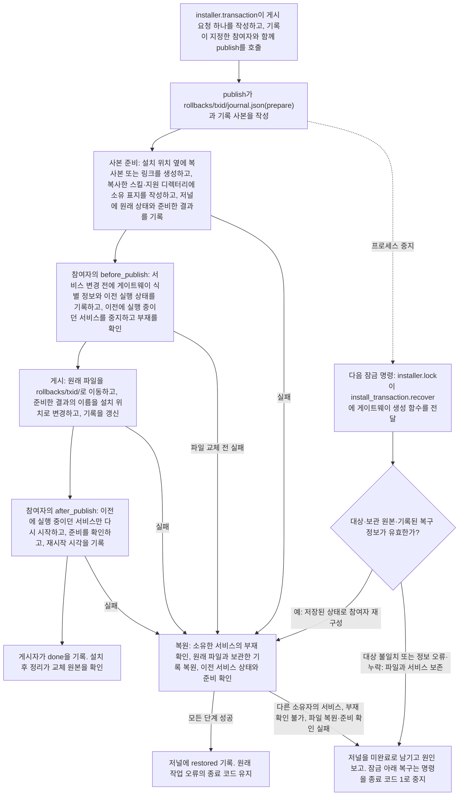
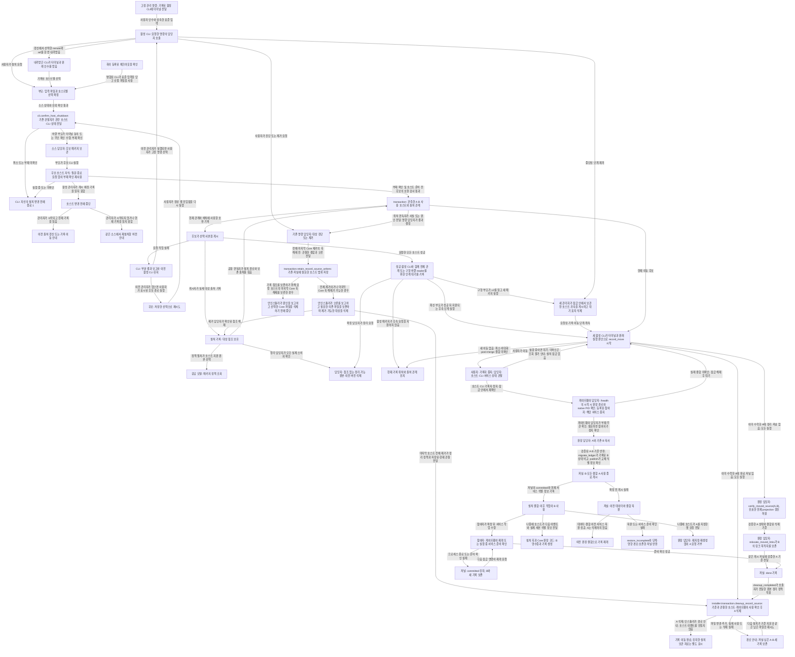
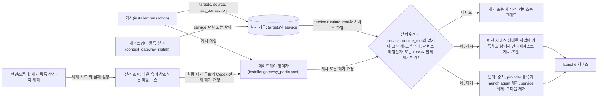

# 인스톨러 아키텍처

[🇺🇸 English](../../reference/installer-architecture.md) | [🇰🇷 한국어](./installer-architecture.md)

이 문서는 기여자가 빠른 설치 안내에서 인스톨러 호환성 계약으로 넘어갈 때 사용하는 구조 안내입니다. 인스톨러, 훅 입력·출력, 설치 상태와 테스트 사이의 연결을 설명합니다.

설치 절차는 [설치 안내](../getting-started/installation.md)에서 확인하실 수 있습니다. 기여자는 [플랫폼 호환성 계약](../policies/installer-platform-compatibility-matrix.md)에서 요구 조건과 담당 테스트를 확인합니다.
## 목차

- [읽는 순서](#읽는-순서)
- [아키텍처 요약](#아키텍처-요약)
- [설치 흐름](#설치-흐름)
- [설치 기록](#설치-기록)
- [게이트웨이 생명주기](#게이트웨이-생명주기)
- [플랫폼별 설치 항목](#플랫폼별-설치-항목)
- [상태와 안전 모델](#상태와-안전-모델)
- [기여자 진입점](#기여자-진입점)
- [추론하지 않을 것](#추론하지-않을-것)
- [전체 이해](#전체-이해)

## 읽는 순서

1. 이 문서에서 구성 요소와 호출 방향을 파악합니다.
2. 파일 위치는 [저장소 구조](./repository-structure.md)에서 찾습니다.
3. 사용자에게 보이는 동작은 [설치 안내](../getting-started/installation.md)와 [제거 안내](../getting-started/uninstall.md)에서 확인합니다.
4. 계약과 검증 부담은 [인스톨러 플랫폼 호환성 매트릭스](../policies/installer-platform-compatibility-matrix.md), [도구 출력의 의미](../policies/tool-output-semantics.md), [실환경 점검 회귀 테스트](../policies/live-smoke-regression.md)에서 확인합니다.

## 아키텍처 요약

Ghost-ALICE는 생성 백엔드 ↔ 호스트 어댑터 ↔ Core 구조를 유지합니다. 호스트와 생성 백엔드는 서로 다른 대상입니다. 현재 제공하는 호스트 어댑터는 Claude Code와 Codex이며, 공통 소유권·설치 기록·버전 보존·원장 규칙은 향후 호스트도 기록상의 식별자로 구분합니다. 특정 작업에 필요한 호스트 어댑터가 없으면 그 호스트를 변경하기 전에 중단합니다. 인스톨러 구현은 다음 네 계층으로 구성됩니다.

| 계층 | 주요 파일 | 책임 |
| --- | --- | --- |
| 셸 진입점 | `install.sh`, `install.ps1`, `install.cmd` | `install.sh`는 UTF-8 로케일을 설정하고 Python 3.11 이상을 찾거나 설치한 뒤, 받은 인수를 변경 없이 `_shared/installer/cli.py`에 전달합니다. `install.ps1`은 PowerShell이 7.6보다 낮으면 7.6 요구 문구를 출력하고 종료합니다. 그 밖에는 콘솔 입출력을 UTF-8로 설정하고 Python 3.11 이상을 찾거나 설치한 뒤, 예전 PowerShell 인스톨러의 매개변수 이름을 같은 뜻의 긴 옵션으로 변환하여 모든 인수를 순서대로 같은 `cli.py`에 전달합니다. `GHOST_ALICE_INSTALL_COMMAND`에 `.\install.cmd`를 지정하므로 인스톨러의 도움말과 안내 문구는 Windows 명령을 표시합니다. 이 값이 없으면 `bash install.sh`를 표시합니다. `install.cmd`는 `pwsh.exe`로, `pwsh.exe`가 없으면 `powershell.exe`로 `install.ps1`을 실행합니다 |
| 인스톨러 패키지 | `_shared/installer/` (`cli`, `auto`, `selection`, `addons`, `preservation`, `transaction`, `record_move`, `terminal`, `hosts`, `diagnostics`, `lifecycle`, `source`, `prerequisites`, `lock`, `report`, `locations`, `config`, `runner`) | 옵션을 해석하고 명령 표에서 명령을 선택하며 플랫폼과 대상을 결정합니다. 설치 단계 순서를 유지하고 설치 잠금을 보유하며 보고서를 출력합니다. 파일 변경은 모두 아래 진입점을 거칩니다 |
| 인스톨러 진입점 | `_shared/install_hooks.py`, `_shared/install_transaction.py`, `_shared/install_state_writer.py`, `_shared/addon_installer.py`, `_shared/uninstall_cleanup.py`, `_shared/install_doctor.py`와 패키지가 자식 프로세스로 실행하는 다른 `_shared/*.py` 도구 | 스킬과 훅을 설치하고, 배치마다 같은 단계에서 설치 기록을 작성하고, 설치 상태를 기록합니다. 로컬 수정을 보호하고 관리 대상을 제거하며 설치를 진단합니다 |
| 런타임 설치 항목 | `~/.claude/`, `~/.codex/`, `~/.agents/skills/`, `~/.ghost-alice/` | 설치된 스킬, 플랫폼 훅 설정, Claude·Codex 전역 부트스트랩 지침, 설치 기록, 게시 복원 자료, 설치 상태 매니페스트, 훅 기능 복원 메타데이터, 병합 대기 자료와 제거 보고서를 보관합니다 |

인스톨러는 설치 파일과 훅을 갱신하면서 외부 변경을 보호하고 자신의 변경을 기록합니다. 외부 변경은 설치 뒤 인스톨러가 설치본에서 찾은, 인스톨러의 기록에 없는 변경이며, 변경한 주체를 인스톨러가 기록하지 않습니다. `status`, `doctor`, 업데이트와 제거 절차는 이 기록을 조회해 실제 설치 상태와 복원 가능한 변경을 판단합니다.

설치된 훅 런타임은 같은 런타임 루트 아래에 `_shared` 모듈과 `session-intent-analyzer/scripts/session_intent_ledger.py`를 함께 포함합니다. 네이티브 훅은 이 설치본에서 원장 API와 관련 모듈을 불러옵니다. 소스 체크아웃은 설치 입력을 지정하며, 소스 편집만으로 설치된 훅의 실행 모듈이 바뀌지 않습니다. 원장 데이터베이스 경로와 네이티브 세션 식별자는 별도의 실행 입력입니다.

다음 공용 모듈은 인스톨러에도 훅 런타임에도 속하지 않으므로 인스톨러, 훅 런타임과 스킬이 모두 가져올 수 있습니다. `_shared/hook_definitions.py`는 인스톨러와 훅 런타임이 공통으로 조회하는 이름을 소유합니다. 훅 ID와 호스트 이벤트 이름, `ghost_alice_context` provider 이름이 여기에 있습니다. `_shared/install_lock.py`는 설치 잠금 파일과, 잠금을 이 프로세스나 이 프로세스를 실행한 부모 프로세스가 보유했는지 판정하는 함수 하나를 소유합니다. `_shared/content_digest.py`는 설치 내용의 지문 생성과 설치 기록 항목·현재 파일의 비교를 소유합니다. `_shared/installed_payload.py`는 설치 기록을 소유합니다. `_shared/install_destination.py`는 검증한 설치 위치와, Core 코드가 파일을 변경할 수 있는 위치를 제한하는 검사를 소유합니다. `_shared/atomic_write.py`는 파일 교체를 소유합니다. 교체 도중에 그 파일을 조회한 결과는 이전 내용 전체이거나 새 내용 전체입니다. `_shared/file_lock.py`는 파일의 배타 잠금과 그 잠금을 기다리는 시간 한도를 소유합니다. `installed_payload`의 조회 경로는 `content_digest`와 `install_lock`을 사용하고 기록 형식 전환은 기존 `install_transaction` 저널을 사용합니다. `atomic_write`는 `install_destination`만 가져오고, `install_lock`은 `file_lock`을 가져옵니다. `_shared/pending_manifest.py`는 `atomic_write`, `file_lock`, `install_destination`을 가져와 대기 경로, 파싱한 관측값과 잠금 아래의 갱신을 소유합니다. 나머지 공용 모듈은 표준 라이브러리만 가져옵니다. 런타임 모듈은 인스톨러 모듈을 가져오지 않고, 인스톨러 모듈은 런타임 모듈을 가져오지 않습니다. `_shared.test_hook_definitions`가 이 규칙들을 검사하고, `installer` 패키지의 모듈 이름이 표준 라이브러리 모듈 이름과 겹치지 않는지도 검사합니다.

## 설치 흐름

| 전달 주체 | 입력으로 넘기는 내용 | 다음 단계에서 사용하는 결과 |
| --- | --- | --- |
| 명령줄 → 셸 진입점 | install.sh를 실행한 주체(인간 사용자, 응답 모델 또는 post-merge 훅 같은 스크립트)가 전달한 명령줄. | 사용 가능한 Python 3.11 이상 실행 환경과, 바뀌지 않은 인수. |
| 진입점 → `installer.cli` | 인수와 셸이 놓인 소스 체크아웃. | 해석한 옵션, 선택한 명령, 설치라면 플랫폼·스킬 디렉터리·적용 가시성. |
| `installer.cli` → `installer.selection`·`installer.addons` | 요청한 스킬 이름과 애드온 출처. | 정확한 설치 대상(핵심 스킬, `_shared`, 애드온 대상)과 대상 수. |
| 조정 코드 → `install_transaction.py publish` | 게시 요청 하나: 호스트, 원본·인스톨러 커밋, 대상마다 이름·종류·제공자·원본 경로·설치 위치·방식. | 설치한 스킬·도우미, 같은 단계에서 작성한 설치 기록 항목, 보존한 로컬 수정. |
| 배포 → 훅·부트스트랩 동기화 | 관리 파일 내용, 플랫폼 경로, 등록 명령. | 갱신한 관리 규칙 블록과 훅 등록. |
| 인스톨러 → 설치 상태 기록기 → 상태 출력 | 실제 변경 대상·해시·복원 정보. | Status·doctor·제거에서 읽을 플랫폼 매니페스트와 설치 보고서. |

Windows에서는 `install.cmd`가 인수를 `install.ps1`에 전달합니다. `install.ps1`과 `install.sh`는 같은 `_shared/installer/cli.py`를 실행하는 얇은 셸이므로, Windows와 Unix 계열은 인스톨러 구현 하나를 함께 씁니다. Unix 계열 환경에서는 `install.sh`가 셸 진입점을 담당하며 필요할 때 Bash로 다시 실행합니다. `--help`와 `--list`를 포함한 모든 명령은 Python에서 실행됩니다. 셸은 인스톨러 문구, 옵션, 명령의 사본을 갖지 않습니다.

`installer.cli`는 명령 표 `COMMAND_LINE` 하나를 소유합니다. 명령 행마다 그 명령을 고르는 토큰, 처리 함수, 쥐는 설치 잠금 이름, 플랫폼이 필요한지, `--help` 행이 있습니다. 옵션 해석, 자동 모드 판정, 명령 분기, 잠금, `--help`가 모두 이 표를 읽으므로, 한 곳에만 알려진 명령은 생기지 않습니다. `-`로 시작하면서 명령 이름이 아닌 토큰은 `Unknown option`으로 멈춥니다. 감지한 플랫폼마다 실행되는 것은 플랫폼 없이 받은 설치뿐이고, 명령은 한 번만 실행됩니다. 인스톨러의 `installer.runner.REPO_ROOT`는 실행 패키지를, `source.root`는 개발 원본을 가리킵니다.

### 설치 단계 순서

1. 부모 인스톨러가 입력 원본·호스트·선택 대상을 확정합니다. `source.match_install_source`가 개발 원본을 비교합니다. 다른 체크아웃의 명시적 설치는 기존 `--adopt-source` 또는 터미널 확인을 따르고, 고정 update와 보관 코드 재설치는 기록된 개발 원본을 유지합니다. 부모는 기록된 프로젝트 또는 최초 입력 프로젝트의 Codex `untrusted` 변경을 한 번 확인합니다. 거절·입력 종료·비대화 실행에서는 `untrusted`를 유지하며, 작성 담당자가 적용 직전에 해당 프로젝트를 다시 조회하고 일치하는 확인이 있을 때만 변경합니다.
2. 바깥 `cli.dispatch`는 소스 상태와 신뢰 확인 뒤, 후보 준비·잠금 복구·설치 파일 변경 전에 `cli.confirm_host_shutdown`을 호출합니다. 관련 프로그램의 부재를 확인하면 `source.prepare_source`가 제품 파일과 공통 정책을 `versions/<digest>/core`에 고정합니다. 이 단계는 후보를 기록하며 설치 성공을 기록하지 않습니다. 부모는 별도 프로세스에서 후보 패키지를 실행하고 입력 출처·호스트별 선택을 전달합니다. 셸 또는 Python 담당자는 사전 프로그램 자동 설치 전에 프로그램 목록과 자동 동의 의미를 한 실행 계보에서 한 번 안내합니다.
3. 바깥 인스톨러는 후보를 시작하기 전에 후보의 reader가 현재 기록을 해석하는지 확인합니다. 후보는 호스트의 부재를 확인하고 설치 잠금을 획득한 뒤 미완료 저널을 복구합니다. 호스트 자식이 Git 훅을 설정하거나 대상을 변경하기 전에 보관된 활성 관리자가 읽을 수 있는 기록 형식을 확인합니다. 각 배치도 실제로 게시할 출처 필드로 이 검사를 반복합니다. 활성 관리자가 v2만 읽는 첫 업그레이드 중에는 같은 출처에서 이미 기록한 모든 호스트 귀속을 보존할 수 있을 때만 임시로 경로 문자열을 쓸 수 있습니다. 이전 출처의 호스트 귀속이나 현재 관찰 오류 때문에 보이지 않는 기존 귀속을 잃는 경우에는 이 형식을 선택할 수 없습니다. 호환되는 형식이 없고 현재 관리자가 동작하면 사용자는 이전 출처에서 갱신하거나 기록 이동을 수락한 뒤 출처 변경을 재시도할 수 있습니다. 현재 관리자가 시작되지 않거나 현재 기록을 읽지 못하면 인스톨러는 같은 버전의 소스가 있는 폴더에서 재설치하도록 안내합니다. 구형 바깥 인스톨러는 자체 재시도 문구를 덧붙일 수 있습니다. 활성 관리자가 없는 첫 설치에서는 명시적 후보 재시도 경로를 남깁니다.
4. 호스트별 자식도 자신의 변경 전에 질문이나 종료 요청 없이 부재를 확인합니다. 준비 단계가 원본을 다시 확인하고 선행 프로그램과 개발 저장소 Git 훅 설정을 준비합니다. 대상 선택·이전 기록 이관·폐기 대상 제거·외부 변경 보존·애드온 충돌 확인은 기존 담당자를 유지합니다.
5. 게시자는 모든 지원 호스트에서 Core 스킬과 `_shared`를 호스트 소유 사본으로 배치합니다. 애드온 링크·복사 정책은 호스트별로 유지합니다. 배치와 같은 트랜잭션이 실제 원본과 호스트 참조를 기록합니다. 임시 사본은 대상 옆에 두며 기존 정리 담당자가 비어 있는 준비 디렉터리를 삭제합니다.
6. 게시자는 선택한 런타임 경로(기본값: `runtime/current`)에 런타임과 원장 동반 스크립트를, `bin/`에 관리 명령을 배치합니다. 기존 게이트웨이 참여자가 등록된 서비스의 중지·재시작을 담당합니다. 호스트 어댑터는 명시적 런타임·원장 좌표로 훅을 등록한 뒤 관리 거버넌스 블록과 명령을 동기화합니다.
7. 호스트마다 검증·스냅숏·애드온 사이드카·설치 목록·이전 사본 정리를 완료합니다. 그 뒤 다른 단계가 실패하면 이미 완료한 배치와 기록을 유지하며 요청 전체의 성공으로 표시하지 않습니다.
8. 요청한 모든 호스트가 성공하면 `source.finalize_source`가 설치 잠금 안에서 버전 성공, 새 `installer.active_root`와 관찰한 원장·출처 관계를 기록합니다. 최신 바깥 인스톨러에서는 `record_update` 한 번으로 온전한 관계를 바로 게시합니다. 후보가 성공한 뒤에도 v2를 다시 읽는 구형 바깥 인스톨러에는 추가 인계가 필요합니다. 같은 활성화 트랜잭션에서 설치 기록 옆의 `pending-install-source.json`에 원본 경로·기록 경로·사용 호스트를 저장하고 v2 기록에는 새 활성 관리자를 게시합니다. 구형 바깥 인스톨러가 v2를 읽어 새 패키지의 기록 이동 단계를 시작하면, 새 관리자가 설치 잠금 안에서 저장된 관계를 정식 형식으로 게시하고 같은 트랜잭션에서 대기 표지를 지웁니다. 인계가 중단되면 다음 새 관리자 실행이 저장된 사실로 이어갈 수 있습니다. 활성화가 확정되기 전에 실패하면 이전 관리자 기록과 버전 상태를 복원합니다.
9. 후보가 종료 코드 0으로 끝나면 설치 요청을 작성한 프로세스가 설치 기록에서 현재 관리자 경로와 설치 원본을 읽습니다. 바깥 명령은 그 관리자의 [기록 이동 후속 단계](#고정-명령정책원장-데이터)에 터미널을 넘깁니다. 이미 배포된 v2 명령에서 처음 갱신할 때는 v2 명령이 직접 설치 기록을 읽습니다.

`cli.dispatch`는 요청한 플랫폼, 읽을 수 있는 현재 기록과 `record_after_recovery`의 복구 후 기록에서 얻은 `installed_core_selection`, 미완료 게시 저널에 지정된 호스트를 합칩니다. 저널의 호스트 값 `installer`는 내부 메타데이터를 나타내므로 이 호스트 집합에서 제외합니다. `dispatch`가 이 집합을 `cli.confirm_host_shutdown`에 전달하면, 해당 함수는 `hosts.observe_writers`로 네이티브 호스트 프로세스와 호스트 결합을 확인한 기록 CLI를 관찰합니다. `cli`는 동의·승인한 PID 집합·대기 상태를, `report`는 프로그램 이름·PID·질문·결과의 한국어와 영어 표시를 담당합니다. 대화형 실행에서 안전하게 종료를 제안할 수 있으면 `cli`는 전체 관찰 집합과 이번 요청 집합이 같을 때 요청 질문에서만 PID 행을 표시하고, 다르면 관찰 상태와 요청 대상을 구분해 표시합니다. `hosts`는 프로세스·조상 관계 관찰과 지원되는 OS 정상 종료 요청을 담당하며, Windows의 창 없는 CLI를 포함해 지원 수단이 없는 실행 형태는 직접 종료해야 합니다. 인스톨러 실행을 유지하는 조상 프로세스는 종료 제안을 막고 독립 터미널에서 다시 실행하도록 안내합니다. 요청 결과는 실제 종료의 근거가 아니며 기존 관찰자가 부재 또는 미확인 상태를 반환합니다. `terminal`은 이전 입력을 비우고 현재 질문을 표시한 뒤 새 답이나 EOF를 읽습니다. 호출자는 각자의 TTY 조건·기본값·취소 의미를 유지합니다. 후보와 호스트별 자식은 동의 기록 없이 부재 확인을 재사용합니다. 응답 순서·취소·무인 실행은 [설치 안내](../getting-started/installation.md#설치-전-프로그램-종료)가 설명합니다. 게이트웨이 서비스 제어는 기존 참여자가 계속 담당하며 뒤의 기록 이동 단계는 기록자를 다시 확인합니다.

macOS에서 `hosts`는 번들 식별자와 번들이 선언한 주 실행 파일로 지원하는 데스크톱 앱을 식별합니다. 앱 번들 안에서 실행된 자식 프로세스는 실행 중인 부모 앱과 묶습니다. 사용자가 동의한 PID와 번들 식별자를 다시 확인한 뒤 `NSRunningApplication`으로 앱에 종료를 요청합니다. 앱이 종료된 뒤 남은 보조 프로그램과 별도로 실행한 CLI는 개별 프로세스로 감지합니다.

기존 잠금 담당자가 후보의 자식 프로세스에 잠금을 상속합니다. 각 관리 진입점은 보관 패키지의 기존 셸 부트스트랩을 `--management-entry`로 실행하고, Python CLI가 기록된 활성 패키지를 조회합니다. 진입점은 런타임 경로를 추측하지 않습니다. 설치 변경, 실제 호스트 콜백 실행, 응답 모델의 설치 지침 준수는 각각 관찰하는 결과입니다.

`install_lock.acquire_lock`은 세대 토큰을 반환하며 인스톨러와 게이트웨이는 그 세대만 해제합니다. 계속 남겨 두는 형제 파일 `install.lock.guard`가 획득, 오래된 잠금의 교체와 해제를 직렬화하므로 이전 보유자가 새 세대를 삭제할 수 없습니다. 해제 토큰을 생략한 직접 Python 호출은 같은 프로세스가 획득한 세대만 해제할 수 있습니다. 독립 `acquire` 명령은 토큰을 출력하고 `release --generation <token>`이 그 토큰을 받습니다. 필수 조정 잠금은 POSIX의 `flock` 또는 Windows의 `msvcrt`를 사용하며 잠금을 사용할 수 없으면 실패를 보고합니다. 원본 훅 경로 작성기는 설치 잠금을 획득하기 전에 별도의 영구 `source-repo-hook-path.json.guard`를 사용해 공용 Git 값과 최초 복원 기록을 직렬화합니다.

### post-merge 훅

`source.setup_git_hooks`는 기록된 개발 저장소의 `core.hooksPath`가 고정 패키지의 `hooks` 디렉터리를 가리키도록 작성합니다. 기존 사이드카와 호스트 설치 목록이 이전 설정을 보존합니다. 언인스톨러는 마지막 소비자를 제거할 때 현재 설정이 기록된 값과 같으면 이전 설정을 복원합니다. 개발 저장소가 삭제되었다면 복원할 Git 설정도 없습니다.

훅은 Git의 worktree 환경변수를 해제하고 실제 병합 체크아웃을 `run_post_merge`에 전달합니다. 기존 원본 비교가 기록된 개발 원본의 병합만 허용합니다. 훅의 인스톨러는 표준 입력을 닫고 병합된 체크아웃의 CLI를 실행합니다. 그 CLI가 등록된 원본을 다시 확인하고 아직 push하지 않은 병합까지 포함한 로컬 파일로 감지한 모든 지원 호스트에 설치합니다. 다른 worktree의 병합은 설치하지 않습니다. 훅은 설치가 실패해도 Git에 0을 반환하고 설치 결과를 표시합니다. 고정 `update`에서 활성 CLI는 선택한 remote와 ref를 한 번 내려받습니다. 내려받은 CLI에 `--install-acquired-update`, 기존 체크아웃 경로, 코드를 받은 remote와 ref, 사용자가 입력한 인수를 차례로 전달합니다. 내려받은 CLI가 터미널을 상속해 현재 설치 기록과 인수로 출처를 확인하고 기존 호스트별 Core 선택에 맞춰 설치 요청을 작성합니다. 활성 CLI는 그 프로세스의 종료 코드를 반환합니다. `--update-source`는 개발 체크아웃의 별도 갱신 경로로 유지됩니다.

인스톨러는 설치 대상의 식별 정보를 한 번 수집하고 같은 `Collected` 값을 사전 확인·배치·검증·설치 목록 기록에 전달합니다. 게시자는 복사 대상의 소유 표지를 배치 준비 중에 작성합니다. 부분 재설치는 선택한 행을 교체하고 선택하지 않은 Core의 기준값을 보존합니다. `install_state_writer`는 부분 실패 기록과 성공적으로 제거한 대상의 목록 정리도 소유하며, 호출자가 설치 목록을 다시 구성하지 않습니다.

## 설치 기록

활성 상세 파일 `~/.ghost-alice/installed-payload-v2.json` 또는 `~/.ghost-alice/installed-payload-v3.json`은 인스톨러가 어느 위치에 무엇을 설치했는지 기록합니다. 기록된 모든 호스트가 상세 파일 하나를 공유하며, 설치 위치 경로마다 항목이 하나입니다. 런타임 `~/.ghost-alice/runtime/current/_shared`처럼 두 호스트가 함께 쓰는 위치는 항목 하나의 `used_by`에 두 호스트를 기록합니다.

| 섹션 | 내용 |
| --- | --- |
| `schema_version` | 원장·출처 관계에 확인된 호스트가 있으면 `3`, 게시할 관계가 모두 경로뿐이거나 비어 있으면 `2`입니다. 호환되는 첫 업그레이드 중에는 구형 활성 관리자에 한해 임시 v2 경로 형식을 쓸 수 있습니다. 레거시 파일 이름에는 스키마 안내를 기록하고 v3가 활성 상태인 동안에는 v2 파일 이름에도 안내를 기록합니다 |
| `installer` | `commit`, `schema_version`, `active_root`. 일반 배치는 마지막 성공 인스톨러의 활성 경로를 유지합니다 |
| `source` | 개발 원본 `root`, 입력 `commit`·`dirty`, `hooks_path`, 갱신 입력 `remote`·`ref`, [기록 스키마](../../../installer_update/install_state_schema.md#installed-ledger-source-relationships)가 정의한 설치 원장 출처 관계 |
| `last_transaction` | 마지막 게시의 `id`, `updated_at`, `rollback_dir` |
| `targets` | 설치 위치마다 `name`, `kind`(`skill`, `support`, `runtime`, `command`, `resource`), `mode`(`link`, `copy`), `provider`(`core` 또는 `addon:<id>`), `source`, `source_commit`, `used_by`, 링크이면 `link_target`, 복사이면 `files`, `installed_at`, `baseline` |
| `service` | 등록된 문맥 게이트웨이. 등록이 없으면 이 섹션도 없습니다. `label`, `runtime_root`(서비스가 실행하는 런타임 `_shared`의 상위 폴더), `program`, 서비스 파일 세 개 `launch_agent`·`state_path`·`config_path`와 지문 `launch_agent_digest`·`state_digest`·`config_block_digest`(Codex `config.toml`의 provider 블록 지문. 등록 명령이 기록하기 전에는 `null`), `config_backup`, `registered_at`, `restarted_at`, `listener_ready` |

복사 항목의 `files`는 상대 경로마다 파일 내용의 `sha256:<hex>` 지문을 기록하며, 파일 하나를 복사한 항목은 자기 자신을 경로 `.`로 기록합니다. 링크 항목은 링크가 가리키는 경로만 기록합니다. `content_digest`가 둘을 생성하며 캐시(`__pycache__`, `.pytest_cache`, `.mypy_cache`, `.ruff_cache`, `node_modules`, `.git`), `.pyc`·`.DS_Store` 파일, 소유 표지 파일, 링크인 파일과 폴더를 제외합니다. `baseline`은 지문의 출처입니다. `recorded`는 게시가 작성한 지문, `migrated`는 이전 인스톨러의 기록에서 이관한 지문, `unknown`은 이전 기록에 지문이 없었다는 뜻입니다.

| 작성 주체 | 시점 | 작성 내용 |
| --- | --- | --- |
| `install_transaction.publish` | 배치할 때마다, 그리고 이미 원본을 가리키는 링크에 대해 설치마다 한 번 | 게시한 대상, `source`, `installer`, `last_transaction`을 이름 변경과 같은 단계에서 갱신합니다. 이미 원본을 가리키는 링크는 교체하지 않고 기록만 작성합니다 |
| `installed_payload.migrate` | 기록이 없고 이전 인스톨러의 install-state가 있을 때의 첫 설치, 복구 또는 제거 | 호스트마다 install-state의 대상을 항목으로 작성합니다. 링크는 지금 가리키는 경로, 복사는 소유 표지의 지문, 표지가 없으면 merge-companion 스냅숏의 지문, 둘 다 없으면 지문 없이(`unknown`) 작성합니다. `provider`는 애드온 사이드카에서 조회합니다. 현재 파일의 지문을 기준값으로 채택하지 않으며, 이전 기록은 변경하지 않습니다 |
| `installed_payload.migrate_service` | 기록에 `service` 섹션이 없고 `~/.ghost-alice/context-gateway-binding.json`이 설치된 게이트웨이 영수증을 가리킬 때의 첫 설치, 복구 또는 제거 | 영수증에서 `service` 섹션을 작성합니다(`config_block_digest`는 등록 명령이 기록하기 전까지 `null`). 영수증이 지문을 기록한 동반 스크립트마다 `migrated` 런타임 대상을 작성합니다. 영수증과 바인딩 파일은 변경하지 않으며 다시 조회하지 않습니다 |
| `context_gateway_install.py` | `gateway` 등록·분리 명령의 단계 기계가 commit 단계에서 | 등록은 서비스 준비 확인 뒤 `service` 섹션을 작성하고, 분리는 섹션을 삭제합니다. 실패한 작업은 섹션을 이전 값으로 복원합니다 |
| `installer.gateway_participant` | 서비스의 코드를 바꾼 게시 뒤 | 서비스가 다시 준비되면 `service` 섹션의 `restarted_at`과 `listener_ready`를 갱신합니다 |
| `installed_payload.release_target` | 호출자가 대상 제거 또는 공유 대상의 참조 해제를 확인한 뒤 | 목적 경로·provider가 정확히 일치하는 행에서 요청한 호스트만 해제합니다. 다른 호스트는 보존하고, 호스트가 남지 않으면 행을 삭제합니다 |

`installed_payload.update`는 섹션을 갱신하며 호스트 참조를 합칩니다. `release_target`은 확인된 호스트 참조를 해제하고, `restore`는 게시가 보관한 사본으로 기록을 복원합니다. 이 연산들은 임시 파일 교체를 사용하며 호출한 프로세스나 그 부모 프로세스가 설치 잠금을 보유해야 합니다. 해석할 수 없는 기록은 변경하지 않고, 제거 호출자는 해당 기록 정리를 미완료로 보고합니다. `--status`와 `--doctor`는 기록에서 해당 플랫폼의 대상을 요약한 줄 하나와, 기록과 다른 대상마다 줄 하나를 출력합니다. 기준값이 없는 대상은 개수만 출력하고 비교하지 않으며, 일치는 비교한 대상에 대해서만 보고합니다. 기록은 두 명령의 결과를 변경하지 않습니다.

게시는 교체한 자료를 `~/.ghost-alice/rollbacks/<txid>/` 한 곳에만 보관합니다. 원래 파일, 기록 사본, `journal.json`이 그 폴더에 있습니다. 저널은 게시가 교체하는 대상을 기록하고, 대상마다 원래 상태와 준비한 결과를 기록합니다. 파일은 지문, 링크는 가리키는 경로, 폴더는 빈 폴더까지 모두 기록하며 캐시와 생성 파일만 제외합니다. 게이트웨이 참여자는 첫 서비스 변경 전에 트랜잭션의 체크포인트로 기록된 서비스 식별 정보와 관찰한 `was_running` 불리언을 저장합니다. 저널은 무엇이든 변경하기 전에 `prepare`, 파일·기록과 참여자의 `after_publish`가 모두 완료된 뒤 `done`, 파일·기록과 참여자의 `after_restore`가 모두 완료된 뒤에만 `restored`를 기록합니다. 따라서 파일이 돌아와도 서비스 복구가 실패하면 저널은 미완료로 남습니다. 참여자의 오류는 복원 뒤에도 자신의 종료 코드(2, 3, 4, 5)를 유지하며, 복원 단계가 자신의 코드로 실패하면 그 코드를 보고합니다(서비스 복구를 확인하지 못하면 5).

`install_transaction.Journal.load`는 저널의 지원 스키마·작업 번호·대상 항목·기록 사본 이름·메타데이터 기록·링크 여부를 판정합니다. 이 reader는 인정한 저널을 반환하며, 실패하면 미지원 형식과 조회 불가·잘못된 구조를 구분하는 원인을 담은 오류를 발생시킵니다. 정리·보존·진단 담당자가 이 reader를 사용하며, 각 호출자는 자신이 처리할 단계와 판정 실패가 삭제·보존·보고에 미치는 결과를 결정합니다.

`unfinished`는 실제 저널 디렉터리와 그 단계로 복구 대상을 별도로 고릅니다. 링크인 디렉터리 항목을 따라가지 않고, 링크인 복구 루트를 거부하며, 읽을 수 없거나 링크인 저널 파일은 reader가 복구를 거부하도록 목록에 포함합니다. 루트 부재나 열거 뒤 사라진 항목에는 복구할 작업이 없습니다. 실제 열거·메타데이터 조회 실패는 빈 목록으로 바꾸지 않고 오류로 전달합니다. 완료 정리는 사라진 후보를 열거 뒤 메타데이터 검사에서 부재를 확인한 경우에만 건너뛰며, 접근 오류는 실패로 유지합니다.

교체할 대상이 없는 게시(이미 원본을 가리키는 링크)는 참여자를 호출하지 않습니다. `install_transaction`은 참여자 인터페이스만 압니다(`installer/participant.py`: `before_publish`, `after_publish`, `before_restore`, `after_restore`에 기록 루트, 호스트, 작업 번호, 교체하는 설치 위치와 저널 체크포인트를 전달합니다). 인터페이스는 표준 라이브러리만 가져옵니다. 인스톨러의 잠금 소유자가 `installer/gateway_participant.py`의 복구 참여자 생성 함수를 `install_transaction.recover`에 전달하고, 트랜잭션은 문맥·저장된 참여자 상태·원래 기록을 그 함수에 전달합니다. 게이트웨이 참여자는 게이트웨이 모듈을 가져오고 서비스 정보를 해석하는 유일한 인스톨러 모듈로 유지됩니다.

프로세스가 `done` 전에 중지되면 다음 잠금 명령이 설치 잠금을 보유한 상태에서 게이트웨이 생성 함수를 전달하여 복구를 호출합니다. 확정된 원장 이관은 [고정 명령·정책·원장 데이터](#고정-명령정책원장-데이터)의 재개 절차를 따릅니다. 확정 전 게시의 복구는 모든 대상을 먼저 확인합니다. 설치 위치에는 게시가 남긴 결과나 원래 파일이 있어야 하고, 이동한 원래 파일은 기록한 원래 상태와 일치해야 합니다. 일치하지 않으면 파일·서비스·기록·저널을 변경하지 않습니다. 재구성된 게이트웨이 참여자는 저장한 식별 정보를 원래 설치 기록과 적재된 서비스에 대조하고, 소유를 확인한 후보 서비스가 실행 중이면 중지하며, 트랜잭션이 파일과 기록을 복원하기 전에 부재를 확인합니다. 그다음 `was_running`이 참일 때만 이전 서비스를 시작하고 준비를 확인합니다. 처음부터 중지되어 있던 서비스는 중지 상태를 유지하며, 외부 작업이 그 서비스를 시작했다면 복구는 변경 전에 보류합니다. 새 저널에 게이트웨이 체크포인트가 없으면 게이트웨이 변경은 시작되지 않은 상태입니다. 참여자 복구 정보가 없는 이전 저널도 무관한 대상을 복원할 수 있지만, 대상이 등록된 게이트웨이에 영향을 주면 이전 실행 상태를 알 수 없으므로 검토가 필요합니다. 복구를 마치지 못하면 인스톨러는 명령을 종료 코드 1로 중지하고 인간 사용자가 검토할 저널 폴더를 알리며, 복구 진단은 구조화된 원인을 유지합니다. 다음 명시적 복구는 그 미완료 저널을 사용하며 재시도 반복문은 없습니다. 하위 `install_transaction.py recover --txid <id>` CLI에는 서비스 생성 함수가 없습니다. 이 CLI는 참여자 상태가 명시적으로 비어 있는 저널이나, 보관한 기록으로 서비스가 없음을 확인한 이전 저널만 복원하며, 유효하지 않거나 서비스를 포함한 복구 정보는 변경 전에 거부합니다.

merge-companion 스냅숏 이후 복사 게시가 완료됐지만 그다음 설치 단계가 실패했다면, 다음 수집은 해당 게시가 기록한 기준값과 파일을 비교합니다. 수집기는 선택한 호스트·대상·설치 위치에 해당하며 상대 파일 경로와 해시가 유효한 더 최근 복사 기록만 채택합니다. 해당 기준값과의 차이는 외부 변경으로 보존합니다. 현재 디스크 내용을 새 기준값으로 인증하거나 전체 설치를 완료로 표시하지 않습니다.

공용 파일 순회 담당자는 스냅숏 작성과 변경 수집에 사용할 설치 사본을 선정합니다. 두 작업은 유효한 배치 기록에 다른 호스트만 명시된 루트를 제외합니다. 인스톨러가 교체 대상으로 명시한 루트는 표지가 없어도 변경 수집에 포함하여 교체 전 외부 수정본을 보존합니다. 호스트 참조가 없거나 유효하지 않으면 기존 표지 기준의 비교를 유지합니다.

### 설치에 성공한 코드 버전

Core 설치가 요청받은 배치·훅·부트스트랩·검증·설치 기록을 완료하면, 인스톨러는 기존 설치 잠금 안에서 `install_transaction.cleanup_completed`를 호출합니다. 일부 대상만 선택한 설치에서도 이 정리를 실행합니다. 마지막 호스트의 전체 언인스톨러도 남은 배치 복구 자료를 보존하기 전에 같은 담당자를 호출합니다. 이 담당자는 호스트·서비스·검토 대기 항목이 더 이상 참조하지 않는 완료된 게시 폴더의 변경 없는 관리 원본을 삭제합니다. 미완료 복구 저널과 사용자 변경·미확인 자료를 포함한 사본은 보존하고 경로와 이유를 표시합니다. 폴더 자체는 내용이 아니므로, 빈 폴더나 캐시만 든 폴더는 사본을 보존할 이유가 되지 않습니다. 그 아래의 파일과 링크는 모두 확인합니다. 기록 이동 저널은 [고정 명령·정책·원장 데이터](#고정-명령정책원장-데이터)의 별도 원본 검증·삭제 절차를 따릅니다. 필수 삭제가 실패하면 이미 성공한 설치·제거 단계를 되돌리지 않고 종료 코드 1을 반환합니다.

요청한 Core 선택 전체가 성공하면 후보 패키지를 성공판으로 확정할 수 있습니다. `source.finalize_source`는 활성판을 포함한 최근 성공 버전 3개를 `~/.ghost-alice/versions/<content-hash>/`에 보관합니다. `version.json`은 실제 제품 파일·출처·설치된 호스트별 선택을 기록합니다. 같은 내용은 같은 패키지를 재사용합니다. 활성 CLI·실제 대상과 설치 목록·서비스·Git 훅·애드온 참조가 있는 버전은 삭제하지 않습니다. 수정된 버전도 구체적 이유와 함께 보존합니다. 보관이나 필수 삭제가 실패하면 완료된 배치를 되돌리지 않고 0이 아닌 종료 코드를 반환합니다.

인스톨러는 보관 패키지 경로와 재설치 명령을 표시합니다. 보관 코드를 재설치하면 현재 Core 선택을 사용하며 전체 제거 뒤에는 그 성공 패키지에 저장한 선택을 사용합니다. 스킬 인자를 명시하면 그 범위를 선택합니다. 재설치는 현재 원장·옛 원장 사용 종료 기록·현재 사용자 설정을 유지합니다. 패키지의 실제 reader가 현재 설치 기록을 해석해야 해당 CLI를 실행할 수 있습니다. 출처 경로가 그대로여도 호스트가 설치 원본 아래의 기록을 계속 사용하면 보관된 v2 전용 패키지를 직접 재설치하지 못할 수 있습니다. 해당 코드가 제공하지 않는 새 대상은 명시적으로 제거하거나 다른 호환 버전을 선택해야 하며, 인스톨러가 현재 선택을 임의로 확대하거나 폐기하지 않습니다.

첫 성공 설치는 그 요청에 사용한 코드만 보관합니다. 배치 저널로 이전 전체 코드 버전을 재구성하지 않습니다.

### 고정 명령·정책·원장 데이터

`bin/ghost-alice`와 Windows의 `.cmd`·`.ps1` 진입점은 기록된 활성 패키지를 실행합니다. 호스트 Core 사본·공용 런타임·보관 소스 패키지·원장 데이터는 소비자와 수명이 다릅니다. `_shared/installed-policies.md`가 설치 기록에서 현재 호스트의 실제 지원 대상 원본을 선택하며 그 패키지가 `docs/policies/`를 제공합니다. 선택하지 않은 스킬이 이전 버전이거나 다른 설치 단계가 실패했더라도 이 정책은 현재 평가 절차에 적용됩니다. 세 소비 스킬은 정책 사본을 갖지 않고 이 조회 절차를 참조합니다.

새 설치는 `<ghost-root>/session-intent`(B)를 사용합니다. `transaction.installed_ledger_locations`는 설치 잠금 옆의 설정과 실제 관리 훅의 경로를 독립적으로 읽습니다. 해석한 설정을 `install_hooks.observed_installation`에 전달하면서 훅 fallback을 끄고, 설정을 읽지 못해도 `install_hooks.installed_hook_ledger_roots`로 훅 경로를 읽습니다. 따라서 설정의 B가 아직 A를 지정하는 훅을 가리지 않습니다. 환경 override나 기본값을 설치 사실로 반환하지 않습니다. `_default_destination`은 관측한 필드와 기존 입력·기본값으로 목적지를 완성한 뒤 검증하며, 명시적 원장 override가 있으면 관리 훅 fallback을 건너뜁니다. `transaction.installed_ledger_locations`는 관측 결과를 정규화한 원장 경로별로 묶고 설치 기록의 보존된 출처 관계와 연결합니다. 그 호스트에 적용할 보존 관계가 없을 때만 현재 출처 안의 경로인지 확인합니다. B와 사용 종료한 경로는 새 이동 후보가 아니지만, 사용 종료한 원본의 미완료 정리는 같은 후속 단계에서 처리합니다. 설치 결합 밖의 독립 개발 경로는 조회 입력에 없습니다. 출처 관계를 확인하지 못한 설치 경로도 관계 미확인 상태로 표시할 수 있습니다. 조회 결과는 설정 관찰 오류와 호스트별 훅 조회 불가를 구분하며, 다른 관찰 위치를 유지합니다. 설정과 필요한 훅 관찰이 성공할 때까지 기록 이동을 보류합니다.

`transaction.publish`는 설치 잠금 안에서 설치 설정·관리 훅·설치 기록을 통해 원장과 출처의 관계를 조회합니다. 관계를 알면 현재 체크아웃에서 관찰한 경우에도 출처 폴더와 호스트 식별자를 함께 보존합니다. 호스트를 읽지 못하게 되어도 기록된 귀속을 유지할 수 있습니다. 새 호스트가 같은 경로를 사용한다는 사실만으로 이전 호스트의 귀속을 물려받지 않습니다. 옛 v2 문자열만으로는 과거 호스트를 알 수 없습니다. 관찰자는 별도 근거로 현재 관계를 확인할 수 있으며, 모든 호스트를 관찰했고 어떤 호스트도 귀속 미확인 경로를 쓰지 않으면 그 관계를 제거할 수 있습니다. 활성화 뒤에도 v2가 필요한 구형 바깥 인스톨러는 v2의 활성 관리자 결합을 읽고, 설치 기록 담당자가 보류 파일에 각 경로를 사용한 호스트 이름을 보관합니다. 새 관리자가 설치 잠금 아래에서 이 사실을 사용해 게시를 마칩니다. [기록 스키마](../../../installer_update/install_state_schema.md#installed-ledger-source-relationships)

후보 CLI는 성공 버전 메타데이터와 활성 CLI를 확정한 뒤 종료합니다. 후보의 종료 코드가 0이고 활성 패키지가 후속 단계 지원을 선언했을 때만 바깥 `dispatch` 부모가 그 패키지의 `record_move`를 한 번 실행하며, 원래 설치·update·post-merge 실행 원인을 전달합니다. 관리 진입점과 이 후속 단계는 `runner.run_command`로 터미널을 상속하고, 후보·호스트 설치 자식은 표준 입력을 닫는 기본값을 유지합니다. 기존 요청 채널은 선택한 패키지와 출처 결합을 전달합니다. `record_move`는 비대화 실행과 post-merge에서도 이미 수락하고 사용 종료한 원본의 미완료 정리를 마치며, 이 실행들은 새 이동을 요청하지 않습니다. 이 모듈은 이동·대기 질문마다 공통 `terminal` reader를 사용하며 자신의 기본값과 취소 의미를 유지합니다. 질문·대기·옮기기와 정리 호출·경로별 결과도 이 모듈이 담당하며, 응답 방법과 최초 업그레이드 순서는 [설치 안내](../getting-started/installation.md#기존-작업-기록-옮기기)가 설명합니다. `report`는 `install.sh`가 UTF-8 locale 보정 전에 보존한 언어로 후속 표시 언어를 한 번 선택하며, 경로와 명령은 바꾸지 않습니다.

설치 전 종료 확인 뒤 사용자는 A 또는 B를 쓰는 호스트와 CLI 기록자를 중지한 상태로 유지합니다. `record_move`는 `hosts.observe_writers`를 재사용하여 설치 잠금 없이 기다리며, 기록자의 상태를 확인하지 못하면 이동을 보류합니다. 이동 직전에 기존 잠금을 획득하여 필요한 복구를 마친 뒤 선택한 결합과 기록자를 다시 확인합니다. 원장에 기록하는 CLI를 발견했지만 명령에서 호스트를 확인할 수 없으면 미확인으로 남깁니다. 부모 앱의 이름만으로 그 CLI가 어느 호스트의 기록을 쓰는지 판단하지 않습니다. 게이트웨이가 실행 중이면 게이트웨이 담당자는 state 파일의 port와 scope로 기존 scope 인증 `/health` 조회에 접속하며, 실행 중인 프로세스는 시작 시 읽은 `ledger_root`와 PID를 반환합니다. `listener_binding`은 응답의 PID가 native 서비스 PID와 일치하는지 확인한 뒤 시작 시 원장 경로를 A/B와 비교합니다. state 파일은 이 조회에 필요한 접속 정보를 제공합니다. 등록된 게이트웨이 참여자는 서비스를 중지하고 부재를 확인한 뒤 기존 트랜잭션을 통해 재개합니다. 등록이 없다는 사실로 서비스 부재를 판정하지 않습니다. 미등록 서비스의 결합을 확인할 수 없거나 관련 서비스가 실행 중이면 snapshot 전에 이동을 보류합니다. 인스톨러는 무관한 서비스를 중지하거나 전역 기록자 추적기를 추가하지 않습니다. 별도로 실행한 개발용 원장 스크립트도 중지해야 하며, snapshot의 변경 감지는 마지막 관찰 뒤 새로 시작한 기록자를 막지 못합니다.

원장 담당자는 SQLite DB와 동반 원문을 복사하고 호환되는 기존 B 자료를 보존하며, 명시적으로 식별한 이력 충돌은 보류합니다. 새 이동에서 `ledger.snapshot_roots`는 마지막 논리 입력 안정성 검사 전에 A와 기존 B의 물리 파일 기준을 확보하고 검사 통과 뒤 두 기준을 반환합니다. `transaction.migrate_ledger`는 A의 기준을 다시 취득하지 않고 반환된 기준을 확정 전 원본 대조와 기존 저널의 `source_cleanup.baseline`에 사용합니다. 교체를 준비한 뒤 `Journal.record_staged`가 준비한 대상과 B의 이전 상태를 기록합니다. `migrate_ledger`는 기록된 B 상태를 검증된 기준과 비교한 뒤 `ReplacementBatch.publish`를 호출하며, 게시자는 확보한 교체 대상 식별 정보를 확인한 뒤 B를 교체합니다. 기존 저널은 B·훅 결합·런타임 설정·A 사용 종료를 함께 게시합니다. 확정 전 실행 오류는 복구에 성공하면 이전 데이터와 설정으로 복원하지만 종료 코드는 1입니다. 확정 뒤 서비스 재개·완료 표지 저장·원본 정리가 미완료이면 B와 새 기록을 유지하고 종료 코드 1을 반환합니다. 원래 A를 삭제해야 기록 이동이 완료됩니다. 취소·이동 전 보류·식별한 자료 충돌·완료는 0입니다. 기존 정리 담당자가 그 밖의 설치 보관 자료를 유지하기로 판단하면 후속 흐름은 해당 경로와 이유를 별도로 표시하며, 이 자료의 보존은 A를 삭제한 기록 이동의 완료를 막지 않습니다. 실패 뒤 공유 B나 서비스 상태를 확인하지 못하면 `record_move`는 다음 경로를 실행하지 않습니다. 설치와 각 원래 경로의 기록 이동 결과를 별도로 표시합니다. 복원이 미완료이면 저널 단계·영향받은 데이터와 설정 경로·복구 기록 위치를 반환합니다. 일부 게시된 목적지에 새 기록이 추가되면 자동 복원은 그 기록을 덮어쓰지 않으므로, 사용자는 변경된 자료를 확인한 뒤 재시도해야 합니다. 설치된 옛 A 요청은 A를 다시 만들지 않고 거부하며 무관한 명시적 개발 원장은 계속 사용할 수 있습니다. 성공 코드 재설치는 현재 원장 결합을 유지합니다.

Doctor와 status는 경로별 기록 위치와 기존 저널의 원본 정리 대기를 안내하며 기록을 옮기거나 삭제를 재시도하지 않습니다. 진단은 공용 저널 reader의 판정 결과와 기록된 정리 경로·단계를 소비하며 삭제 판단을 다시 구현하지 않습니다. 안내용 위치 조회는 `record_move.read_locations`를 사용합니다. 조회가 실패하면 경고를 표시하고 명령 담당자가 자체 결과를 결정합니다.

`installed_ledger_locations`는 설정 전체 오류, 호스트별 설정 오류, 설치 기록 오류와 실제 훅 조회 실패를 구분합니다. 관찰자는 설정 오류보다 고정 B를 먼저 분류하며, 설정 전체를 읽지 못하면 그 밖의 관찰한 훅 경로를 `unconfirmed`로 둡니다. doctor와 일반 제거 명령은 이 불확실한 경로를 현재 위치나 사용 종료 위치라고 단정하지 않습니다. 관찰자와 제거 reader는 대상 소유권 검증에 기존 `installed_payload._check_entry`를 사용하며, 잘못된 항목은 설치 기록 경로의 오류로 남겨 게시나 공유 파일 삭제의 근거로 사용하지 않습니다. 호스트별 설정 오류에는 해당 호스트와 설정 경로를 남깁니다. 그 호스트의 훅이 없고 설치 대상의 참조도 없다고 확인하면 잘못된 항목이 다른 호스트의 제거·게시·기록 이동을 막지 않습니다. 요청한 호스트 자신의 잘못된 항목은 해당 게시를 막습니다. 공유 설치 출처를 바꾸려면 사용 중이거나 관찰하지 못한 호스트의 잘못된 항목도 해결해야 합니다. 출처가 같은 게시는 그 호스트의 기존 출처 관계를 보존합니다. 공유 기록 이동과 원본 정리는 이 활성 의존 관계를 읽을 수 있어야 진행합니다. 단독 정리 명령은 같은 관찰값으로 의존 관계를 판단하지만 일반 제거 명령의 위치 안내 경고는 표시하지 않습니다.

`uninstall_cleanup.build_report`의 전체 제거와 `lifecycle.uninstall`의 마지막 Core 스킬 선택 제거는 훅 해제 전에 관찰한 원장 위치를 `transaction.retain_record_source_writers`에 전달합니다. 이 담당자는 설치 잠금 안에서 사용 종료 원본의 미완료 정리에 필요한 호스트 범위와 확인 불가 상태를 기존 완료 원본 정리 저널에 저장합니다. 호스트별 해제 보류 원인과 설정 전체·저널 오류를 구분하여 반환합니다. 각 호출자는 요청한 호스트의 보류를 적용하고 공통 오류를 보고합니다. 해당 호스트의 실제 훅이 고정 B만 사용한다고 확인되면 설정 오류만으로 해제를 막지 않습니다. 설정 전체 오류는 제거 결과를 실패로 남기지만, 무관한 호스트 항목 오류는 경고로만 알립니다. 확인한 미완료 원본이 있거나 해당 호스트의 설정을 읽지 못한 비고정 훅이 있으면, 필요한 호스트 관계를 해제 전에 설정이나 기존 정리 저널에 보존해야 합니다. 설정과 훅을 모두 읽지 못하면 원본 경로를 특정하지 못한 경우에도 그 호스트의 해제를 보류합니다. 남는 설정이 관계를 보존하면 저널 저장에 실패해도 해제를 허용하며, 저장 오류는 결과에 남깁니다. 정리 저널이 없어도 현재 원장과 그 설정은 보존합니다.

전체 제거는 기존 의존성 처리를 통해 해당 훅, 필요한 관리 명령·런타임 파일과 소유 참조, 애드온 sidecar 및 재시도 기록을 보존합니다. 독립 대상의 제거와 화면·JSON 보고서의 결과 보고를 계속합니다. 스냅숏 정비 이벤트는 저장된 스냅숏의 변경을 별도로 기록합니다. 이 두 제거 경로 중 사용 종료 원본을 정리하는 것은 전체 제거뿐입니다. 마지막 호스트의 전체 제거는 저장된 관찰과 현재 관찰을 정리 담당자에게 전달하며, 해제 뒤 훅이 없다는 사실을 기록자 부재로 판정하지 않습니다. 인정한 정리 저널이 지정한 원본이 남아 있으면 해당 저널과 설치 상태 매니페스트를 재시도에 사용할 수 있도록 유지합니다. 뒤의 실패가 이미 성공한 훅·서비스 해제를 되돌리지 않습니다. 제거는 별도 관계 저장소를 만들지 않습니다.

이관 준비 파일·원래 A 경로·검증된 전체 파일 기준 지문은 기존 게시 저널에 속하며 정리를 위한 데이터베이스나 레지스트리를 추가하지 않습니다. 저널은 기록자 재개 전에 `committed`와 현재 서비스 식별 정보를 함께 기록합니다. 복구 담당자는 게시된 설정과 서비스 소유권을 확인하고 B와 현재 설치 기록을 유지하며, 이전에 실행 중이던 서비스가 없으면 시작하고 이미 실행 중이면 준비만 확인합니다. 준비 확인 실패는 저널을 `committed`로 남기고 재개 성공만 `done`으로 기록합니다. `done` 뒤 호출자는 기록 원본 정리 정책을 `install_transaction.cleanup_completed`에 명시적으로 전달하며, `installer.transaction.cleanup_record_source`가 A 검증과 삭제를 소유합니다. 이 담당자는 A의 사용 종료, 관찰한 호스트·게이트웨이 사용, 검증된 A 기준과 남은 파일의 일치를 확인합니다. 파일 추가·변경, 실제 사용이나 조회 불가는 삭제를 막고 남은 경로와 원인을 표시합니다. B의 DB 파일 존재, 앞선 B 보존 검증, 현재 A와 기준의 대조는 서로 다른 확인이며 이 정리는 현재 B 내용을 다시 검증하지 않습니다. 일부 삭제 뒤 실패해도 B와 새 기록, A 잔여 및 재시도용 정리 근거를 유지합니다. `restored` 저널은 A를 삭제하지 않습니다. 마지막 호스트의 전체 제거도 완료된 이동에 같은 정책을 사용하고 실제 삭제 또는 남은 경로를 표시합니다. 이전 인스톨러가 정리 저널 없이 사용 종료한 A를 남겼다면 `record_move`는 `ledger.verify_moved_source(A,B)`에 원본 보존을 확인하고 검증한 A 상태에 결합된 삭제 기준을 반환하도록 요청합니다. 기존 자료 소유자가 현재 상태의 허용 갱신 의미를 정의하며 원장 담당자는 원본 행 보존 검사를 유지합니다. 링크 처리는 이후 A의 변경을 새 기준으로 채택하지 않고 검증된 기준을 같은 저널 경로로 전달합니다. 인정한 정리 저널이 지정한 원본이 남아 있으면 언인스톨러는 그 저널과 호스트 범위를 활성 `rollbacks` 위치에 유지합니다. `cleanup_completed`가 반환한 뒤에도 원본이 남으면 언인스톨러는 원본과 개별 저널 경로를 표시합니다. 정리 중 예외가 발생하면 원인과 관찰에서 확보한 원본·목적지 경로를 표시하고 보고서에 보존한 복구 자료 루트를 적습니다. 공용 reader가 무관한 저널을 거부했다는 이유로 미완료 정리 근거를 정리 경로 밖에 보관하지 않습니다. 확정 뒤 정리 실패는 B를 되돌리지 않습니다.

원장 담당자는 SQLite 조회가 만든 sidecar와 실제 원본 자료 변경을 구분하면서 검증한 원본 상태에 삭제용 파일 기준을 결합합니다. A 내부를 가리키는 링크는 B의 같은 상대 위치로 연결하고 외부 링크는 같은 외부 목적지를 유지합니다. 새 스냅숏과 이전 이동의 정리는 같은 목적지 계산을 사용합니다. `source_reference`는 사용 종료된 A 내부의 파일 원문을 조회할 때 명시적으로 선택한 고정 B와 설치 설정의 사용 종료 경로를 이용하며 인증된 원래 경로와 지문을 바꾸지 않습니다. 관련 없는 외부 참조나 미등록 경로는 다른 위치로 연결하지 않습니다.

### 제거 기록

호출자는 물리 삭제나 공유 대상의 호스트 참조 해제를 확인한 뒤 목적 경로·종류·플랫폼·provider를 `uninstall_cleanup.release_target_records`에 전달합니다. 이 도우미는 `installer.runner.run_tool`로 실행 패키지의 `merge-companion/scripts/snapshot_cli.py --prune`을 실행하며, `snapshot.py`만 해당 호스트 스냅숏의 `files`와 `file_records`에서 일치하는 경로를 함께 제거합니다. 관리 명령·런타임 경로는 재시도 열거를 payload 기록이 담당하므로 `install_state_writer.remove_targets` 다음에 `installed_payload.release_target`을 호출합니다. 다른 대상은 payload 해제가 성공할 때까지 설치 목록을 유지합니다. merge-companion 자체를 제거할 때도 패키지 도우미를 실행하며, 부모 프로세스에 적재된 `snapshot` 모듈을 사용하지 않습니다.

공유 관리 명령·런타임 행은 실행 전 `would-release-reference`, 확정 뒤 `reference-released`로 표시합니다. `uninstall_cleanup._release_shared_support`는 남은 공유 참조, 관리 명령 삭제와 마지막 호스트 설치 목록·기록 제거를 기존 `install_transaction.record_update` 경계에 전달합니다. 호스트 전용 런타임은 먼저 제거하며 재시도 명령은 보관 CLI 패키지를 실행합니다. 담당자는 명령을 삭제하기 전에 기록된 내용을 다시 확인하고 일반 파일인지를 검사한 뒤 `Journal.preserve_metadata(..., restore_if_absent=True)`로 보존합니다. 복구는 삭제된 명령을 복원하지만 이미 존재하는 명령 경로는 유지하며, 사본 생성 뒤 생긴 외부 변경도 덮지 않습니다. 같은 저널이 payload·활성 CLI 결합·호스트 설치 목록·활성 스냅숏도 보존합니다. 최종 제거에서는 저널이 보관된 각 명령과 메타데이터 파일을 먼저, payload를 이어서 복원합니다. 개별 복원이 실패하면 해당 항목을 기록하고 남은 항목을 계속 복원합니다. 메타데이터 바이트가 같으면 해당 파일을 그대로 두며, 일반 파일의 사본을 저장하거나 복원할 때 변경 금지 또는 읽기 전용 속성을 옮기지 않습니다. 다른 호스트가 쓰는 물리 파일은 그대로 있습니다. 호출자는 확정 뒤에만 완료 행을 전달하며, 이후 의존성 검사는 완료한 해제를 미실행 보류로 덮지 않습니다. 앞서 완료한 런타임 삭제와 성공한 훅·서비스 해제는 유지합니다. 빈 설치 목록이 남았다는 사실만으로 실제 공유 소비자가 있다고 보지 않습니다. 확인한 대상·payload·애드온 참조로 계속 사용하는지를 판단하며, 참조를 확인하지 못하면 오류와 관련 정리 보류를 유지합니다.

마지막 제거 때 저널에 `done`을 기록하기 전에 Ctrl-C를 받으면 트랜잭션이 보관한 관리 명령과 설치 기록을 복원한 뒤 중단을 전달합니다. 기록 저장이 실패하면 남은 설치 목록과 애드온의 `.removing`·사이드카 근거를 재실행에 사용하도록 보존하며, 이미 끝난 기록 연산을 반복해도 결과는 같습니다. 언인스톨러는 다른 호스트의 유효 참조가 있는 공유 파일을 보존하면서 요청한 호스트의 기록만 해제합니다. 실패 뒤 남은 파일의 보고, 종료 코드와 재실행은 [복구 원칙](../getting-started/uninstall.md#복구-원칙)을 확인해 주세요.

공유 참조만 해제하면 `uninstall_cleanup`은 확정 뒤 해당 저널의 ID를 지정해 `install_transaction.cleanup_completed`에 정리를 요청합니다. 실패하면 확정된 해제 행은 완료 상태를 유지하고 별도 행이 해당 저널을 지목합니다. 전체 제거와 마지막 선택 제거는 요청한 설치 목록에 해당하는 완료 내부 저널을 식별하며, 여기에는 `done` 직후 중단된 최종 제거도 포함됩니다. 호스트의 잔여 참조와 설치 목록에 남은 행을 확인한 뒤 제거할 수 있는 기록을 정리합니다. 저널 정리는 식별한 내용만 삭제하며 안내 파일을 상세 기록보다 먼저, `journal.json`을 마지막에 삭제합니다. `publish-rollbacks` 지원 항목은 루트를 계속 사용하는지, 복구 자료가 있는지, 제거할 수 있는지를 별도로 판정합니다. 재시도 때 다른 트랜잭션의 원본 정리 결정은 해당 담당자가 맡습니다. 이 내부 저널은 `host=installer`를 사용하며 정리 재시도 때문에 호스트를 종료 요청에 추가하지 않습니다. 트랜잭션은 자신이 만든 루트가 비었으면 그 루트만 삭제할 수 있습니다. 마지막 선택 제거가 앞선 복원 저널의 정리를 다시 시도한 뒤에는 기존의 빈 루트를 전체 제거가 처리합니다. 전체 제거는 저널 정리와 그 결과 비게 된 루트의 판정을 같은 실행에서 마칩니다.

마지막 명령·기록 제거는 `record_update(cleanup_on_commit=True)`를 사용합니다. 이 경계는 저널 정리가 끝날 때까지 작은 사본을 메모리에 보관합니다. 정리가 사본 일부를 삭제한 뒤 실패하면 같은 저널에 사본을 다시 만들고 `prepare` 기록을 시도한 뒤 파일과 기록을 복원합니다. 단계 쓰기 오류와 복원 결과를 별도로 보고하며, 복원 성공 뒤 `restored` 기록을 시도합니다. 복원이 미완료이면 실패한 항목을 지목합니다. 전체·선택 제거는 `installer.report.removal_item_lines`로 결과 행을 화면의 경로와 원인으로 변환합니다. 원본의 이동을 마친 경우 보관 경로를 표시합니다. 요청 호스트의 필수 파일 삭제·참조 해제가 남았거나 제거 판단에 필요한 소유권을 확인하지 못하면 검토 행이 해당 항목을 지목하고 명령은 0이 아닌 종료 코드를 반환합니다. 사용자는 안내된 원인을 해소한 뒤 같은 명령을 다시 실행합니다. 해당 호스트에 남은 작업이 없으면 매니페스트가 없어도 할 일이 없다고 보고하고 `0`으로 종료합니다.

### 폐기와 최종 정리

`retired_assets.py`는 `harness-security-scan`, `session-intent-guard`, `jailbreak-detector`와 관련 Claude 명령의 폐기를 담당합니다. 소유 근거와 다른 호스트 참조를 확인하고, 대상을 발견 경로 밖으로 옮기기 전에 `prepared` 작업 영수증을 작성합니다. 외부 변경이 있으면 병합 대기 검토 항목을 기록한 뒤 [제거 기록](#제거-기록)에 따라 현재 기록을 해제합니다. 이 저장들이 성공한 뒤에만 영수증을 `complete`로 표시합니다. 재실행은 영수증과 보존 내용이 일치하는지 확인한 뒤 남은 단계를 이어갑니다. 공유 자산은 다른 호스트를 위해 발견 경로에 남을 수 있으므로, 요청한 호스트의 기록 해제만으로 물리 폐기를 완료로 표시하지 않습니다.

`uninstall_cleanup.cleanup_obsolete_copies`는 `~/.ghost-alice/install-rollbacks`와 Claude 스킬 폴더의 `.ghost-alice-install-rollbacks`를 포함한 이전 교체 사본과 폐기 사본의 최종 삭제를 담당합니다. 인스톨러는 검증·스냅숏·사이드카·설치 목록 저장이 성공한 뒤 호출하며, 전체 언인스톨러는 남은 복구 자료를 보존하기 전에 제거 결과를 전달합니다. 정리 담당자는 사본을 요청한 자산·provider·호스트·소스와 대조하고 일반 지문에서 제외한 항목까지 전체 사본의 관리 소유를 확인하며, 실제 호스트·서비스·검토 대기 참조를 확인합니다. 이 범위의 불필요한 옛 관리 코드를 삭제하고 부모 폴더가 비면 함께 삭제합니다. 옛 목적 경로를 모르거나 현재 대상이 없다는 사실만으로 옛 코드를 보존하지 않습니다. 사용자 변경, 소유 미확인 자료와 실제 의존이 남은 사본에는 구체적인 보존 이유를 표시합니다. 삭제가 실패하면 같은 정리 담당자가 재실행할 수 있는 위치에 사본을 유지하고 0이 아닌 종료 코드를 반환하며, 실패 사본을 다른 폴더에 보관한 결과를 정리 완료로 표시하지 않습니다. 현대 `rollbacks/<txid>`의 완료 건 보존은 [런타임 상태 보존](repository-structure.md#런타임-상태-보존)의 별도 규칙을 따릅니다.

## 게이트웨이 생명주기

공개 Python API `context_gateway_install.install`, `context_gateway_install.detach`, `addon_uninstall.uninstall_addon`, `addon_uninstall.resume_pending`는 `apply_changes=`와 이전 키워드 `confirm=`을 받습니다. 두 이름에 같은 값을 주면 한 실행 모드로 해석하고, 값이 다르면 파일이나 서비스를 변경하기 전에 `ValueError`를 발생시킵니다. 생략하면 기존 기본값을 유지하여 등록과 애드온 제거는 적용하고 게이트웨이 분리는 미리 봅니다. 내부 함수는 `apply_changes`만 사용합니다. 게이트웨이 분리는 `--apply`와 이전 별칭 `--confirm`을 받고 등록은 `--dry-run`을 유지합니다. 이 선택지는 실행 여부를 정하며 인간 사용자의 승인을 기록하지 않습니다.

새 Core 훅 설정은 의미 키 `on_prompt_submit`을 사용합니다. 공용 변환기는 이전 `on_user_prompt`도 읽으며 두 키를 호스트 이벤트 `UserPromptSubmit`으로 변환하므로 기존 이벤트 등록 규칙이 훅의 중복 등록을 계속 방지합니다. 애드온 정책은 두 키를 모두 거부합니다. 새 인스톨러 안내는 수신자를 `For the human user:`로 표시합니다. 과거의 `User:` 줄도 인간 사용자의 발언이 아니라 인스톨러 출력으로 읽어 주세요.

게이트웨이 등록·갱신·분리는 `_shared/context_gateway_*`의 여섯 모듈이 담당합니다. `model`은 요청·관측값·계획·결과와 실행 인터페이스의 자료형을 정의하며 AI 모델을 호출하지 않습니다. `inventory`는 전달받은 플랫폼 어댑터로 서비스 파일을 조회합니다. `plan`은 서비스 파일을 설치 기록의 `service` 섹션과 비교하여 I/O 없이 순서가 정해진 계획을 작성합니다. `transaction`은 계획을 실행하고, commit 단계에서 기록의 `service` 섹션을 작성하며, 역순 복구를 담당합니다. `platform`은 개별 파일·기록·네이티브 서비스 작업을 수행합니다. `install`은 `gateway` 명령 뒤에서 이 모듈들을 연결합니다. `bash install.sh gateway --codex-dir <dir> --ledger-root <dir> --state-dir <dir> --launch-agent <plist>`는 서비스를 등록하거나 갱신하고, `bash install.sh gateway detach --apply`는 등록을 해제하며, `--dry-run`은 검증한 계획을 출력하고 적용 없이 종료합니다.

등록 명령은 설치 기록에서 가장 최근 게시가 작성한 런타임 대상을 조회하고 서비스 파일 세 개만 작성합니다. launch agent, `state.json`, Codex `config.toml`의 provider 블록입니다. 모듈을 복사하지 않습니다. 서비스는 인스톨러가 게시한 런타임 `_shared`와 동반 스크립트를 실행하며, 실행할 파일은 기록의 `targets`가 지정합니다. 그래서 Core를 먼저 설치해야 합니다. 상태 디렉터리는 심볼릭 링크를 따라간 실제 경로도 그 런타임 밖에 있어야 합니다. `service` 섹션이 없으면 명령은 새 리스너를 등록하며, 기록이 지정하지 않은 launch agent, 상태 디렉터리 항목, provider 블록이 있으면 거부합니다. 섹션이 있으면 서비스 파일 세 개가 섹션의 기록과 같을 때 같은 포트와 `scope` 값으로 갱신하고, 어느 하나가 인스톨러 밖에서 변경되었으면 무엇이든 변경하기 전에 종료합니다(종료 코드 2). 인간 사용자가 그 파일을 검토한 뒤 명령을 다시 실행합니다.

인스톨러 모듈 중 게이트웨이 모듈을 가져오는 유일한 파일 `installer/gateway_participant.py`가 모든 게시와 제거를 기록으로 판정합니다. 설치 위치가 `service.runtime_root`와 같거나 그 아래·그 위이거나 서비스 파일 세 개 중 하나이면 서비스에 영향을 줍니다. `~/.codex`, `~/.claude`, 원장은 서비스가 조회하는 데이터이지 코드가 아니며, 링크는 가리키는 곳이 아니라 링크 자신의 경로로 비교합니다. [설치 기록](#설치-기록)이 참여자의 게시 체크포인트와 서비스 복구를 정의합니다. [제거 순서](../getting-started/uninstall.md#제거-순서)가 언인스톨러의 최종 제거 루트·Codex 전체 제거 요청 전달, 서비스 분리와 실패 시 보존 조건을 정의합니다. 설치(런타임 게시 뒤)와 복구(`--repair`)도 같은 함수 `installer.gateway_participant.loaded_service`로 launchd를 조회합니다. 기록에 `service` 섹션이 없는데 적재된 게이트웨이 서비스가 런타임 루트 아래에서 실행되면, 게시는 진행하고 인스톨러는 그 서비스를 중지하거나 시작하지 않습니다. 인스톨러에는 그 서비스 파일의 기록이 없기 때문입니다. 그다음 `Context gateway:` 줄이 경고를 출력하고 등록 명령을 안내합니다. 등록 명령은 서비스를 기록에 작성하고 새 코드로 재시작합니다. 조회 결과가 불확실하면 서비스가 없다고 판정하고 설치 로그에 한 줄을 작성합니다. 체크아웃의 관리형 Git 업데이트(`--update-source`)는 서비스를 변경하지 않습니다. 체크아웃은 서비스의 코드가 아니기 때문입니다.

전송 설정이 변경되면 호스트를 새로 실행해야 할 수 있습니다. 제공자 등록이나 설치 성공은 이미 실행 중인 네이티브 프로세스가 새 설정을 적용했다는 근거가 아니며, 그 주장에는 그 프로세스의 세션 영수증과 그 프로세스가 실제로 보낸 요청의 관찰이 있어야 합니다. 서비스는 요청의 형태와 식별자, 선택된 원본 참조, 서버가 알린 원래 사용량, 응답 해시를 기록하고, 그 밖의 대화나 자격 증명 본문은 보관하지 않습니다. 효과를 판단하려면 선택된 원본, 그 참조, 그 부재를 이후의 여러 요청에서 대조하고, 이후 판단이 요구하는 원본을 다시 조회할 수 있는지 확인하며, 서버 응답마다 한 번 세고 없는 사용량은 알 수 없음으로 남깁니다. 캐시 적중이나 한 번 작아진 요청은 제외를 입증하지 않습니다. 머리글, 리다이렉트, 모르는 provider 경로에 대한 게이트웨이의 동작과 변경 없이 보내는 요청은 [아키텍처](../../../architecture_ko.md#문맥과-원본-근거)가 담당합니다.

게이트웨이 오류는 발생 단계와 고정 오류 식별자를 유지합니다. 종료 코드 2는 선행 조건 불충족, 3은 파일 변경 전 서비스 상태 확인 불가, 4는 작업 실패 후 이전 설치 복원, 5는 변경 시작 후 복구 확인 불가를 뜻합니다. 인스톨러는 구조화된 원인을 출력하고 그 종료 코드를 유지합니다. 등록은 zstd 코덱이 동작하는 Python 3.14를 요구하며, 분리는 Python 3.11에서 실행합니다. [설치 생명주기 명세](../coding-convention/specs/2026-10-15-gateway-installer-design.md)는 이 단계 전이 구조가 따르는 설계를 기록합니다.

## 플랫폼별 설치 항목

| 플랫폼 | 설치 항목 |
| --- | --- |
| Claude Code | `${CLAUDE_CONFIG_DIR:-~/.claude}/skills/`, `${CLAUDE_CONFIG_DIR:-~/.claude}/CLAUDE.md`, `${CLAUDE_CONFIG_DIR:-~/.claude}/settings.json`, Claude 명령 래퍼 |
| Codex | `~/.agents/skills/`, `~/.codex/AGENTS.md`, `~/.codex/ghost-alice-governance.md`, `~/.codex/hooks.json`, `~/.codex/config.toml` |
| 공용 상태 | `~/.ghost-alice/installed-payload-v2.json` 또는 `~/.ghost-alice/installed-payload-v3.json`, `~/.ghost-alice/rollbacks/`, `~/.ghost-alice/install-state/`, `~/.ghost-alice/pending-merges/`, `~/.ghost-alice/uninstall-reports/`, `~/.ghost-alice/install/` |

Claude Code는 네이티브 스킬 호출과 훅 권한을 제공할 수 있지만, 이 수단은 저장소 밖의 세션에 전역 지침을 전달하는 경로를 대신하지 않습니다. 그래서 인스톨러는 `platforms/claude/CLAUDE.md`의 관리 블록을 Claude 설정 디렉터리에 병합합니다. Codex는 같은 스킬 호출 수단을 제공하지 않으므로, Codex의 별도 부트스트랩과 훅 설정이 필수 게이트를 `SKILL.md` 조회 기록과 훅 입력·출력으로 감사할 수 있게 합니다. 두 전역 규칙 파일은 관리 블록 밖의 글을 보존하며, Ghost-ALICE 표지가 없는 파일은 교체하지 않고 `.ghost-alice-proposed` 제안 파일을 따로 작성합니다.

인스톨러가 관리하는 훅 명령과, 인스톨러가 설치할 때마다 그 명령에 기록하는 Codex의 훅 신뢰 항목은 설치 기록과 일치해야 합니다. 실행 중인 호스트가 이전 등록을 유지할 수 있으므로, 호스트별 재로드 절차를 실행한 뒤 실제 네이티브 콜백으로 적용을 확인합니다. [훅 신뢰와 재로드](../getting-started/troubleshooting.md#네이티브-훅-신뢰와-재로드)를 참고해 주세요. [세션 게이트 참고 사항](../policies/session-gate-matrix.md#참고)은 설치된 바이트와 네이티브 실행을 서로 다른 주장으로 나열합니다.

부트스트랩 작성기는 바이트 내용이 같은 기존 일반 제안 파일을 다시 기록하지 않고 재사용합니다. 기본 파일 이름과 별도 이름으로 만든 형제 파일들을 확인합니다. 같은 내용의 파일이 없으면 기본 경로에 새 파일을 만들고, 그 경로가 이미 있으면 옆에 별도 이름의 제안 파일을 만듭니다. 기존 파일과 링크는 보존합니다. 선택한 경로를 출력하고 설치를 계속합니다. 훅 설정 편집기는 관리하는 TOML 할당문을 수정하면서 다른 여러 줄 값, 따옴표로 묶은 표 이름과 주석을 보존하며, 점 표기와 인라인 표도 편집합니다. 유효한 TOML을 보존할 수 없는 정리 편집은 검토 대상으로 보고합니다.

Codex 훅 편집 코드 `_shared/install_hooks.py`는 공용 문법 패키지 `codex_config_toml`이 보유한 Tomli 2.4.0 파서를 호출합니다. 설치 중 파서를 다운로드하지 않고 TOML 1.1과 파일 첫머리의 UTF-8 BOM을 수용합니다. 잘못된 TOML이면 편집 코드는 설정을 저장하기 전에 훅 설정 변경을 중단합니다. JSON 훅 설정의 문법이 잘못되면 기존의 백업 후 계속 경로를 따르며, 인스톨러의 기본 출력에 설정 경로·백업 경로·빈 설정에서 계속한다는 사실을 표시합니다.

## 상태와 안전 모델

인스톨러는 제거·복원할 대상을 추측하지 않도록 변경 내용을 기록합니다.

바깥 `cli.dispatch`는 종료 확인 전에 compact 설치 로그를 시작하므로 취소·조회 불가·무인 중단의 원인을 이후 후보와 기록 이동 단계가 사용할 같은 로그에 남깁니다. `report`가 화면에 표시한 경로와 짝 이벤트 파일을 소유합니다. 후보를 얻기 전 중단은 패키지 식별값이나 후보의 `install-result`를 만들어내지 않습니다. 후보와 후속 단계가 종료하면 바깥 CLI는 실제 종료 코드와 패키지의 기존 내용 식별값을 `install-result`로 기록합니다. 호스트 하나의 성공만으로 이번 실행을 완료로 기록하지 않습니다. 성공 분류에는 공통 이벤트 파일의 호스트 결과도 필요하므로 별도 로그를 작성하는 구형 후보의 실행은 미분류로 남습니다. `state_retention`이 중복 삭제와 [런타임 상태 보존](repository-structure.md#런타임-상태-보존)의 보관 상한·현재 실행 보호를 담당합니다. verbose 모드는 계속 터미널에 상세 내용을 직접 출력합니다.

| 상태 경로 | 존재 이유 |
| --- | --- |
| `~/.ghost-alice/installed-payload-v2.json` 또는 `~/.ghost-alice/installed-payload-v3.json` | 설치 기록입니다. 두 호스트의 모든 설치 위치, 출처, 복사한 파일의 지문을 배치와 같은 단계에서 기록합니다 |
| `~/.ghost-alice/rollbacks/<txid>/` | 게시 한 번이 교체한 원래 파일, 게시 전의 기록, 저널을 보관합니다. 잠금을 획득하는 다음 명령은 확정 전 게시를 복원하거나 확정된 원장 이관의 서비스 재개를 마칩니다. 보관하는 완료 게시 수는 [런타임 상태 보존](repository-structure.md#런타임-상태-보존)이 정합니다 |
| `~/.ghost-alice/install-state/<platform>.json` | 인스톨러가 관리한 대상과 환경 변경을 기록하며 상태 조회와 제거 명령이 읽습니다 |
| `~/.ghost-alice/pending-merges/<platform>/` | 인스톨러가 Ghost-ALICE 복사 설치 스킬 파일을 교체하기 전에 외부 변경을 백업합니다. 설치 표식이 있는 폴더와, 이번 설치가 교체하는 폴더는 표식이 사라졌어도 확인하며, 응답 모델은 merge-companion을 따라 인간 사용자에게 각 백업을 병합, 폐기하거나 보류할지 묻습니다. Claude 앱의 `synced`처럼 Ghost-ALICE가 설치하지 않는 폴더는 기록하지 않습니다 |
| `~/.ghost-alice/install/` | 감사와 복구에 사용하는 설치 보고서와 이벤트 기록을 보관하며, 보관하는 실행 수는 [런타임 상태 보존](repository-structure.md#런타임-상태-보존)이 정합니다 |

그래서 업데이트와 제거는 별도 작업이 아니라 인스톨러 아키텍처에 속합니다. 복사한 설치 파일, 훅이나 실행 설정을 변경하는 작업은 대개 상태 조회, 진단, 병합 대기 동작과 제거 복원에도 영향을 줍니다.

## 기여자 진입점

| 변경 유형 | 시작 위치 | 검증 수단 |
| --- | --- | --- |
| Python 런타임 감지, PowerShell 7.6 확인, PowerShell 매개변수 이름 또는 로케일 설정 | `install.sh`, `install.ps1`, `install.cmd` | `scripts/tests/test_thin_shells.py`, `scripts/tests/test_install_runtime_detection.py`, 호환성 매트릭스 그룹 |
| 인스톨러 옵션, 명령 표, 명령 분기 또는 설치 순서 | `_shared/installer/cli.py`, `_shared/installer/auto.py` | `_shared/test_installer_cli.py`, `_shared/test_installer_auto.py`, `_shared/test_installer_checkout.py`, `_shared/test_*_shell.py` 종단 간 테스트 |
| 인스톨러 문구 또는 설치 보고서 | `_shared/installer/report.py` | `_shared/test_installer_report.py`, `scripts/tests/test_installer_default_auto.py` |
| 훅 항목 또는 훅 상태 문구 | `_shared/install_hooks.py` | `_shared.test_install_hooks`, `scripts/check_skill_gate_contract.py` |
| 훅 ID 또는 호스트 이벤트 이름 | `_shared/hook_definitions.py` | `_shared.test_hook_definitions` |
| 설치 기록, 지문, 게시 저널 또는 복원 | `_shared/installed_payload.py`, `_shared/content_digest.py`, `_shared/install_transaction.py`, `_shared/installer/transaction.py`, `_shared/installer/lock.py` | `_shared/test_installed_payload.py`, `_shared/test_content_digest.py`, `_shared/test_install_transaction_publish.py`, `_shared/test_install_record_shell.py` |
| install-state 또는 제거 동작 | `_shared/install_state_writer.py`, `_shared/uninstall_cleanup.py`, `_shared/installer/lifecycle.py`, `_shared/installer/transaction.py` | `_shared/test_installer_lifecycle.py`, `_shared/test_installer_transaction.py`, install-state 스키마 테스트와 제거 테스트 |
| 공개 문서 또는 공개 명령 | `README.md`, `docs/`, `index.html` | `scripts/validate_public_surfaces.py`와 `public-surface-contract` 그룹 테스트 |
| 플랫폼 호환성 규칙 | `docs/policies/installer-platform-compatibility-matrix.md` | `scripts/run_installer_compat_tests.py --list`와 정책이 지정한 개별 그룹 |

기여자는 구성 요소를 변경할 때 연결된 계약을 확인하고, 호환성 매트릭스가 지정한 담당 테스트에서 그 계약의 회귀 검사를 찾습니다.

## 추론하지 않을 것

- 훅 파일의 존재만으로 현재 입력·출력 계약과 일치한다고 판단하지 않습니다.
- 복사된 스킬 디렉터리만으로 플랫폼이 해당 스킬을 호출하거나 감사할 수 있다고 판단하지 않습니다.
- 설치 점검의 통과만으로 상태 조회·진단·업데이트·병합 대기·제거 절차의 일관성을 판단하지 않습니다.
- 사용자용 설치 명령은 진입점을 안내하며 내부 구조 설명을 대신하지 않습니다.

## 전체 이해

인스톨러 전체를 이해하려면 변경 하나를 셸 진입점, 설치 조정 코드, 런타임 설치 항목, 상태 파일, 담당 테스트까지 따라가야 합니다. 이 문서는 그 추적의 첫 안내도입니다. 이 문서는 해당 구현과 호환성 계약을 조회하는 절차를 대신하지 않습니다.
