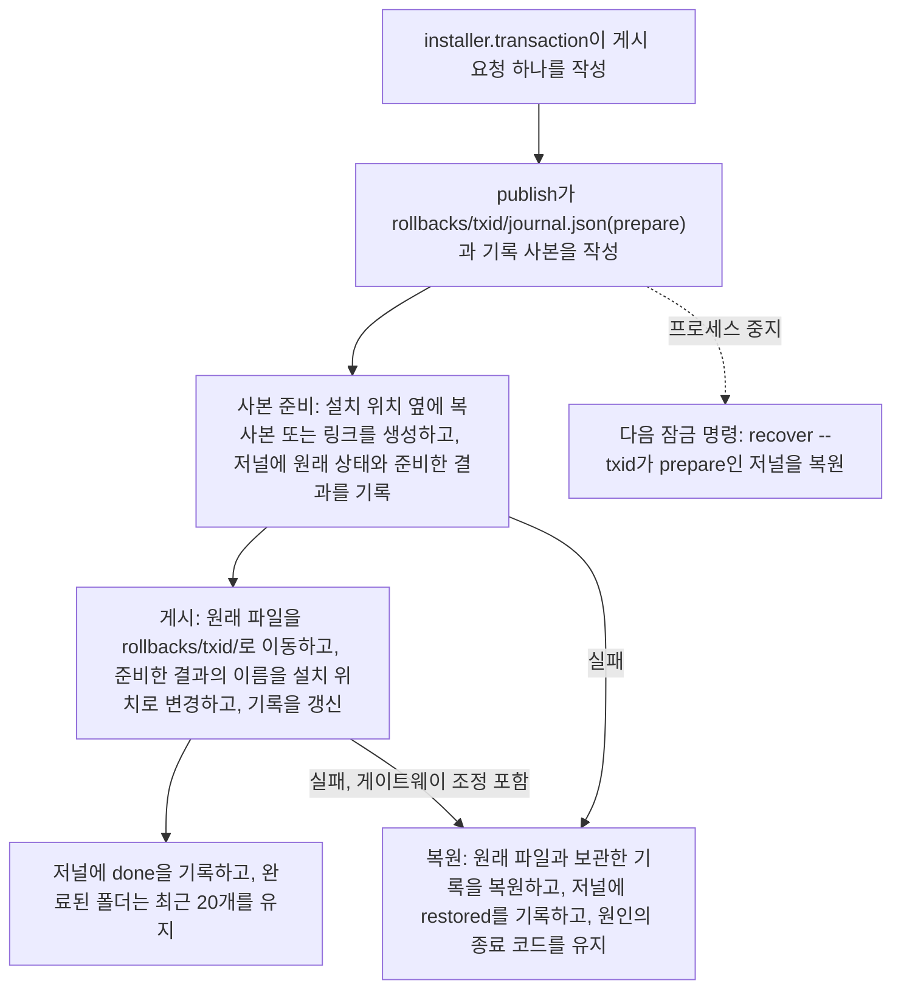

# Installer Architecture

Language: [🇺🇸 English](../../reference/installer-architecture.md) | 🇰🇷 한국어

이 문서는 기여자가 빠른 설치 안내에서 설치기 호환성 계약으로 넘어갈 때 사용하는 구조 안내입니다. 설치기, 훅 입력·출력, 설치 상태와 테스트 사이의 연결을 설명합니다.

사용자는 [설치 안내](../getting-started/installation.md)에서 실행 절차를 확인하실 수 있습니다. 기여자는 [플랫폼 호환성 계약](../policies/installer-platform-compatibility-matrix.md)에서 요구 조건과 담당 테스트를 확인합니다.
## Contents

- [읽는 순서](#읽는-순서)
- [Architecture Summary](#architecture-summary)
- [Install Flow](#install-flow)
- [Install Record](#install-record)
- [Gateway Lifecycle](#gateway-lifecycle)
- [Platform Surfaces](#platform-surfaces)
- [State And Safety Model](#state-and-safety-model)
- [Contributor Entry Points](#contributor-entry-points)
- [What Not To Infer](#what-not-to-infer)
- [Full Understanding](#full-understanding)

## 읽는 순서

1. 이 문서에서 구성 요소와 호출 방향을 파악합니다.
2. 파일 위치는 [repository structure](./repository-structure.md)에서 찾습니다.
3. 사용자에게 보이는 동작은 [installation](../getting-started/installation.md)과 [uninstall](../getting-started/uninstall.md)에서 확인합니다.
4. 계약과 필요한 검증은 [installer platform compatibility](../policies/installer-platform-compatibility-matrix.md), [tool output semantics](../policies/tool-output-semantics.md), [live smoke regression](../policies/live-smoke-regression.md)에서 확인합니다.

## Architecture Summary

설치기 구성 요소는 다음 세 계층에서 역할을 나눕니다.

| Layer | Main files | Responsibility |
| --- | --- | --- |
| Shell entrypoints | `install.sh`, `install.ps1`, `install.cmd` | `install.sh`는 UTF-8 로케일을 설정하고 Python 3.11 이상을 찾거나 설치한 뒤, 사용자의 인수를 그대로 `_shared/installer/cli.py`에 넘깁니다. `install.ps1`은 PowerShell이 7.6보다 낮으면 7.6 요구 문구를 출력하고 멈춥니다. 그 밖에는 콘솔 입출력을 UTF-8로 설정하고 Python 3.11 이상을 찾거나 설치한 뒤, 예전 PowerShell 설치기의 매개변수 이름을 같은 뜻의 긴 옵션으로 바꾸어 모든 인수를 순서대로 같은 cli에 넘깁니다. `GHOST_ALICE_INSTALL_COMMAND`로 `.\install.cmd`를 알리므로 설치기의 help와 안내 문구가 Windows 명령을 씁니다. 알리지 않으면 `bash install.sh`를 씁니다. `install.cmd`는 `pwsh.exe`로, `pwsh.exe`가 없으면 `powershell.exe`로 `install.ps1`을 실행합니다 |
| Installer package | `_shared/installer/` (`cli`, `auto`, `selection`, `addons`, `preservation`, `transaction`, `hosts`, `diagnostics`, `lifecycle`, `source`, `prerequisites`, `lock`, `report`, `locations`, `config`, `runner`) | 옵션을 해석하고 명령 표에서 명령을 고르며 플랫폼과 대상을 정합니다. 설치 단계 순서를 지키고 설치 잠금을 쥐며 보고서를 출력합니다. 파일 변경은 모두 아래 진입점을 거칩니다 |
| Installer entry points | `_shared/install_hooks.py`, `_shared/install_transaction.py`, `_shared/install_state_writer.py`, `_shared/addon_installer.py`, `_shared/uninstall_cleanup.py`, `_shared/install_doctor.py`와 패키지가 자식 프로세스로 실행하는 다른 `_shared/*.py` 도구 | 스킬과 훅을 설치하고, 배치마다 같은 단계에서 설치 기록을 작성하고, 설치 상태를 기록합니다. 로컬 수정을 보호하고 관리 대상을 제거하며 설치를 진단합니다 |
| Runtime surfaces | `~/.claude/`, `~/.codex/`, `~/.agents/skills/`, `~/.ghost-alice/` | 설치된 스킬, 플랫폼 훅 설정, Claude·Codex 전역 부트스트랩 지침, 설치 기록, 게시 복원 자료, 설치 상태 매니페스트, 훅 기능 복원 메타데이터, 병합 대기 자료와 제거 결과를 보관합니다 |

설치기는 설치 파일과 훅을 갱신하면서 사용자가 수정한 파일을 보호하고 자신의 변경을 기록합니다. `status`, `doctor`, 업데이트와 제거 절차는 이 기록을 읽어 실제 설치 상태와 복원 가능한 변경을 판단합니다.

설치된 훅 런타임은 같은 런타임 루트 아래에 `_shared` 모듈과 `session-intent-analyzer/scripts/session_intent_ledger.py`를 함께 포함합니다. 네이티브 훅과 Ghost-ALICE Autopilot은 이 설치본에서 원장 API와 관련 모듈을 불러옵니다. 소스 체크아웃은 설치 입력을 지정하며, 소스 편집만으로 설치된 훅의 실행 모듈이 바뀌지 않습니다. 원장 데이터베이스 경로와 네이티브 세션 식별자는 별도의 실행 입력입니다.

공용 모듈 네 개는 어느 계층에도 속하지 않으므로 설치기, 훅 런타임과 스킬이 모두 가져올 수 있습니다. `_shared/hook_definitions.py`는 설치기와 훅 런타임이 함께 읽는 이름을 소유합니다. 훅 ID와 호스트 이벤트 이름, `ghost_alice_context` 제공자 이름, 권한 어댑터 허용 목록이 여기에 있습니다. `_shared/install_lock.py`는 설치 잠금 파일과, 잠금을 이 프로세스나 이 프로세스를 실행한 부모 프로세스가 쥐었는지 판정하는 함수 하나를 소유합니다. `_shared/content_digest.py`는 설치 내용의 지문 생성과 설치 기록 항목·현재 파일의 비교를 소유합니다. `_shared/installed_payload.py`는 설치 기록을 소유합니다. 앞의 세 모듈은 표준 라이브러리만 가져오고, `installed_payload`는 `content_digest`와 `install_lock`만 가져옵니다. 런타임 모듈은 설치기 모듈을 가져오지 않고, 설치기 모듈은 런타임 모듈을 가져오지 않습니다. `_shared.test_hook_definitions`가 이 규칙들을 검사하고, `installer` 패키지의 모듈 이름이 표준 라이브러리 모듈 이름과 겹치지 않는지도 검사합니다.

## Install Flow

| 전달 주체 | 입력으로 넘기는 내용 | 다음 단계에서 사용하는 결과 |
| --- | --- | --- |
| 사용자 명령 → 셸 진입점 | 입력한 명령줄 그대로. | 사용 가능한 Python 3.11 이상 실행 환경과, 바뀌지 않은 인수. |
| 진입점 → `installer.cli` | 인수와 셸이 놓인 소스 체크아웃. | 해석한 옵션, 선택한 명령, 설치라면 플랫폼·스킬 디렉터리·적용 가시성. |
| `installer.cli` → `installer.selection`·`installer.addons` | 요청한 스킬 이름과 애드온 출처. | 정확한 설치 대상(핵심 스킬, `_shared`, 애드온 대상)과 대상 수. |
| 조정 코드 → `install_transaction.py publish` | 게시 요청 하나: 호스트, 원본·설치기 커밋, 대상마다 이름·종류·제공자·원본 경로·설치 위치·방식. | 설치한 스킬·도우미, 같은 단계에서 작성한 설치 기록 항목, 보존한 로컬 수정. |
| 배포 → 훅·부트스트랩 동기화 | 관리 파일 내용, 플랫폼 경로, 등록 명령. | 갱신한 관리 규칙 블록과 훅 등록. |
| 설치기 → 설치 상태 기록기 → 상태 출력 | 실제 변경 대상·해시·복원 정보. | Status·doctor·제거에서 읽을 플랫폼 매니페스트와 설치 보고서. |

Windows에서는 `install.cmd`가 인수를 `install.ps1`에 전달합니다. `install.ps1`과 `install.sh`는 같은 `_shared/installer/cli.py`를 실행하는 얇은 셸이므로, Windows와 Unix 계열은 설치기 구현 하나를 함께 씁니다. Unix 계열 환경에서는 `install.sh`가 셸 진입점을 담당하며 필요할 때 Bash로 다시 실행합니다. `--help`와 `--list`를 포함한 모든 명령은 Python에서 실행됩니다. 셸은 설치기 문구, 옵션, 명령의 사본을 갖지 않습니다.

`installer.cli`는 명령 표 `COMMAND_LINE` 하나를 소유합니다. 명령 행마다 그 명령을 고르는 토큰, 처리 함수, 쥐는 설치 잠금 이름, 플랫폼이 필요한지, `--help` 행이 있습니다. 옵션 해석, 자동 모드 판정, 명령 분기, 잠금, `--help`가 모두 이 표를 읽으므로, 한 곳에만 알려진 명령은 생기지 않습니다. `-`로 시작하면서 명령 이름이 아닌 토큰은 `Unknown option`으로 멈춥니다. 감지한 플랫폼마다 실행되는 것은 플랫폼 없이 받은 설치뿐이고, 명령은 한 번만 실행됩니다. 설치기는 자신이 실행되는 체크아웃을 `installer.runner.REPO_ROOT` 한 이름으로 부릅니다.

### 설치 단계 순서

설치 명령은 다음 순서로 진행합니다. `installer.cli.prepare_install`이 1단계를 실행하고, `installer.cli.run_command`가 잠금을 잡은 뒤, `installer.cli.run_install`이 나머지를 실행합니다. `_shared/test_installer_cli.py`가 이 순서를 고정합니다.

1. 선행 도구(`git`, `node`)와 소스 체크아웃의 git hook 경로.
2. 설치 잠금(`~/.ghost-alice/install.lock`). 명령이 끝날 때까지 쥡니다. 설치기는 잠금을 생성한 직후, 저널이 `done`도 `restored`도 아닌 게시를 모두 복원합니다.
3. 설치 기록 이관. `~/.ghost-alice/installed-payload.json`이 없고 이전 설치기의 install-state가 있을 때만 실행합니다. 그다음 소스 상태 확인, 그다음 대상 수집(핵심 스킬, `_shared`, 애드온 대상).
4. deprecated 설치 스킬을 발견 경로 밖으로 옮긴 뒤, 인코딩 검사, 그다음 로컬 수정을 격리하거나 기록하는 사전 점검.
5. 중단된 애드온 제거를 재개합니다. 애드온 충돌은 설치를 멈춥니다.
6. 배치: `_shared`와 모든 대상을 링크(Claude Code)로, 또는 하나의 복사 배치(Codex)로 놓습니다. 배치 한 번은 `install_transaction.py publish` 한 번이며, 같은 단계에서 대상들의 설치 기록 항목을 작성합니다.
7. 런타임 `_shared` 게시, 훅 설치, 관리 규칙 블록, 명령 래퍼.
8. 검증, 소유 표지, merge-companion 스냅숏, 애드온 사이드카, 설치 상태 매니페스트, 설치 이벤트. 설치기는 배치 뒤에 이 이전 기록들을 예전처럼 작성하며, status·doctor·보존·제거·복구는 이 기록들을 계속 조회합니다.

명령 표가 명령마다 잠금을 지정합니다. 설치, 제거, 복구(`--repair`), `--cleanup-pending`, `gateway` 전달 명령이 잠금 아래에서 실행되며, `installer.cli.run_command`가 처리 함수 전에 잠금을 잡고 끝난 뒤 풉니다. 자식 도구는 자신을 호출한 설치기 프로세스의 잠금을 그대로 씁니다. 잠금 파일이 그 프로세스 ID를 기록하며, `install_lock.held_by_process_tree`가 잠금이 호출한 프로세스나 그 부모 프로세스의 것인지 판정합니다. 게이트웨이 조정과 설치 기록 작성 함수가 모두 이 함수를 호출하며, 무관한 소유자는 둘을 막습니다. 잠금의 소유자 문자열은 표시용이며 아무 권한도 주지 않습니다.

## Install Record

`~/.ghost-alice/installed-payload.json`은 설치기가 어느 위치에 무엇을 설치했는지 기록합니다. 두 호스트가 파일 하나를 함께 쓰며, 설치 위치 경로마다 항목이 하나입니다. 런타임 `~/.ghost-alice/runtime/current/_shared`처럼 두 호스트가 함께 쓰는 위치는 항목 하나의 `used_by`에 두 호스트를 기록합니다.

| Section | Content |
| --- | --- |
| `schema_version` | `1` |
| `installer` | 마지막으로 기록을 작성한 설치기의 `commit`과 `schema_version` |
| `source` | 설치 원본 체크아웃의 `root`, `commit`, `dirty`, `hooks_path` |
| `last_transaction` | 마지막 게시의 `id`, `updated_at`, `rollback_dir` |
| `targets` | 설치 위치마다 `name`, `kind`(`skill`, `support`, `runtime`, `command`, `resource`), `mode`(`link`, `copy`), `provider`(`core` 또는 `addon:<id>`), `source`, `source_commit`, `used_by`, 링크이면 `link_target`, 복사이면 `files`, `installed_at`, `baseline` |

복사 항목의 `files`는 상대 경로마다 파일 내용의 `sha256:<hex>` 지문을 기록하고, 링크 항목은 링크가 가리키는 경로만 기록합니다. `content_digest`가 둘을 생성하며 캐시(`__pycache__`, `.pytest_cache`, `.mypy_cache`, `.ruff_cache`, `node_modules`, `.git`), `.pyc`·`.DS_Store` 파일, 소유 표지 파일, 링크인 파일과 폴더를 제외합니다. `baseline`은 지문의 출처입니다. `recorded`는 게시가 작성한 지문, `migrated`는 이전 설치기의 기록에서 이관한 지문, `unknown`은 이전 기록에 지문이 없었다는 뜻입니다.

| Writer | When | What it writes |
| --- | --- | --- |
| `install_transaction.py publish` | 배치할 때마다 | 게시한 대상, `source`, `installer`, `last_transaction`을 이름 변경과 같은 단계에서 갱신합니다 |
| `installed_payload.migrate` | 기록이 없고 이전 설치기의 install-state가 있을 때의 첫 설치 또는 복구 | 호스트마다 install-state의 대상을 항목으로 작성합니다. 링크는 지금 가리키는 경로, 복사는 소유 표지의 지문, 표지가 없으면 merge-companion 스냅숏의 지문, 둘 다 없으면 지문 없이(`unknown`) 작성합니다. `provider`는 애드온 사이드카에서 조회합니다. 현재 파일의 지문을 기준값으로 채택하지 않으며, 이전 기록은 변경하지 않습니다 |

`installed_payload.update`는 기록 섹션을 작성하는 유일한 함수이고, `installed_payload.restore`는 게시가 보관한 사본으로 기록을 복원합니다. 두 함수는 임시 파일에 작성한 뒤 이름을 변경하여 교체하며, 설치 잠금이 호출한 프로세스나 그 부모 프로세스의 것이 아니면 거부합니다. 다른 schema version처럼 이 설치기가 읽을 수 없는 기록은 변경하지 않고, 파일 게시는 계속합니다. `--status`와 `--doctor`는 기록에서 해당 플랫폼의 대상을 요약한 줄 하나와, 기록과 다른 대상마다 줄 하나를 출력합니다. 기록은 두 명령의 결과를 변경하지 않습니다.

게시는 교체한 자료를 `~/.ghost-alice/rollbacks/<txid>/` 한 곳에만 보관합니다. 원래 파일, 기록 사본, `journal.json`이 그 폴더에 있습니다. 저널은 무엇이든 변경하기 전에 `prepare`, 파일·기록·게이트웨이 조정이 모두 끝난 뒤 `done`, 복원한 뒤 `restored`를 기록합니다. 게이트웨이 오류는 복원 뒤에도 자신의 종료 코드(2, 3, 4, 5)를 유지합니다. 프로세스가 `done` 전에 중지되면 다음 잠금 명령이 `install_transaction.py recover --txid <id>`를 호출합니다. 이 명령은 모든 대상을 먼저 확인합니다. 설치 위치에는 게시가 남긴 결과나 원래 파일이 있어야 하고, 이동한 원래 파일이 남아 있어야 합니다. 복원할 수 없는 게시는 명령을 종료 코드 1로 중지하고 검토할 폴더를 알립니다. 절반만 게시된 파일 위에 다시 게시하면 어느 파일이 원래 파일인지 판별할 수 없기 때문입니다.

## Gateway Lifecycle

게이트웨이 설치·갱신·해제는 `_shared/context_gateway_*`의 여섯 모듈이 담당합니다. `model`은 요청·관측값·계획·결과와 실행 인터페이스의 자료형을 정의하며 AI 모델을 호출하지 않습니다. `inventory`는 전달받은 플랫폼 어댑터로 사실을 읽습니다. `plan`은 소유권을 확인하고 변경 대상과 실제 게이트웨이 의존성을 비교하여 I/O 없이 순서가 정해진 계획을 만듭니다. `transaction`은 계획 실행과 역순 복구를 담당합니다. `platform`은 개별 파일·네이티브 서비스 작업을 수행합니다. `install`은 기존 Python·CLI 진입점에서 이 모듈들을 연결합니다.

일반 파일 교체는 `install_transaction.py`의 되돌릴 수 있는 `ReplacementBatch` 작업을, 관리형 Git 업데이트는 `installer_source_update.py`의 되돌릴 수 있는 `SourceUpdate` 작업을 제공합니다. 선택한 경로가 소유권이 확인된 게이트웨이에 영향을 주면 같은 게이트웨이 트랜잭션이 교체 전에 서비스를 중지하고 후보 서비스의 준비 상태를 확인한 뒤 설치 명세와 등록 바인딩을 갱신합니다. 무관함이 확인된 변경은 게이트웨이를 그대로 둡니다. Core 정리는 영향을 받는 게이트웨이를 먼저 해제한 뒤 의존 파일을 삭제합니다. 소유권이나 의존성을 확인할 수 없으면 해제와 그에 의존하는 삭제를 허용하지 않습니다.

게이트웨이 설치 CLI의 `--dry-run` 옵션은 확인한 변경 계획을 출력하고 실제 반영이나 승인 대기 없이 종료합니다. 게이트웨이·컴포넌트 오류는 발생 단계와 고정 오류 식별자를 유지합니다. 종료 코드 2는 선행 조건 불충족, 3은 활성 파일 교체 전 서비스 상태 확인 불가, 4는 작업 실패 후 이전 설치 복원, 5는 변경 시작 후 복구 확인 불가를 뜻합니다. 일반 셸·PowerShell 호출자는 기존 전체 실패 보고와 구조화된 컴포넌트 원인을 유지합니다. 설치에는 zstd 코덱이 동작하는 Python 3.14가 필요하며 해제는 Python 3.11을 지원합니다. [설치 생명주기 명세](../../coding-convention/specs/2026-10-15-gateway-installer-design.md)에서 작업별 조건, 자료 전달과 실패 분기를 확인하실 수 있습니다.

## Platform Surfaces

| Platform | Installed surfaces |
| --- | --- |
| Claude Code | `${CLAUDE_CONFIG_DIR:-~/.claude}/skills/`, `${CLAUDE_CONFIG_DIR:-~/.claude}/CLAUDE.md`, `${CLAUDE_CONFIG_DIR:-~/.claude}/settings.json`, Claude command wrappers |
| Codex | `~/.agents/skills/`, `~/.codex/AGENTS.md`, `~/.codex/ghost-alice-governance.md`, `~/.codex/hooks.json`, `~/.codex/config.toml` |
| Shared state | `~/.ghost-alice/installed-payload.json`, `~/.ghost-alice/rollbacks/`, `~/.ghost-alice/install-state/`, `~/.ghost-alice/pending-merges/`, `~/.ghost-alice/uninstall-reports/`, `~/.ghost-alice/install/` |

Claude Code의 native skill invocation과 hook permission은 저장소 밖의 세션에 필요한 global instruction을 대신하지 않습니다. installer는 `platforms/claude/CLAUDE.md`의 managed block을 Claude config directory에 병합합니다. Codex의 별도 bootstrap과 hook config는 required gate를 `SKILL.md` read record와 hook payload로 감사할 수 있게 합니다. 두 global rule file은 managed block 밖의 사용자 텍스트를 보존하며, marker가 없는 사용자 파일에는 덮어쓰기 대신 `.ghost-alice-proposed` 제안 파일을 만듭니다.

일반 Core hook 전달은 실제 native cwd를 Core 맥락으로 유지하고 명시된 Ghost-ALICE Autopilot 대상 override를 보존합니다. 프로젝트 선택은 Ghost-ALICE Autopilot이 담당합니다. Claude는 절대 CLI 프로젝트 경로를 payload cwd보다 먼저 선택하며, Codex는 payload cwd를 사용하고 Claude 전용 힌트를 무시합니다. 설치 source와 프로젝트 신뢰 경로는 Ghost-ALICE Autopilot 대상을 선택하지 않으며, 격리 바인딩은 소유 프로젝트 대상을 유지합니다. Pretool과 Stop은 해당 대상을 선택하고 OFF를 읽은 뒤 Core 권한 자료에 접근합니다. OFF는 캡처 맥락이나 권한 읽기·쓰기 없이 조용히 계속 진행을 반환하며, 활성 대상은 기존 적격 선택 검사로 진행합니다. 대상 선택은 권한을 부여하지 않습니다.

관리 훅 명령과 네이티브 신뢰 항목은 검토한 설치 내용과 일치해야 합니다. 실행 중인 호스트가 이전 등록을 유지할 수 있으므로 적절히 재로드한 뒤 실제 네이티브 콜백으로 반영을 확인합니다. [훅 신뢰와 재로드](../getting-started/troubleshooting.md#native-hook-trust-and-reload)를 참고해 주세요. 설치 상태만으로 네이티브 실행을 입증하지 않습니다.

## State And Safety Model

설치기는 제거·복원할 대상을 추측하지 않도록 변경 내용을 기록합니다.

| State path | Why it exists |
| --- | --- |
| `~/.ghost-alice/installed-payload.json` | 설치 기록입니다. 두 호스트의 모든 설치 위치, 출처, 복사한 파일의 지문을 배치와 같은 단계에서 기록합니다 |
| `~/.ghost-alice/rollbacks/<txid>/` | 게시 한 번이 교체한 원래 파일, 게시 전의 기록, 저널을 보관합니다. 저널이 done을 기록하기 전에 중지된 게시는 다음 잠금 명령이 복원합니다 |
| `~/.ghost-alice/install-state/<platform>.json` | 설치기가 관리한 대상과 환경 변경을 기록하며 상태 조회와 제거 명령이 읽습니다 |
| `~/.ghost-alice/pending-merges/<platform>/` | 설치기가 Ghost-ALICE 복사 설치 스킬 파일을 바꾸기 전에 사용자 수정본을 보존합니다. 설치 표식이 있는 폴더와, 이번 설치가 바꾸는 폴더는 표식이 사라졌어도 확인하며, merge-companion과 사용자가 병합 여부를 결정합니다. Claude 앱의 `synced`처럼 Ghost-ALICE가 설치하지 않는 폴더는 기록하지 않습니다 |
| `~/.ghost-alice/install/` | 감사와 복구에 필요한 설치 결과와 이벤트를 보관합니다 |

설치된 파일, 훅이나 실행 설정을 바꾸는 개발자는 상태 조회, 진단, 병합 대기 처리와 제거 복원에 미치는 영향도 확인해야 합니다. 이 절차들은 같은 설치 기록에 의존합니다.

## Contributor Entry Points

| Change type | Start here | Then verify with |
| --- | --- | --- |
| Python runtime detection, the PowerShell 7.6 check, PowerShell parameter names or locale setup | `install.sh`, `install.ps1`, `install.cmd` | `scripts/tests/test_thin_shells.py`, `scripts/tests/test_install_runtime_detection.py`, compatibility matrix groups |
| Installer option, command table, dispatch or install order | `_shared/installer/cli.py`, `_shared/installer/auto.py` | `_shared/test_installer_cli.py`, `_shared/test_installer_auto.py`, `_shared/test_installer_checkout.py`, `_shared/test_*_shell.py` end-to-end tests |
| Installer wording or the install report | `_shared/installer/report.py` | `_shared/test_installer_report.py`, `scripts/tests/test_installer_default_auto.py` |
| Hook payload or hook status wording | `_shared/install_hooks.py` | `_shared.test_install_hooks`, `scripts/check_skill_gate_contract.py` |
| Hook id, host event name or privileged adapter allowlist | `_shared/hook_definitions.py` | `_shared.test_hook_definitions` |
| Install record, fingerprints, publish journal or restore | `_shared/installed_payload.py`, `_shared/content_digest.py`, `_shared/install_transaction.py`, `_shared/installer/transaction.py`, `_shared/installer/lock.py` | `_shared/test_installed_payload.py`, `_shared/test_content_digest.py`, `_shared/test_install_transaction_publish.py`, `_shared/test_install_record_shell.py` |
| Install-state or uninstall behavior | `_shared/install_state_writer.py`, `_shared/uninstall_cleanup.py`, `_shared/installer/lifecycle.py`, `_shared/installer/transaction.py` | `_shared/test_installer_lifecycle.py`, `_shared/test_installer_transaction.py`, install-state schema tests and uninstall tests |
| Public docs or command surface | `README.md`, `docs/`, `docs/index.html` | `scripts/validate_public_surfaces.py` and public-surface contract tests |
| Platform compatibility rule | `docs/policies/installer-platform-compatibility-matrix.md` | `scripts/run_installer_compat_tests.py --list` and policy가 지정한 focused group |

기여자는 구성 요소를 바꿀 때 연결된 계약을 확인합니다. 호환성 표가 지정한 담당 테스트에서 영향을 받는 회귀 검사를 찾습니다.

## What Not To Infer

- 훅 파일의 존재만으로 현재 입력·출력 계약과 일치한다고 판단하지 않습니다.
- 복사된 스킬 디렉터리만으로 플랫폼이 해당 스킬을 호출하거나 감사할 수 있다고 판단하지 않습니다.
- 설치 점검의 통과만으로 상태 조회·진단·업데이트·병합 대기·제거 절차의 일관성을 판단하지 않습니다.
- 사용자용 설치 명령은 진입점을 안내하며 내부 구조 설명을 대신하지 않습니다.

## Full Understanding

기여자는 검토할 변경이 셸 진입점에서 설치 조정 코드, 설치 대상, 상태 기록과 담당 테스트로 어떻게 이어지는지 확인합니다. 이 문서는 그 연결을 찾는 안내이며, 관련 구현과 호환성 계약을 읽는 절차를 대신하지 않습니다.
