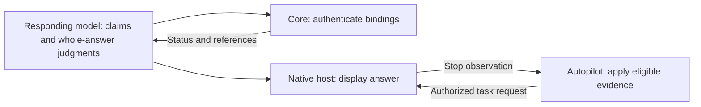

# Tool Output Semantics

언어: 🇺🇸 English | [🇰🇷 한국어](../ko/policies/tool-output-semantics.md)

Tool results distinguish an observation, an authenticated review, and an executed action. Human labels help readers; the documented machine fields govern consumers. Compatibility labels do not replace those fields.

## Host and hook responsibilities

The native host validates tool arguments and enforces permission. A reported argument error determines the correction to an authorized call. Governance hooks inspect work authority and evidence; they do not infer tool capabilities from serialized text.

Hook status distinguishes a matching installation, configuration drift, disabled hooks, missing components and an unsupported platform. Drift requires examining the affected installed binding; it does not mean that every hook is absent. The [platform compatibility contract](installer-platform-compatibility-matrix.md) owns installation decisions.

Counts retain their declared unit. A unique finding count differs from physical occurrences, and an absent count is unknown.

## Review, output and continuation

The responding model judges each claim against original evidence, then judges the complete answer against the user's objective. Core authenticates those judgments and source bindings. A review receipt returns status and references; it does not repeat the answer body. The model submits its reviewed draft through native output. An unfavorable review or missing prerequisite remains unresolved under the [review procedure](../../coding-convention/verification-before-completion/references/response-review.md).

An accepted answer can accurately report incomplete work. Authentication, publication and criterion application are separate results. Original evidence keeps its original verification time during unchanged reuse. A recording failure does not authorize repeating the business operation.

Native Stop observes the response and permits the native conversation to continue. A diagnostic assessment does not establish answer visibility or create missing judgments. Autopilot selects continuation from an admitted plan; a returned request proves neither delivery nor execution. See the [architecture](../../architecture.md) and [session gate owner map](session-gate-matrix.md) for responsibilities.
