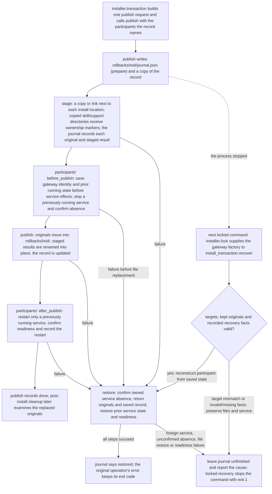
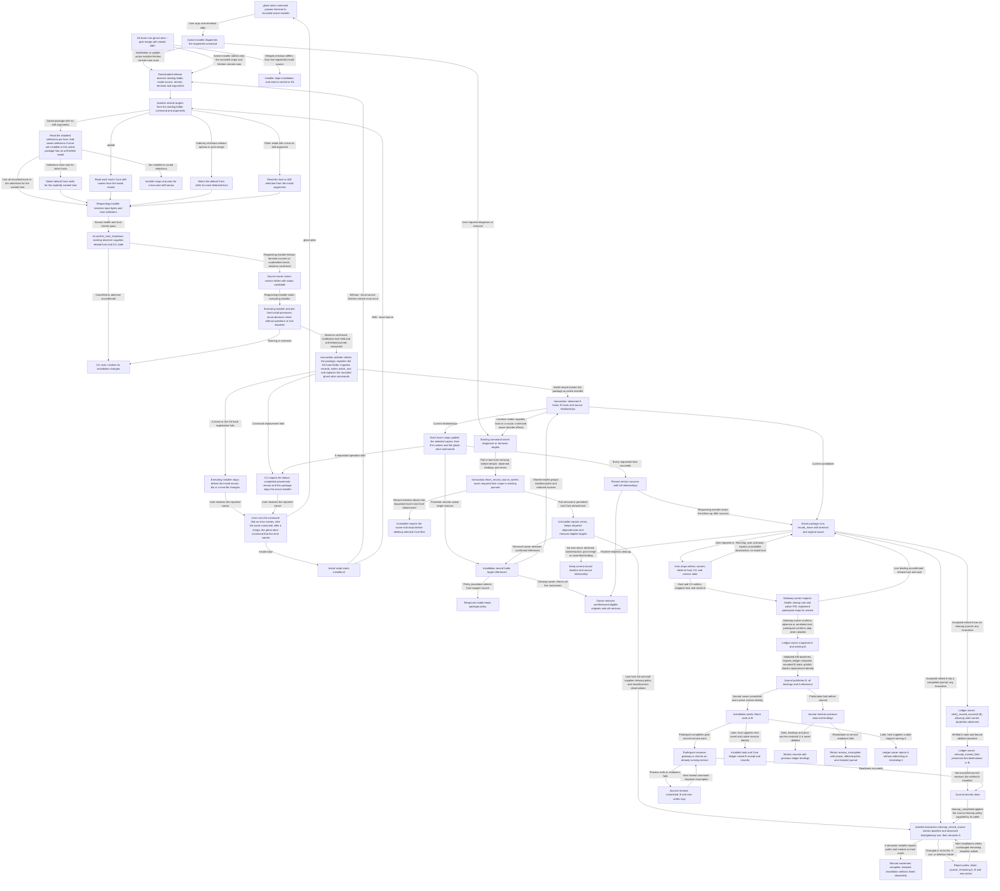
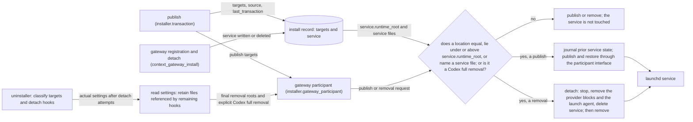

# Installer Architecture

[🇺🇸 English](./installer-architecture.md) | [🇰🇷 한국어](../ko/reference/installer-architecture.md)

This document is the contributor bridge between the quick installation docs and the installer compatibility contracts. It gives contributors the architecture map they need before tracing a change through the installer, hook payloads, install state, and tests.

For the installation steps, read the [installation guide](../getting-started/installation.md). For compatibility requirements and test ownership, read [installer platform compatibility](../policies/installer-platform-compatibility-matrix.md).
## Contents

- [Reading Path](#reading-path)
- [Architecture Summary](#architecture-summary)
- [Install Flow](#install-flow)
- [Install Record](#install-record)
- [Gateway Lifecycle](#gateway-lifecycle)
- [Platform Surfaces](#platform-surfaces)
- [State And Safety Model](#state-and-safety-model)
- [Contributor Entry Points](#contributor-entry-points)
- [What Not To Infer](#what-not-to-infer)
- [Full Understanding](#full-understanding)

## Reading Path

1. Use this page to understand the moving parts and the call direction.
2. Use [repository structure](./repository-structure.md) to find the files.
3. Use [installation](../getting-started/installation.md) and [uninstall](../getting-started/uninstall.md) to understand user-facing behavior.
4. Use [installer platform compatibility](../policies/installer-platform-compatibility-matrix.md), [tool output semantics](../policies/tool-output-semantics.md), and [live smoke regression](../policies/live-smoke-regression.md) to understand the contract and verification burden.

## Architecture Summary

Ghost-ALICE connects a generative backend through a host adapter to Core. A host and its generative backend are distinct. The installer currently supplies Claude Code and Codex adapters; common ownership, record, version-retention and ledger rules use recorded host identifiers, including future hosts. An operation needing an unavailable host adapter stops before changing that host. The installer has four implementation layers.

| Layer | Main files | Responsibility |
| --- | --- | --- |
| Shell entrypoints | `install.sh`, `install.ps1`, `install.cmd` | `install.sh` sets a UTF-8 locale, finds or installs Python 3.11+ and runs `_shared/installer/cli.py` with the arguments it received unchanged. When that file is missing, `install.sh` and `install.ps1` stop with exit code 1 and name the repair from a checkout that holds the same Core files; the file prints the same sentence when an installer module is missing. `install.ps1` stops with the PowerShell 7.6 requirement on an older PowerShell, sets UTF-8 console input and output, finds or installs Python 3.11+, turns the parameter names of the earlier PowerShell installer into the matching long flags and runs the same cli with every argument in order. It reports `.\install.cmd` in `GHOST_ALICE_INSTALL_COMMAND`, so the installer's help and hints name the Windows command; without that report they name `bash install.sh`. `install.cmd` runs `install.ps1` with `pwsh.exe`, or with `powershell.exe` when `pwsh.exe` is absent |
| Installer package | `_shared/installer/` (`cli`, `auto`, `selection`, `addons`, `preservation`, `transaction`, `record_move`, `terminal`, `hosts`, `diagnostics`, `lifecycle`, `source`, `git_hooks`, `prerequisites`, `lock`, `report`, `locations`, `config`, `runner`) | Parse options, pick the command from the command table, resolve platforms and targets, keep the install step order, hold the install lock and print the report; every file change goes through the entry points below |
| Installer entry points | `_shared/install_hooks.py`, `_shared/install_transaction.py`, `_shared/install_state_writer.py`, `_shared/addon_installer.py`, `_shared/uninstall_cleanup.py`, `_shared/install_doctor.py` and the other `_shared/*.py` tools the package runs as child processes | Install skills and hooks, write the install record in the same step as each placement, record install state, protect local edits, remove managed targets and diagnose an installation |
| Runtime surfaces | `~/.claude/`, `~/.codex/`, `~/.agents/skills/`, `~/.ghost-alice/` | Hold installed skills, platform hook config, Claude and Codex global bootstrap instructions, the install record, publish rollbacks, install-state manifests, hook feature rollback metadata, pending merges, and uninstall reports |

The installer updates assets and hooks while protecting external changes and recording its own changes. External changes are changes the installer finds in installed targets after install that its records do not hold; the installer does not record who made them. Status, doctor, update and uninstall commands consume those records to identify the actual installed state and changes they can safely restore.

The hook runtime contains both `_shared` modules and `session-intent-analyzer/scripts/session_intent_ledger.py` under the same runtime root. Native hooks resolve the ledger API and its sibling helpers from that deployment. The source checkout identifies installation inputs; editing that checkout does not select execution libraries for an installed hook. The ledger database path and native session identity remain separate runtime inputs.

The following shared modules belong to neither the installer nor the hook runtime, so the installer, the hook runtime and the skills may all import them. `_shared/hook_definitions.py` owns the names that the installer and the hook runtime read together: hook ids and host event names, and the `ghost_alice_context` provider name. `_shared/install_lock.py` owns the install lock file and the one judgment of whether this process or the process that started it holds the lock. `_shared/content_digest.py` owns the one fingerprint of installed content and the one comparison of an install record entry with the disk. `_shared/installed_payload.py` owns the install record and reads the host inventories used for migration, repair and removal. The inventory writer uses the same reader before changing a host inventory. `_shared/install_destination.py` owns the validated install locations and the check that limits where Core code may change files. `_shared/atomic_write.py` owns file replacement: a read of the file during the replacement returns either the whole old contents or the whole new contents. `_shared/file_lock.py` owns the exclusive lock on a file and the time limit for waiting on it. `installed_payload` reads through `content_digest` and `install_lock`; its format-changing writer uses the existing `install_transaction` journal, `atomic_write` imports only `install_destination`, `install_lock` imports `file_lock`, and `_shared/pending_manifest.py` imports `atomic_write`, `file_lock` and `install_destination` to own pending paths, parsed observations and locked updates. The other shared modules import only the standard library. A runtime module imports no installer module, and an installer module imports no runtime module. `_shared.test_hook_definitions` checks these rules, and that no `installer` package module shadows a standard-library module name.

## Install Flow

| Sender → receiver | Input passed | Result used by the next step |
| --- | --- | --- |
| Command line → shell entrypoint | The command line that whoever runs install.sh (the human user, the response model or a script such as the `ghost-alice` command) passed. | A usable Python 3.11+ runtime and the arguments, unchanged. |
| Entrypoint → `installer.cli` | The arguments and the source checkout the shell lives in. | Parsed options, the selected command and, for an install, the platform, its skills directory and the effective visibility. |
| Started `installer.cli` → downloaded release's `installer.cli` | `--install-acquired-release`, the started installer's folder, the remote, the unchanged arguments and the terminal, and in the environment the install source read before the download; after a merge, the merged checkout and `--post-merge`. | The downloaded release installs itself, and the started `installer.cli` returns its exit code. |
| `installer.cli` → `installer.selection` and `installer.addons` | Requested skill names and addon sources. | Exact installation targets (core skills, `_shared`, addon targets) and the target count. |
| Orchestration → `install_transaction.py publish` | One publish request: the host, the source and installer commits, and each target's name, kind, provider, source path, install location and mode. | Installed skills/helpers, their install record entries written in the same step, and preserved local edits. |
| Deployment → hook/bootstrap synchronization | Managed payloads, platform paths and registration commands. | Updated managed rule blocks and hook registrations. |
| Installer → install-state writer → status output | Actual changed targets, hashes and rollback information. | Per-platform manifest and an install report for status, doctor and uninstall. |

`install.cmd` is only a Windows wrapper around `install.ps1`. `install.ps1` and `install.sh` are both thin shells around the same `_shared/installer/cli.py`, so Windows and Unix-like systems run one installer implementation. On Unix-like environments, `install.sh` owns the shell entry path and re-enters Bash when needed. Every command, `--help` and `--list` included, runs in Python: the shell keeps no copy of the installer's text, options or commands.

`installer.cli` owns one command table, `COMMAND_LINE`. Each command row names the tokens that select it, its handler, the install-lock name it holds, whether it needs a platform, and its `--help` row. Option parsing, the auto-mode decision, dispatch, the lock and `--help` all read that table, so a command cannot reach one of them without the others. A token that starts with `-` and names no command stops as `Unknown option`; an install or a full removal without a platform runs once per detected platform, and every other command runs once. A row can name the active installer as the one that runs its command: `--repair` started from another installer goes to the active installer's `_shared/installer/cli.py` with this command's host, skills and addon sources while the active package is complete and its `version.json` states that command under `active_runs` (`source.active_installer`); the started installer checks the install source first and returns that process's exit code. When the package states no such command or is missing files, the started installer repairs by itself or stops. `active_runs` is a promise between releases: the release that saved the package writes the commands that its installer runs for another installer, the started installer of another release reads them and passes the arguments that `auto.child_command` writes, and it starts no package that states nothing, because only the statement tells that the package's `--repair` restores the installed selection and no other skill. The installer names its execution package `installer.runner.REPO_ROOT`; `source.root` separately identifies the development origin.

### Install step order

1. For a Core install without `--local-source`, the started `installer.cli` fetches `refs/heads/main` from the remote into a temporary checkout. It runs the downloaded release's `_shared/installer/cli.py` with `--install-acquired-release`, its own folder, the remote, the unchanged arguments and its terminal, and returns that process's exit code. After exit code 1, the starting installer explains how to proceed if the release reported an unknown `--install-acquired-release` option. Before the download it reads its install source, the checkout path and the remote (for a saved package, those that the install record names), and the registration, the checkout and the remote that the install record names, and passes them to that process in its environment. The downloaded installer checks that registration before asking about replacing a checkout. A local installation takes its registration from the same record it uses for that question. The requesting installer is the downloaded release's `cli.dispatch`; with `--local-source`, it is the `cli.dispatch` of the started checkout or saved package. It resolves the requested hosts and targets. A saved package stops with exit code 1 when a file that its `version.json` lists is missing or changed, and every package stops with exit code 1 when it does not hold a requested skill. `source.match_install_source` owns development-origin comparison. An explicit different checkout follows the existing `--adopt-source` or terminal confirmation behavior; fixed update and saved-code reinstall retain the recorded origin. The requesting installer asks once about an existing Codex `untrusted` project, using the recorded project or original input project. Rejection, EOF or noninteractive execution retains `untrusted`; the write owner rereads that exact project before applying a matching confirmation.
2. After source health and trust checks, the requesting installer calls `cli.confirm_host_shutdown` before version-folder preparation, lock recovery or installed-file changes. Once related programs are confirmed absent, `prerequisites.install_prerequisites` installs missing programs, and `source.prepare_source` freezes the requesting installer's product files and shared policies under `versions/<digest>/core`. It records the version status `candidate`, not a successful install. The requesting installer starts that folder's `cli.py` in a separate process, the executing installer, and passes input provenance and per-host selections in the install request (`GHOST_ALICE_PACKAGE_REQUEST`). An earlier installer passes its request in `GHOST_ALICE_INSTALL_REQUEST`; a package started with that variable stops with exit 1 before it takes the lock or changes a file, and its message names the package's `install.sh` (Windows: `install.cmd`). Before automatic prerequisite acquisition, the shell or Python owner displays the shared program list and automatic-consent meaning once per process tree.
3. The executing installer confirms host absence, takes the installation lock and recovers unfinished journals. It stops before activation if the registered checkout or remote changed. An update or saved-package reinstall also stops if the recorded Core selection used by the command changed. A post-merge run checks that the merged checkout still matches the registered checkout. `transaction.activate` then makes this package the active installer before any host file changes. It compares every file listed in `version.json` with its digest, reads a leftover `pending-install-source.json` and stops when `config.json` or the install record is unreadable or invalid, or when invalid host configurations block the publication of every requested host. `git_hooks.register` then writes the [fixed Git hook folder](#post-merge-hook) and the Git setting. When `activate` stops at one of these steps, the install record, `bin/` and host files are unchanged. `migrate_record` creates the install record once from an earlier installer's records. `activate` then writes the status `candidate` and this request's selections and source into the package's `version.json`, and one update of the record writes `installer.active_root`. From then on the `ghost-alice` command starts this package, and this package recovers an interrupted placement. `activate` then replaces each recorded `ghost-alice` command under `bin/` for one host that uses it and leaves the hosts that use it unchanged. When the configuration of every host that uses a command is invalid, it leaves that command, and the placement of a requested host publishes it. A first installation has no record and no command yet; the placement creates both. Without `--platform`, the executing installer then starts one per-host install process for each requested host; with `--platform`, it performs that host's steps itself.
4. Each per-host install process also checks absence without prompting or requesting exit before its changes. Selection, deprecated-target retirement, external-change preservation and addon collision checks retain their existing owners.
5. The publisher places Core skills and `_shared` as host-owned copies on every supported host. Addon link/copy policy remains host-specific. Each placement records its actual source and host references in the same transaction. Temporary copies stay beside their destinations; the existing cleanup owner removes empty staging directories.
6. The publisher places the runtime and ledger companion at the selected runtime location (default: `runtime/current`) and the management commands under `bin/`. The existing gateway participant coordinates registered service effects. The host adapter registers hooks with explicit runtime and ledger coordinates, then synchronizes managed governance blocks and commands.
7. Verification, snapshot, addon sidecars, inventory and original-copy cleanup complete for each host. A later failure retains completed placements and their records; it does not declare the whole request successful. This package stays the active installer while its `version.json` status is `candidate`, and running `ghost-alice` downloads remote `main` and installs the installed Core selection together with the saved one.
8. After all requested hosts succeed, `source.finalize_source` checks the package's files again and compares the placed targets with them. One `record_update` under the installation lock writes `version.json` status `successful` with its platforms and selections, and the observed ledger-source relationships in the install record. An error inside that `record_update` restores the previous `version.json` and record; `installer.active_root` still names this package.
9. After the executing installer exits 0, the requesting installer starts the same package's [record-movement follow-up](#fixed-commands-policies-and-ledger-data) with the terminal and the original cause. After a nonzero exit, its message tells the user to run the command that an error names or, when no error names a command, to resolve the reported cause and to run the same command again; after a merge, the message names the `ghost-alice` command, or `ghost-alice update` when another package is the active installer. The message also shows the active installer when the install record names one.

`cli.dispatch` combines the requested platforms, `installed_core_selection` from both the readable current record and the `record_after_recovery` view, and the hosts named by unfinished publication journals. The journal host `installer` identifies internal metadata and is excluded from this host set. `dispatch` passes that set to `cli.confirm_host_shutdown`, which reuses `hosts.observe_writers` for native host processes and bound record-writing CLIs. `cli` owns consent, the approved PID set and waiting state; `report` owns English and Korean program names, PIDs, questions and results. For an interactive, safe exit proposal, `cli` shows PID rows only in the request question when the complete observation set equals the current request set; otherwise it shows observed state and request targets separately. `hosts` owns process observation, ancestor relationships and supported OS normal-exit requests; unsupported forms, including windowless Windows CLIs, require manual exit. An ancestor needed to keep the installer running prevents an exit proposal and directs the user to an independent terminal. A request result is not proof of exit: the existing observer returns absence or an unknown state. `terminal` discards prior input, displays the current question and reads its new answer or EOF; callers retain their own TTY rules, defaults and cancellation meanings. The executing installer and per-host install processes reuse the absence check without consent records. The [installation guide](../getting-started/installation.md#close-programs-before-installation) owns the response sequence, cancellation and unattended behavior. Gateway service control remains with its existing participant, and the later record-movement step rechecks writers.

On macOS, `hosts` identifies supported desktop apps by their bundle identifier and declared main executable. It groups a bundled helper with its running parent app and sends the app a quit request through `NSRunningApplication` after checking the approved PID and bundle identifier. A surviving helper or separate CLI remains observable on its own.

The existing lock owner supplies inherited-lock execution to the per-host install processes. Each `ghost-alice` command invokes its saved package's existing shell bootstrap with `--management-entry`; the Python CLI then starts the active package that the install record names. Only when that record names none, it reads the record that recovery would restore. The command does not infer the runtime location. Installation effects, actual host callback execution and a response model following the installed instructions are distinct observations.

`install_lock.acquire_lock` returns a generation token; the installer and gateway release only that generation. The persistent sibling `install.lock.guard` serializes acquisition, stale takeover and release, so an earlier holder cannot unlink a newer generation. Direct Python callers that omit the release token can release only the generation this process acquired. The standalone `acquire` command prints the token and `release --generation <token>` consumes it. Mandatory coordination uses POSIX `flock` or Windows `msvcrt` and reports failure when locking is unavailable. `git_hooks.register` writes the shared Git value and each repository's value to restore under this installation lock.

### Post-merge hook

`git_hooks.register` writes the folder `~/.ghost-alice/git-hooks` and sets `core.hooksPath` to it in the configuration file that every worktree of the recorded development repository shares (`<Git common folder>/config`). The folder holds the `post-merge` script that Git runs and `repositories.json`, which keeps one row per registered repository with the value that the uninstaller restores, beside the rows copied from an earlier installation. The registration writes the script and the row before the Git setting. A later installation keeps the setting and replaces the script only when its bytes differ. When a write fails, the registration restores the folder's files and stops the installation with exit 1; the message names the configuration file and an existing `config.lock`. An install source outside a Git repository is skipped. A worktree's own value (`git config --worktree`) stays and wins in that worktree. When the final consumer is removed, the uninstaller restores the row's value if the current setting is the path in the row or, for a row with `common_dir`, another path inside `~/.ghost-alice`. An absent development repository has no setting left to restore.

The hook finds the installation from its own folder, clears Git's worktree environment and runs `bin/ghost-alice --post-merge --merged-checkout <merged checkout>` with closed stdin; without that command it ends without output. The active installer's `run_post_merge` compares the merged checkout with the recorded origin. For a merge in the recorded origin, it fetches `main` from the registered remote (the checkout's remote when the record names none) and starts the downloaded release with `--install-acquired-release` and `--post-merge`; that release installs its files for every detected supported host. A merge in another worktree installs nothing. The hook returns zero to Git even when installation fails and reports the installation's result. For a fixed `update`, the active installer fetches `refs/heads/main` from the selected remote once, starts the downloaded release with `--install-acquired-release` and the unchanged arguments, and returns its exit code. Before downloading, the active installer reads the registered checkout path and remote. It passes both values to the downloaded process in its environment, including when the user selects a different download remote with `--remote`. The downloaded installer compares those values with the current installation record before preparing the install request for the installed Core selections. The prepared installer checks the same path and remote under the install lock before activating the package. If either value changed, the update stops with exit code 1, and its message names the update without `--remote`, which uses the remote recorded now; an update with `--remote` replaces that remote. It also accepts `--install-acquired-update`, which an earlier installer's `update` passes, when the passed checkout path is the recorded one, the passed remote is the selected one and the passed ref is `main`. `--update-source` retains the separate developer-checkout update path.

The installer collects target identities once and passes the same `Collected` value through preflight, placement, verification and inventory writes. The publisher writes copied targets' ownership markers as part of staging. A partial reinstall replaces selected rows and preserves unselected Core baselines. `install_state_writer` also owns partial-failure records and successful-removal pruning; callers do not reconstruct those inventories.

## Install Record

The active detail file, `~/.ghost-alice/installed-payload-v2.json` or `~/.ghost-alice/installed-payload-v3.json`, records what the installer installed where. All recorded hosts share one detail file with one entry per install location path; a location that both hosts use, such as the runtime `~/.ghost-alice/runtime/current/_shared`, has one entry whose `used_by` names both.

| Section | Content |
| --- | --- |
| `schema_version` | `3` when a ledger-source relationship records known hosts, `2` when the published relationships contain only paths or the map is empty. The legacy filename carries a schema notice, as does the v2 filename while v3 is active |
| `installer` | `commit`, `schema_version` and `active_root`, the saved package that the `ghost-alice` command starts; an installation writes `active_root` before it places host files |
| `source` | Development `root`, input `commit` and `dirty`, update acquisition `remote`/`ref`, and the installed ledger relationships defined in the [record schema](https://github.com/AidALL/ghost-alice/blob/main/installer_update/install_state_schema.md#installed-ledger-source-relationships) |
| `last_transaction` | `id`, `updated_at` and `rollback_dir` of the last publish |
| `targets` | Per install location: `name`, `kind` (`skill`, `support`, `runtime`, `command`, `resource`), `mode` (`link`, `copy`), `provider` (`core` or `addon:<id>`), `source`, `source_commit`, `used_by`, `link_target` for a link or `files` for a copy, `installed_at` and `baseline` |
| `service` | The registered context gateway, absent when none is registered: `label`, `runtime_root` (the folder that holds the runtime `_shared` the service runs from), `program`, the three service files `launch_agent`, `state_path` and `config_path` with `launch_agent_digest`, `state_digest` and `config_block_digest` (the fingerprint of the provider blocks in Codex `config.toml`; `null` until a registration recorded it), `config_backup`, `registered_at`, `restarted_at` and `listener_ready` |

A copy's `files` maps each relative path to `sha256:<hex>` of its bytes, and a copied single file is its own one path `.`; a link records only the path it points to. `content_digest` computes both and leaves out caches (`__pycache__`, `.pytest_cache`, `.mypy_cache`, `.ruff_cache`, `node_modules`, `.git`), `.pyc` and `.DS_Store` files, the ownership marker and linked files and folders. `baseline` says where the fingerprints come from: `recorded` by a publish, `migrated` from an earlier installer's records, or `unknown` when those records had none.

| Writer | When | What it writes |
| --- | --- | --- |
| `install_transaction.publish` | Every placement, the command replacement in `activate`, and once per install for the links that already point at their source | The published targets, `source`, `installer` and `last_transaction`, in the same step as the renames; a link that already points at its source is recorded and not replaced |
| `installer.transaction.activate` | Every installation that finds the record, before its first placement | `installer.active_root`, and the source facts of a leftover `pending-install-source.json` that still matches the record |
| `installed_payload.migrate` | The first install, repair or uninstall when no installer has written the record (it does not exist, has schema `1` or holds only a service registration) and an earlier installer's install-state exists | Every host's install-state target: a link with the path it points to now, a copy with its ownership marker's fingerprints, else the merge-companion snapshot's, else none (`unknown`); `provider` from the addon sidecars. Current files are never adopted as a baseline, and migration accepts an inventory only after validating all its target rows. Installation moves an unreadable selected host inventory to a sibling backup and reports its cause. An unreadable inventory of an unselected host stops activation before Git hook registration. Repair and uninstall stop migration on an unreadable host inventory. A failed installation without targets contributes no entries. When nothing can be read, `migrate` writes no record. A saved package that the latest install-state names is not recorded as the install source |
| `installed_payload.migrate_service` | The first install, repair or uninstall when the record has no `service` section and `~/.ghost-alice/context-gateway-binding.json` names an installed gateway receipt | The `service` section from the receipt (`config_block_digest` stays `null` until a registration records it) and a `migrated` runtime target for each companion script the receipt fingerprinted. The receipt and the binding stay unchanged and are not read again |
| `context_gateway_install.py` | The `gateway` registration and detach commands, in the commit phase of their phase machine | A registration writes the `service` section after the service is ready; a detach deletes it; a failed operation puts the section back as it was |
| `installer.gateway_participant` | After a publish that touched the service's code | `restarted_at` and `listener_ready` of the `service` section once the service is back |
| `installed_payload.release_target` | After a caller confirms removal or release of a shared target | Removes the requested host from the exact destination/provider entry; preserves other hosts and deletes the entry only when no host remains |

`installed_payload.update` writes section updates and merges host references; `release_target` removes a confirmed host reference, and `restore` puts back a copy a publish saved. These operations use temporary-file replacement and require the calling process or its parent to hold the install lock. An unreadable record stays unchanged; removal callers report its cleanup as incomplete. `--status` and `--doctor` print one summary line of the platform's targets in the record and one line per target that differs from it. Targets without a baseline are counted and not compared, and a match is reported only for the targets that were compared; the record does not change their result.

A publish keeps what it replaced only in `~/.ghost-alice/rollbacks/<txid>/`: the originals, the record copy and `journal.json`. The journal names the targets the publish replaces and records each one's original and staged result: files with their digests, links with their targets and every folder, empty ones too, leaving out only caches and generated files. Before its first service effect, the gateway participant uses the transaction's checkpoint to persist the recorded service identity and observed `was_running` boolean. The journal says `prepare` before anything changes, `done` after the files, the record and the participants' `after_publish` finish, and `restored` only after files, record and participants' `after_restore` finish. Failed service recovery therefore leaves the journal unfinished even when the files are back. A participant's error keeps its exit code (2, 3, 4 or 5) through the restore, and a restore step that fails with its own code reports that code (5 for unconfirmed service recovery).

`install_transaction.Journal.load` owns recognition of supported journal schemas, transaction ids, target entries, saved-record names, metadata records and linked journal material. It returns a recognized journal or raises an error whose cause distinguishes unsupported formats from unreadable or malformed records. Cleanup, retention and diagnostics consume this reader; each caller owns its phase selection and the effect of a recognition failure on deletion, preservation or reporting.

`unfinished` separately selects recovery work from actual journal directories and their phase. It does not follow linked directory entries, refuses a linked rollback root, and includes unreadable or linked journal files so the reader can refuse recovery. An absent root or an entry that vanished after enumeration has no recovery work; a real enumeration or metadata-access failure raises an error instead of reporting an empty list. Completed cleanup skips a vanished candidate only when metadata inspection after enumeration finds it absent; access errors remain failures.

A publish that replaces nothing (links already pointing at their source) calls no participant. `install_transaction` knows only the participant interface (`installer/participant.py`: `before_publish`, `after_publish`, `before_restore`, `after_restore` with the record root, host, transaction id, replaced install locations and journal checkpoint). The interface imports only the standard library. The installer's lock owner supplies `installer/gateway_participant.py`'s recovery factory to `install_transaction.recover`; the transaction passes the context, saved participant state and original record to that factory. The gateway participant remains the one installer module that imports gateway modules and interprets service facts.

When a process stops before `done`, the next locked command calls recovery with the gateway factory while holding the installation lock. Committed ledger migration follows the resumption procedure under [Fixed commands, policies and ledger data](#fixed-commands-policies-and-ledger-data). For an uncommitted publish, recovery checks every target first: an install location must still hold what the publish left there or its original, and a moved original must match its recorded original state. A mismatch leaves files, service, record and journal unchanged. The reconstructed gateway participant checks its saved identity against the original install record and the loaded service, stops an owned running candidate, and confirms absence before the transaction restores files and record. It then starts the prior service and checks readiness only when `was_running` is true. An initially stopped service stays stopped; if an external action started it, recovery holds before changing it. A new journal with no gateway checkpoint establishes that no gateway effect began. An older journal without participant recovery facts can restore unrelated targets, but a registered gateway affected by those targets requires review because its prior running state is unknown. When recovery cannot finish, the installer stops the command with exit 1 and names the journal folder for the human user to review; the recovery diagnostic retains the structured cause. The next explicit recovery uses that unfinished journal, with no retry loop. The low-level `install_transaction.py recover --txid <id>` CLI has no service factory: it restores only journals with explicit empty participant state or legacy journals whose saved record establishes no service, and refuses invalid or service-bearing recovery facts before mutation.

When a copy publish completed after the merge-companion snapshot but a later installation step failed, the next collection compares files with that publish's recorded baseline. The collector accepts a newer copy record only for the selected host, target and destination, with valid relative file paths and hashes. It preserves differences from that baseline as external changes; it does not certify current disk contents as a new baseline or mark the whole installation complete.

The shared file walker selects the installed copies for snapshot capture and change collection. Both exclude a root whose valid placement record names only other hosts. A root explicitly selected for replacement still enters change collection, including when its marker is absent, so the installer can preserve external edits before replacing it. Missing or invalid host attribution retains the existing marker-based comparison.

### Successful code versions

After a Core installation completes its requested placement, hooks, bootstrap, verification and installation records, the installer calls `install_transaction.cleanup_completed` under the existing installation lock. This cleanup also runs for a partial selection. The last host's full uninstall calls the same owner before archiving remaining placement recovery material. The owner deletes unchanged managed originals from completed publish folders when no host, service or pending review still references them. It retains unfinished recovery journals and copies containing user changes or unidentified content, and reports their paths and reasons. A folder holds no content of its own, so an empty folder or one holding only caches does not keep a copy; every file and link below it is still checked. Record-move journals follow the separate source validation and deletion procedure under [Fixed commands, policies and ledger data](#fixed-commands-policies-and-ledger-data). A required deletion failure returns exit 1 without reverting the installation or removal steps that already succeeded.

When every requested placement succeeds, `source.finalize_source` marks the version successful and retains the latest three distinct successful versions under `~/.ghost-alice/versions/<content-hash>/`, including the active version. `version.json` records actual product files, provenance, installed host selections and the commands that the package's installer runs for another installer (`active_runs`). Repeated identical bytes reuse one package. Active installer, live target/inventory, service and addon references prevent premature pruning; modified versions retain their specific reason. A preservation or required pruning failure returns a nonzero exit without reversing completed placements.

The installer prints the retained package and a reinstall command that names no host. Reinstalling saved code with `--local-source` uses the installed Core selection; the active package of an unfinished installation adds its saved selection, and removing a skill or a host while another Core skill stays installed also drops it from that saved selection. Without an installed Core skill, as after full removal, it uses the package's saved selection. `--platform` selects only that host; when that host has no selection, the installer installs every Core skill for it. A package that installs itself again without `--platform` installs for each host only the addons that the host holds; the installer reads each host's addon registry under the install lock before activating the package. If it cannot read a registration, it reports the host, the file and the error and stops before activation. After a full removal it installs no addon. With `--platform`, that host receives every addon of the sources that the command names. A command that names another addon source saves another package, and that installation gives every named source to every host that it installs. Explicit skill arguments select their own scope. Reinstallation preserves the current ledger, retired-root facts and current user settings. The package's own code must read the current install record before it can install. A retained package that reads only schema `2` cannot install while the record uses schema `3`. New targets not supplied by that code require explicit removal or another compatible version; the installer does not silently expand or discard the current selection.

The first successful installation saves only the code used for that request. Placement journals do not reconstruct earlier complete code versions.

### Fixed commands, policies and ledger data

`bin/ghost-alice` and the Windows `.cmd`/`.ps1` entries invoke the recorded active package. Host Core copies, the common runtime, saved source packages and ledger data have separate consumers and lifetimes. `_shared/installed-policies.md` selects this host's actual support-target source in the installation record; its package supplies `docs/policies/`. These policies govern the current evaluation procedure even when unselected skills are older or another installation step failed. The three consuming skills refer to that procedure once instead of carrying policy copies.

A new installation uses `<ghost-root>/session-intent` (B). `transaction.installed_ledger_locations` reads the installation configuration beside the lock and actual managed-hook paths independently. It passes the parsed configuration to `install_hooks.observed_installation` with hook fallback disabled and reads hook paths through `install_hooks.installed_hook_ledger_roots`, even when configuration cannot be read. A configured B therefore cannot hide a remaining hook that names A. This lookup supplies no environment override or default as an installed fact. `_default_destination` completes those observed fields with its existing inputs and defaults before validating a destination; an explicit ledger override skips managed-hook fallback. `transaction.installed_ledger_locations` groups these observations by normalized ledger path and joins them to the installation record's retained source relationships, falling back to containment under the current source only when no retained relationship applies to that host. B and retired paths are not new move candidates; retired sources remain eligible for pending cleanup through the same follow-up. An independent development path outside installed bindings is not an input. An installed path without a confirmed source relationship remains visible with an unknown relationship. The result keeps configuration observation errors separate from per-host unavailable hooks and preserves other observed locations. Record movement waits until configuration and required hook observations succeed.

`transaction.publish` obtains ledger-source relationships from installed configuration, managed hooks and the stored record under the installation lock. For a known relationship it retains both the source folder and its host identifiers, including hosts observed under the current checkout. If a host becomes unreadable, its recorded attribution can survive. A newly observed host using the same path does not inherit a former host’s attribution. An old v2 string alone supplies no historical host identity. The observer can establish a current relationship from independent evidence and can prune an unattributed path when every host is observable and none uses it. A `pending-install-source.json` that an earlier installer's interrupted activation left beside the record holds host names that the record lacks. `transaction.activate` adds them when the file's active package, source and ledger paths still match the record, and deletes the file in every case. [Record schema](https://github.com/AidALL/ghost-alice/blob/main/installer_update/install_state_schema.md#installed-ledger-source-relationships)

After the executing installer commits successful version metadata, it exits. A zero exit lets the requesting installer's `dispatch` start `record_move` from the same package, once, with the original install, update or post-merge cause. The management entry, the downloaded release, the active installer started for a repair and this follow-up inherit the terminal through `runner.run_command`; the executing installer and per-host install processes retain its closed-stdin default. The existing request channel carries the selected package and source binding. `record_move` finishes pending cleanup for already accepted retired sources even in noninteractive and post-merge runs; those runs do not request new moves. It uses the shared `terminal` reader for each move or waiting question, retaining its own default and cancellation meanings. It owns the question, waiting, move and cleanup calls and per-path results; [installation guidance](../getting-started/installation.md#move-existing-work-records) owns the answers. `report` selects the follow-up language once, using the language preserved by `install.sh` before UTF-8 locale adjustment; paths and commands remain unchanged.

After the pre-installation shutdown check, the user keeps hosts and CLI writers that use A or B stopped. `record_move` reuses `hosts.observe_writers`, waits without the installation lock and treats an unknown writer state as a reason to defer. Immediately before moving, it acquires the existing lock, completes required recovery, and rechecks the selected bindings and writers. A recognized record-writing CLI without an explicit host binding remains unknown; its parent app does not establish which host’s records it writes. For a loaded gateway, the gateway owner uses the state file's port and scope to contact the existing scope-authenticated `/health` inspector, which returns the running process's startup `ledger_root` and PID. `listener_binding` requires that PID to match the native service PID before comparing the startup ledger root with A/B; the state file supplies contact coordinates for this query. The registered gateway participant stops and confirms its service, then resumes it through the existing transaction. A missing registration does not establish service absence: an unregistered service with an unknown or relevant live binding defers the move before snapshot. The installer neither stops unrelated services nor adds a global writer tracker. Separately launched development ledger scripts must also be stopped; snapshot change detection cannot prevent a writer starting after the last observation.

The ledger owner snapshots SQLite databases and companion originals, preserving compatible existing B data and deferring on explicitly identified history conflicts. For a new move, `ledger.snapshot_roots` captures physical file baselines for A and existing B before its final logical input-stability check and returns both after the check passes. `transaction.migrate_ledger` keeps A's returned baseline for its source comparison before commit and the existing journal's `source_cleanup.baseline`, without recapturing A. After staging, `Journal.record_staged` records the prepared targets and B's before-state. `migrate_ledger` compares that recorded state with B's validated baseline before calling `ReplacementBatch.publish`, which checks the captured replacement identity before replacing B. The existing journal publishes B, hook bindings, runtime configuration and retirement of A together. A pre-commit execution error restores prior data and settings when recovery succeeds and still returns exit 1. After commit, unfinished service resumption, completion marking or source cleanup retains B and its new writes and returns exit 1. Record movement completes only after original A is removed. Cancellation, a pre-move deferral, an identified data conflict and completion return 0. When the existing cleanup owner intentionally retains other installation artifacts, the flow lists those paths and reasons separately; their retention does not prevent record-movement completion after A is removed. If a failure leaves shared B or service state uncertain, `record_move` leaves later paths unattempted. It reports installation and each source path's record-movement result separately. Incomplete restoration returns the journal phase, affected data/configuration paths and recovery record locations. New writes to a partially published destination prevent automatic restoration from overwriting those writes; the user must resolve that changed data before retrying. Installed stale A requests are rejected without recreating A; unrelated explicit development ledgers remain usable. Successful code reinstallation preserves the current ledger binding.

Doctor and status report grouped record locations and pending source cleanup from existing journals without moving records or retrying deletion. Diagnostics consume the shared journal reader's recognition result and the recorded cleanup paths and stage; they do not reimplement the deletion decision. Informational location lookup uses `record_move.read_locations`: an unavailable lookup produces a warning while the command owner determines its own result.

`installed_ledger_locations` keeps whole-configuration errors, per-host configuration errors, installation-record errors and actual hook-read failures separate. The observer classifies fixed B before configuration errors; other observed hook paths remain `unconfirmed` when the whole configuration is unreadable. Doctor and the normal removal command do not call those uncertain paths current or retired. The observer and removal readers reuse `installed_payload._check_entry` for target ownership; invalid entries remain errors at the installation-record path and cannot authorize publication or shared-file deletion. A per-host configuration error remains associated with that host and the configuration path. If the host has no observed hooks and no installed target reference, its bad entry does not block another host's removal, publication or record move. A requested host's bad entry blocks its publication. Changing the shared installation source also requires resolving bad entries of active or unobserved hosts; publication at the same source preserves their existing source relationships. Shared record movement and source cleanup require those active dependencies to be readable. Standalone cleanup uses the same observations for dependency decisions without displaying the normal command's informational location warnings.

Full removal through `uninstall_cleanup.build_report` and selected removal of the last Core skill through `lifecycle.uninstall` pass observed ledger locations to `transaction.retain_record_source_writers` before detaching hooks. Under the installation lock, that owner saves the host scope and unavailable observations needed for pending retired-source cleanup in existing completed source-cleanup journals. It returns host-scoped blocking causes separately from whole-configuration or journal errors. Each caller applies the requested host's blocks and reports the shared errors. When that host's actual hooks are confirmed to use only fixed B, a configuration error alone does not block detachment; a whole-configuration error still makes removal unsuccessful, while an unrelated host-entry error is only a warning. For a known pending original, or a nonfixed hook whose host configuration is unreadable, retention requires the needed host relationship to survive in configuration or an existing cleanup journal before detachment. Unreadable configuration combined with unreadable hooks also blocks that host when the original path cannot be established. A relationship retained in surviving configuration also permits detachment when journal saving fails, while the save error remains in the result. The current ledger and its configuration remain preserved without a cleanup journal.

Full removal retains affected hooks, required management/runtime files and their ownership references, addon sidecars and retry records through its existing dependency handling. It continues independent target removal and result reporting on screen and in the JSON report. Snapshot maintenance events record changes to saved snapshots separately. Of these removal paths, only full removal invokes retired-source cleanup: the last host's full uninstall passes saved and current observations to the cleanup owner, and missing post-detachment hooks do not establish writer absence. A remaining original named by a recognized cleanup journal keeps that journal and the install-state manifest available for retry. Already successful hook or service detachments remain in effect after a later failure. Removal creates no separate relationship store.

Preparation files, the original A path and its verified full-file digest baseline belong to the existing publish journal; cleanup adds no database or registry. The journal saves `committed` with the current service identity before allowing writers to resume. Recovery validates published configuration and service ownership, preserves B and the current install record, and starts an absent previously running service or checks an already-running service's readiness. Failed readiness leaves the journal `committed`; only successful resumption marks `done`. After `done`, the caller explicitly supplies the record-source cleanup policy to `install_transaction.cleanup_completed`; `installer.transaction.cleanup_record_source` owns A's validation and removal. It checks A's retirement, observed host/gateway use and each remaining file against the verified A baseline. A changed or additional file, live use or unavailable observation prevents deletion and reports the remaining path and cause. B's database-file existence, its earlier preservation verification and the current A-baseline comparison are distinct checks; cleanup does not re-verify B's current contents. Partial deletion retains B and its new writes, A's remaining files and cleanup evidence for retry. A `restored` journal never deletes A. The last host's full uninstall uses the same policy for completed moves and reports actual deletion or remaining paths. When an earlier installer left retired A without a cleanup journal, `record_move` asks `ledger.verify_moved_source(A,B)` to verify source preservation and return a deletion baseline bound to that verified A state. Existing data owners define permitted current-state advances; the ledger owner retains source-row preservation checks. Link handling passes that verified baseline through the same journal path without adopting later A changes. While a source named by a recognized cleanup journal remains, the uninstaller keeps that journal and its host scope in the active `rollbacks` location; when `cleanup_completed` returns with that source still present, the uninstaller reports the source and individual journal paths. If cleanup raises an error, the uninstaller reports the cause and the source/destination paths available from its observations and identifies the retained rollback root in its report. An unrelated journal rejected by the shared reader does not cause that pending evidence to be archived out of the cleanup path. No post-commit cleanup failure rolls B back.

The ledger owner distinguishes SQLite reader-created sidecars from actual source-data changes while binding the physical deletion baseline to the verified source state. Its link relocation preserves each target: links inside A point to the matching path in B, while external links keep the same external destination. New snapshots and cleanup of earlier moves use the same target calculation. For original file references inside a retired A, `source_reference` uses the explicitly selected fixed B and the installation’s recorded retirement paths to read the copied bytes; it preserves the authenticated locator and digest. Unrelated external references and unregistered roots are not redirected.

### Removal records

After confirming physical removal or a host's release of a shared target, the caller passes the destination, kind, platform and provider to `uninstall_cleanup.release_target_records`. This helper invokes the executing package's `merge-companion/scripts/snapshot_cli.py --prune` through `installer.runner.run_tool`; `snapshot.py` alone removes matching paths from both `files` and `file_records` in that host's snapshot. For command and runtime destinations, the helper calls `install_state_writer.remove_targets` before `installed_payload.release_target`, because the payload record owns their retry enumeration. For other targets, it keeps the inventory until payload release succeeds. The package helper remains available when merge-companion itself is removed, and it does not use a `snapshot` module loaded in the parent process.

Shared command/runtime rows use `would-release-reference` before execution and `reference-released` after commit. `uninstall_cleanup._release_shared_support` submits remaining shared references, management-command deletion and final host-inventory/record removal to the existing `install_transaction.record_update` boundary. Host-only runtime removal finishes first; retry commands execute the saved CLI package. Before removing a command, the owner rechecks its recorded content and requires a regular file, then saves it through `Journal.preserve_metadata(..., restore_if_absent=True)`. Recovery restores a deleted command but preserves any command path that already exists, including an external edit made after the snapshot. The same journal preserves the payload, active CLI binding, host inventory and any active snapshot. For final removal the journal attempts each saved command and metadata file before the payload, records individual restoration errors and continues through the remaining items. Equal metadata bytes stay in place. The journal copies and restores regular-file metadata without transferring immutable or read-only attributes. Other hosts’ physical files stay in place. The caller publishes completed rows only after commit, and later dependency checks do not rewrite a completed release as an unattempted hold. Earlier runtime deletion and successful hook/service detachments remain completed. A retained empty inventory alone is not a live shared consumer; confirmed target, payload and addon references determine continued use. Unknown references retain their error and the dependent cleanup.

If Ctrl-C interrupts final removal before the journal records `done`, the transaction restores the saved management command and installation records, then propagates the interrupt. A failed record write leaves the remaining inventory and addon `.removing`/sidecar evidence for a rerun; repeating an already completed record operation is harmless. The uninstaller preserves another host's confirmed shared files while releasing only the requested host's records. [Recovery principles](../getting-started/uninstall.md#recovery-principles) explain the remaining-file report, exit status and rerun after a failure.

After a shared-only reference release, `uninstall_cleanup` asks `install_transaction.cleanup_completed` to clean that journal by ID. If cleanup fails, the committed release rows stay complete and a separate row identifies the journal. Full and final selected removal recognize a finished internal journal for the requested inventory, including a final removal interrupted after `done`. They confirm the host’s remaining references and inventory rows before retiring eligible records. Journal cleanup removes only recognized contents, with the record notices before their detail and `journal.json` last. The `publish-rollbacks` support item separately decides whether the root is still in use, contains recovery material or can be removed. A cleanup retry leaves other transactions’ source-cleanup decisions with their owner. These internal journals use `host=installer`. Retrying their cleanup does not add a host to the shutdown request. The transaction can remove an empty root that it created itself. After final selected removal retries an earlier restored journal, full removal handles a preexisting empty root. On full removal, journal cleanup and the newly empty root are handled in the same invocation.

Final command and record removal uses `record_update(cleanup_on_commit=True)`. The boundary keeps its small saved files in memory until journal cleanup finishes. If cleanup partly deletes them, the boundary rebuilds the copies in the same journal and attempts to record `prepare` before restoring files and records. It reports a failed phase write separately from the restoration outcome, attempts to record `restored` after successful restoration, and identifies failed items if restoration is incomplete. Full and selected removal convert result rows into displayed paths and causes with `installer.report.removal_item_lines`. The report uses the backup path after a completed move. When required removal of this host’s files or references remains incomplete, or it cannot establish ownership for a required decision, review rows identify the affected items, the command returns a nonzero exit code and the user reruns the same command after resolving the cause. With no remaining work for that host, the command reports no work and exits `0` even if its manifest is absent.

### Retirement and final cleanup

`retired_assets.py` owns retirement of `harness-security-scan`, `session-intent-guard`, `jailbreak-detector` and the related Claude command. It verifies ownership and other-host references, writes a `prepared` work receipt before moving a target out of discovery, records any external changes for pending review, then releases the current records under [Removal records](#removal-records). It marks the receipt `complete` only after those writes succeed. A rerun validates the receipt and retained content before resuming; a shared asset can remain discoverable for another host, so releasing this host's records alone does not complete its physical retirement.

`uninstall_cleanup.cleanup_obsolete_copies` owns final deletion of legacy replacement and retirement copies, including `~/.ghost-alice/install-rollbacks` and the Claude skills folder's `.ghost-alice-install-rollbacks`. The installer calls it after verification, snapshot, sidecars and inventory succeed; full uninstall calls it with removal results before archiving remaining recovery material. The cleanup owner matches each copy to the requested asset, provider, host and source, verifies ownership of the whole copy including entries omitted from ordinary fingerprints, and checks actual host, service and pending-review references. It deletes obsolete managed code within that scope and removes an empty parent afterward. An unknown former destination or a missing current target does not by itself require retaining obsolete code. User changes, unconfirmed ownership and copies with an actual remaining dependency retain their specific reason.

When an ordinary rollback directory has no ownership marker, cleanup preserves it and a verified installation can finish. A damaged marker requires manual review. If cleanup cannot delete a confirmed obsolete copy, it keeps the copy for a retry and returns a nonzero exit code. The separate retention rule for completed modern `rollbacks/<txid>` stays in [Runtime state retention](repository-structure.md#runtime-state-retention).

## Gateway Lifecycle

The public Python APIs `context_gateway_install.install`, `context_gateway_install.detach`, `addon_uninstall.uninstall_addon` and `addon_uninstall.resume_pending` accept `apply_changes=` and the historical `confirm=` keyword. Equal values supplied under both names select one execution mode; conflicting values raise `ValueError` before filesystem or service work. Omission keeps the existing default: registration and addon removal apply, while gateway detachment previews. Internal helpers use only `apply_changes`. Gateway detachment accepts `--apply` and the historical `--confirm` alias; registration retains its `--dry-run` option. These switches select execution and record no human approval.

New Core hook configuration uses the semantic key `on_prompt_submit`. The shared resolver also reads historical `on_user_prompt`; both resolve to the host event `UserPromptSubmit`, so the existing event registration rules still prevent duplicate hooks. Addon policy rejects both keys. New installer guidance labels its recipient `For the human user:`; historical `User:` lines remain installer output, not a human utterance.

Gateway registration, refresh and detachment use six `_shared/context_gateway_*` modules. `model` defines request, observation, plan, result and effects types; it does not invoke an AI model. `inventory` reads the service files through an injected platform adapter. `plan` compares the service files with the install record's `service` section and produces an ordered plan without I/O. `transaction` applies the plan, writes the record's `service` section in its commit phase and owns reverse recovery. `platform` implements individual filesystem, record and native-service operations. `install` composes them behind the `gateway` command: `bash install.sh gateway --codex-dir <dir> --ledger-root <dir> --state-dir <dir> --launch-agent <plist>` registers or refreshes, `bash install.sh gateway detach --apply` unregisters, and `--dry-run` prints the validated plan without applying it.

The registration reads the runtime target the latest publish wrote from the install record and writes only the three service files: the launch agent, `state.json` and the provider blocks in Codex `config.toml`. It copies no module: the service runs the runtime `_shared` and the companion script the installer publishes, and the record's `targets` say which bytes those are, so Core must be installed first. The state directory must lie outside that runtime, links followed. Without a `service` section the command registers a new listener and refuses an existing launch agent, state directory entry or provider block the record does not name. With one, it refreshes with the same port and scope when the three files are as the section records them, and stops before any change when one of them changed outside the installer (exit 2): the human user reviews the file before the command runs again.

`installer/gateway_participant.py`, the one installer module that imports the gateway modules, judges every publish and removal from the record: a location equal to, under or above `service.runtime_root`, or one of the three service files, touches the service; `~/.codex`, `~/.claude` and the ledger are data the service reads, not its code, and a link is compared by its own path, never by where it points. [Install Record](#install-record) defines the participant's publish checkpoints and service recovery. [Cleanup Order](../getting-started/uninstall.md#cleanup-order) owns the uninstaller's handoff of final removal roots and its Codex full-removal request, detachment and preservation after failures. The install, after its runtime publish, and the repair ask launchd through the same function, `installer.gateway_participant.loaded_service`. When a loaded gateway service runs from the runtime root and the record has no `service` section, the publish goes on and the installer leaves the service as it is: it has no record of the service's files. The `Context gateway:` line then warns and names the registration command, which records the service and restarts it on the new code. An observation that is not clear counts as none and leaves one line in the install log. A managed Git update of the checkout (`--update-source`) does not touch the service: the checkout is not its code.

A changed transport configuration can require a new host launch: a registered provider or a successful installation does not establish adoption by a native process that is already running, and that claim needs the session receipt of that process and observations of its actual requests. The service records request shapes and identities, selected source references, raw server usage and response hashes, and retains no extra conversation or credential bodies. To judge its effect, match each selected original, its reference and its absence across several later requests, verify that the originals that later decisions need remain retrievable, count each server response once and leave missing usage unknown; a cache hit or one smaller request does not prove exclusion. [Architecture](../../architecture.md#context-and-original-evidence) owns how the gateway handles headers, redirects, unknown provider paths and the requests it forwards unchanged.

Gateway errors keep their phase and stable identifier: exit 2 for a failed precondition, 3 for unconfirmed service state before any file changed, 4 for an operation that failed but restored the prior installation, and 5 for uncertain recovery after changes began. The installer reports the structured cause and keeps that exit code. Registration requires Python 3.14 with a working zstd codec; detachment runs on Python 3.11. The [installer lifecycle specification](../coding-convention/specs/2026-10-15-gateway-installer-design.md) records the design the phase machine comes from.

## Platform Surfaces

| Platform | Installed surfaces |
| --- | --- |
| Claude Code | `${CLAUDE_CONFIG_DIR:-~/.claude}/skills/`, `${CLAUDE_CONFIG_DIR:-~/.claude}/CLAUDE.md`, `${CLAUDE_CONFIG_DIR:-~/.claude}/settings.json`, Claude command wrappers |
| Codex | `~/.agents/skills/`, `~/.codex/AGENTS.md`, `~/.codex/ghost-alice-governance.md`, `~/.codex/hooks.json`, `~/.codex/config.toml` |
| Shared state | `~/.ghost-alice/installed-payload-v2.json` or `~/.ghost-alice/installed-payload-v3.json`, `~/.ghost-alice/rollbacks/`, `~/.ghost-alice/install-state/`, `~/.ghost-alice/git-hooks/`, `~/.ghost-alice/pending-merges/`, `~/.ghost-alice/uninstall-reports/`, `~/.ghost-alice/install/` |

Claude Code can expose native skill invocation and hook permissions, but those surfaces do not replace a global instruction port for sessions outside the repository. The installer therefore merges the managed block from `platforms/claude/CLAUDE.md` into the Claude config directory. Codex does not expose the same skill surface, so its separate bootstrap and hook config make required gates auditable through `SKILL.md` read records and hook payloads. Both global rule files preserve text outside their managed blocks; a destination without a Ghost-ALICE marker receives a `.ghost-alice-proposed` file instead of an overwrite.

Managed hook commands and the Codex hook trust entries that the installer writes for them on every install run must agree with the install record. A running host can retain its previously loaded registration. Verify adoption through an actual native callback after the appropriate reload; refer to [hook trust and reload](../getting-started/troubleshooting.md#native-hook-trust-and-reload). The [session gate notes](../policies/session-gate-matrix.md#notes) list installed bytes and native execution as separate claims.

When recognizing a registered prompt-submit hook, the installer compares the command’s `--root` with the ledger root stored in the hook binding. The hook runner also compares any inner `--root` or `--session-intent-root` with that binding before executing the command. Both accept differences in letter case and path separators (`/` and `\`) on Windows and require the exact path string on macOS and Linux. If the paths differ, the installer does not recognize that prompt-submit command as managed, and the runner rejects the command before execution.

The bootstrap writer reuses an existing regular proposal file with identical bytes, without rewriting it. It checks the preferred filename and its separately named siblings. If none matches, it creates the preferred file or, when that path already exists, a separately named proposal beside it; it preserves existing files and links. It reports the selected path and continues the install. The hook settings editor changes the managed TOML assignment while retaining unrelated multiline values, quoted table names and comments; dotted and inline table forms remain editable. A cleanup edit that cannot preserve valid TOML is reported for review.

The Codex hook editor in `_shared/install_hooks.py` uses Tomli 2.4.0 through the shared syntax owner, `codex_config_toml`. It accepts TOML 1.1 and an initial UTF-8 BOM without downloading a parser during installation. Invalid TOML still stops hook configuration before the editor saves it. For malformed JSON hook settings, the existing backup-and-continue path reports the settings path, backup path and continuation with empty settings in the installer's normal output.

## State And Safety Model

The installer records what it changes instead of guessing during cleanup.

The requesting installer's `cli.dispatch` initializes its compact installation log before the exit check, so cancellation, unavailable observation and unattended stops retain their causes in the same log later used by the executing installer and record-move stage. `report` owns that displayed path and paired event file. An early stop without a version folder does not invent a package digest or `install-result`. After the executing installer and follow-up return, the requesting installer records `install-result` with the actual exit code and the package's existing content digest; a host's success alone does not complete this run. A success also requires a host result in that shared event file. `state_retention` owns duplicate removal, retention limits and current-run protection under [runtime state retention](repository-structure.md#runtime-state-retention). Verbose mode continues to send details directly to the terminal.

| State path | Why it exists |
| --- | --- |
| `~/.ghost-alice/installed-payload-v2.json` or `~/.ghost-alice/installed-payload-v3.json` | The install record: every install location of both hosts, its source and the fingerprints of copied files, written in the same step as each placement |
| `~/.ghost-alice/rollbacks/<txid>/` | What one publish replaced, the record as it was before it, and its journal; the next locked command restores an uncommitted publish or completes service resumption for a committed ledger migration. [Runtime state retention](repository-structure.md#runtime-state-retention) sets how many finished publishes stay |
| `~/.ghost-alice/install-state/<platform>.json` | Records installer-owned targets and environment changes for status and uninstall |
| `~/.ghost-alice/git-hooks/` | Holds the `post-merge` script that Git runs and `repositories.json`, the value that the uninstaller restores for each registered repository |
| `~/.ghost-alice/pending-merges/<platform>/` | The installer backs up external changes to Ghost-ALICE copy-mode skill files before replacing them. It checks roots with the install marker and every root the current install replaces, even when that root's marker has disappeared; the response model follows merge-companion to ask the human user whether to merge, discard or defer each backup. Folders that Ghost-ALICE does not install, such as the Claude app's `synced`, are never recorded |
| `~/.ghost-alice/install/` | Keeps the install reports and event traces for audit and recovery; [runtime state retention](repository-structure.md#runtime-state-retention) sets how many runs stay |

This is why update and uninstall are part of the installer architecture, not separate chores. A change that affects copied assets, hooks, or runtime config usually also affects status, doctor, pending merge behavior, and uninstall rollback.

## Contributor Entry Points

| Change type | Start here | Then verify with |
| --- | --- | --- |
| Python runtime detection, the PowerShell 7.6 check, PowerShell parameter names or locale setup | `install.sh`, `install.ps1`, `install.cmd` | `scripts/tests/test_thin_shells.py`, `scripts/tests/test_install_runtime_detection.py`, compatibility matrix groups |
| Installer option, command table, dispatch or install order | `_shared/installer/cli.py`, `_shared/installer/auto.py` | `_shared/test_installer_cli.py`, `_shared/test_installer_auto.py`, `_shared/test_installer_checkout.py`, the `_shared/test_*_shell.py` end-to-end tests |
| Installer wording or the install report | `_shared/installer/report.py` | `_shared/test_installer_report.py`, `scripts/tests/test_installer_default_auto.py` |
| Hook payload or hook status wording | `_shared/install_hooks.py` | `_shared.test_install_hooks`, `scripts/check_skill_gate_contract.py` |
| Hook id or host event name | `_shared/hook_definitions.py` | `_shared.test_hook_definitions` |
| Install record, fingerprints, publish journal or restore | `_shared/installed_payload.py`, `_shared/content_digest.py`, `_shared/install_transaction.py`, `_shared/installer/transaction.py`, `_shared/installer/lock.py` | `_shared/test_installed_payload.py`, `_shared/test_content_digest.py`, `_shared/test_install_transaction_publish.py`, `_shared/test_install_record_shell.py` |
| Install-state or uninstall behavior | `_shared/install_state_writer.py`, `_shared/uninstall_cleanup.py`, `_shared/installer/lifecycle.py`, `_shared/installer/transaction.py` | `_shared/test_installer_lifecycle.py`, `_shared/test_installer_transaction.py`, install-state schema tests and uninstall tests |
| Public docs or command surface | `README.md`, `docs/`, `index.html` | `scripts/validate_public_surfaces.py` and public-surface contract tests |
| Platform compatibility rule | `docs/policies/installer-platform-compatibility-matrix.md` | `scripts/run_installer_compat_tests.py --list` and the focused group named by the policy |

When changing one part, look for the paired contract and find its regression checks in the test owner that the compatibility matrix names.

## What Not To Infer

- Hook files existing on disk does not prove hook payloads are current.
- A copied skill directory does not prove the platform can invoke or audit that skill.
- A passing install smoke does not prove status, doctor, update, pending merge, and uninstall paths are aligned.
- A user-facing install command does not explain the architecture; it is only the entrypoint.

## Full Understanding

Full installer understanding requires tracing one change through the entrypoint, orchestration layer, runtime surface, state file, and test owner. This page is the first map for that trace. It is not a substitute for reading the relevant implementation and compatibility contract.
