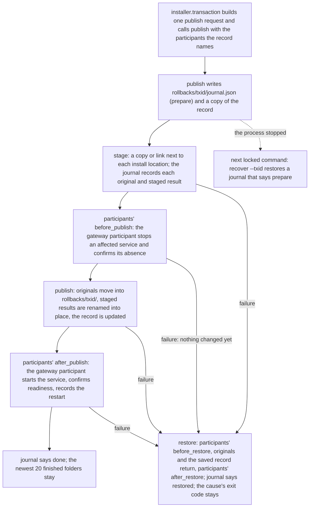
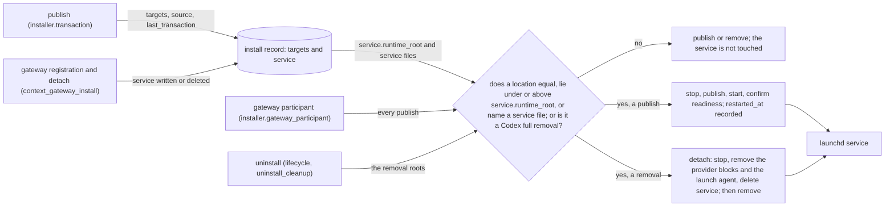

# Installer Architecture

언어: 🇺🇸 English | [🇰🇷 한국어](../ko/reference/installer-architecture.md)

This document is the contributor bridge between the quick installation docs and the installer compatibility contracts. It does not make the whole installer trivial. It gives contributors the architecture map they need before tracing a change through the installer, hook payloads, install state, and tests.

For quick user instructions, read [installation](../getting-started/installation.md). For compatibility requirements and test ownership, read [installer platform compatibility](../policies/installer-platform-compatibility-matrix.md).
## Contents

- [Reading Path](#reading-path)
- [Architecture Summary](#architecture-summary)
- [Install Flow](#install-flow)
- [Install Record](#install-record)
- [Hook Registration](#hook-registration)
- [Gateway Lifecycle](#gateway-lifecycle)
- [Platform Surfaces](#platform-surfaces)
- [State And Safety Model](#state-and-safety-model)
- [Contributor Entry Points](#contributor-entry-points)
- [What Not To Infer](#what-not-to-infer)
- [Full Understanding](#full-understanding)


## Reading Path

1. Use this page to understand the moving parts and the call direction.
2. Use [repository structure](./repository-structure.md) to find the files.
3. Use [installation](../getting-started/installation.md) and [uninstall](../getting-started/uninstall.md) to understand user-facing behavior.
4. Use [installer platform compatibility](../policies/installer-platform-compatibility-matrix.md), [tool output semantics](../policies/tool-output-semantics.md), and [live smoke regression](../policies/live-smoke-regression.md) to understand the contract and verification burden.

## Architecture Summary

The installer has three layers.

| Layer | Main files | Responsibility |
| --- | --- | --- |
| Shell entrypoints | `install.sh`, `install.ps1`, `install.cmd` | `install.sh` sets a UTF-8 locale, finds or installs Python 3.11+ and runs `_shared/installer/cli.py` with the user's arguments unchanged. `install.ps1` stops with the PowerShell 7.6 requirement on an older PowerShell, sets UTF-8 console input and output, finds or installs Python 3.11+, turns the parameter names of the earlier PowerShell installer into the matching long flags and runs the same cli with every argument in order. It reports `.\install.cmd` in `GHOST_ALICE_INSTALL_COMMAND`, so the installer's help and hints name the Windows command; without that report they name `bash install.sh`. `install.cmd` runs `install.ps1` with `pwsh.exe`, or with `powershell.exe` when `pwsh.exe` is absent |
| Installer package | `_shared/installer/` (`cli`, `auto`, `selection`, `addons`, `preservation`, `transaction`, `hosts`, `diagnostics`, `lifecycle`, `source`, `prerequisites`, `lock`, `report`, `locations`, `config`, `runner`) | Parse options, pick the command from the command table, resolve platforms and targets, keep the install step order, hold the install lock and print the report; every file change goes through the entry points below |
| Installer entry points | `_shared/install_hooks.py`, `_shared/install_transaction.py`, `_shared/install_state_writer.py`, `_shared/addon_installer.py`, `_shared/uninstall_cleanup.py`, `_shared/install_doctor.py` and the other `_shared/*.py` tools the package runs as child processes | Install skills and hooks, write the install record in the same step as each placement, record install state, protect local edits, remove managed targets and diagnose an installation |
| Runtime surfaces | `~/.claude/`, `~/.codex/`, `~/.agents/skills/`, `~/.ghost-alice/` | Hold installed skills, platform hook config, Claude and Codex global bootstrap instructions, the install record, publish rollbacks, install-state manifests, hook feature rollback metadata, pending merges, and uninstall reports |

The installer updates assets and hooks while protecting user edits and recording its own changes. Status, doctor, update and uninstall commands consume those records to identify the actual installed state and changes they can safely restore.

The hook runtime contains both `_shared` modules and `session-intent-analyzer/scripts/session_intent_ledger.py` under the same runtime root. Native hooks resolve the ledger API and its sibling helpers from that deployment. The source checkout identifies installation inputs; editing that checkout does not select execution libraries for an installed hook. The ledger database path and native session identity remain separate runtime inputs.

Four shared modules belong to neither layer, so the installer, the hook runtime and the skills may all import them. `_shared/hook_definitions.py` owns the names that the installer and the hook runtime read together: hook ids and host event names, and the `ghost_alice_context` provider name. `_shared/install_lock.py` owns the install lock file and the one judgment of whether this process or the process that started it holds the lock. `_shared/content_digest.py` owns the one fingerprint of installed content and the one comparison of an install record entry with the disk. `_shared/installed_payload.py` owns the install record. The first three import only the standard library; `installed_payload` imports only `content_digest` and `install_lock`. A runtime module imports no installer module, and an installer module imports no runtime module. `_shared.test_hook_definitions` checks these rules, and that no `installer` package module shadows a standard-library module name.

## Install Flow

| Sender → receiver | Input passed | Result used by the next step |
| --- | --- | --- |
| User command → shell entrypoint | The command line as typed. | A usable Python 3.11+ runtime and the arguments, unchanged. |
| Entrypoint → `installer.cli` | The arguments and the source checkout the shell lives in. | Parsed options, the selected command and, for an install, the platform, its skills directory and the effective visibility. |
| `installer.cli` → `installer.selection` and `installer.addons` | Requested skill names and addon sources. | Exact installation targets (core skills, `_shared`, addon targets) and the target count. |
| Orchestration → `install_transaction.py publish` | One publish request: the host, the source and installer commits, and each target's name, kind, provider, source path, install location and mode. | Installed skills/helpers, their install record entries written in the same step, and preserved local edits. |
| Deployment → hook/bootstrap synchronization | Managed payloads, platform paths and registration commands. | Updated managed rule blocks and hook registrations. |
| Installer → install-state writer → status output | Actual changed targets, hashes and rollback information. | Per-platform manifest and an install report for status, doctor and uninstall. |

`install.cmd` is only a Windows wrapper around `install.ps1`. `install.ps1` and `install.sh` are both thin shells around the same `_shared/installer/cli.py`, so Windows and Unix-like systems run one installer implementation. On Unix-like environments, `install.sh` owns the shell entry path and re-enters Bash when needed. Every command, `--help` and `--list` included, runs in Python: the shell keeps no copy of the installer's text, options or commands.

`installer.cli` owns one command table, `COMMAND_LINE`. Each command row names the tokens that select it, its handler, the install-lock name it holds, whether it needs a platform, and its `--help` row. Option parsing, the auto-mode decision, dispatch, the lock and `--help` all read that table, so a command cannot reach one of them without the others. A token that starts with `-` and names no command stops as `Unknown option`; a command never runs once per detected platform, only an install without a platform does. The installer names the checkout it runs from once, as `installer.runner.REPO_ROOT`.

### Install step order

The install command runs in this order: `installer.cli.dispatch` runs step 1, `installer.cli.prepare_install` runs step 2, `installer.cli.run_command` takes the lock, and `installer.cli.run_install` runs the rest. `_shared/test_installer_cli.py` fixes the order.

1. The install source check, before anything changes. `installer.source.match_install_source` compares the install record's `source.root` with the checkout the installer runs from, both with their links followed; it is the one judgment of whether a checkout is the install source. `installer.source.check_install_source` acts on it: no record, a record without a source, or the recorded checkout goes on. Another checkout, such as a second clone or a git worktree, goes on with `--adopt-source`, and without a question when the recorded checkout no longer exists, such as after a fresh clone at another path. Otherwise the installer names both folders; at a terminal it asks whether this checkout replaces the install source (no by default), elsewhere it stops with exit 2 and the command to run. The auto mode checks once, in the parent, and passes a replacement to its children as `--adopt-source`. An unreadable record skips the check with a warning. The command's first publish records the new source. Addon sources are prepared after this step. `--repair` runs the same step first but never replaces the install source: from another checkout it stops with exit 2 and names the install that moves the installation. Under the lock (step 3) the command compares again, so a source that another installer changed while this command waited is judged as it is then.
2. Prerequisites (`git`, `node`) and the git hook path: the repository's shared `core.hooksPath` becomes the absolute path of the install source's `hooks` folder ([Post-merge hook](#post-merge-hook)).
3. The install lock (`~/.ghost-alice/install.lock`), held until the command ends. Right after taking it, the installer restores every publish whose journal says neither `done` nor `restored`.
4. The migrations: the install record, only when `~/.ghost-alice/installed-payload.json` does not exist and an earlier installer's install-state does, and the removal of the two folders where an earlier installer kept the copies it replaced, `~/.ghost-alice/install-rollbacks` and the Claude skills folder's `.ghost-alice-install-rollbacks`, where a folder that cannot be removed is reported as a warning and recorded in `~/.ghost-alice/state-retention-failures.jsonl`; then source health; then target collection (core skills, `_shared`, addon targets).
5. Deprecated installed skills leave the discovery path; then the encoding guard; then the preflight that quarantines or records local edits.
6. Pending addon uninstalls resume; an addon collision stops the install.
7. Placement: `_shared` and every target as links (Claude Code) or as one copy batch (Codex). Each placement is one `install_transaction.publish` call in the installer process, with the participants the install record names, that writes the targets' install record entries in the same step. A publish stages each target in `.ghost-alice-install-staging` beside it and removes that folder after the publish or the restore when it is empty. A folder that holds another entry stays; a removal that fails for another reason is recorded in `~/.ghost-alice/state-retention-failures.jsonl`.
8. Runtime publish: `_shared` and the companion script `session-intent-analyzer/scripts/session_intent_ledger.py` under `~/.ghost-alice/runtime/current`, in one publish. When the install record has a `service` section, the gateway participant stops the registered service before the files change and starts it after. The Codex copy `~/.agents/skills/_shared` and the Claude links are not the service's code, so their placement calls no service effect. Then one read-only `Context gateway:` report line; then the hook registration ([Hook Registration](#hook-registration)), the managed rule block and the command wrappers.
9. Verification, ownership markers, the merge-companion snapshot, addon sidecars, the install-state manifest and the install event. The installer writes these earlier records after placement as before, and status, doctor, preservation, uninstall and repair still read them.

The command table names the lock of each command: install, uninstall, repair, `--cleanup-pending` and the `gateway` passthrough run under it, and `installer.cli.run_command` takes it before the handler and releases it after. A child tool reuses the lock of the installer process that called it: the lock records that process id, and `install_lock.held_by_process_tree` answers whether the lock belongs to the calling process or its parent. The gateway registration command and the install record writer both ask that function, and an unrelated holder blocks them; the registration command run on its own takes the lock itself. The lock's owner text is only a label and grants nothing.

### Post-merge hook

The git hook step (step 2) writes the repository's `core.hooksPath` with `git config --local`, the configuration every worktree of the repository shares, as the absolute path of the install source's `hooks` folder. A successful merge or pull in any worktree therefore runs the install source's `hooks/post-merge`, never another checkout's copy of that file; a worktree's own setting (`git config --worktree`) still comes first. `installer.source.setup_git_hooks` returns the value it wrote and the value from before Ghost-ALICE wrote one. Each host's install-state records both (`system_env_changes`, kind `source_repo_hook_path`), and the install record keeps the written value in `source.hooks_path`. The relative `hooks` an earlier installer wrote counts as no earlier value, unless that installer's install-state, for a checkout of the same repository, recorded the value it replaced. A reinstall that finds its own value in place keeps the earlier value the installation recorded. The step also writes the two values to `~/.ghost-alice/install-state/source-repo-hook-path.json` in the same step as the git write, so an install that stops before its install-state is written leaves the earlier value for the next install. A value in place that no record names leaves the earlier value unknown, so the install-state records no entry for it.

The hook clears the variables git exports for the merged worktree, such as `GIT_DIR`, and runs the install source's `bash install.sh --post-merge --merged-checkout <merged worktree>`. `installer.cli.run_post_merge` asks `installer.source.match_install_source`, the judgment of the install source check, about the merged checkout. When the merged checkout is the checkout the install record names as the install source, the step goes on with the auto-mode install for every detected host. The step takes no lock: each host's install takes it, and while another install holds it the install refuses and the hook reports the exit code in one line. For any other checkout, without a record, or with a record that cannot be read, the step prints one line and installs nothing; a recorded checkout that no longer exists is replaced only by an install the user runs, never by a merge. The hook always exits 0, so a merge never fails because of it.

The full uninstall of the last host restores the hook path. When the repository's value is still the value an install-state records as written, `_shared/uninstall_cleanup.py` writes back the recorded earlier value, or unsets the path when there was none. While another host's install-state remains, the hook path and `source-repo-hook-path.json` stay for that host; the last host's removal deletes that record. A value that no install-state records as written, and a value that changed after the install, stay as they are.

## Install Record

`~/.ghost-alice/installed-payload.json` records what the installer installed where. Both hosts use one file with one entry per install location path; a location that both hosts use, such as the runtime `~/.ghost-alice/runtime/current/_shared`, has one entry whose `used_by` names both.

| Section | Content |
| --- | --- |
| `schema_version` | `1` |
| `installer` | `commit` and `schema_version` of the installer that last wrote the record |
| `source` | `root`, `commit`, `dirty` and `hooks_path` of the source checkout |
| `last_transaction` | `id`, `updated_at` and `rollback_dir` of the last publish |
| `targets` | Per install location: `name`, `kind` (`skill`, `support`, `runtime`, `command`, `resource`), `mode` (`link`, `copy`), `provider` (`core` or `addon:<id>`), `source`, `source_commit`, `used_by`, `link_target` for a link or `files` for a copy, `installed_at` and `baseline` |
| `service` | The registered context gateway, absent when none is registered: `label`, `runtime_root` (the folder of the runtime `_shared` the service runs from), `program`, the three service files `launch_agent`, `state_path` and `config_path` with `launch_agent_digest`, `state_digest` and `config_block_digest` (the fingerprint of the provider blocks in Codex `config.toml`; `null` until a registration recorded it), `config_backup`, `registered_at`, `restarted_at` and `listener_ready` |
| `hooks` | The hook registrations the hosts carry, absent before the first one: `launcher` (`path`, `python`, `digest` and `written_at` of the launcher file) and per host (`claude`, `codex`) `hook_file`, `destination` (the installation locations the hooks run with), `entries` (per hook id: `event`, `marker`, `command`, `provider`) and `registered_at` |

A copy's `files` maps each relative path to `sha256:<hex>` of its bytes, and a copied single file is its own one path `.`; a link records only the path it points to. `content_digest` computes both and leaves out caches (`__pycache__`, `.pytest_cache`, `.mypy_cache`, `.ruff_cache`, `node_modules`, `.git`), `.pyc` and `.DS_Store` files, the ownership marker and linked files and folders. `baseline` says where the fingerprints come from: `recorded` by a publish, `migrated` from an earlier installer's records, or `unknown` when those records had none.

| Writer | When | What it writes |
| --- | --- | --- |
| `install_transaction.publish` | Every placement, and once per install for the links that already point at their source | The published targets, `source`, `installer` and `last_transaction`, in the same step as the renames; a link that already points at its source is recorded and not replaced |
| `installed_payload.migrate` | The first install, repair or uninstall when the record does not exist and an earlier installer's install-state does | Every host's install-state target: a link with the path it points to now, a copy with its ownership marker's fingerprints, else the merge-companion snapshot's, else none (`unknown`); `provider` from the addon sidecars. Current files are never adopted as a baseline, and the earlier records stay unchanged |
| `installed_payload.migrate_service` | The first install, repair or uninstall when the record has no `service` section and `~/.ghost-alice/context-gateway-binding.json` names an installed gateway receipt | The `service` section from the receipt (`config_block_digest` stays `null` until a registration records it) and a `migrated` runtime target for each companion script the receipt fingerprinted. The receipt and the binding stay unchanged and are not read again |
| `context_gateway_install.py` | The `gateway` registration and detach commands, in the commit phase of their phase machine | A registration writes the `service` section after the service is ready; a detach deletes it; a failed operation puts the section back as it was |
| `installer.gateway_participant` | After a publish that touched the service's code | `restarted_at` and `listener_ready` of the `service` section once the service is back |
| `hook_launcher.write_registration` | The hook registration of each install, in `install_hooks.py` before the host file changes | The `hooks` section: the launcher file's path, Python and digest, and the host's `hook_file`, `destination` and entries. The host's uninstall drops its part, and the last host's uninstall drops the launcher too |

`installed_payload.update` is the one writer of record sections and `installed_payload.restore` puts back a copy a publish saved. Both write through a temporary file and a rename, and refuse unless the install lock belongs to the calling process or its parent. A record this installer cannot read, such as another schema version, stays unchanged while the files still publish. `--status` and `--doctor` print one summary line of the platform's targets in the record and one line per target that differs from it. Targets without a baseline are counted and not compared, and a match is reported only for the targets that were compared; the record does not change their result.



A publish keeps what it replaced only in `~/.ghost-alice/rollbacks/<txid>/`: the originals, the record copy and `journal.json`. The journal names the targets the publish replaces and records each one's original and staged result: files with their digests, links with their targets and every folder, empty ones too, leaving out only caches and generated files. It says `prepare` before anything changes, `done` after the files, the record and the participants' `after_publish` finished, and `restored` after a restore. A participant's error keeps its exit code (2, 3, 4 or 5) through the restore, and a restore step that fails with its own code reports that code (5 for an unconfirmed service recovery). A publish that replaces nothing (links already pointing at their source) calls no participant. `install_transaction` knows only the participant interface (`installer/participant.py`: `before_publish`, `after_publish`, `before_restore`, `after_restore` with the record root, the host, the transaction id and the replaced install locations); `installer/gateway_participant.py` is the one installer module that imports the gateway modules. When a process stops before `done`, the next locked command runs `install_transaction.py recover --txid <id>`: it checks every target first, so an install location must still hold what the publish left there or its original, and a moved original must still exist. A publish that cannot be restored stops the command with exit 1 and names its folder for review, because placing files over a half-finished publish would hide which files are the originals. This restore puts back files and the record only; it does not stop or restart the context gateway service.

## Hook Registration

Each host's hook settings (`settings.json` for Claude Code, `hooks.json` for Codex) carry one short command per Core hook:

```text
"<ghost_root>/bin/hook-launcher" <hook-id> <platform> # <marker> [hook-runner:<hook-id>]
```

`<hook-id>` is one of `hook_definitions.CORE_HOOK_IDS`, or `addon-<addon id>-<hook id>` for an addon's hook so that two addons declaring the same hook id keep separate registrations and record entries; `<platform>` is `claude` or `codex`, and the comment carries the ownership marker that the installer, status, doctor and the security scan recognize. The command names nothing else. The launcher `~/.ghost-alice/bin/hook-launcher` (`hook-launcher.cmd` on Windows) finds Python 3.11+ the way the earlier long registration did and runs the runtime `_shared/hook_launcher.py` with the install record's path. That module reads the record's `hooks.<platform>` section, binds its `destination` into the environment and hands the runner `hook_profile_gate.py` the entry's inner command and the destination binding as `run <hook-id> <platform> <payload> --binding-b64 <binding>`; the runner validates, runs and audits the inner command as before. A registration the record does not carry ends with `hook registration rejected` and exit 126, with a strict log row when the host's destination is known; a usage error exits 1. Neither blocks the host.

`_shared/hook_launcher.py` owns the format, the launcher file and the record section. `_shared/install_hooks.py` writes them in this order: the launcher file, the record section, then the host file, so a host never names a launcher that is not there. A record that cannot be written stops the hook installation before the host file changes. Uninstall goes the other way: the host file, the record section, and after the last host the launcher file. Status compares the host commands with the expected ones, and the record's section and the launcher's digest with what the install writes; a difference is reported as `registration` drift. Doctor resolves a registration through the record and the launcher file when it checks that every managed hook runs the runtime core.

An older installer registered the long form, in which every command carried the Python discovery, the runner path, the inner command and the destination binding. Every install and uninstall removes that form of a Core hook id ([Retired Hook Registration](../getting-started/troubleshooting.md#retired-hook-registration)). The runner still accepts it, so a host that keeps an older command loaded until its next reload runs as before. An addon's long registration stays until that addon is installed again or a full uninstall removes it. The destination the hooks run with lives in the record; the copy an earlier installer kept in `config.json` under `install_locations` is read once to keep the ledger root and is not written again.

## Gateway Lifecycle

Gateway registration, refresh and detachment use six `_shared/context_gateway_*` modules. `model` defines request, observation, plan, result and effects types; it does not invoke an AI model. `inventory` reads the service files through an injected platform adapter. `plan` compares the service files with the install record's `service` section and produces an ordered plan without I/O. `transaction` applies the plan, writes the record's `service` section in its commit phase and owns reverse recovery. `platform` implements individual filesystem, record and native-service operations. `install` composes them behind the `gateway` command: `bash install.sh gateway --codex-dir <dir> --ledger-root <dir> --state-dir <dir> --launch-agent <plist>` registers or refreshes, `bash install.sh gateway detach --confirm` unregisters, and `--dry-run` prints the validated plan without applying it.

The registration reads the runtime target the latest publish wrote from the install record and writes only the three service files: the launch agent, `state.json` and the provider blocks in Codex `config.toml`. It copies no module: the service runs the runtime `_shared` and the companion script the installer publishes, and the record's `targets` say which bytes those are, so Core must be installed first. The state directory must lie outside that runtime, links followed. Without a `service` section the command registers a new listener and refuses an existing launch agent, state directory entry or provider block the record does not name. With one, it refreshes with the same port and scope when the three files are as the section records them, and stops before any change when one of them changed outside the installer (exit 2): review the file, then run the command again.



`installer/gateway_participant.py`, the one installer module that imports the gateway modules, judges every publish and removal from the record: a location equal to, under or above `service.runtime_root`, or one of the three service files, touches the service; `~/.codex`, `~/.claude` and the ledger are data the service reads, not its code, and a link is compared by its own path, never by where it points. An affected publish stops the service before the files change, starts it after, confirms readiness and records `restarted_at`; a failed readiness restores the files and starts the prior service (exit 4). An affected removal, and every Codex full uninstall, detaches first: stop, remove the provider blocks and the launch agent, delete the `service` section; the state directory stays. A service file that changed outside the installer stops the detach for review. Without a `service` section the removal asks launchd: a loaded service with the gateway's label whose program is inside a removal root holds the removal for review (exit 3); an absent service or one that runs from elsewhere lets the removal go on. The install, after its runtime publish, and the repair ask launchd through the same function, `installer.gateway_participant.loaded_service`. When a loaded gateway service runs from the runtime root and the record has no `service` section, the publish goes on and the installer leaves the service as it is: it has no record of the service's files. The `Context gateway:` line then warns and names the registration command, which records the service and restarts it on the new code. An observation that is not clear counts as none and leaves one line in the install log. A managed Git update of the checkout (`--update-source`) does not touch the service: the checkout is not its code.

Gateway errors keep their phase and stable identifier: exit 2 for a failed precondition, 3 for unconfirmed service state before any file changed, 4 for an operation that failed but restored the prior installation, and 5 for uncertain recovery after changes began. The installer reports the structured cause and keeps that exit code. Registration requires Python 3.14 with a working zstd codec; detachment runs on Python 3.11. The [installer lifecycle specification](../coding-convention/specs/2026-10-15-gateway-installer-design.md) records the design the phase machine comes from.

## Platform Surfaces

| Platform | Installed surfaces |
| --- | --- |
| Claude Code | `${CLAUDE_CONFIG_DIR:-~/.claude}/skills/`, `${CLAUDE_CONFIG_DIR:-~/.claude}/CLAUDE.md`, `${CLAUDE_CONFIG_DIR:-~/.claude}/settings.json`, Claude command wrappers |
| Codex | `~/.agents/skills/`, `~/.codex/AGENTS.md`, `~/.codex/ghost-alice-governance.md`, `~/.codex/hooks.json`, `~/.codex/config.toml` |
| Shared state | `~/.ghost-alice/installed-payload.json`, `~/.ghost-alice/bin/hook-launcher`, `~/.ghost-alice/rollbacks/`, `~/.ghost-alice/install-state/`, `~/.ghost-alice/pending-merges/`, `~/.ghost-alice/uninstall-reports/`, `~/.ghost-alice/install/` |

Claude Code can expose native skill invocation and hook permissions, but those surfaces do not replace a global instruction port for sessions outside the repository. The installer therefore merges the managed block from `platforms/claude/CLAUDE.md` into the Claude config directory. Codex does not expose the same skill surface, so its separate bootstrap and hook config make required gates auditable through `SKILL.md` read records and hook payloads. Both global rule files preserve text outside their managed blocks; a markerless user-owned destination receives a `.ghost-alice-proposed` file instead of an overwrite.

Core hook transport preserves the firing native cwd as Core context; installation source and project-trust paths do not replace it.

Managed hook commands and native trust entries must agree with the reviewed installed payload. A running host can retain its previously loaded registration. Verify adoption through an actual native callback after the appropriate reload; refer to [hook trust and reload](../getting-started/troubleshooting.md#native-hook-trust-and-reload). Installation state alone is not native execution evidence.

## State And Safety Model

The installer records what it changes instead of guessing during cleanup.

| State path | Why it exists |
| --- | --- |
| `~/.ghost-alice/installed-payload.json` | The install record: every install location of both hosts, its source and the fingerprints of copied files, written in the same step as each placement; the hook registrations of both hosts, written before the host files name them |
| `~/.ghost-alice/bin/hook-launcher` | The launcher every host's hook registration runs: it finds Python 3.11+ and runs the runtime `hook_launcher.py` with the install record. Written with the registration, removed with the last host's |
| `~/.ghost-alice/rollbacks/<txid>/` | What one publish replaced, the record as it was before it, and its journal; the next locked command restores a publish that stopped before its journal said done. The newest 20 finished publishes stay |
| `~/.ghost-alice/install-state/<platform>.json` | Records installer-owned targets and environment changes for status and uninstall |
| `~/.ghost-alice/pending-merges/<platform>/` | Preserves the user's edits to Ghost-ALICE copy-mode skill files before the installer replaces them. It checks roots with the install marker and every root the current install replaces, even when that root's marker has disappeared; merge-companion and the user decide whether to merge. Folders that Ghost-ALICE does not install, such as the Claude app's `synced`, are never recorded |
| `~/.ghost-alice/install/` | Keeps the install reports and event traces of the last 30 runs for audit and recovery |

This is why update and uninstall are part of the installer architecture, not separate chores. A change that affects copied assets, hooks, or runtime config usually also affects status, doctor, pending merge behavior, and uninstall rollback.

## Contributor Entry Points

| Change type | Start here | Then verify with |
| --- | --- | --- |
| Python runtime detection, the PowerShell 7.6 check, PowerShell parameter names or locale setup | `install.sh`, `install.ps1`, `install.cmd` | `scripts/tests/test_thin_shells.py`, `scripts/tests/test_install_runtime_detection.py`, compatibility matrix groups |
| Installer option, command table, dispatch or install order | `_shared/installer/cli.py`, `_shared/installer/auto.py` | `_shared/test_installer_cli.py`, `_shared/test_installer_auto.py`, `_shared/test_installer_checkout.py`, the `_shared/test_*_shell.py` end-to-end tests |
| Installer wording or the install report | `_shared/installer/report.py` | `_shared/test_installer_report.py`, `scripts/tests/test_installer_default_auto.py` |
| Hook payload or hook status wording | `_shared/install_hooks.py` | `_shared.test_install_hooks`, `scripts/check_skill_gate_contract.py` |
| Hook id or host event name | `_shared/hook_definitions.py` | `_shared.test_hook_definitions` |
| Hook registration format, the launcher file or the record's `hooks` section | `_shared/hook_launcher.py`, `_shared/install_hooks.py` | `_shared/test_hook_launcher.py`, `_shared/test_install_hooks.py`, `_shared/test_installed_hook_cleanup.py` |
| Install record, fingerprints, publish journal or restore | `_shared/installed_payload.py`, `_shared/content_digest.py`, `_shared/install_transaction.py`, `_shared/installer/transaction.py`, `_shared/installer/lock.py` | `_shared/test_installed_payload.py`, `_shared/test_content_digest.py`, `_shared/test_install_transaction_publish.py`, `_shared/test_install_record_shell.py` |
| Install-state or uninstall behavior | `_shared/install_state_writer.py`, `_shared/uninstall_cleanup.py`, `_shared/installer/lifecycle.py`, `_shared/installer/transaction.py` | `_shared/test_installer_lifecycle.py`, `_shared/test_installer_transaction.py`, install-state schema tests and uninstall tests |
| Public docs or command surface | `README.md`, `docs/`, `docs/index.html` | `scripts/validate_public_surfaces.py` and public-surface contract tests |
| Platform compatibility rule | `docs/policies/installer-platform-compatibility-matrix.md` | `scripts/run_installer_compat_tests.py --list` and the focused group named by the policy |

When changing one part, look for the paired contract. The test owner named in the compatibility matrix is the fastest way to find the regression surface.

## What Not To Infer

- Hook files existing on disk does not prove hook payloads are current.
- A copied skill directory does not prove the platform can invoke or audit that skill.
- A passing install smoke does not prove status, doctor, update, pending merge, and uninstall paths are aligned.
- A user-facing install command does not explain the architecture; it is only the entrypoint.

## Full Understanding

A contributor can usually get oriented in a few minutes, but full installer understanding requires tracing one change through the entrypoint, orchestration layer, runtime surface, state file, and test owner. This page is the first map for that trace. It is not a substitute for reading the relevant implementation and compatibility contract.
