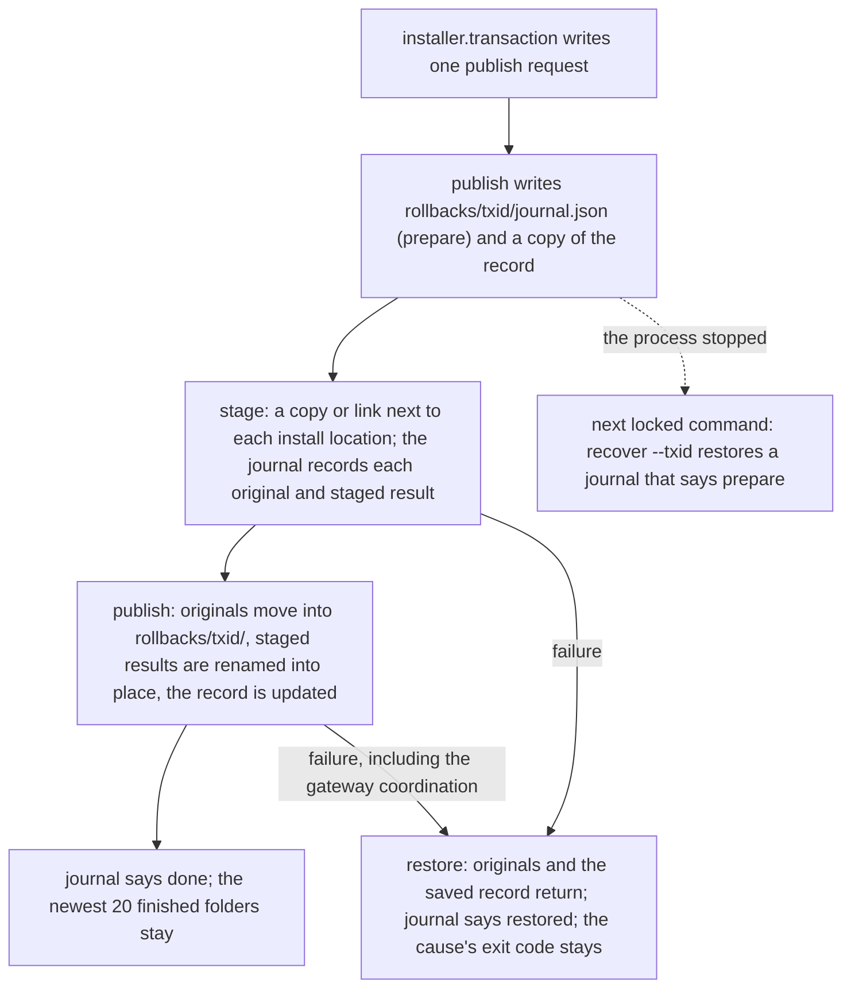

# Installer Architecture

언어: 🇺🇸 English | [🇰🇷 한국어](../ko/reference/installer-architecture.md)

This document is the contributor bridge between the quick installation docs and the installer compatibility contracts. It does not make the whole installer trivial. It gives contributors the architecture map they need before tracing a change through the installer, hook payloads, install state, and tests.

For quick user instructions, read [installation](../getting-started/installation.md). For compatibility requirements and test ownership, read [installer platform compatibility](../policies/installer-platform-compatibility-matrix.md).
## Contents

- [Reading Path](#reading-path)
- [Architecture Summary](#architecture-summary)
- [Install Flow](#install-flow)
- [Install Record](#install-record)
- [Gateway Lifecycle](#gateway-lifecycle)
- [Platform Surfaces](#platform-surfaces)
- [State And Safety Model](#state-and-safety-model)
- [Contributor Entry Points](#contributor-entry-points)
- [What Not To Infer](#what-not-to-infer)
- [Full Understanding](#full-understanding)

## Reading Path

1. Use this page to understand the moving parts and the call direction.
2. Use [repository structure](./repository-structure.md) to find the files.
3. Use [installation](../getting-started/installation.md) and [uninstall](../getting-started/uninstall.md) to understand user-facing behavior.
4. Use [installer platform compatibility](../policies/installer-platform-compatibility-matrix.md), [tool output semantics](../policies/tool-output-semantics.md), and [live smoke regression](../policies/live-smoke-regression.md) to understand the contract and verification burden.

## Architecture Summary

The installer has three layers.

| Layer | Main files | Responsibility |
| --- | --- | --- |
| Shell entrypoints | `install.sh`, `install.ps1`, `install.cmd` | `install.sh` sets a UTF-8 locale, finds or installs Python 3.11+ and runs `_shared/installer/cli.py` with the user's arguments unchanged. `install.ps1` stops with the PowerShell 7.6 requirement on an older PowerShell, sets UTF-8 console input and output, finds or installs Python 3.11+, turns the parameter names of the earlier PowerShell installer into the matching long flags and runs the same cli with every argument in order. It reports `.\install.cmd` in `GHOST_ALICE_INSTALL_COMMAND`, so the installer's help and hints name the Windows command; without that report they name `bash install.sh`. `install.cmd` runs `install.ps1` with `pwsh.exe`, or with `powershell.exe` when `pwsh.exe` is absent |
| Installer package | `_shared/installer/` (`cli`, `auto`, `selection`, `addons`, `preservation`, `transaction`, `hosts`, `diagnostics`, `lifecycle`, `source`, `prerequisites`, `lock`, `report`, `locations`, `config`, `runner`) | Parse options, pick the command from the command table, resolve platforms and targets, keep the install step order, hold the install lock and print the report; every file change goes through the entry points below |
| Installer entry points | `_shared/install_hooks.py`, `_shared/install_transaction.py`, `_shared/install_state_writer.py`, `_shared/addon_installer.py`, `_shared/uninstall_cleanup.py`, `_shared/install_doctor.py` and the other `_shared/*.py` tools the package runs as child processes | Install skills and hooks, write the install record in the same step as each placement, record install state, protect local edits, remove managed targets and diagnose an installation |
| Runtime surfaces | `~/.claude/`, `~/.codex/`, `~/.agents/skills/`, `~/.ghost-alice/` | Hold installed skills, platform hook config, Claude and Codex global bootstrap instructions, the install record, publish rollbacks, install-state manifests, hook feature rollback metadata, pending merges, and uninstall reports |

The installer updates assets and hooks while protecting user edits and recording its own changes. Status, doctor, update and uninstall commands consume those records to identify the actual installed state and changes they can safely restore.

The hook runtime contains both `_shared` modules and `session-intent-analyzer/scripts/session_intent_ledger.py` under the same runtime root. Native hooks and Ghost-ALICE Autopilot resolve the ledger API and its sibling helpers from that deployment. The source checkout identifies installation inputs; editing that checkout does not select execution libraries for an installed hook. The ledger database path and native session identity remain separate runtime inputs.

Four shared modules belong to neither layer, so the installer, the hook runtime and the skills may all import them. `_shared/hook_definitions.py` owns the names that the installer and the hook runtime read together: hook ids and host event names, the `ghost_alice_context` provider name, and the privileged adapter allowlist. `_shared/install_lock.py` owns the install lock file and the one judgment of whether this process or the process that started it holds the lock. `_shared/content_digest.py` owns the one fingerprint of installed content and the one comparison of an install record entry with the disk. `_shared/installed_payload.py` owns the install record. The first three import only the standard library; `installed_payload` imports only `content_digest` and `install_lock`. A runtime module imports no installer module, and an installer module imports no runtime module. `_shared.test_hook_definitions` checks these rules, and that no `installer` package module shadows a standard-library module name.

## Install Flow

| Sender → receiver | Input passed | Result used by the next step |
| --- | --- | --- |
| User command → shell entrypoint | The command line as typed. | A usable Python 3.11+ runtime and the arguments, unchanged. |
| Entrypoint → `installer.cli` | The arguments and the source checkout the shell lives in. | Parsed options, the selected command and, for an install, the platform, its skills directory and the effective visibility. |
| `installer.cli` → `installer.selection` and `installer.addons` | Requested skill names and addon sources. | Exact installation targets (core skills, `_shared`, addon targets) and the target count. |
| Orchestration → `install_transaction.py publish` | One publish request: the host, the source and installer commits, and each target's name, kind, provider, source path, install location and mode. | Installed skills/helpers, their install record entries written in the same step, and preserved local edits. |
| Deployment → hook/bootstrap synchronization | Managed payloads, platform paths and registration commands. | Updated managed rule blocks and hook registrations. |
| Installer → install-state writer → status output | Actual changed targets, hashes and rollback information. | Per-platform manifest and an install report for status, doctor and uninstall. |

`install.cmd` is only a Windows wrapper around `install.ps1`. `install.ps1` and `install.sh` are both thin shells around the same `_shared/installer/cli.py`, so Windows and Unix-like systems run one installer implementation. On Unix-like environments, `install.sh` owns the shell entry path and re-enters Bash when needed. Every command, `--help` and `--list` included, runs in Python: the shell keeps no copy of the installer's text, options or commands.

`installer.cli` owns one command table, `COMMAND_LINE`. Each command row names the tokens that select it, its handler, the install-lock name it holds, whether it needs a platform, and its `--help` row. Option parsing, the auto-mode decision, dispatch, the lock and `--help` all read that table, so a command cannot reach one of them without the others. A token that starts with `-` and names no command stops as `Unknown option`; a command never runs once per detected platform, only an install without a platform does. The installer names the checkout it runs from once, as `installer.runner.REPO_ROOT`.

### Install step order

The install command runs in this order: `installer.cli.prepare_install` runs step 1, `installer.cli.run_command` takes the lock, and `installer.cli.run_install` runs the rest. `_shared/test_installer_cli.py` fixes the order.

1. Prerequisites (`git`, `node`) and the source checkout's git hook path.
2. The install lock (`~/.ghost-alice/install.lock`), held until the command ends. Right after taking it, the installer restores every publish whose journal says neither `done` nor `restored`.
3. The install record migration, only when `~/.ghost-alice/installed-payload.json` does not exist and an earlier installer's install-state does; then source health; then target collection (core skills, `_shared`, addon targets).
4. Deprecated installed skills leave the discovery path; then the encoding guard; then the preflight that quarantines or records local edits.
5. Pending addon uninstalls resume; an addon collision stops the install.
6. Placement: `_shared` and every target as links (Claude Code) or as one copy batch (Codex). Each placement is one `install_transaction.py publish` that writes the targets' install record entries in the same step.
7. Runtime `_shared` publish, hook installation, the managed rule block and the command wrappers.
8. Verification, ownership markers, the merge-companion snapshot, addon sidecars, the install-state manifest and the install event. The installer writes these earlier records after placement as before, and status, doctor, preservation, uninstall and repair still read them.

The command table names the lock of each command: install, uninstall, repair, `--cleanup-pending` and the `gateway` passthrough run under it, and `installer.cli.run_command` takes it before the handler and releases it after. A child tool reuses the lock of the installer process that called it: the lock records that process id, and `install_lock.held_by_process_tree` answers whether the lock belongs to the calling process or its parent. The gateway coordination and the install record writer both ask that function, and an unrelated holder blocks them. The lock's owner text is only a label and grants nothing.

## Install Record

`~/.ghost-alice/installed-payload.json` records what the installer installed where. Both hosts use one file with one entry per install location path; a location that both hosts use, such as the runtime `~/.ghost-alice/runtime/current/_shared`, has one entry whose `used_by` names both.

| Section | Content |
| --- | --- |
| `schema_version` | `1` |
| `installer` | `commit` and `schema_version` of the installer that last wrote the record |
| `source` | `root`, `commit`, `dirty` and `hooks_path` of the source checkout |
| `last_transaction` | `id`, `updated_at` and `rollback_dir` of the last publish |
| `targets` | Per install location: `name`, `kind` (`skill`, `support`, `runtime`, `command`, `resource`), `mode` (`link`, `copy`), `provider` (`core` or `addon:<id>`), `source`, `source_commit`, `used_by`, `link_target` for a link or `files` for a copy, `installed_at` and `baseline` |

A copy's `files` maps each relative path to `sha256:<hex>` of its bytes, and a copied single file is its own one path `.`; a link records only the path it points to. `content_digest` computes both and leaves out caches (`__pycache__`, `.pytest_cache`, `.mypy_cache`, `.ruff_cache`, `node_modules`, `.git`), `.pyc` and `.DS_Store` files, the ownership marker and linked files and folders. `baseline` says where the fingerprints come from: `recorded` by a publish, `migrated` from an earlier installer's records, or `unknown` when those records had none.

| Writer | When | What it writes |
| --- | --- | --- |
| `install_transaction.py publish` | Every placement, and once per install for the links that already point at their source | The published targets, `source`, `installer` and `last_transaction`, in the same step as the renames; a link that already points at its source is recorded and not replaced |
| `installed_payload.migrate` | The first install or repair when the record does not exist and an earlier installer's install-state does | Every host's install-state target: a link with the path it points to now, a copy with its ownership marker's fingerprints, else the merge-companion snapshot's, else none (`unknown`); `provider` from the addon sidecars. Current files are never adopted as a baseline, and the earlier records stay unchanged |

`installed_payload.update` is the one writer of record sections and `installed_payload.restore` puts back a copy a publish saved. Both write through a temporary file and a rename, and refuse unless the install lock belongs to the calling process or its parent. A record this installer cannot read, such as another schema version, stays unchanged while the files still publish. `--status` and `--doctor` print one summary line of the platform's targets in the record and one line per target that differs from it. Targets without a baseline are counted and not compared, and a match is reported only for the targets that were compared; the record does not change their result.

A publish keeps what it replaced only in `~/.ghost-alice/rollbacks/<txid>/`: the originals, the record copy and `journal.json`. The journal names the targets the publish replaces and records each one's original and staged result: files with their digests, links with their targets and every folder, empty ones too, leaving out only caches and generated files. It says `prepare` before anything changes, `done` after the files, the record and the gateway coordination finished, and `restored` after a restore. A gateway error keeps its exit code (2, 3, 4 or 5) through the restore. When a process stops before `done`, the next locked command runs `install_transaction.py recover --txid <id>`: it checks every target first, so an install location must still hold what the publish left there or its original, and a moved original must still exist. A publish that cannot be restored stops the command with exit 1 and names its folder for review, because placing files over a half-finished publish would hide which files are the originals. This restore puts back files and the record only; it does not stop or restart the context gateway service.

## Gateway Lifecycle

Gateway installation, refresh and detachment use six `_shared/context_gateway_*` modules. `model` defines request, observation, plan, result and effects types; it does not invoke an AI model. `inventory` reads facts through an injected platform adapter. `plan` authenticates ownership, compares selected mutations with actual gateway dependencies and produces an ordered plan without I/O. `transaction` applies the plan and owns reverse recovery. `platform` implements individual filesystem/native-service operations. `install` composes them behind the existing Python/CLI entrypoints.

General payload replacement exposes reversible `ReplacementBatch` effects from `install_transaction.py`; managed Git updates expose reversible `SourceUpdate` effects from `installer_source_update.py`. When their selected paths affect an owned gateway, the same gateway transaction stops the service before replacement, establishes candidate readiness and updates the receipt/binding. Proven independent changes leave the gateway untouched. Core cleanup detaches affected gateway dependencies before deleting them. An unowned or inconclusive dependency cannot authorize detachment or dependent deletion.

The gateway install CLI's `--dry-run` option prints the validated proposed changes and exits without application or an approval wait. Gateway/component errors retain their phase and stable identifier: exit 2 for a failed precondition, 3 for unconfirmed service state before active file replacement, 4 for an operation that failed but restored the prior installation, and 5 for uncertain recovery after changes began. General shell/PowerShell callers retain their existing overall failure reporting and the structured component cause. Installation requires Python 3.14 with a working zstd codec; detachment supports Python 3.11. The [installer lifecycle specification](../coding-convention/specs/2026-10-15-gateway-installer-design.md) contains the operation-specific conditions, data handoffs and failure diagrams.

## Platform Surfaces

| Platform | Installed surfaces |
| --- | --- |
| Claude Code | `${CLAUDE_CONFIG_DIR:-~/.claude}/skills/`, `${CLAUDE_CONFIG_DIR:-~/.claude}/CLAUDE.md`, `${CLAUDE_CONFIG_DIR:-~/.claude}/settings.json`, Claude command wrappers |
| Codex | `~/.agents/skills/`, `~/.codex/AGENTS.md`, `~/.codex/ghost-alice-governance.md`, `~/.codex/hooks.json`, `~/.codex/config.toml` |
| Shared state | `~/.ghost-alice/installed-payload.json`, `~/.ghost-alice/rollbacks/`, `~/.ghost-alice/install-state/`, `~/.ghost-alice/pending-merges/`, `~/.ghost-alice/uninstall-reports/`, `~/.ghost-alice/install/` |

Claude Code can expose native skill invocation and hook permissions, but those surfaces do not replace a global instruction port for sessions outside the repository. The installer therefore merges the managed block from `platforms/claude/CLAUDE.md` into the Claude config directory. Codex does not expose the same skill surface, so its separate bootstrap and hook config make required gates auditable through `SKILL.md` read records and hook payloads. Both global rule files preserve text outside their managed blocks; a markerless user-owned destination receives a `.ghost-alice-proposed` file instead of an overwrite.

Normal Core hook transport preserves the firing native cwd as Core context and explicit Ghost-ALICE Autopilot target overrides. Ghost-ALICE Autopilot owns project discovery: Claude uses an absolute CLI project directory before payload cwd; Codex uses payload cwd and ignores the Claude-specific hint. Installation source and project-trust paths do not select a Ghost-ALICE Autopilot target; isolated bindings retain their owned project target. Pretool and Stop resolve that target and read OFF before accessing Core authority. OFF returns quiet continue without capture context or authority reads/writes; an active target proceeds to the existing qualified-selection checks. Target selection grants no authority.

Managed hook commands and native trust entries must agree with the reviewed installed payload. A running host can retain its previously loaded registration. Verify adoption through an actual native callback after the appropriate reload; refer to [hook trust and reload](../getting-started/troubleshooting.md#native-hook-trust-and-reload). Installation state alone is not native execution evidence.

## State And Safety Model

The installer records what it changes instead of guessing during cleanup.

| State path | Why it exists |
| --- | --- |
| `~/.ghost-alice/installed-payload.json` | The install record: every install location of both hosts, its source and the fingerprints of copied files, written in the same step as each placement |
| `~/.ghost-alice/rollbacks/<txid>/` | What one publish replaced, the record as it was before it, and its journal; the next locked command restores a publish that stopped before its journal said done |
| `~/.ghost-alice/install-state/<platform>.json` | Records installer-owned targets and environment changes for status and uninstall |
| `~/.ghost-alice/pending-merges/<platform>/` | Preserves the user's edits to Ghost-ALICE copy-mode skill files before the installer replaces them. It checks roots with the install marker and every root the current install replaces, even when that root's marker has disappeared; merge-companion and the user decide whether to merge. Folders that Ghost-ALICE does not install, such as the Claude app's `synced`, are never recorded |
| `~/.ghost-alice/install/` | Keeps install reports and event traces for audit and recovery |

This is why update and uninstall are part of the installer architecture, not separate chores. A change that affects copied assets, hooks, or runtime config usually also affects status, doctor, pending merge behavior, and uninstall rollback.

## Contributor Entry Points

| Change type | Start here | Then verify with |
| --- | --- | --- |
| Python runtime detection, the PowerShell 7.6 check, PowerShell parameter names or locale setup | `install.sh`, `install.ps1`, `install.cmd` | `scripts/tests/test_thin_shells.py`, `scripts/tests/test_install_runtime_detection.py`, compatibility matrix groups |
| Installer option, command table, dispatch or install order | `_shared/installer/cli.py`, `_shared/installer/auto.py` | `_shared/test_installer_cli.py`, `_shared/test_installer_auto.py`, `_shared/test_installer_checkout.py`, the `_shared/test_*_shell.py` end-to-end tests |
| Installer wording or the install report | `_shared/installer/report.py` | `_shared/test_installer_report.py`, `scripts/tests/test_installer_default_auto.py` |
| Hook payload or hook status wording | `_shared/install_hooks.py` | `_shared.test_install_hooks`, `scripts/check_skill_gate_contract.py` |
| Hook id, host event name or privileged adapter allowlist | `_shared/hook_definitions.py` | `_shared.test_hook_definitions` |
| Install record, fingerprints, publish journal or restore | `_shared/installed_payload.py`, `_shared/content_digest.py`, `_shared/install_transaction.py`, `_shared/installer/transaction.py`, `_shared/installer/lock.py` | `_shared/test_installed_payload.py`, `_shared/test_content_digest.py`, `_shared/test_install_transaction_publish.py`, `_shared/test_install_record_shell.py` |
| Install-state or uninstall behavior | `_shared/install_state_writer.py`, `_shared/uninstall_cleanup.py`, `_shared/installer/lifecycle.py`, `_shared/installer/transaction.py` | `_shared/test_installer_lifecycle.py`, `_shared/test_installer_transaction.py`, install-state schema tests and uninstall tests |
| Public docs or command surface | `README.md`, `docs/`, `docs/index.html` | `scripts/validate_public_surfaces.py` and public-surface contract tests |
| Platform compatibility rule | `docs/policies/installer-platform-compatibility-matrix.md` | `scripts/run_installer_compat_tests.py --list` and the focused group named by the policy |

When changing one part, look for the paired contract. The test owner named in the compatibility matrix is the fastest way to find the regression surface.

## What Not To Infer

- Hook files existing on disk does not prove hook payloads are current.
- A copied skill directory does not prove the platform can invoke or audit that skill.
- A passing install smoke does not prove status, doctor, update, pending merge, and uninstall paths are aligned.
- A user-facing install command does not explain the architecture; it is only the entrypoint.

## Full Understanding

A contributor can usually get oriented in a few minutes, but full installer understanding requires tracing one change through the entrypoint, orchestration layer, runtime surface, state file, and test owner. This page is the first map for that trace. It is not a substitute for reading the relevant implementation and compatibility contract.
