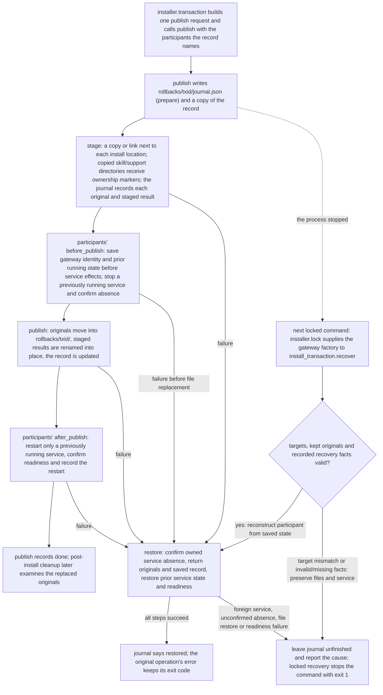
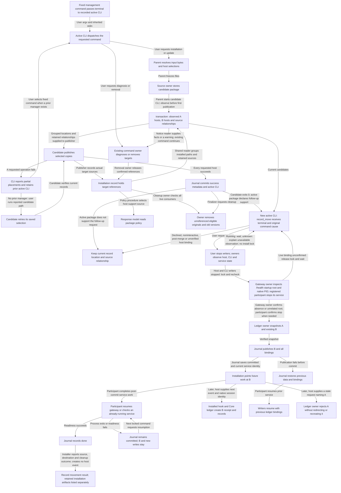
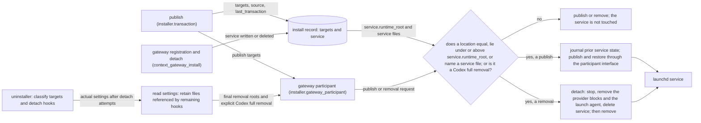

# Installer Architecture

[🇺🇸 English](./installer-architecture.md) | [🇰🇷 한국어](../ko/reference/installer-architecture.md)

This document is the contributor bridge between the quick installation docs and the installer compatibility contracts. It gives contributors the architecture map they need before tracing a change through the installer, hook payloads, install state, and tests.

For the installation steps, read the [installation guide](../getting-started/installation.md). For compatibility requirements and test ownership, read [installer platform compatibility](../policies/installer-platform-compatibility-matrix.md).
## Contents

- [Reading Path](#reading-path)
- [Architecture Summary](#architecture-summary)
- [Install Flow](#install-flow)
- [Install Record](#install-record)
- [Gateway Lifecycle](#gateway-lifecycle)
- [Platform Surfaces](#platform-surfaces)
- [State And Safety Model](#state-and-safety-model)
- [Contributor Entry Points](#contributor-entry-points)
- [What Not To Infer](#what-not-to-infer)
- [Full Understanding](#full-understanding)

## Reading Path

1. Use this page to understand the moving parts and the call direction.
2. Use [repository structure](./repository-structure.md) to find the files.
3. Use [installation](../getting-started/installation.md) and [uninstall](../getting-started/uninstall.md) to understand user-facing behavior.
4. Use [installer platform compatibility](../policies/installer-platform-compatibility-matrix.md), [tool output semantics](../policies/tool-output-semantics.md), and [live smoke regression](../policies/live-smoke-regression.md) to understand the contract and verification burden.

## Architecture Summary

Ghost-ALICE connects a generative backend through a host adapter to Core. A host and its generative backend are distinct. The installer currently supplies Claude Code and Codex adapters; common ownership, record, version-retention and ledger rules use recorded host identifiers, including future hosts. An operation needing an unavailable host adapter stops before changing that host. The installer has four implementation layers.

| Layer | Main files | Responsibility |
| --- | --- | --- |
| Shell entrypoints | `install.sh`, `install.ps1`, `install.cmd` | `install.sh` sets a UTF-8 locale, finds or installs Python 3.11+ and runs `_shared/installer/cli.py` with the arguments it received unchanged. `install.ps1` stops with the PowerShell 7.6 requirement on an older PowerShell, sets UTF-8 console input and output, finds or installs Python 3.11+, turns the parameter names of the earlier PowerShell installer into the matching long flags and runs the same cli with every argument in order. It reports `.\install.cmd` in `GHOST_ALICE_INSTALL_COMMAND`, so the installer's help and hints name the Windows command; without that report they name `bash install.sh`. `install.cmd` runs `install.ps1` with `pwsh.exe`, or with `powershell.exe` when `pwsh.exe` is absent |
| Installer package | `_shared/installer/` (`cli`, `auto`, `selection`, `addons`, `preservation`, `transaction`, `record_move`, `hosts`, `diagnostics`, `lifecycle`, `source`, `prerequisites`, `lock`, `report`, `locations`, `config`, `runner`) | Parse options, pick the command from the command table, resolve platforms and targets, keep the install step order, hold the install lock and print the report; every file change goes through the entry points below |
| Installer entry points | `_shared/install_hooks.py`, `_shared/install_transaction.py`, `_shared/install_state_writer.py`, `_shared/addon_installer.py`, `_shared/uninstall_cleanup.py`, `_shared/install_doctor.py` and the other `_shared/*.py` tools the package runs as child processes | Install skills and hooks, write the install record in the same step as each placement, record install state, protect local edits, remove managed targets and diagnose an installation |
| Runtime surfaces | `~/.claude/`, `~/.codex/`, `~/.agents/skills/`, `~/.ghost-alice/` | Hold installed skills, platform hook config, Claude and Codex global bootstrap instructions, the install record, publish rollbacks, install-state manifests, hook feature rollback metadata, pending merges, and uninstall reports |

The installer updates assets and hooks while protecting external changes and recording its own changes. External changes are changes the installer finds in installed targets after install that its records do not hold; the installer does not record who made them. Status, doctor, update and uninstall commands consume those records to identify the actual installed state and changes they can safely restore.

The hook runtime contains both `_shared` modules and `session-intent-analyzer/scripts/session_intent_ledger.py` under the same runtime root. Native hooks resolve the ledger API and its sibling helpers from that deployment. The source checkout identifies installation inputs; editing that checkout does not select execution libraries for an installed hook. The ledger database path and native session identity remain separate runtime inputs.

The following shared modules belong to neither the installer nor the hook runtime, so the installer, the hook runtime and the skills may all import them. `_shared/hook_definitions.py` owns the names that the installer and the hook runtime read together: hook ids and host event names, and the `ghost_alice_context` provider name. `_shared/install_lock.py` owns the install lock file and the one judgment of whether this process or the process that started it holds the lock. `_shared/content_digest.py` owns the one fingerprint of installed content and the one comparison of an install record entry with the disk. `_shared/installed_payload.py` owns the install record. `_shared/install_destination.py` owns the validated install locations and the check that limits where Core code may change files. `_shared/atomic_write.py` owns file replacement: a read of the file during the replacement returns either the whole old contents or the whole new contents. `_shared/file_lock.py` owns the exclusive lock on a file and the time limit for waiting on it. `installed_payload` reads through `content_digest` and `install_lock`; its format-changing writer uses the existing `install_transaction` journal, `atomic_write` imports only `install_destination`, `install_lock` imports `file_lock`, and `_shared/pending_manifest.py` imports `atomic_write`, `file_lock` and `install_destination` to own pending paths, parsed observations and locked updates. The other shared modules import only the standard library. A runtime module imports no installer module, and an installer module imports no runtime module. `_shared.test_hook_definitions` checks these rules, and that no `installer` package module shadows a standard-library module name.

## Install Flow

| Sender → receiver | Input passed | Result used by the next step |
| --- | --- | --- |
| Command line → shell entrypoint | The command line that whoever runs install.sh (the human user, the response model or a script such as the post-merge hook) passed. | A usable Python 3.11+ runtime and the arguments, unchanged. |
| Entrypoint → `installer.cli` | The arguments and the source checkout the shell lives in. | Parsed options, the selected command and, for an install, the platform, its skills directory and the effective visibility. |
| `installer.cli` → `installer.selection` and `installer.addons` | Requested skill names and addon sources. | Exact installation targets (core skills, `_shared`, addon targets) and the target count. |
| Orchestration → `install_transaction.py publish` | One publish request: the host, the source and installer commits, and each target's name, kind, provider, source path, install location and mode. | Installed skills/helpers, their install record entries written in the same step, and preserved local edits. |
| Deployment → hook/bootstrap synchronization | Managed payloads, platform paths and registration commands. | Updated managed rule blocks and hook registrations. |
| Installer → install-state writer → status output | Actual changed targets, hashes and rollback information. | Per-platform manifest and an install report for status, doctor and uninstall. |

`install.cmd` is only a Windows wrapper around `install.ps1`. `install.ps1` and `install.sh` are both thin shells around the same `_shared/installer/cli.py`, so Windows and Unix-like systems run one installer implementation. On Unix-like environments, `install.sh` owns the shell entry path and re-enters Bash when needed. Every command, `--help` and `--list` included, runs in Python: the shell keeps no copy of the installer's text, options or commands.

`installer.cli` owns one command table, `COMMAND_LINE`. Each command row names the tokens that select it, its handler, the install-lock name it holds, whether it needs a platform, and its `--help` row. Option parsing, the auto-mode decision, dispatch, the lock and `--help` all read that table, so a command cannot reach one of them without the others. A token that starts with `-` and names no command stops as `Unknown option`; a command never runs once per detected platform, only an install without a platform does. The installer names its execution package `installer.runner.REPO_ROOT`; `source.root` separately identifies the development origin.

### Install step order

1. The parent resolves the input source, requested hosts and targets. `source.match_install_source` owns development-origin comparison. An explicit different checkout follows the existing `--adopt-source` or terminal confirmation behavior; fixed update and saved-code reinstall retain the recorded origin. The parent asks once about an existing Codex `untrusted` project, using the recorded project or original input project. Rejection, EOF or noninteractive execution retains `untrusted`; the write owner rereads that exact project before applying a matching confirmation.
2. `source.prepare_source` freezes the product files and shared policies under `versions/<digest>/core`. It records a candidate, not a successful install. The parent starts that package in a separate process and passes input provenance and per-host selections. Before automatic prerequisite acquisition, the shell or Python owner displays the shared program list and automatic-consent meaning once per process tree.
3. The candidate holds the installation lock across the requested host children and restores unfinished journals first. Its real record reader must accept the current record, and the retained active manager's real reader must accept candidate-produced records before placement. Without a previous active manager, the failure report retains an explicit candidate retry path.
4. Each host's preparation rechecks the origin, installs prerequisites and records the development repository's Git hook setting. Selection, legacy-record migration, deprecated-target retirement, external-change preservation and addon collision checks retain their existing owners.
5. The publisher places Core skills and `_shared` as host-owned copies on every supported host. Addon link/copy policy remains host-specific. Each placement records its actual source and host references in the same transaction. Temporary copies stay beside their destinations; the existing cleanup owner removes empty staging directories.
6. The publisher places the runtime and ledger companion at the selected runtime location (default: `runtime/current`) and the management commands under `bin/`. The existing gateway participant coordinates registered service effects. The host adapter registers hooks with explicit runtime and ledger coordinates, then synchronizes managed governance blocks and commands.
7. Verification, snapshot, addon sidecars, inventory and original-copy cleanup complete for each host. A later failure retains completed placements and their records; it does not declare the whole request successful.
8. Only after every requested host succeeds, `source.finalize_source` commits the successful version metadata and `installer.active_root` together through the existing journal, then prunes eligible older successful versions. The fixed command reads that active path. A failed candidate cannot become the active manager through folder ordering or a fallback search.
9. After the candidate exits 0, the outer parent invokes the newly active package's [record-movement follow-up](#fixed-commands-policies-and-ledger-data).

The existing lock owner supplies inherited-lock execution to the candidate's children. Each management launcher invokes its saved package's existing shell bootstrap with `--management-entry`; the Python CLI then reads the recorded active package. The launcher does not infer the runtime location. Installation effects, actual host callback execution and a response model following the installed instructions are distinct observations.

`install_lock.acquire_lock` returns a generation token; the installer and gateway release only that generation. The persistent sibling `install.lock.guard` serializes acquisition, stale takeover and release, so an earlier holder cannot unlink a newer generation. Direct Python callers that omit the release token can release only the generation this process acquired. The standalone `acquire` command prints the token and `release --generation <token>` consumes it. Mandatory coordination uses POSIX `flock` or Windows `msvcrt` and reports failure when locking is unavailable. The source hook-path writer uses its own persistent `source-repo-hook-path.json.guard` before taking the installation lock; it serializes the shared Git value and the original rollback record.

### Post-merge hook

`source.setup_git_hooks` writes `core.hooksPath` in the recorded development repository, pointing to the fixed package's `hooks` directory. The existing sidecar and host inventories retain the previous setting; the uninstaller restores it when the final consumer is removed and the current setting still matches the recorded value. An absent development repository has no setting left to restore.

The hook clears Git's worktree environment and supplies the actual merged checkout to `run_post_merge`. The existing origin comparison admits only a merge in the recorded origin. The parent captures that checkout's actual local HEAD, including an unpushed merge, and retains automatic installation for every detected supported host. A merge in another worktree installs nothing. The hook returns zero to Git even when installation fails and reports the installation's result. Fixed `update` instead fetches recorded remote/ref into a temporary input, preserves installed Core selections and existing addons, and never stashes or pulls the developer checkout. `--update-source` retains the separate developer-checkout update path.

The installer collects target identities once and passes the same `Collected` value through preflight, placement, verification and inventory writes. The publisher writes copied targets' ownership markers as part of staging. A partial reinstall replaces selected rows and preserves unselected Core baselines. `install_state_writer` also owns partial-failure records and successful-removal pruning; callers do not reconstruct those inventories.

## Install Record

`~/.ghost-alice/installed-payload-v2.json` records what the installer installed where. All recorded hosts share one detail file with one entry per install location path; a location that both hosts use, such as the runtime `~/.ghost-alice/runtime/current/_shared`, has one entry whose `used_by` names both.

| Section | Content |
| --- | --- |
| `schema_version` | `2`; the legacy `installed-payload.json` contains a schema notice so old writers reject it |
| `installer` | `commit`, `schema_version` and `active_root`; ordinary placement preserves the last successful manager |
| `source` | Development `root`, input `commit` and `dirty`, `hooks_path`, update acquisition `remote`/`ref`, and the installed ledger relationships defined in the [record schema](../../installer_update/install_state_schema.md#installed-ledger-source-relationships) |
| `last_transaction` | `id`, `updated_at` and `rollback_dir` of the last publish |
| `targets` | Per install location: `name`, `kind` (`skill`, `support`, `runtime`, `command`, `resource`), `mode` (`link`, `copy`), `provider` (`core` or `addon:<id>`), `source`, `source_commit`, `used_by`, `link_target` for a link or `files` for a copy, `installed_at` and `baseline` |
| `service` | The registered context gateway, absent when none is registered: `label`, `runtime_root` (the folder that holds the runtime `_shared` the service runs from), `program`, the three service files `launch_agent`, `state_path` and `config_path` with `launch_agent_digest`, `state_digest` and `config_block_digest` (the fingerprint of the provider blocks in Codex `config.toml`; `null` until a registration recorded it), `config_backup`, `registered_at`, `restarted_at` and `listener_ready` |

A copy's `files` maps each relative path to `sha256:<hex>` of its bytes, and a copied single file is its own one path `.`; a link records only the path it points to. `content_digest` computes both and leaves out caches (`__pycache__`, `.pytest_cache`, `.mypy_cache`, `.ruff_cache`, `node_modules`, `.git`), `.pyc` and `.DS_Store` files, the ownership marker and linked files and folders. `baseline` says where the fingerprints come from: `recorded` by a publish, `migrated` from an earlier installer's records, or `unknown` when those records had none.

| Writer | When | What it writes |
| --- | --- | --- |
| `install_transaction.publish` | Every placement, and once per install for the links that already point at their source | The published targets, `source`, `installer` and `last_transaction`, in the same step as the renames; a link that already points at its source is recorded and not replaced |
| `installed_payload.migrate` | The first install, repair or uninstall when the record does not exist and an earlier installer's install-state does | Every host's install-state target: a link with the path it points to now, a copy with its ownership marker's fingerprints, else the merge-companion snapshot's, else none (`unknown`); `provider` from the addon sidecars. Current files are never adopted as a baseline, and the earlier records stay unchanged |
| `installed_payload.migrate_service` | The first install, repair or uninstall when the record has no `service` section and `~/.ghost-alice/context-gateway-binding.json` names an installed gateway receipt | The `service` section from the receipt (`config_block_digest` stays `null` until a registration records it) and a `migrated` runtime target for each companion script the receipt fingerprinted. The receipt and the binding stay unchanged and are not read again |
| `context_gateway_install.py` | The `gateway` registration and detach commands, in the commit phase of their phase machine | A registration writes the `service` section after the service is ready; a detach deletes it; a failed operation puts the section back as it was |
| `installer.gateway_participant` | After a publish that touched the service's code | `restarted_at` and `listener_ready` of the `service` section once the service is back |
| `installed_payload.release_target` | After a caller confirms removal or release of a shared target | Removes the requested host from the exact destination/provider entry; preserves other hosts and deletes the entry only when no host remains |

`installed_payload.update` writes section updates and merges host references; `release_target` removes a confirmed host reference, and `restore` puts back a copy a publish saved. These operations use temporary-file replacement and require the calling process or its parent to hold the install lock. An unreadable record stays unchanged; removal callers report its cleanup as incomplete. `--status` and `--doctor` print one summary line of the platform's targets in the record and one line per target that differs from it. Targets without a baseline are counted and not compared, and a match is reported only for the targets that were compared; the record does not change their result.

A publish keeps what it replaced only in `~/.ghost-alice/rollbacks/<txid>/`: the originals, the record copy and `journal.json`. The journal names the targets the publish replaces and records each one's original and staged result: files with their digests, links with their targets and every folder, empty ones too, leaving out only caches and generated files. Before its first service effect, the gateway participant uses the transaction's checkpoint to persist the recorded service identity and observed `was_running` boolean. The journal says `prepare` before anything changes, `done` after the files, the record and the participants' `after_publish` finish, and `restored` only after files, record and participants' `after_restore` finish. Failed service recovery therefore leaves the journal unfinished even when the files are back. A participant's error keeps its exit code (2, 3, 4 or 5) through the restore, and a restore step that fails with its own code reports that code (5 for unconfirmed service recovery).

A publish that replaces nothing (links already pointing at their source) calls no participant. `install_transaction` knows only the participant interface (`installer/participant.py`: `before_publish`, `after_publish`, `before_restore`, `after_restore` with the record root, host, transaction id, replaced install locations and journal checkpoint). The interface imports only the standard library. The installer's lock owner supplies `installer/gateway_participant.py`'s recovery factory to `install_transaction.recover`; the transaction passes the context, saved participant state and original record to that factory. The gateway participant remains the one installer module that imports gateway modules and interprets service facts.

When a process stops before `done`, the next locked command calls recovery with the gateway factory while holding the installation lock. Committed ledger migration follows the resumption procedure under [Fixed commands, policies and ledger data](#fixed-commands-policies-and-ledger-data). For an uncommitted publish, recovery checks every target first: an install location must still hold what the publish left there or its original, and a moved original must match its recorded original state. A mismatch leaves files, service, record and journal unchanged. The reconstructed gateway participant checks its saved identity against the original install record and the loaded service, stops an owned running candidate, and confirms absence before the transaction restores files and record. It then starts the prior service and checks readiness only when `was_running` is true. An initially stopped service stays stopped; if an external action started it, recovery holds before changing it. A new journal with no gateway checkpoint establishes that no gateway effect began. An older journal without participant recovery facts can restore unrelated targets, but a registered gateway affected by those targets requires review because its prior running state is unknown. When recovery cannot finish, the installer stops the command with exit 1 and names the journal folder for the human user to review; the recovery diagnostic retains the structured cause. The next explicit recovery uses that unfinished journal, with no retry loop. The low-level `install_transaction.py recover --txid <id>` CLI has no service factory: it restores only journals with explicit empty participant state or legacy journals whose saved record establishes no service, and refuses invalid or service-bearing recovery facts before mutation.

When a copy publish completed after the merge-companion snapshot but a later installation step failed, the next collection compares files with that publish's recorded baseline. The collector accepts a newer copy record only for the selected host, target and destination, with valid relative file paths and hashes. It preserves differences from that baseline as external changes; it does not certify current disk contents as a new baseline or mark the whole installation complete.

The shared file walker selects the installed copies for snapshot capture and change collection. Both exclude a root whose valid placement record names only other hosts. A root explicitly selected for replacement still enters change collection, including when its marker is absent, so the installer can preserve external edits before replacing it. Missing or invalid host attribution retains the existing marker-based comparison.

### Successful code versions

After a Core installation completes its requested placement, hooks, bootstrap, verification and installation records, the installer calls `install_transaction.cleanup_completed` under the existing installation lock. This cleanup also runs for a partial selection. The last host's full uninstall calls the same owner before archiving remaining placement recovery material. The owner deletes unchanged managed originals from completed publish folders when no host, service or pending review still references them. It retains unfinished recovery journals and copies containing user changes or unidentified content, and reports their paths and reasons. A folder holds no content of its own, so an empty folder or one holding only caches does not keep a copy; every file and link below it is still checked. A required deletion failure returns exit 1 without reverting the installation or removal steps that already succeeded.

Every successful requested Core selection can complete a candidate package. `source.finalize_source` retains the latest three distinct successful versions under `~/.ghost-alice/versions/<content-hash>/`, including the active version. `version.json` records actual product files, provenance and installed host selections. Repeated identical bytes reuse one package. Active CLI, live target/inventory, service, Git hook and addon references prevent premature pruning; modified versions retain their specific reason. A preservation or required pruning failure returns a nonzero exit without reversing completed placements.

The installer prints the retained package and reinstall command. Reinstalling saved code uses the current Core selection; after full removal it uses that successful package's saved selection. Explicit skill arguments select their own scope. Reinstallation preserves the current ledger, retired-root facts and current user settings. The package reader must accept the current installation record before its CLI can run. New targets not supplied by that code require explicit removal or another compatible version; the installer does not silently expand or discard the current selection.

The first successful installation saves only the code used for that request. Placement journals do not reconstruct earlier complete code versions.

### Fixed commands, policies and ledger data

`bin/ghost-alice` and the Windows `.cmd`/`.ps1` entries invoke the recorded active package. Host Core copies, the common runtime, saved source packages and ledger data have separate consumers and lifetimes. `_shared/installed-policies.md` selects this host's actual support-target source in the installation record; its package supplies `docs/policies/`. These policies govern the current evaluation procedure even when unselected skills are older or another installation step failed. The three consuming skills refer to that procedure once instead of carrying policy copies.

A new installation uses `<ghost-root>/session-intent` (B). `install_hooks.observed_installation` reads actual partial configuration and, when needed, the existing managed hooks' ledger path. The relationship reader passes the same installation config that the migration owner will change, beside the installation lock. It supplies no environment override or default as an installed fact. `_default_destination` completes those observed fields with its existing inputs and defaults before validating a destination; an explicit ledger override skips managed-hook fallback. `transaction.installed_ledger_locations` groups these observations by normalized ledger path and joins them to the installation record's retained source relationships, falling back to containment under the current source only when no retained relationship exists. B and retired paths are not move candidates; an independent development path outside installed bindings is not an input. An installed path without a confirmed source relationship remains visible with an unknown relationship. The grouped result also carries per-host observation failures; one unavailable host does not erase other observed locations. If that host may use the shared destination, record movement waits for its binding to be verified.

Before the first target publication changes source C1 to C2, `transaction.publish` calculates the relationships under the installation lock and passes them with C2 to the existing record writer. The writer's single replacement and journal preserve both facts together. Repeated publications retain a legacy hook's A→C1 relationship until configuration records it, even when C1 no longer exists. A later installation failure or a declined move leaves that relationship available for the next attempt. The publisher discards relationships transported in acquisition metadata and prunes relationships that no current binding uses only when every host could be observed. An unavailable host preserves previously confirmed relationships; it supplies no invented relationship. [The schema](../../installer_update/install_state_schema.md#installed-ledger-source-relationships) owns the field format and empty-map semantics.

After the candidate commits successful version metadata and the active CLI, it exits. Only a zero candidate exit and the active package’s declared follow-up support let the outer `dispatch` parent start `record_move` from that package, once, with the original install, update or post-merge cause. The management entry and this follow-up inherit the terminal through `runner.run_command`; candidate and host installation children retain its closed-stdin default. The existing request channel carries the selected package and source binding. `record_move` discards pending terminal input immediately before the first question; subsequent answers and waiting input remain intact. It owns the question, waiting, move calls and per-path results; [installation guidance](../getting-started/installation.md#move-existing-work-records) owns the answers and first-upgrade sequence. `report` selects the follow-up language once, using the language preserved by `install.sh` before UTF-8 locale adjustment; paths and commands remain unchanged.

The user stops the hosts and CLI writers that use A or B. `record_move` waits without the installation lock and treats an unknown writer state as a reason to defer. Immediately before moving, it acquires the existing lock, completes required recovery, and rechecks the selected bindings and writers. `hosts` owns host and CLI process observations. For a loaded gateway, the gateway owner uses the state file's port and scope to contact the existing scope-authenticated `/health` inspector, which returns the running process's startup `ledger_root` and PID. `listener_binding` requires that PID to match the native service PID before comparing the startup ledger root with A/B; the state file supplies contact coordinates for this query. The registered gateway participant stops and confirms its service, then resumes it through the existing transaction. A missing registration does not establish service absence: an unregistered service with an unknown or relevant live binding defers the move before snapshot. The installer neither stops unrelated services nor adds a global writer tracker. Separately launched development ledger scripts must also be stopped; snapshot change detection cannot prevent a writer starting after the last observation.

The ledger owner snapshots SQLite databases and companion originals, preserving compatible existing B data and deferring on explicitly identified history conflicts. The existing journal publishes B, hook bindings, runtime configuration and retirement of A together. A pre-commit execution error restores prior data and settings when recovery succeeds and still returns exit 1. After commit, unfinished service resumption or completion marking retains B and its new writes and returns exit 1. Cancellation, a pre-move deferral, an identified data conflict and completion return 0. When the existing cleanup owner intentionally retains installation artifacts, the move remains complete and the flow lists those paths and reasons separately; a cleanup exception returns exit 1 while preserving the completed move to B. If a failure leaves shared B or service state uncertain, `record_move` leaves later paths unattempted. It reports installation and each source path's record-movement result separately. Incomplete restoration returns the journal phase, affected data/configuration paths and recovery record locations. New writes to a partially published destination prevent automatic restoration from overwriting those writes; the user must resolve that changed data before retrying. Installed stale A requests are rejected without recreating A; unrelated explicit development ledgers remain usable. Successful code reinstallation preserves the current ledger binding.

Doctor reads the same grouped observations to report record locations and the default move procedure without changing configuration, its status or its exit code. The uninstaller captures those facts before deleting installation records and reports source-dependent or unclassified locations for the removed host after removal; it preserves work records and their configured location. Both commands use `record_move.read_locations`: an unavailable informational lookup produces a warning while the existing diagnosis or removal continues and determines its own result. Neither command reconstructs source relationships or creates an extra persistent notice record.

Preparation files belong to the migration journal. The journal saves `committed` with the current service identity before allowing writers to resume. Recovery validates the published configuration and service ownership, preserves B and the current install record, and starts an absent previously running service or checks an already-running service's readiness. Failed readiness leaves the journal `committed`; only successful resumption marks `done`. The existing completed-journal cleanup owner compares migration originals with their recorded pre-publication state and preserves actual remaining references. It removes eligible redundant originals and preparation files only after completed resumption or restoration; cleanup failure cannot roll back new B writes.

### Removal records

After confirming physical removal or a host's release of a shared target, the caller passes the destination, kind, platform and provider to `uninstall_cleanup.release_target_records`. This helper invokes the executing package's `merge-companion/scripts/snapshot_cli.py --prune` through `installer.runner.run_tool`; `snapshot.py` alone removes matching paths from both `files` and `file_records` in that host's snapshot. It then calls `installed_payload.release_target` and finally `install_state_writer.remove_targets` for the confirmed destinations. The package helper remains available when merge-companion itself is removed, and it does not use a `snapshot` module loaded in the parent process.

Physical deletion and record cleanup have separate results. A failed record write leaves the remaining inventory and addon `.removing`/sidecar evidence for a rerun; repeating an already completed record operation is harmless. The uninstaller preserves another host's confirmed shared files while releasing only the requested host's records. [Recovery principles](../getting-started/uninstall.md#recovery-principles) explain the remaining-file report, exit status and rerun after a failure.

### Retirement and final cleanup

`retired_assets.py` owns retirement of `harness-security-scan`, `session-intent-guard`, `jailbreak-detector` and the related Claude command. It verifies ownership and other-host references, writes a `prepared` work receipt before moving a target out of discovery, records any external changes for pending review, then releases the current records under [Removal records](#removal-records). It marks the receipt `complete` only after those writes succeed. A rerun validates the receipt and retained content before resuming; a shared asset can remain discoverable for another host, so releasing this host's records alone does not complete its physical retirement.

`uninstall_cleanup.cleanup_obsolete_copies` owns final deletion of legacy replacement and retirement copies, including `~/.ghost-alice/install-rollbacks` and the Claude skills folder's `.ghost-alice-install-rollbacks`. The installer calls it after verification, snapshot, sidecars and inventory succeed; full uninstall calls it with removal results before archiving remaining recovery material. The cleanup owner matches each copy to the requested asset, provider, host and source, verifies ownership of the whole copy including entries omitted from ordinary fingerprints, and checks actual host, service and pending-review references. It deletes obsolete managed code within that scope and removes an empty parent afterward. An unknown former destination or a missing current target does not by itself require retaining obsolete code. User changes, unconfirmed ownership and copies with an actual remaining dependency retain their specific reason. Failed deletion leaves the copy where the same cleanup owner can retry it and reports a nonzero exit; it does not archive that failure as completed work. The separate retention rule for completed modern `rollbacks/<txid>` stays in [Runtime state retention](repository-structure.md#runtime-state-retention).

## Gateway Lifecycle

The public Python APIs `context_gateway_install.install`, `context_gateway_install.detach`, `addon_uninstall.uninstall_addon` and `addon_uninstall.resume_pending` accept `apply_changes=` and the historical `confirm=` keyword. Equal values supplied under both names select one execution mode; conflicting values raise `ValueError` before filesystem or service work. Omission keeps the existing default: registration and addon removal apply, while gateway detachment previews. Internal helpers use only `apply_changes`. Gateway detachment accepts `--apply` and the historical `--confirm` alias; registration retains its `--dry-run` option. These switches select execution and record no human approval.

New Core hook configuration uses the semantic key `on_prompt_submit`. The shared resolver also reads historical `on_user_prompt`; both resolve to the host event `UserPromptSubmit`, so the existing event registration rules still prevent duplicate hooks. Addon policy rejects both keys. New installer guidance labels its recipient `For the human user:`; historical `User:` lines remain installer output, not a human utterance.

Gateway registration, refresh and detachment use six `_shared/context_gateway_*` modules. `model` defines request, observation, plan, result and effects types; it does not invoke an AI model. `inventory` reads the service files through an injected platform adapter. `plan` compares the service files with the install record's `service` section and produces an ordered plan without I/O. `transaction` applies the plan, writes the record's `service` section in its commit phase and owns reverse recovery. `platform` implements individual filesystem, record and native-service operations. `install` composes them behind the `gateway` command: `bash install.sh gateway --codex-dir <dir> --ledger-root <dir> --state-dir <dir> --launch-agent <plist>` registers or refreshes, `bash install.sh gateway detach --apply` unregisters, and `--dry-run` prints the validated plan without applying it.

The registration reads the runtime target the latest publish wrote from the install record and writes only the three service files: the launch agent, `state.json` and the provider blocks in Codex `config.toml`. It copies no module: the service runs the runtime `_shared` and the companion script the installer publishes, and the record's `targets` say which bytes those are, so Core must be installed first. The state directory must lie outside that runtime, links followed. Without a `service` section the command registers a new listener and refuses an existing launch agent, state directory entry or provider block the record does not name. With one, it refreshes with the same port and scope when the three files are as the section records them, and stops before any change when one of them changed outside the installer (exit 2): the human user reviews the file before the command runs again.

`installer/gateway_participant.py`, the one installer module that imports the gateway modules, judges every publish and removal from the record: a location equal to, under or above `service.runtime_root`, or one of the three service files, touches the service; `~/.codex`, `~/.claude` and the ledger are data the service reads, not its code, and a link is compared by its own path, never by where it points. [Install Record](#install-record) defines the participant's publish checkpoints and service recovery. [Cleanup Order](../getting-started/uninstall.md#cleanup-order) owns the uninstaller's handoff of final removal roots and its Codex full-removal request, detachment and preservation after failures. The install, after its runtime publish, and the repair ask launchd through the same function, `installer.gateway_participant.loaded_service`. When a loaded gateway service runs from the runtime root and the record has no `service` section, the publish goes on and the installer leaves the service as it is: it has no record of the service's files. The `Context gateway:` line then warns and names the registration command, which records the service and restarts it on the new code. An observation that is not clear counts as none and leaves one line in the install log. A managed Git update of the checkout (`--update-source`) does not touch the service: the checkout is not its code.

A changed transport configuration can require a new host launch: a registered provider or a successful installation does not establish adoption by a native process that is already running, and that claim needs the session receipt of that process and observations of its actual requests. The service records request shapes and identities, selected source references, raw server usage and response hashes, and retains no extra conversation or credential bodies. To judge its effect, match each selected original, its reference and its absence across several later requests, verify that the originals that later decisions need remain retrievable, count each server response once and leave missing usage unknown; a cache hit or one smaller request does not prove exclusion. [Architecture](../../architecture.md#context-and-original-evidence) owns how the gateway handles headers, redirects, unknown provider paths and the requests it forwards unchanged.

Gateway errors keep their phase and stable identifier: exit 2 for a failed precondition, 3 for unconfirmed service state before any file changed, 4 for an operation that failed but restored the prior installation, and 5 for uncertain recovery after changes began. The installer reports the structured cause and keeps that exit code. Registration requires Python 3.14 with a working zstd codec; detachment runs on Python 3.11. The [installer lifecycle specification](../coding-convention/specs/2026-10-15-gateway-installer-design.md) records the design the phase machine comes from.

## Platform Surfaces

| Platform | Installed surfaces |
| --- | --- |
| Claude Code | `${CLAUDE_CONFIG_DIR:-~/.claude}/skills/`, `${CLAUDE_CONFIG_DIR:-~/.claude}/CLAUDE.md`, `${CLAUDE_CONFIG_DIR:-~/.claude}/settings.json`, Claude command wrappers |
| Codex | `~/.agents/skills/`, `~/.codex/AGENTS.md`, `~/.codex/ghost-alice-governance.md`, `~/.codex/hooks.json`, `~/.codex/config.toml` |
| Shared state | `~/.ghost-alice/installed-payload-v2.json`, `~/.ghost-alice/rollbacks/`, `~/.ghost-alice/install-state/`, `~/.ghost-alice/pending-merges/`, `~/.ghost-alice/uninstall-reports/`, `~/.ghost-alice/install/` |

Claude Code can expose native skill invocation and hook permissions, but those surfaces do not replace a global instruction port for sessions outside the repository. The installer therefore merges the managed block from `platforms/claude/CLAUDE.md` into the Claude config directory. Codex does not expose the same skill surface, so its separate bootstrap and hook config make required gates auditable through `SKILL.md` read records and hook payloads. Both global rule files preserve text outside their managed blocks; a destination without a Ghost-ALICE marker receives a `.ghost-alice-proposed` file instead of an overwrite.

Managed hook commands and the Codex hook trust entries that the installer writes for them on every install run must agree with the install record. A running host can retain its previously loaded registration. Verify adoption through an actual native callback after the appropriate reload; refer to [hook trust and reload](../getting-started/troubleshooting.md#native-hook-trust-and-reload). The [session gate notes](../policies/session-gate-matrix.md#notes) list installed bytes and native execution as separate claims.

The bootstrap writer reuses an existing regular proposal file with identical bytes, without rewriting it. It checks the preferred filename and its separately named siblings. If none matches, it creates the preferred file or, when that path already exists, a separately named proposal beside it; it preserves existing files and links. It reports the selected path and continues the install. The hook settings editor changes the managed TOML assignment while retaining unrelated multiline values, quoted table names and comments; dotted and inline table forms remain editable. A cleanup edit that cannot preserve valid TOML is reported for review.

The Codex hook editor in `_shared/install_hooks.py` uses Tomli 2.4.0 through the shared syntax owner, `codex_config_toml`. It accepts TOML 1.1 and an initial UTF-8 BOM without downloading a parser during installation. Invalid TOML still stops hook configuration before the editor saves it. For malformed JSON hook settings, the existing backup-and-continue path reports the settings path, backup path and continuation with empty settings in the installer's normal output.

## State And Safety Model

The installer records what it changes instead of guessing during cleanup.

| State path | Why it exists |
| --- | --- |
| `~/.ghost-alice/installed-payload-v2.json` | The install record: every install location of both hosts, its source and the fingerprints of copied files, written in the same step as each placement |
| `~/.ghost-alice/rollbacks/<txid>/` | What one publish replaced, the record as it was before it, and its journal; the next locked command restores an uncommitted publish or completes service resumption for a committed ledger migration. [Runtime state retention](repository-structure.md#runtime-state-retention) sets how many finished publishes stay |
| `~/.ghost-alice/install-state/<platform>.json` | Records installer-owned targets and environment changes for status and uninstall |
| `~/.ghost-alice/pending-merges/<platform>/` | The installer backs up external changes to Ghost-ALICE copy-mode skill files before replacing them. It checks roots with the install marker and every root the current install replaces, even when that root's marker has disappeared; the response model follows merge-companion to ask the human user whether to merge, discard or defer each backup. Folders that Ghost-ALICE does not install, such as the Claude app's `synced`, are never recorded |
| `~/.ghost-alice/install/` | Keeps the install reports and event traces for audit and recovery; [runtime state retention](repository-structure.md#runtime-state-retention) sets how many runs stay |

This is why update and uninstall are part of the installer architecture, not separate chores. A change that affects copied assets, hooks, or runtime config usually also affects status, doctor, pending merge behavior, and uninstall rollback.

## Contributor Entry Points

| Change type | Start here | Then verify with |
| --- | --- | --- |
| Python runtime detection, the PowerShell 7.6 check, PowerShell parameter names or locale setup | `install.sh`, `install.ps1`, `install.cmd` | `scripts/tests/test_thin_shells.py`, `scripts/tests/test_install_runtime_detection.py`, compatibility matrix groups |
| Installer option, command table, dispatch or install order | `_shared/installer/cli.py`, `_shared/installer/auto.py` | `_shared/test_installer_cli.py`, `_shared/test_installer_auto.py`, `_shared/test_installer_checkout.py`, the `_shared/test_*_shell.py` end-to-end tests |
| Installer wording or the install report | `_shared/installer/report.py` | `_shared/test_installer_report.py`, `scripts/tests/test_installer_default_auto.py` |
| Hook payload or hook status wording | `_shared/install_hooks.py` | `_shared.test_install_hooks`, `scripts/check_skill_gate_contract.py` |
| Hook id or host event name | `_shared/hook_definitions.py` | `_shared.test_hook_definitions` |
| Install record, fingerprints, publish journal or restore | `_shared/installed_payload.py`, `_shared/content_digest.py`, `_shared/install_transaction.py`, `_shared/installer/transaction.py`, `_shared/installer/lock.py` | `_shared/test_installed_payload.py`, `_shared/test_content_digest.py`, `_shared/test_install_transaction_publish.py`, `_shared/test_install_record_shell.py` |
| Install-state or uninstall behavior | `_shared/install_state_writer.py`, `_shared/uninstall_cleanup.py`, `_shared/installer/lifecycle.py`, `_shared/installer/transaction.py` | `_shared/test_installer_lifecycle.py`, `_shared/test_installer_transaction.py`, install-state schema tests and uninstall tests |
| Public docs or command surface | `README.md`, `docs/`, `index.html` | `scripts/validate_public_surfaces.py` and public-surface contract tests |
| Platform compatibility rule | `docs/policies/installer-platform-compatibility-matrix.md` | `scripts/run_installer_compat_tests.py --list` and the focused group named by the policy |

When changing one part, look for the paired contract and find its regression checks in the test owner that the compatibility matrix names.

## What Not To Infer

- Hook files existing on disk does not prove hook payloads are current.
- A copied skill directory does not prove the platform can invoke or audit that skill.
- A passing install smoke does not prove status, doctor, update, pending merge, and uninstall paths are aligned.
- A user-facing install command does not explain the architecture; it is only the entrypoint.

## Full Understanding

Full installer understanding requires tracing one change through the entrypoint, orchestration layer, runtime surface, state file, and test owner. This page is the first map for that trace. It is not a substitute for reading the relevant implementation and compatibility contract.
